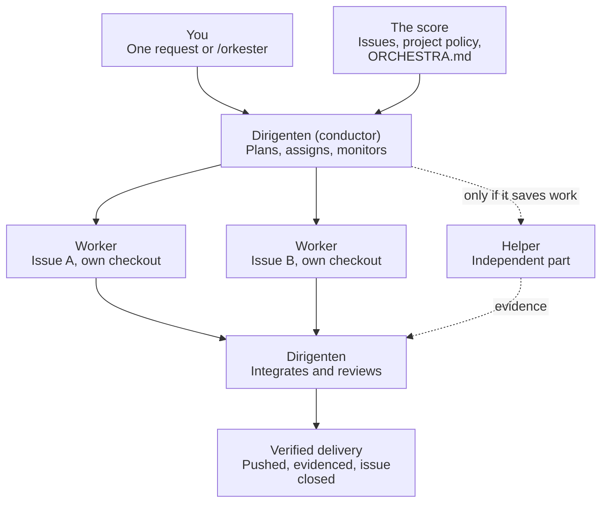

<p align="center">
  
</p>

# Dirigenten och orkestern

**You talk to the conductor. The conductor runs the orchestra.**

Give your AI coding agent a baton. Instead of one agent juggling everything in a single
thread, the agent you talk to becomes **dirigenten**, the conductor. It reads the
score (your issues and project rules), hands each part to a musician in
**orkestern**, the orchestra of worker agents, listens to every section and only
lets verified work reach your main branch.

Plain Markdown files. No runtime, no service, no lock-in. Works with any agent that
can read files.

## Why a conductor?

Agents left to themselves over-plan, spawn helpers they don't need, rerun the same
test suite again and again, wait for you to answer questions they could have settled,
and close issues nobody checked. A conductor fixes that by keeping one job in one
place: **decide, delegate, listen, deliver.**

| Without a conductor | With dirigenten och orkestern |
| --- | --- |
| One long chat that you have to babysit | You give one instruction; the queue runs unattended |
| "Should I…?" prompts mid-task | The conductor decides with ordinary judgement; real product questions land on the issue with options and a recommendation |
| Agents editing the same files and stepping on each other | Each worker plays its own part in its own checkout and ports |
| Test suites rerun "just in case" | 2–3 checks chosen for the actual risk, then stop |
| "Should work" | Evidence before closing: test results, screenshots, the delivered revision |
| Issues parked waiting for "please test on your phone" | Best-guess fix, honest note of what could not be tested, closed; you report again if it persists |

## Who plays what



- **Dirigenten (the conductor)** is the agent thread you talk to. It picks the work,
  writes a short plan, spawns the workers and gives each one a compact brief, keeps an
  eye on their progress, integrates their results and reviews them once before
  delivery. Where delegation isn't available it plays the parts itself in sequence,
  without pretending to have workers.
- **Orkestern (the orchestra)** is the worker agents. Each one gets a single issue, its
  own checkout and ports, and returns a commit with evidence. None of them goes off to
  play a solo nobody asked for.

## What a run looks like

1. You type `/orkester` (or just describe a change).
2. The conductor fetches the issue queue, chooses the highest-priority startable work,
   claims it and starts up to your configured number of workers in parallel.
3. While they work, the conductor runs your intake hooks, for example turning incoming
   reports into new issues.
4. Each worker plans briefly, implements, runs the checks that matter and hands back.
5. The conductor reviews the combined diff and evidence, pushes, posts the result on
   the issue and closes it, then gives the free worker the next issue.
6. When the queue is empty, the conductor reviews everything delivered in the session
   (with workers for parts if that helps); findings become new issues and the loop
   continues. With nothing left, an optional idle watch waits for new issues.
7. Anything only you can decide waits on its issue, not in your chat. Everything else
   keeps moving.

## What you get

- **Verified delivery.** Plan → implement → verify → review → deliver → follow up. A
  failed check loops back; nothing ships on "should work".
- **Right-sized teams.** A small fix stays with one agent. Independent issues run in
  parallel up to your capacity, and nobody tramples anybody's files.
- **Autonomy by default.** The conductor decides what reasonable judgement can settle
  and closes device-dependent bugs after its best fix. You are interrupted only for
  decisions that are really yours.
- **Your rules, your instruments.** Project policy and phase hooks (screenshots, deploy
  checks, release rules) live in your repository; the shared workflow decides when
  they apply.
- **Spend where it matters.** The cheapest capable worker for routine edits, stronger
  reasoning only where the risk is.
- **No lock-in.** Independent of LLM provider, agent API, editor, language and package
  manager.

## Get started in two minutes

**Easiest:** ask your agent to do it.

> Install the orchestra in this repository by following
> https://github.com/solwation/dirigenten-och-orkestern/blob/main/INSTALL.md
> and fill in the project policy from what you know about this repository.

**Or by hand:**

```sh
git subtree add --prefix=.orchestra/shared \
  https://github.com/solwation/dirigenten-och-orkestern.git v0.6.0 --squash
cp .orchestra/shared/PROJECT.example.md .orchestra/project.md
```

Fill in `.orchestra/project.md`, point your agent's entry file (`AGENTS.md`,
`CLAUDE.md`, …) at it and at `.orchestra/shared/ORCHESTRA.md`, and ask for a change.
Optionally add a thin `/orkester` command that does the same. Pinning, updates and
the upstream release check are in [INSTALL.md](INSTALL.md).

## What's inside

| File | Purpose |
| --- | --- |
| [ORCHESTRA.md](ORCHESTRA.md) | The conductor's score: the shared workflow |
| [WORKER.md](WORKER.md) | The brief each worker receives |
| [COORDINATION.md](COORDINATION.md) | Bounded passes and queue sessions over open issues |
| [ISSUE-WORKFLOW.md](ISSUE-WORKFLOW.md) | GitHub labels and issue state via Issueflow |
| [PROJECT.example.md](PROJECT.example.md) | Template for your project policy and hooks |
| [INSTALL.md](INSTALL.md) | Install, update and release discovery |
| [CONTRIBUTING.md](CONTRIBUTING.md) | Improving the package and maintainer checks |

Changes are listed in [CHANGELOG.md](CHANGELOG.md). MIT licensed; see
[LICENSE.md](LICENSE.md).
