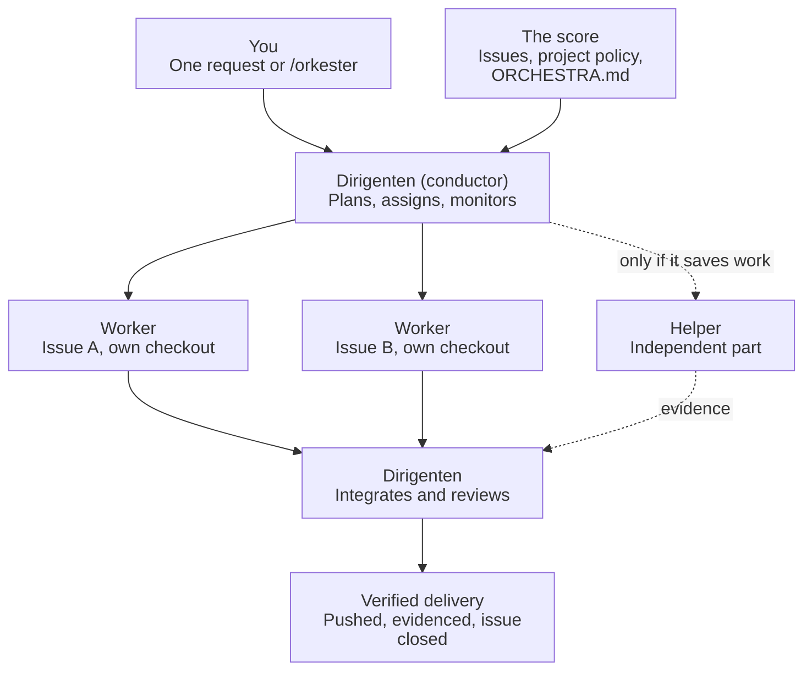

<p align="center">
  
</p>

# Dirigenten och orkestern

**You talk to the conductor. The conductor runs the orchestra.**

A model-independent workflow for delivering scoped, verified changes with autonomous AI coding agents in plain Markdown. No runtime, no background daemon, no lock-in. Works with any AI coding agent that can read and edit files (Claude Code, Codex, Antigravity, Aider, and others).

👉 **[Explore the Website & Visual Guide](https://solwation.github.io/dirigenten-och-orkestern/)** for interactive workflows, architecture diagrams, and value comparisons.

---

## Why a conductor?

Agents left to themselves over-plan, spawn unneeded helpers, rerun test suites in loops, wait for unnecessary confirmations, and close issues nobody checked. A conductor keeps one job in one place: **decide, delegate, listen, deliver.**

- **Requests become issues:** Ask for a change in chat and the conductor files an issue and delivers it, with no separate command needed.
- **Autonomous queue execution:** `/orkester` works through the open issues unattended: one bounded pass by default, or a queue session with polling and an idle watch if your policy enables it. If the queue is empty at the start, it first reviews the project, files concrete findings as issues and then fixes them.
- **Isolated worktrees:** Each worker plays its part in its own checkout under a git-ignored `workingtree/` directory, with its own ports; no colliding git stashes.
- **Risk-based verification:** 2–3 checks chosen for the actual risk, then stop.
- **Evidence before delivery:** Test results, links, and diffs verified on `main` (pushed directly or merged as a PR, per your policy) before closing.
- **Best-guess closure:** Routine issues settled autonomously; questions only for real user decisions.

See the full [side-by-side comparison on the website](https://solwation.github.io/dirigenten-och-orkestern/#why).

## Who plays what



- **Dirigenten (the conductor)** is the agent thread you talk to. It selects work, writes a short plan, spawns workers with compact briefs, integrates results, and reviews diffs against acceptance criteria.
- **Orkestern (the orchestra)** is the worker agents. Each handles a single issue in an isolated checkout and returns a commit with verification evidence.

The six phase gates (Planning → Implementation → Verification → Review → Delivery → Follow-up) are explained in the [documentation guide](https://solwation.github.io/dirigenten-och-orkestern/#workflow).

## Get started in two minutes

**Easiest:** Ask your agent to install it:

> Install the orchestra in this repository by following
> https://github.com/solwation/dirigenten-och-orkestern/blob/main/INSTALL.md
> and fill in the project policy from what you know about this repository.

**Or by hand:**

```sh
git subtree add --prefix=.orchestra/shared \
  https://github.com/solwation/dirigenten-och-orkestern.git v0.14.1 --squash
cp .orchestra/shared/PROJECT.example.md .orchestra/project.md
echo '/workingtree/' >> .gitignore   # worker checkouts live here
```

Fill in `.orchestra/project.md`, point your agent's entry file (`AGENTS.md`, `CLAUDE.md`, …) at it and at `.orchestra/shared/ORCHESTRA.md`, and start a run with `/orkester` (the Claude Code adapter; other agents can simply be asked to run the orchestra). See [INSTALL.md](INSTALL.md) for full instructions, updates, and adapters.

## Core files

| File | Purpose |
| --- | --- |
| [ORCHESTRA.md](ORCHESTRA.md) | The conductor's score: the shared workflow |
| [WORKER.md](WORKER.md) | The brief each worker receives |
| [COORDINATION.md](COORDINATION.md) | Bounded passes and queue sessions over open issues |
| [ISSUE-WORKFLOW.md](ISSUE-WORKFLOW.md) | GitHub labels and issue state via Issueflow |
| [PROJECT.example.md](PROJECT.example.md) | Template for your project policy and hooks |
| [INSTALL.md](INSTALL.md) | Install, agent entry points, updates and release discovery |
| [CONTRIBUTING.md](CONTRIBUTING.md) | Improving the package, field reports, maintainer checks and releases |
| [scripts/](scripts/) | Link checker, release consistency check and leftover-worktree pruning |
| [issueflow/](issueflow/ISSUEFLOW.md) | Offline snapshot of the Issueflow guide, with its license |

Changes are listed in [CHANGELOG.md](CHANGELOG.md). MIT licensed; see [LICENSE.md](LICENSE.md).
Pair with [BoosterAI](https://solwation.github.io/booster-ai/) for multi-tab agent workspaces on Windows & Linux.
