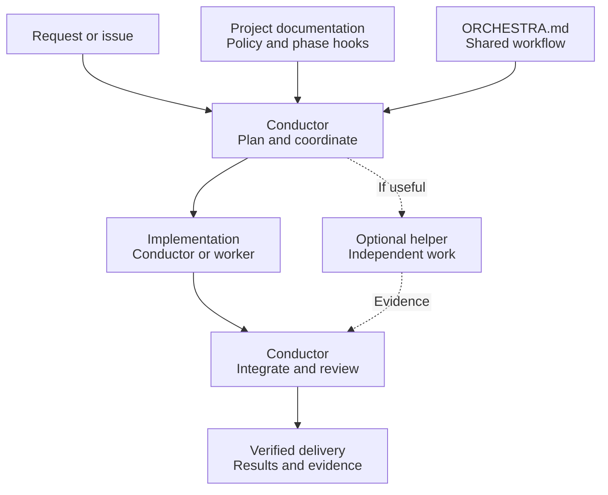

# Dirigenten och orkestern

**Turn your AI coding agent into a conductor that delivers verified changes — not
just diffs.**

Agents left to themselves over-plan, spawn helpers they don't need, rerun the same
test suite over and over and close issues nobody checked. This package is a handful of
plain Markdown files that give any agent a disciplined way to work: plan briefly,
use workers only where work is truly independent, run the checks that matter, review
once, and deliver with evidence.

## What you get

- **Verified delivery.** Every change goes plan → implement → verify → review →
  deliver → follow up. A failed check loops back; nothing ships on "should work".
- **Right-sized teams.** A small fix stays with one agent. Independent issues run in
  parallel up to your capacity, each worker in its own checkout with a clear scope, so
agents sharing a machine never trample each other's files.
- **Hands-off issue queue.** Run `/orkester` with no scope and the conductor picks
  eligible GitHub issues, delivers them and stops. Questions only you can answer land
  on the issue with options and a recommendation — never as a chat prompt you have to
  babysit.
- **Your rules, your tools.** Project policy and phase hooks (screenshots, deploy
  checks, release rules) live in your repository; the shared workflow decides when
  they apply.
- **No lock-in.** Independent of LLM provider, agent API, editor, language and
  package manager. No runtime, no service, no dependency — just text your agent reads.

## How it works



The **conductor** owns the whole delivery: it reads your project policy and the
shared workflow, chooses the smallest useful team, integrates and reviews. Where
delegation isn't available it plays the roles in sequence instead of pretending to
have workers.

## Get started in two minutes

**Easiest:** ask your agent to do it.

> Install the orchestra in this repository by following
> https://github.com/solwation/dirigenten-och-orkestern/blob/main/INSTALL.md
> and fill in the project policy from what you know about this repository.

**Or by hand:**

```sh
git subtree add --prefix=.orchestra/shared \
  https://github.com/solwation/dirigenten-och-orkestern.git v0.2.3 --squash
cp .orchestra/shared/PROJECT.example.md .orchestra/project.md
```

Fill in `.orchestra/project.md`, point your agent's entry file (`AGENTS.md`,
`CLAUDE.md`, …) at it and at `.orchestra/shared/ORCHESTRA.md`, and ask for a change.
Optionally add a thin `/orkester` command that does the same. Pinning, updates and
the upstream release check are in [INSTALL.md](INSTALL.md).

## What's inside

| File | Purpose |
| --- | --- |
| [ORCHESTRA.md](ORCHESTRA.md) | The shared workflow the conductor follows |
| [WORKER.md](WORKER.md) | The brief each worker receives |
| [COORDINATION.md](COORDINATION.md) | Bounded passes and queue sessions over open issues |
| [ISSUE-WORKFLOW.md](ISSUE-WORKFLOW.md) | GitHub labels and issue state via Issueflow |
| [PROJECT.example.md](PROJECT.example.md) | Template for your project policy and hooks |
| [INSTALL.md](INSTALL.md) | Install, update and release discovery |
| [CONTRIBUTING.md](CONTRIBUTING.md) | Improving the package and maintainer checks |

Changes are listed in [CHANGELOG.md](CHANGELOG.md). MIT licensed; see
[LICENSE.md](LICENSE.md).
