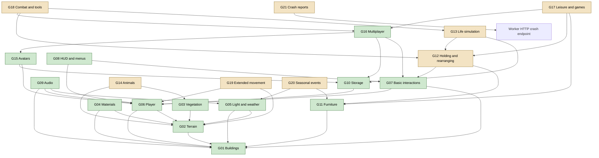

# Unreal inventory and porting plan (#2247)

Read [CLAUDE.md](../../CLAUDE.md) first for shared workflow rules. Paths in code spans are relative to the repository root.

Related: [Unreal Engine version](unreal.md) (project, LFS and parallel-work rules, owned by #2243), [architecture](architecture.md), [storage](storage.md).

This is the feature inventory of the web version, grouped for porting to the Windows Unreal version (#2242). It is the input for the porting issues that follow the pilot decision (#2246); it creates none itself. Only the original repository is concerned: nothing here is transferred to the public downstream. The web code (JavaScript/three.js) cannot be reused in Unreal. What carries over is data, measurements, IDs and models (shared export, #2245), plus rules and constants that can be exported as data.

The owner answered the six release questions on 2026-11-20. This plan incorporates those decisions. The final boundary goes into parent #2242 after the #2246 pilot decision. The porting issues below remain drafts until then. [Owner’s answers](https://github.com/solwation/lunden-3d-apartment/issues/2247#issuecomment-7052188642) · [Pilot](https://github.com/solwation/lunden-3d-apartment/issues/2246)

## How to read the table

- **Modules** are `src/` files (representative names; `*` is a family). The count is every file the group owns in `src/`, including CSS and test files; the full list per group is in [the module index](#module-index). `src/main.js` is a 4 736-line integration monolith and belongs to no feature group (G22).
- **Size** uses the module count: S up to 8, M 9-25, L 26-60, XL over 60. Lines of code are shown as a second indicator; neither is an effort estimate, the pilot (#2246) calibrates that.
- **Release**: R1 means first Windows release, Later means after it, Not applicable means the web-only mechanism is replaced by the engine. Changes against the proposal in #2247 are marked **changed** or **new row**.
- Hidden functions and codes are deliberately not listed. The few modules that belong to them are counted only in the module index.

## Inventory

| ID | Group | Main modules | Data and assets | Depends on | Size (modules / LOC) | Release |
|---|---|---|---|---|---|---|
| G01 | Buildings (L1007, Hus L/A/B/C, stairwells, lift, garage) | `src/world.js` `src/core.js` `src/corehouse.js` `src/interior.js` `src/exterior.js` `src/garage.js` `src/southwindows.js` `src/stairs.js` `src/entrancedoor.js` `src/portik.js` `src/rooms.js` | `data/plan.json`, `L1007_mattsatt_planritning.pdf`, `docs/peab/` | none (root) | L (34 / 21582) | R1 |
| G02 | Terrain and surroundings (site, streets, courtyard, river valley) | `src/surroundings.js` `src/courtyard.js` `src/elevation*` `src/streetlife.js` `src/roads.js` `src/street.js` `src/parkinglot1442.js` `src/riverpark.js` `src/schoolyard.js` | `data/elevation.json`, `docs/references/` | G01 | M (25 / 6608) | R1 |
| G03 | Vegetation | `src/foliage.js` `src/plants.js` `src/treeform.js` `src/grass*` `src/hedge*` `src/entranceplants.js` `src/plantpots.js` `src/riverflora.js` | none (procedural; positions come from site data) | G02 | M (24 / 3027) | R1 |
| G04 | Surface materials and shaders | `src/brickstyle.js` `src/bricksurface.js` `src/asphaltsurface.js` `src/pavingsurface.js` `src/roofsurface.js` `src/woodgrain.js` `src/railmetal.js` `src/paintsurface.js` | none (procedural shading; palette in `src/config.js`) | G01, G02 | M (13 / 1034) | R1 |
| G05 | Light, sky, day cycle, weather, season | `src/daycycle.js` `src/lights.js` `src/weather.js` `src/realweather.js` `src/seasons.js` `src/snow*` `src/wet*` `src/windsim.js` `src/lightmodes.js` | none (`SITE.geo` in `src/config.js`) | G01, G02 | L (41 / 6167) | R1 partial |
| G06 | Player, movement and collision | `src/player.js` `src/fall.js` `src/falldamage.js` `src/rest.js` `src/stepsurface.js` | `data/plan.json` (collision segments from G01) | G01, G02 | S (5 / 1363) | R1 |
| G07 | Basic interactions (doors, windows, lights, taps) | `src/actions.js` `src/doors.js` `src/openables.js` `src/water.js` `src/liftpanel.js` `src/drains.js` | none | G01, G06 | S (6 / 963) | R1 |
| G08 | HUD, menus, input and settings | `src/hud*` `src/compass.js` `src/fps.js` `src/menusettings.js` `src/minimap.js` `src/touch*` `src/interactionoutline.js` `src/inventoryhud.js` | `data/fonts/` (note font) | G06, G07 | M (16 / 1813) | R1 partial |
| G09 | Audio | `src/audio.js` `src/footsteps.js` `src/ambientbed.js` `src/roomreverb.js` `src/soundocclusion.js` `src/spatialsound.js` | none: sound is synthesised with WebAudio (28 oscillator uses in `src/audio.js`) | G01, G05, G06 | S (6 / 1846) | R1 partial |
| G10 | Storage and profiles | `src/keep.js` `src/resume.js` `src/stores.js` `src/playerprofiles.js` `src/idb.js` `src/layoutmigrations.js` `src/reset.js` | none (browser storage) | G06 (later also G12, G13) | S (7 / 1062) | R1 partial |
| G11 | Furniture and furnishings | `src/furniture.js` `src/cabinets.js` `src/cushions.js` `src/rugs.js` `src/curtains.js` `src/blinds.js` `src/shelves.js` `src/pendants.js` `src/closet.js` `src/upholstery.js` | `models/`: none; `textures/*.jpg` (wall pictures; owner approved all pictures for original Windows export; preserve source credits); `docs/` product references | G01 | L (27 / 9933) | R1 static |
| G12 | Holding, carrying, rearranging, drawings | `src/holdable.js` `src/things.js` `src/contents.js` `src/rearrange.js` `src/drawing.js` `src/customizer.js` `src/posters.js` `src/materialcatalog.js` | `textures/` (pictures) | G06, G07, G11 | M (13 / 3901) | Later |
| G13 | Life simulation, food, chores, quests and score | `src/life.js` `src/items.js` `src/cleaning.js` `src/dishes.js` `src/cooking.js` `src/coffee.js` `src/fridge.js` `src/laundry.js` `src/tasks.js` `src/stats.js` `src/mailbox.js` | `data/beer-shelf-default.json` | G12, G07, G10, G11 | XL (64 / 14984) | Later |
| G14 | Animals | `src/cat*` `src/duck*` `src/squirrel*` `src/bird*` `src/outdoorcat*` `src/paddock*` `src/pony*` `src/riverfish*` `src/bestiary*` | `models/cat-rigged.glb`, `duck-rigged.glb`, `squirrel-rigged.glb`, `pony-rigged.glb`, `fish-generic.glb` | G02, G03, G06 | XL (72 / 12015) | Later |
| G15 | Avatars and mirror | `src/avatar*` (about 75 modules) `src/mirror.js` `src/playerportraits.js` `src/reactpose.js` `src/seatlegs.js` | `models/avatar-rigged.glb` | G06, G10 | XL (77 / 10830) | R1 |
| G16 | Multiplayer and shared world | `src/ghosts.js` `src/cloud.js` `src/chat.js` `src/presence.js` `src/remote.js` `src/doorsync.js` `src/lifesync.js` `src/thingsync.js` `src/picnic*` | Worker API in `cloudflare/` (`/players` WebSocket, `/scores`, `/presence`, `/boards`, `/drawings`, ...) | G06, G07, G10, G15; later shared features add G12/G13 | M (24 / 3867) | R1 shared-world core |
| G17 | Leisure and games | `src/billiard*` `src/boule*` `src/football*` `src/gym*` `src/playroom*` `src/cinema*` `src/clubhouse*` `src/snake*` `src/screen*` `src/computer*` `src/nes*.js` `src/music.js` `src/fishing.js` | `music/` (24 tracks as mp3 and ogg, licences in `music/CREDITS.md`), `data/nes/` (ROMs and licences), `models/pingping.glb` | G12, G07, G11, G16 | XL (92 / 11172) | Later |
| G18 | Combat, weapons and tools | `src/combat*` `src/rifle.js` `src/nerf.js` `src/bow*` `src/harpoon*` `src/target*` `src/balloon*` `src/shark*` | `models/shark.glb` | G06, G12, G13, G16 | L (27 / 3993) | Later |
| G19 | Extended movement (swim, dive, bicycle, scooter, car) | `src/swim.js` `src/diveair.js` `src/bike*` `src/scooter*` `src/car*` `src/slidemovement.js` | `models/bicycle.glb`, `car-megane.glb`, `car-parked.glb` | G06, G02 | M (16 / 2132) | Later |
| G20 | Seasonal events | `src/christmas.js` `src/newyear.js` `src/santa*` `src/fireworks.js` `src/xmastree.js` | `models/santa.glb` | G05, G11 | M (12 / 1545) | Later |
| G21 | Crash reports and report intake | `src/crashlog.js` `src/report*` | Worker `/crash`, `cloudflare/crash.js` | Worker HTTP contract | S (5 / 600) | Later |
| G22 | Web startup and render infrastructure | `src/bootstrap.js` `src/startup*` `src/warmup.js` `src/lod.js` `src/viewlod.js` `src/merge.js` `src/quality*` `src/lowmemory.js` `src/main.js` (4 736 lines) | `data/changelog.json`, `data/todo.sample.json` | none | L (40 / 9557) | Not applicable |
| G23 | Test, debug and measurement tooling | `*.test.mjs` (21), `src/testmode.js` `src/hitchlog.js` `src/frameintervals.js` `src/roomprobe.js` `src/resourceprofile.js` | none | none | L (31 / 3142) | Not applicable |

The snapshot at `24d416d2` has 693 top-level entries in `src/`, including 16 deliberately unnamed modules and one vendor directory (its third-party implementation is excluded from the top-level LOC counts). Root data: `data/plan.json`, `data/elevation.json`, `data/beer-shelf-default.json`, `data/changelog.json`, `data/todo.sample.json`, `data/fonts/`; models: 12 GLB files in `models/`; pictures: `textures/`; cartridges and their licences: `data/nes/`; music: `music/`. All of these are in the table above or in G22.

## Group notes
- **G01 Buildings (L1007, Hus L/A/B/C, stairwells, lift, garage)** (R1): L1007 both levels, stairwell, Hus L facade; Hus A/B/C and garage as static geometry (furnishing later). Doors and openables belong to G07, door fittings to G11.
- **G02 Terrain and surroundings (site, streets, courtyard, river valley)** (R1): Terrain, streets, courtyard and the Höje å valley as environment. Paddock, school yards, east campus and street life later.
- **G03 Vegetation** (R1): Trees, hedges and grass with Unreal-native vegetation built from exported meshes. Pot plants and watering follow with G13.
- **G04 Surface materials and shaders** (R1): New row versus the issue: the web shades surfaces in code; Unreal needs the same finishes as master materials and instances. Source/assumption markers from plan-material must be kept.
- **G05 Light, sky, day cycle, weather, season** (R1 partial): Day cycle (sun/moon by `SITE.geo`), sky, clouds, simulated rain/snow, lamp light. Real weather (Open-Meteo), season details and frost later.
- **G06 Player, movement and collision** (R1): Walk/run/jump/crouch, stairs, collision, mouse and keyboard. The shared life and hit semantics belong to G16; later life simulation and equipment use the same contract.
- **G07 Basic interactions (doors, windows, lights, taps)** (R1): Doors, windows, light switches, taps. The #2246 pilot covers at least one door.
- **G08 HUD, menus, input and settings** (R1 partial): Start/pause menu, settings (graphics, mouse, sound), compass, FPS. Touch modules are not applicable on Windows. Chat HUD ships with G16. Windows R1 uses keyboard and mouse; a gamepad is Later. Touch remains supported by the web client. The web `main.js` (4 736 lines, G22) holds much HUD wiring that must be read when porting.
- **G09 Audio** (R1 partial): Build surface-specific footsteps, outdoor ambience and wind in MetaSounds from the web synthesis parameters. No purchased samples are required. Music player, Sonos and DJ are in G17.
- **G10 Storage and profiles** (R1 partial): Settings and last position in `Saved/` that survives updates (#2249). Home/life data come with G13.
- **G11 Furniture and furnishings** (R1 static): The owner confirmed static L1007 furniture, curtains, fixtures and original wall pictures for R1. Interaction (open cupboards, move, material library) is later and belongs to G12/G13.
- **G12 Holding, carrying, rearranging, drawings** (Later): Prerequisite for G13, G17 and G18. Pick up, carry (inventory of five), put down, rearrange, drawings, material library.
- **G13 Life simulation, food, chores, quests and score** (Later): Largest logical group. Suggested split: life core and items; kitchen and food; cleaning, laundry and dishes; hall, beds and mailbox; quests and score.
- **G14 Animals** (Later): Cat first (GLB exists, #2245). Animal rigs are a later task; the owner chose the Mannequin for human avatars. Suggested split: indoor/outdoor cats; ducks and fish; squirrels and birds; paddock and ponies; bestiary.
- **G15 Avatars and mirror** (R1): Use Epic’s Mannequin with retargeting. Preserve the web’s customisable appearance in the local mirror and on peers, including encoded height and accessory choices.
- **G16 Multiplayer and shared world** (R1 core): Windows players and existing web clients join the same Worker room. Cover presence, movement, appearance, chat, R1 door state and the existing hit/life contract. Shared objects, chores and games follow their owning groups.
- **G17 Leisure and games** (Later): Suggested split per game or room: billiards; boule; football; gyms; cinema; playroom and club house; computer games; music, TV and screens; fishing.
- **G18 Combat, weapons and tools** (Later): New row (the issue lists weapons under leisure). Server-validated hit contracts in the Worker make this tightly coupled to G16.
- **G19 Extended movement (swim, dive, bicycle, scooter, car)** (Later): Split out of the issue's player row. Swimming needs the river surface from G02; parked cars are static scenery in G02 for release 1.
- **G20 Seasonal events** (Later): New row. Date-driven decoration and guests; no release-1 value.
- **G21 Crash reports and report intake** (Later in the existing split): Route native crash summaries to the existing Worker with an explicit Windows-client marker and its anonymised public projection. The owner selected the destination; only G15/G16 were promoted to R1. See the diagnostics acceptance below.
- **G22 Web startup and render infrastructure** (Not applicable): Replaced by Unreal rendering (Nanite/HLOD/streaming, shader compilation). `main.js` is the web integration monolith: read it for wiring, do not port it.
- **G23 Test, debug and measurement tooling** (Not applicable): Web test tooling stays in the web version; Unreal tests are owned by #2243.

## Release 1 boundary

The working R1 contains G01–G10 (subject to the partial rows above), static G11, human avatars G15 and the mixed-client core of G16. G12–G14 and G17–G21 follow later. G22–G23 describe web infrastructure and test tooling. The #2246 web references are available; the pilot still needs its Unreal comparison and the owner's decision before release scope is final. [Pilot evidence](../verification/2246/README.md)

## Cross-platform acceptance

- **Shared world.** Use the existing `/players` WebSocket, `cloudflare/worker.js` route, `cloudflare/players.js` room,
  `src/ghosts.js`, `src/outbox.js` and the [shared state contract](storage.md). Preserve the welcome/peer IDs,
  coordinate and yaw conversion, optional look/pose fields, rate and message budgets, disconnect and reconnect. A
  native connection can omit browser Origin. The existing origin allowlist still guards browser requests. On one local
  Worker, join with native Windows and existing desktop and touch web clients. Test movement in both directions, chat,
  an R1 door from each side and rejoining to recover its current state. Replay the version-2 hit fixtures (the three
  `PVP_HEAD_BOXES` at different heights and in crouch) and legacy messages. The room recomputes hits from accepted
  poses and sends the life total. Both clients must agree on damage and respawn. Preserve existing web-only messages
  and clients that omit optional extensions. Later game, item and chore actors can remain unsupported on Windows
  without disturbing a web peer. [Web-to-Unreal coordinates](../../tools/unreal-engine/coordinates.mjs) ·
  [Room tests](../../cloudflare/players.test.mjs)
- **Human avatars.** Map source and target chains and rest poses to Epic’s Mannequin. Test standing, walking and
  crouching on both peers and the local mirror. Round-trip web look codes through the existing config encoder/decoder
  with legacy and extended samples across the available customisation categories. Compare the same character in both
  clients, including stature, clothing, skin, hair and accessories. Logical hit boxes stay in the shared contract
  regardless of the rendered skeleton. [Web rig and attribution](../../models/ATTRIBUTION.md) ·
  [Epic IK Rig retargeting](https://dev.epicgames.com/documentation/en-us/unreal-engine/ik-rig-animation-retargeting-in-unreal-engine)
- **Diagnostics.** A Windows browser can already produce `Windows Chrome` in `device()`. Add a bounded, optional
  native-client marker, for example `client: "unreal-windows"`, and validate it explicitly in ingestion and
  `publicView()`. Treat unmarked/legacy reports as before. An OS string alone cannot establish native origin.
  Preserve the current accepted report types, 16 KiB ceiling, rate limits, private admin access, public field
  allowlist, hour rounding and duplicate handling. Test an old browser report, a Windows-browser report and a native
  report for the same error through local POST, storage and public GET. Both ingest deduplication and public grouping
  must retain the native distinction, while retries of one native event still deduplicate. Reject or omit unknown
  marker values. Construct the native payload from enumerated fault codes and bounded counters. Keep raw logs, dumps,
  file paths, user names, credentials and attachments out of the upload, and check that no private identifier survives
  the public projection. Personal image export approval does not cover crash payloads.
  [Worker implementation](../../cloudflare/crash.js) · [Existing privacy tests](../../cloudflare/crash.test.mjs)
- **Controls and audio.** Verify walk, look and interact with mouse and keyboard, including after changing settings.
  Gamepad work follows later. The phone browser keeps its touch controls and joins the same room. No Windows touch
  port is planned. Compare MetaSounds footsteps on two known surfaces and outdoor wind/ambience against the web
  references on the same route. R1 uses procedural sound. Licensed music and playback devices remain G17.
  [Footstep synthesis](../../src/footsteps.js) ·
  [Epic MetaSounds](https://dev.epicgames.com/documentation/en-us/unreal-engine/metasounds-in-unreal-engine)
- **Furniture and pictures.** Original Windows can export every picture in `textures/`, including personal pictures.
  Static furniture, fixtures and wall pictures in L1007 must match the source layout and scale. Check references and
  attribution for the files actually included in the package. The permission applies to original Windows assets. The
  public downstream continues to exclude personal content, and user-created uploads and bestiary photos are outside
  this decision. [Export sources](../../shared/README.md) ·
  [Packaging notices](../../unreal/Lunden/THIRD_PARTY_NOTICES.md)

## Dependency graph

Arrows point from a group to what it needs first.

Green is release 1, brown is Later. Cross-cutting chains worth stating in words: life simulation (G13) needs holding and carrying (G12), which needs interactions (G07) and the player (G06); games (G17) and combat (G18) need G12; everything that is shared between players (G16) also needs avatars (G15) and storage (G10); shared gameplay from G12/G13 can be added to the G16 core when those groups ship.

## Draft porting issues after the pilot

The titles below are ready for sizing against #2246. Each future original issue starts with a Swedish `Lapp:`, links to parent #2242, carries the release marker in its title and has priority at most the parent's. Register them as subissues after the owner confirms the boundary in #2242. A row names the sole writer of its assets or source area. The map owner places references to assets delivered by other groups. Use separate zone levels or OFPA actors and take the LFS lock before editing a binary. Generated imports stay owned by #2245. [Parallel work rules](unreal.md#parallel-work-levels-and-blueprints)

| Proposed title (release 1) | Sole write area | Acceptance for the draft |
|---|---|---|
| G01 Bygg L1007 och husens skal | Building zone levels, stair/garage structure | Compare both storeys, stairwell and static shells with exported measurements and pilot views. |
| G02 Återskapa gård och terräng | Outdoor terrain level | Verify courtyard, streets and river valley against site heights and shared coordinates. |
| G03 Placera träd, häckar och gräs | Foliage actors and vegetation assets | Compare placement and scale at outdoor reference points. |
| G04 Återskapa ytmaterialen | Surface master materials and instances | Match sampled finishes on known meshes in pilot lighting. |
| G05 Sätt dygnsljus och simulerat väder | Lighting level, sky and weather assets | Compare day/night and simulated precipitation in a fixed camera view. |
| G06 Flytta spelaren och pröva kollisionerna | Player movement C++ and pawn | Walk stairs, crouch, jump and test collision at both levels. |
| G07 Öppna dörrar och använd lägenhetens reglage | Interaction components and fixtures’ interaction assets | Use a door, window, switch and tap; expose stable door IDs to G16. |
| G08 Bygg menyer och tangentbordsstyrning | HUD widgets, settings UI and input mappings | Use the menu, mouse/keyboard, compass and settings in a packaged build. |
| G09 Skapa fotsteg, vind och utemiljö | MetaSounds and audio components | Hear surface and environment changes along the G06 test route. |
| G10 Spara inställningar och senaste position | Save/profile C++ and its fixtures | Reload the same position and settings after restart and an update per #2249. |
| G11 Möblera L1007 och sätt upp bilderna | Furnishings actors and picture materials | Compare furnished rooms and representative pictures with the web reference; verify attribution. |
| G15 Återskapa avatarernas utseenden och rörelser | Character meshes, IK rigs, retargeter, animation Blueprint and character materials | Pass the shared look-code/pose and mirror comparisons above. |
| G16 Dela världen med webbspelarna | Network client, wire fixtures and any additive Worker protocol change | Pass the Windows/desktop/phone matrix above with the existing Worker budgets and authority. |

The dependency graph controls scheduling. For example, G04 can land material assets while G01's level owner places them. G15's animation Blueprint is separate from G06's movement code. Split G16 protocol fixtures from integration if the pilot sizing warrants it, with one named writer per shared file. The registration checklist is the parent’s final boundary, one linked issue for every retained R1 row, and distinct level/asset ownership in each issue.

## Coverage of the topic files

| Source | Groups |
|---|---|
| [README](../../README.md) | Walkthrough and feature descriptions span G01–G21. Styrning maps to G06/G08/G19. Köra lokalt and Hur det funkar cover G22–G23, the Unreal section links #2242, and Gemensam orkester covers coordination. |
| [architecture](architecture.md), [plan-material](plan-material.md) | G01, G04, G11 (verified facts) |
| [environment](environment.md) | G02, G03, G14 (site, neighbours, cars, paddock, river) |
| [plants](plants.md) | G03 |
| [graphics](graphics.md) | G04, G05, G11 (curtains, reflections) |
| [furniture](furniture.md) | G11 |
| [interactions](interactions.md) | G06, G07, G08, G12, G18 |
| [life](life.md), [food](food.md) | G13 |
| [animals-audio](animals-audio.md), [rigged-cat-evaluation](rigged-cat-evaluation.md) | G14, G09, G17 (music, smart devices) |
| [storage](storage.md) | G10, G16, G15 (identity, shared contracts), G21 |
| [deployment](deployment.md), [performance](performance.md), [local-development](local-development.md) | G22 (not applicable) |
| [verification](verification.md), [test-mode-inventory](test-mode-inventory.md), [frame-intervals](frame-intervals.md), [orchestra](orchestra.md) | G23 and process (not applicable) |
| [report-import](report-import.md) | G21 |
| [unreal](unreal.md), this inventory | the Unreal project itself (#2243) |
| `cloudflare/README.md` | G16 (`/players`, `/scores`, `/presence`, `/boards`, `/drawings`, `/paper`, shared layouts), G17 (`/games`, `/cinema/posters`, `/playroom/posters`), G13 (`/beer-shelf`), G21 (`/crash`) |

## Module index

The index assigns each named top-level `src/` entry to one group. Names without extension are `.js` files; `.css` and `.test.mjs` are shown with their extension. Sixteen intentionally undisclosed entries are included only in the total.

- **G01** (34): architectureedges, buildingroofs, busstop, busstopgeo, campusfacades, config, core, corehouse, entrancedoor, exterior, garage, glasspanes, interior, interiormap, karpfacade, l1201plan, neighborglass, pavilionroof, polygoncut, portik, randers, roofs, rooms, schoolfacade, schoolwall, segmentopenings, sitegeo, southannex, southwindows, stairs, standardinterior, stlars41, visitunit, world
- **G02** (25): bridgeconcrete, courtyard, eastlot, elevation, elevationgrid, farwalk, nordicground, parkinglayout, parkinglot1442, riverbridge, riveredge, riverpark, roadends, roads, schoolyard, sitebackdrop, southbackdrop, southbank, southgardens, street, streetlife, streetsigns, streetwear, surroundings, terraincells
- **G03** (24): boxwood, entranceplants, foliage, grass, grassdetail, hedgeclump, hedgeform, leaflitter, leafrgb, musselfield, mussels, nutpaths, patiohedge, plantpots, plants, plantwind, riverflora, riverfloraview, shademoss, sillplants, treeform, watering, wateringmodels, zzplant
- **G04** (13): asphaltsurface, barksurface, brickstyle, bricksurface, gravelsurface, paintsurface, pavingsurface, railmetal, riversurface, roofsurface, solarsurface, tilesurface, woodgrain
- **G05** (41): aerialhaze, cloudshadow, curtainwind, daycycle, flare, frost, groundglow, indoorhalo, lamphalo, lampshade, lampwash, lightmodes, lights, moon, pathlamps, power, rainsurface, realweather, roadlamps, roofsteam, seasons, shadepools, shadowtiles, shelterwinter, showermoisture, sitewind, snowcap, snowcover, snowground, stairdaylight, sunbounce, sundust, valleymist, visitlights, weather, wetground, wetsurface, windowlight, windowschedule, windsim, windsound
- **G06** (5): fall, falldamage, player, rest, stepsurface
- **G07** (6): actions, doors, drains, liftpanel, openables, water
- **G08** (16): clockinput, compass, football.css, fps, gymeffort.css, hudicons, hudicons.css, interactionoutline, inventoryhud, marks, measure, menusettings, minimap, rowkey, touch, touchlayout
- **G09** (6): ambientbed, audio, footsteps, roomreverb, soundocclusion, spatialsound
- **G10** (7): idb, keep, layoutmigrations, playerprofiles, reset, resume, stores
- **G11** (27): aborg, benchwood, blinds, cabinets, closet, curtains, cushions, doorfittings, elcabinet, elcabinetbody, furniture, hallmodels, hooks, keycabinet, outdoorseats, parquet, patio, patiodecor, pendants, rugs, shelves, signs, stuff, terracedecor, towerclock, upholstery, wallclock
- **G12** (13): contents, customizer, drawing, groundplacement, heldcategory, holdable, materialcatalog, posterdesigns, posterlayout, posters, rearrange, thingcontents, things
- **G13** (64): airfryer, basket, bedcare, bedding, beer, beercan, beershelf, beershelfdata, beershelfschema, book, bottles, calendar, cleaning, coffee, coffeejar, cooking, cookrules, cookstores, cups, dishes, dishwasher, drinks, fishfingers, fridge, fries, frozenmealmodels, fruit, grill, hallcare, handwash, hob, hood, icecreammodels, items, kitchenstuff, laundry, laundrymodels, laundryprogramme, life, lifemodels, mailbox, mailboxbody, mess, microwave, miele, milk, movementstats, ovens, oventray, pan, pineapple, sausagemodels, sausages, sponge, statcount, stats, statspanel, tablesetting, tasks, toaster, toilet, toiletpaper, vacuum, waste
- **G14** (72): bestiary, bestiaryevents, bestiaryimages, bestiarymetadata, bestiarymodels, bestiaryphotos, bestiarystore, bestiaryworld, birdflock, birds, birdsong, butterflymodel, cat, cataffordances, catbinder, catbinderprop, catcards, catclimb, catexploration, catfur, cathabitat, catlife, catmodel, catnuzzle, catnuzzlepose, catphoto, catrest, chicken, chickenpiece, corvids, duckbrain, duckhabitat, duckkiss, ducklife, duckmodel, duckmotion, ducks, duckscore, eggmodels, eggs, fishsurface, footprints, footprinttrail, ghostcat, gullmodel, hepcat, nest, outdoorcatbrain, outdoorcathunt, outdoorcatprey, outdoorcatroute, outdoorcats, paddock, paddockfeed, paddockgeo, paddockshelter, ponyblanket, ponymotion, ponysound, riverdrift, riverdriftview, riverfish, riverfishfeed, riverfishmodel, riverfishschool, riverfishswim, riverfishsync, squirrelbrain, squirrelclimb, squirrellife, squirrels, squirrelsync
- **G15** (77): avatar, avatarage, avataraim, avatararmfix, avatarbeard, avatarbreath, avatarbrow, avatarbuild, avatarcarry, avatarchest, avatarcloth, avatarcontour, avatarcue, avatarcurls, avatarear, avatarenv, avatareyes, avatarfabric, avatarface, avatarfacegender, avatarflyaway, avatarfootik, avatargaze, avatarglasses, avatargrip, avatarhairgloss, avatarhairline, avatarhand, avatarhit, avataridle, avatarjump, avatarknock, avatarlean, avatarlids, avatarlight, avatarlips, avatarlonghair, avatarmakeup, avatarmotion, avatarmouth, avatarnose, avataroutwear, avatarpattern, avatarphone, avatarpreview, avatarreach, avatarsculpt, avatarseam, avatarselfshadow, avatarselfview, avatarshadow, avatarshoes, avatarshorthair, avatarsideburn, avatarskin, avatarskinvar, avatarskirt, avatarsleep, avatarstairs, avatarsway, avatartalk, avatarteeth, avatartone, avatartrainers, avatartype, avatarweather, avatarwind, cloth, conversation, conversationwire, hand, mirror, playerportraits, reactpose, remote-pose, seatlegs, smallfigures
- **G16** (24): awaypresence, chat, chatfilter, choresync, cloud, doorsync, ghostbadge, ghostfar, ghostinterp, ghostprops, ghosts, greet, joinnotice, lifeshare, lifesync, outbox, picnicclient, picnicwire, presence, remote, shareddropwire, sharedfishclient, thingshare, thingsync
- **G17** (92): arcadeview, berdi, billiardphysics, billiardrules, billiards, billiardscore, billiardsync, blocks, boardcatalog, boards, boule, bouleclient, boulephysics, boulerules, boulesync, caughtfish, cinemacurtains, cinemaplayer, cinemaposters, cinemasurface, clubhouse, clubhouseexit, clubhousefinish, clubhousefurnishings, clubhouseleds, clubhousematerials, clubhouseshelves, computerfurniture, computerhub, dancescore, djinput, djstate, escape, fishing, fishquest, football, footballcredit, footballgeo, footballlife, footballmodel, footballphysics, footballwire, gameboards, gymapparatus, gymbodypose, gymeffort, gymefforthud, gymposewire, gympump, gymscore, huego, laptop, leaderboard, medalcatalog, medals, meteors, music, nes, nesboards, nestitles, nordicgym, nordicgymsign, outdoorgym, outdoorgymdecor, pingping, pingpingsurface, playroom, playroomcinema, playroomcues, playroomdevices, playroomdj, playroommusic, playroomphotos, playroomposters, playroomsound, popcorn, realgym20, respawn, roofpicnic, screens, screenshare, screenspill, screenwall, screenwallsurface, screenwire, snakearena, snakeview, sonos, tillydesk, toys, tvmedia, tvsound
- **G18** (27): ballflight, balloon, balloonbeer, balloongeo, binoculars, bow, bowflight, breaking, combat, combatcold, combatworld, harpoon, harpoonflight, hitmarker, nerf, paperball, rifle, saber, shark, sharkattack, sharkhunt, sharksurface, sharkswim, spraycan, target, targetmove, targetscore
- **G19** (16): bikemotion, bikeride, bikeshader, car, carfinish, carlights, carmodel, carvariants, diveair, divelook, scootermotion, scooters, slidemovement, swim, turbo, vehicleshadow
- **G20** (12): christmas, fireworks, newyear, santa, santaconfig, santagiftconfig, santagifts, santalife, santasurface, santatv, santatvconfig, xmastree
- **G21** (5): crashlog, reportattachments, reportauthor, reportcapture, reportphoto
- **G22** (40): ao, bootstrap, ceilingbatchgate, changelog, contactshadow, detail, dialogclose.css, edgebackdrop, entranceplantbatch, garagelods, groundao, install, loadingstep, lod, lowmemory, main, merge, modelurl, occlusion, quality, qualitysetting, reflections, rendersurface, siteinstancebatch, sockets, startup, startupcache, startuprecovery, tightfrustum, timesync, todo, trigrid, vendor/, version, vertexcompile, viewlod, viewport, warmup, welcome, worldtime
- **G23** (31): chickenpiece.test.mjs, cookrules.test.mjs, doorsync.test.mjs, fishquest.test.mjs, footprinttrail.test.mjs, frameintervals, ghostfar.test.mjs, harpoonflight.test.mjs, heldcategory.test.mjs, hitchlog, inventory.test.mjs, lifeshare.test.mjs, longtasks, nes.test.mjs, outbox.test.mjs, outdoorcathunt.test.mjs, outdoorcatprey.test.mjs, outdoorcatroute.test.mjs, resourceprofile, riverdrift.test.mjs, riverfishfeed.test.mjs, riverflora.test.mjs, roomprobe, screenshare.test.mjs, sharkattack.test.mjs, swim.test.mjs, testmode, thingcontents.test.mjs, thingshare.test.mjs, thingsync.test.mjs, valleymist.test.mjs

## Verification

The index is a source snapshot at `24d416d2`. Verify named entries against `git ls-tree --name-only HEAD:src`, the unnamed count separately, and the topic map against `docs/development/`. The release checks and draft rows above are acceptance criteria for future ports; a passing web fixture does not demonstrate a working Unreal client.
