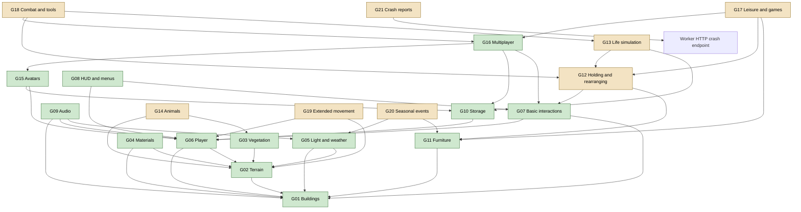

# Unreal inventory and porting plan (#2247)

Read [CLAUDE.md](../../CLAUDE.md) first for shared workflow rules. Paths in code spans are relative to the repository root.

Related: [Unreal Engine version](unreal.md) (project, LFS and parallel-work rules, owned by #2243), [architecture](architecture.md), [storage](storage.md).

This is the feature inventory of the web version, grouped for porting to the Windows Unreal version (#2242), and the release-1 porting plan. The [porting issues](#porting-issues-release-1) #2278–#2293 implement the release-1 groups. Only the original repository is concerned: nothing here is transferred to the public downstream. The web code (JavaScript/three.js) cannot be reused in Unreal. What carries over is data, measurements, IDs and models (shared export, #2245), plus rules and constants that can be exported as data.

The owner answered the six release questions on 2026-11-20. This plan incorporates those decisions, and the [release-1 boundary](#release-1-boundary) is recorded in parent #2242. Issue sizes stay preliminary until the #2246 pilot is finished. [Owner’s answers](https://github.com/solwation/lunden-3d-apartment/issues/2247#issuecomment-7052188642) · [Pilot](https://github.com/solwation/lunden-3d-apartment/issues/2246)

## How to read the table

- **Modules** are `src/` files (representative names; `*` is a family). The count is every file the group owns in `src/`, including CSS and test files; the full list per group is in [the module index](#module-index). `src/main.js` is a 4 732-line integration monolith and belongs to no feature group (G22).
- **Size** uses the module count: S up to 8, M 9-25, L 26-60, XL over 60. Lines of code are shown as a second indicator; neither is an effort estimate, the pilot (#2246) calibrates that.
- **Release**: every group has exactly one status. R1 means first Windows release, Later means after it, Not applicable means the web-only mechanism is replaced by the engine. "R1 (part)" means the group is in release 1 and its group note names the parts that are Later. Changes against the proposal in #2247 are marked **changed** or **new row**.
- Hidden functions and codes are deliberately not listed. The few modules that belong to them are counted only in the module index.

## Inventory

| ID | Group | Main modules | Data and assets | Depends on | Size (modules / LOC) | Release |
|---|---|---|---|---|---|---|
| G01 | Buildings (L1007, Hus L/A/B/C, stairwells, lift, garage) | `src/world.js` `src/core.js` `src/corehouse.js` `src/interior.js` `src/exterior.js` `src/garage.js` `src/southwindows.js` `src/stairs.js` `src/entrancedoor.js` `src/portik.js` `src/rooms.js` | `data/plan.json`, `L1007_mattsatt_planritning.pdf`, `docs/peab/` | none (root) | L (34 / 21666) | R1 |
| G02 | Terrain and surroundings (site, streets, courtyard, river valley) | `src/surroundings.js` `src/courtyard.js` `src/elevation*` `src/streetlife.js` `src/roads.js` `src/street.js` `src/parkinglot1442.js` `src/riverpark.js` `src/schoolyard.js` | `data/elevation.json`, `docs/references/` | G01 | M (25 / 6631) | R1 |
| G03 | Vegetation | `src/foliage.js` `src/plants.js` `src/treeform.js` `src/grass*` `src/hedge*` `src/entranceplants.js` `src/plantpots.js` `src/riverflora.js` | none (procedural; positions come from site data) | G02 | M (24 / 3027) | R1 |
| G04 | Surface materials and shaders | `src/brickstyle.js` `src/bricksurface.js` `src/asphaltsurface.js` `src/pavingsurface.js` `src/roofsurface.js` `src/woodgrain.js` `src/railmetal.js` `src/paintsurface.js` | none (procedural shading; palette in `src/config.js`) | G01, G02 | M (13 / 1034) | R1 |
| G05 | Light, sky, day cycle, weather, season | `src/daycycle.js` `src/lights.js` `src/weather.js` `src/realweather.js` `src/seasons.js` `src/snow*` `src/wet*` `src/windsim.js` `src/lightmodes.js` | none (`SITE.geo` in `src/config.js`) | G01, G02 | L (41 / 6172) | R1 (part) |
| G06 | Player, movement and collision | `src/player.js` `src/fall.js` `src/falldamage.js` `src/rest.js` `src/stepsurface.js` | `data/plan.json` (collision segments from G01) | G01, G02 | S (5 / 1376) | R1 |
| G07 | Basic interactions (doors, windows, lights, taps) | `src/actions.js` `src/doors.js` `src/openables.js` `src/water.js` `src/liftpanel.js` `src/drains.js` | none | G01, G06 | S (6 / 963) | R1 |
| G08 | HUD, menus, input and settings | `src/hud*` `src/compass.js` `src/fps.js` `src/menusettings.js` `src/minimap.js` `src/touch*` `src/interactionoutline.js` `src/inventoryhud.js` | `data/fonts/` (note font) | G06, G07 | M (16 / 1813) | R1 (part) |
| G09 | Audio | `src/audio.js` `src/footsteps.js` `src/ambientbed.js` `src/roomreverb.js` `src/soundocclusion.js` `src/spatialsound.js` | none: sound is synthesised with WebAudio (28 oscillator uses in `src/audio.js`) | G01, G05, G06 | S (6 / 1846) | R1 (part) |
| G10 | Storage and profiles | `src/keep.js` `src/resume.js` `src/stores.js` `src/playerprofiles.js` `src/idb.js` `src/layoutmigrations.js` `src/reset.js` | none (browser storage) | G06 (later also G12, G13) | S (7 / 1062) | R1 (part) |
| G11 | Furniture and furnishings | `src/furniture.js` `src/cabinets.js` `src/cushions.js` `src/rugs.js` `src/curtains.js` `src/blinds.js` `src/shelves.js` `src/pendants.js` `src/closet.js` `src/upholstery.js` | `models/`: none; `textures/*.jpg` (wall pictures; owner approved all pictures for original Windows export; preserve source credits); `docs/` product references | G01 | L (27 / 9942) | R1 (static furniture) |
| G12 | Holding, carrying, rearranging, drawings | `src/holdable.js` `src/things.js` `src/contents.js` `src/rearrange.js` `src/drawing.js` `src/customizer.js` `src/posters.js` `src/materialcatalog.js` | `textures/` (pictures) | G06, G07, G11 | M (14 / 3915) | Later |
| G13 | Life simulation, food, chores, quests and score | `src/life.js` `src/items.js` `src/cleaning.js` `src/dishes.js` `src/cooking.js` `src/coffee.js` `src/fridge.js` `src/laundry.js` `src/tasks.js` `src/stats.js` `src/mailbox.js` | `data/beer-shelf-default.json` | G12, G07, G10, G11 | XL (64 / 14990) | Later |
| G14 | Animals | `src/cat*` `src/duck*` `src/squirrel*` `src/bird*` `src/outdoorcat*` `src/paddock*` `src/pony*` `src/riverfish*` `src/bestiary*` | `models/cat-rigged.glb`, `duck-rigged.glb`, `squirrel-rigged.glb`, `pony-rigged.glb`, `fish-generic.glb` | G02, G03, G06 | XL (72 / 12015) | Later |
| G15 | Avatars and mirror | `src/avatar*` (about 75 modules) `src/mirror.js` `src/playerportraits.js` `src/reactpose.js` `src/seatlegs.js` | `models/avatar-rigged.glb` | G06, G10 | XL (77 / 10837) | R1 |
| G16 | Multiplayer and shared world | `src/ghosts.js` `src/cloud.js` `src/chat.js` `src/presence.js` `src/remote.js` `src/doorsync.js` `src/lifesync.js` `src/thingsync.js` `src/picnic*` | Worker API in `cloudflare/` (`/players` WebSocket, `/scores`, `/presence`, `/boards`, `/drawings`, ...) | G06, G07, G10, G15; later shared features add G12/G13 | M (24 / 3876) | R1 (shared-world core) |
| G17 | Leisure and games | `src/billiard*` `src/boule*` `src/football*` `src/gym*` `src/playroom*` `src/cinema*` `src/clubhouse*` `src/snake*` `src/screen*` `src/computer*` `src/nes*.js` `src/music.js` `src/fishing.js` | `music/` (24 tracks as mp3 and ogg, licences in `music/CREDITS.md`), `data/nes/` (ROMs and licences), `models/pingping.glb` | G12, G07, G11, G16 | XL (92 / 11172) | Later |
| G18 | Combat, weapons and tools | `src/combat*` `src/rifle.js` `src/nerf.js` `src/bow*` `src/harpoon*` `src/target*` `src/balloon*` `src/shark*` | `models/shark.glb` | G06, G12, G13, G16 | L (27 / 3993) | Later |
| G19 | Extended movement (swim, dive, bicycle, scooter, car) | `src/swim.js` `src/diveair.js` `src/bike*` `src/scooter*` `src/car*` `src/slidemovement.js` | `models/bicycle.glb`, `car-megane.glb`, `car-parked.glb` | G06, G02 | M (16 / 2132) | Later |
| G20 | Seasonal events | `src/christmas.js` `src/newyear.js` `src/santa*` `src/fireworks.js` `src/xmastree.js` | `models/santa.glb` | G05, G11 | M (12 / 1553) | Later |
| G21 | Crash reports and report intake | `src/crashlog.js` `src/report*` | Worker `/crash`, `cloudflare/crash.js` | Worker HTTP contract | S (5 / 600) | Later |
| G22 | Web startup and render infrastructure | `src/bootstrap.js` `src/startup*` `src/warmup.js` `src/lod.js` `src/viewlod.js` `src/merge.js` `src/quality*` `src/lowmemory.js` `src/main.js` (4 732 lines) | `data/changelog.json`, `data/todo.sample.json` | none | L (40 / 9569) | Not applicable |
| G23 | Test, debug and measurement tooling | `*.test.mjs` (21), `src/testmode.js` `src/hitchlog.js` `src/frameintervals.js` `src/roomprobe.js` `src/resourceprofile.js` | none | none | L (31 / 3142) | Not applicable |

The snapshot at [56f0bb65](https://github.com/solwation/lunden-3d-apartment/commit/56f0bb65c56f4086eae2bed6ef81e100e3ccb235) has 694 top-level entries in `src/`, including 16 deliberately unnamed modules and one vendor directory (its third-party implementation is excluded from the top-level LOC counts). Root data: `data/plan.json`, `data/elevation.json`, `data/beer-shelf-default.json`, `data/changelog.json`, `data/todo.sample.json`, `data/fonts/`; models: 12 GLB files in `models/`; pictures: `textures/`; cartridges and their licences: `data/nes/`; music: `music/`. All of these are in the table above or in G22.

## Group notes
- **G01 Buildings (L1007, Hus L/A/B/C, stairwells, lift, garage)** (R1): L1007 both levels and the world map (#2278); Hus L facade, stairwells and lift shaft, Hus A/B/C and garage as static geometry (#2279). Furnishing of the other houses is Later. Doors and openables belong to G07, door fittings to G11.
- **G02 Terrain and surroundings (site, streets, courtyard, river valley)** (R1): Terrain, streets, courtyard and the Höje å valley as environment, and the backdrop houses round the quarter including the campus building's façade, arched windows and roof (zone `fond`, #2323). Parked cars and bicycles from the street, east car parks, courtyard and garage are R1 scenery (#2374). The remaining east campus environment and street life, paddock, school yards and football site follow later.
- **G03 Vegetation** (R1): Trees, hedges and grass with Unreal-native vegetation built from exported meshes. Pot plants and watering follow with G13.
- **G04 Surface materials and shaders** (R1): New row versus the issue: the web shades surfaces in code; Unreal needs the same finishes as master materials and instances. Source/assumption markers from plan-material must be kept.
- **G05 Light, sky, day cycle, weather, season** (R1, part): Day cycle (sun/moon by `SITE.geo`), sky, clouds, simulated rain/snow, lamp light. Real weather (Open-Meteo), season details and frost later.
- **G06 Player, movement and collision** (R1): Walk/run/jump/crouch, stairs, collision, mouse and keyboard. The shared life and hit semantics belong to G16; later life simulation and equipment use the same contract.
- **G07 Basic interactions (doors, windows, lights, taps)** (R1): Doors, windows, light switches, taps. The #2246 pilot covers at least one door.
- **G08 HUD, menus, input and settings** (R1, part): Start/pause menu, settings (graphics, mouse, sound), compass, FPS. Minimap, measuring tool and inventory bar are Later. Touch modules are not applicable on Windows. Chat HUD ships with G16. Windows R1 uses keyboard and mouse; a gamepad is Later. Touch remains supported by the web client. The web `main.js` (4 732 lines, G22) holds much HUD wiring that must be read when porting.
- **G09 Audio** (R1, part): Build surface-specific footsteps, outdoor ambience and wind in MetaSounds from the web synthesis parameters. No purchased samples are required. Music player, Sonos and DJ are in G17.
- **G10 Storage and profiles** (R1, part): Settings, player name, an opaque player id, look code and last position in the user's save folder that survives updates (#2249). Home/life data come with G13.
- **G11 Furniture and furnishings** (R1, static furniture): The owner confirmed static L1007 furniture, curtains, fixtures and original wall pictures for R1. Interaction (open cupboards, move, material library) is later and belongs to G12/G13. The fruit bowl and Tilly's basketball with its holder are exported as static `furniture` nodes (#2310); eating, carrying and throwing them stay G12/G13/G17.
- **G12 Holding, carrying, rearranging, drawings** (Later): Prerequisite for G13, G17 and G18. Pick up, carry (inventory of five), put down, rearrange, drawings, material library.
- **G13 Life simulation, food, chores, quests and score** (Later): Largest logical group. Suggested split: life core and items; kitchen and food; cleaning, laundry and dishes; hall, beds and mailbox; quests and score.
- **G14 Animals** (Later): Cat first (GLB exists, #2245). Animal rigs are a later task; the owner chose the Mannequin for human avatars. Suggested split: indoor/outdoor cats; ducks and fish; squirrels and birds; paddock and ponies; bestiary.
- **G15 Avatars and mirror** (R1, split in two): skeleton, retargeting and movement (#2290); looks, look codes and the mirror (#2291). Use Epic’s Mannequin with retargeting. Preserve the web’s customisable appearance in the local mirror and on peers, including encoded height and accessory choices. Facial detail beyond the basics is Later.
- **G16 Multiplayer and shared world** (R1, shared-world core, split in two): connection, presence and movement (#2292); chat, door state, hits and life (#2293). Windows players and existing web clients join the same Worker room. Shared objects, chores and games follow their owning groups. Without G18 the Windows player holds no weapon, so it takes no part in fights in release 1.
- **G17 Leisure and games** (Later): Suggested split per game or room: billiards; boule; football; gyms; cinema; playroom and club house; computer games; music, TV and screens; fishing.
- **G18 Combat, weapons and tools** (Later): New row (the issue lists weapons under leisure). Server-validated hit contracts in the Worker make this tightly coupled to G16.
- **G19 Extended movement (swim, dive, bicycle, scooter, car)** (Later): Split out of the issue's player row. Swimming needs the river surface from G02; parked cars are static scenery in G02 for release 1.
- **G20 Seasonal events** (Later): New row. Date-driven decoration and guests; no release-1 value.
- **G21 Crash reports and report intake** (Later): Route native crash summaries to the existing Worker with an explicit Windows-client marker and its anonymised public projection. The owner selected the destination; only G15/G16 were promoted to R1. See the diagnostics acceptance below.
- **G22 Web startup and render infrastructure** (Not applicable): Replaced by Unreal rendering (Nanite/HLOD/streaming, shader compilation). `main.js` is the web integration monolith: read it for wiring, do not port it.
- **G23 Test, debug and measurement tooling** (Not applicable): Web test tooling stays in the web version; Unreal tests are owned by #2243.

## Release 1 boundary

Release 1 contains G01–G11 (with the parts named in the group notes), human avatars G15 and the shared-world core of
G16. G12–G14 and G17–G21 are Later. G22–G23 are Not applicable. The owner's decisions of 2026-11-20 set this boundary:
the Windows client shares one world with the web, uses Epic's Mannequin with the web's looks, sends crash reports to
the Worker's `/crash` when G21 is ported, has keyboard and mouse (gamepad Later), uses procedural MetaSounds, and
shows L1007 furnished with all pictures in `textures/`. Sizes are preliminary until the #2246 pilot is finished.
[Pilot evidence](../verification/2246/README.md)

**What the shared world requires.** Three contracts must hold before a Windows player joins web players:

- **Protocol.** The Windows client speaks the existing `/players` WebSocket protocol, including IDs, coordinates and
  yaw, optional look and pose fields, rate and size limits, heartbeat, away state, reconnect and the monthly cap.
  Every protocol change is additive and backward compatible: current web clients, phone clients and clients that
  omit optional fields keep working unchanged. The Worker and native network suites read the shared fixture file. [Wire cases](../../tools/unreal-engine/wire/players.json) · [Worker test](../../cloudflare/playerswire.test.mjs) · [Unreal network test](../../tools/unreal-engine/tests/test_network.py)
- **Hit and life contract.** The room keeps its authority. It recomputes hits from accepted poses with the shared
  head boxes, counts lives per connection and sends the totals. The Windows pose must give the same results as a web
  pose for the version-2 fixtures, and life and respawn must agree in both clients.
- **Avatar look.** A web look code decodes to the same character on Windows and encodes back unchanged. The rendered
  skeleton (Mannequin) is free, but logical hit boxes and stature follow the shared contract.

**Shared-room transport (#2292).** The owner selected the launcher bridge because UE 5.8.4 exposes no generic WebSocket client to Blueprints. The saved production player and peer avatars ran in Windows PIE alongside desktop Chromium and a touch-emulated phone in the same local Worker room. The Windows renderer and both browsers saw movement in both directions and one avatar per ID after reconnect. The launcher bridge for that session ran under .NET in WSL. Hosted Windows CI separately exercised the Windows launcher transport. The signed installed client and published desktop and mobile clients remain the #2327 release test. [Three-client views, movement checks and Windows CI](https://github.com/solwation/lunden-3d-apartment/blob/11528ae5a0f8ce2086943c3e999a30ec677fab2a/docs/verification/2292/README.md)

## Cross-platform acceptance

- **Shared world.** Use the existing `/players` WebSocket, `cloudflare/worker.js` route, `cloudflare/players.js` room,
  `src/ghosts.js`, `src/outbox.js` and the [shared state contract](storage.md). Preserve the welcome/peer IDs,
  coordinate and yaw conversion, optional look/pose fields, rate and message budgets, disconnect and reconnect. A
  native connection can omit browser Origin. The existing origin allowlist still guards browser requests. On one local
  Worker, join with native Windows and existing desktop and touch web clients. Test movement in both directions, chat,
  an R1 door from each side and rejoining to recover its current state. Replay the version-2 hit fixtures (the three
  `PVP_HEAD_BOXES` at different heights and in crouch) and legacy messages. The room recomputes hits from accepted
  poses and sends the life total. Both clients must agree on damage and respawn. Preserve existing web-only messages
  and clients that omit optional extensions. Later game, item and chore actors can remain unsupported on Windows
  without disturbing a web peer. [Web-to-Unreal coordinates](../../tools/unreal-engine/coordinates.mjs) ·
  [Room tests](../../cloudflare/players.test.mjs)
- **Human avatars.** Map source and target chains and rest poses to Epic’s Mannequin. Test standing, walking and
  crouching on both peers and the local mirror. Round-trip web look codes through the existing config encoder/decoder
  with legacy and extended samples across the available customisation categories. Compare the same character in both
  clients, including stature, clothing, skin, hair and accessories. Logical hit boxes stay in the shared contract
  regardless of the rendered skeleton. [Web rig and attribution](../../models/ATTRIBUTION.md) ·
  [Epic IK Rig retargeting](https://dev.epicgames.com/documentation/en-us/unreal-engine/ik-rig-animation-retargeting-in-unreal-engine)
- **Diagnostics.** A Windows browser can already produce `Windows Chrome` in `device()`. Add a bounded, optional
  native-client marker, for example `client: "unreal-windows"`, and validate it explicitly in ingestion and
  `publicView()`. Treat unmarked/legacy reports as before. An OS string alone cannot establish native origin.
  Preserve the current accepted report types, 16 KiB ceiling, rate limits, private admin access, public field
  allowlist, hour rounding and duplicate handling. Test an old browser report, a Windows-browser report and a native
  report for the same error through local POST, storage and public GET. Both ingest deduplication and public grouping
  must retain the native distinction, while retries of one native event still deduplicate. Reject or omit unknown
  marker values. Construct the native payload from enumerated fault codes and bounded counters. Keep raw logs, dumps,
  file paths, user names, credentials and attachments out of the upload, and check that no private identifier survives
  the public projection. Personal image export approval does not cover crash payloads.
  [Worker implementation](../../cloudflare/crash.js) · [Existing privacy tests](../../cloudflare/crash.test.mjs)
- **Controls and audio.** Verify walk, look and interact with mouse and keyboard, including after changing settings.
  Gamepad work follows later. The phone browser keeps its touch controls and joins the same room. No Windows touch
  port is planned. Compare MetaSounds footsteps on two known surfaces and outdoor wind/ambience against the web
  references on the same route. R1 uses procedural sound. Licensed music and playback devices remain G17.
  [Footstep synthesis](../../src/footsteps.js) ·
  [Epic MetaSounds](https://dev.epicgames.com/documentation/en-us/unreal-engine/metasounds-in-unreal-engine)
- **Furniture and pictures.** Original Windows can export every picture in `textures/`, including personal pictures.
  Static furniture, fixtures and wall pictures in L1007 must match the source layout and scale. Check references and
  attribution for the files actually included in the package. The permission applies to original Windows assets. The
  public downstream continues to exclude personal content, and user-created uploads and bestiary photos are outside
  this decision. [Export sources](../../shared/README.md) ·
  [Packaging notices](../../unreal/Lunden/THIRD_PARTY_NOTICES.md)

## Dependency graph

Arrows point from a group to what it needs first.

Green is release 1, brown is Later. Cross-cutting chains worth stating in words: life simulation (G13) needs holding and carrying (G12), which needs interactions (G07) and the player (G06); games (G17) and combat (G18) need G12; everything that is shared between players (G16) also needs avatars (G15) and storage (G10); shared gameplay from G12/G13 can be added to the G16 core when those groups ship.

## Porting issues (release 1)

One issue per release-1 group; the XL group G15 and the protocol-heavy G16 are split in two. Each issue starts with a
Swedish `Lapp:`, is a sub-issue of #2242 with priority medium, and names the only writer of its content folders,
levels and builder scripts. Shared text files (`world-levels.json`, `player-extensions.json`, `material-map.json`,
`Config/*.ini`, `cloudflare/`) change additively by ordinary rebase. The issues follow the
[parallel-work rules](unreal.md#parallel-work-levels-and-blueprints). Content folders are under `/Game/Lunden/`
(`unreal/Lunden/Content/Lunden/`); builders are `tools/unreal-engine/python/build_<area>.py` with tests in
`tools/unreal-engine/tests/`.

| Group | Issue | Sole write area (binary) | Starts after |
|---|---|---|---|
| G01 (1/2) | #2278 L1007 both storeys and the world map | `Maps/L_Lunden` (via `compose_world.py`), `Buildings/L1007/`, `Generated/L1007World/` (not `L1007/`: case-insensitive paths would make it the importer's `l1007/`); owns the format of `world-levels.json`; keeps `Maps/Pilot_L1007` as a test map | #2246 |
| G01 (2/2) | #2279 Hus L, Hus A/B/C, stairwells and garage as static shells | `Buildings/Exterior/`, `Maps/Zones/HusL`, `Maps/Zones/Kvarteret`; the exporter's zone split | #2278 |
| G02 | #2280 Terrain, streets, courtyard and river valley | `Site/`, `Maps/Zones/Gard`, `Maps/Zones/Omgivning` | #2279 (export split), #2278 |
| G03 | #2281 Trees, hedges and grass | `Vegetation/`, `Generated/VegetationWorld/` (not `Maps/Zones/Vegetation`: derived from the import like #2278–#2280's levels) | #2280 |
| G04 | #2282 Surface materials | `Materials/` (including `M_LundenWallPaint`), order of `material-map.json` | #2246 |
| G05 | #2283 Day light, sky and simulated weather | `Lighting/`, generated `Generated/Lighting/Level_lighting` (sun, sky, weather, lamp lights with id tags) | #2278 (#2280 for outdoors) |
| G06 | #2284 Player movement and collision | `Player/` (character, GameMode, PlayerController, movement input; takes over `Blueprints/Pilot/` after #2246); owns the format of `player-extensions.json` | #2246, #2278 |
| G07 | #2285 Doors, windows, light switches and taps | `Interaction/`, `Generated/Interaction/` (takes over `Blueprints/PilotDoors/` after #2246) | #2284, #2278 (#2283 for switches) |
| G08 | #2286 Menu, settings and compass | `UI/` (widgets, HUD class, menu input) | #2284, #2288 |
| G09 | #2287 Footsteps, wind and outdoor sound with MetaSounds | `Audio/`, `Maps/Zones/Audio` | #2284, #2283 |
| G10 | #2288 Saved settings, profile and last position | `Save/` | #2284 (#2249 for the update test) |
| G11 | #2289 Static furniture and pictures in L1007 | `Furnishing/`, `Maps/Zones/L1007Furnishing` if needed; furniture and picture rules in `material-map.json` | #2278, #2282 |
| G15 (1/2) | #2290 Avatar skeleton and movement | `Avatar/Rig/`, `Avatar/Animation/` (Mannequin, IK rigs, retargeter, animation Blueprint, `BP_LundenAvatar`) | #2284 |
| G15 (2/2) | #2291 Avatar looks and the mirror | `Avatar/Looks/` (look meshes, materials, look component and menu) and the mirror actor | #2290, #2288 |
| G16 (1/2) | #2292 Shared world: connection, presence and movement | `Network/` except `Network/Shared/`; wire fixtures in `tools/unreal-engine/wire/`; sole writer of additive `cloudflare/players.js` changes | Launcher bridge (see Shared-room transport above), #2284, #2288, #2290 |
| G16 (2/2) | #2293 Shared world: chat, doors, hits and life | `Network/Shared/` (chat widget, door sync, life component) | #2292, #2285, #2286 |

The first wave after #2246 comprised #2278, #2282, #2284 and the WebSocket check in #2292.
The [release-1 boundary](#release-1-boundary) and [dependency graph](#dependency-graph) describe that release.

## Full port after release 1

The [full-port tracker and its sub-issues](https://github.com/solwation/lunden-3d-apartment/issues/2327) cover the
Later groups, remaining behaviour in partially ported groups, and gaps found in earlier deliveries. Its group table
links each area to implementation or evidence, and [the coverage table](#coverage-of-player-behaviour-2327) links each
behaviour. The tracker also covers player-facing features wired through
`main.js` or grouped with infrastructure, such as the fridge notes and freezer changelog. Browser startup, touch
input on the web and the two engines' test harnesses keep their platform-specific implementations.

The final checks use a signed, installed Windows build and the published desktop and mobile web clients. They cover
a shared session, saved progress across an update, and representative visual, audio and interaction comparisons.
The tracker records the tested revisions, outstanding differences and any agreed platform exceptions.

## Coverage of player behaviour (#2327)

The initial reconciliation covered the closing or latest comments for #2243–#2369. The 2026-11-21 update below covers subsequent deliveries through [56f0bb65](https://github.com/solwation/lunden-3d-apartment/commit/56f0bb65c56f4086eae2bed6ef81e100e3ccb235). The shared-room rows also include [the #2293 Windows verification](https://github.com/solwation/lunden-3d-apartment/blob/bf9718ae3e862bda6d484050e49fc5381d6c2b6b/docs/verification/2293/README.md). **D** records delivery of the listed behaviour, **D+O** a delivered part with work still open, **O** an open behaviour and **P** a deliberate platform difference. Of the 67 behaviours, 15 are delivered, 18 have both a delivery and an open remainder, and 34 are open. The last column identifies outstanding editor, PIE and image checks. The signed, installed Windows game, published desktop and mobile web, and a joint session still need the final play test in #2327 item 3. #2376 covers a clean and a weaker Windows 11 PC.

| Behaviour | Group | Status | Delivered (issue, commit) | Open issue / note |
|---|---|---|---|---|
| Walk L1007's two storeys, stairs and rooms in the world map | G01 | D | #2246 `3c0faef2`, #2278 `30e49f93` | pilot door test: bug #2315 |
| Hus L, Hus A/B/C, stairwells and garage as solid shells | G01 | D+O | #2279 `b8c74df1`, #2302 `8750af3c`, #2299 `443c0588`, #2298 `65a0b6ef`; façade materials #2318 | packaged Nanite appearance #2376 |
| Entrances of A/B/C, Hus L stairwell doors, garage door open | G01/G07 | D+O | #2314 `816b695d`; apartment and garage door exports and interaction builder [d692afe1](https://github.com/solwation/lunden-3d-apartment/commit/d692afe1f7231a7bf354c9219675776d8c1d5f31) | #2328 door and button PIE checks |
| Backdrop houses round the quarter, campus house | G01/G02 | D | [Native views and measurements](https://github.com/solwation/lunden-3d-apartment/blob/b539527dec01536516f2385bc4a28f239b8f75c2/docs/verification/2323/README.md) for #2323, 41 pieces within 0.8 cm | courtyard GPU time was 11.3 ms both ways. The [closing test](https://github.com/solwation/lunden-3d-apartment/issues/2323#issuecomment-7066660619) left FPS on an idle machine unverified |
| Neighbours' lit windows, entrance and gallery lamps at dusk | G01/G05 | D | [Nine matched clear-November views of Hus L/A/B/C and 29 crop measurements](https://github.com/solwation/lunden-3d-apartment/blob/56f0bb65c56f4086eae2bed6ef81e100e3ccb235/docs/verification/2324/README.md). Windows checked all 1,397 faces and four masks. PIE followed dusk, the power cut and recovery. | The courtyard bollards have their own ground-light issue #2397. |
| Call and ride the lifts | G01/G07 | D+O | buttons usable #2285 `b43ac06f`, events #2312 `27c6f83a` | #2329 |
| Visit flats, furnished other houses, school yards, east campus, street life | G01/G02/G11 | O | — | #2330 |
| Terrain, streets, courtyard and river valley at the web's heights | G02 | D | #2280 `d5862d76` | |
| Parked cars and bicycles as scenery (street, garage) | G02/G01 | D+O | [Full export and three web views](https://github.com/solwation/lunden-3d-apartment/blob/c22d059e58327d81625936bbd333aa6c13ab2065/docs/verification/2374/README.md) for #2374, 68 cars, 69 bicycles and 82 collision boxes | imported LOD0 vertices, standing capsule contacts and matching Unreal images #2374 |
| River water, hedge leaves, balcony and fence slats, house letters | G02/G03 | D+O | [Windows render pairs and material checks](https://github.com/solwation/lunden-3d-apartment/blob/9f662b65524a3d341c996b8e8f54355f901a3c20/docs/verification/2325/README.md) (#2325). A/B/C loggia slats and letters, Hus L hedges and river water passed. | Water luminance was 2.0–2.3× web. Bank reflections and glints #2362, outdoor daylight #2390, bridge railing #2391 and tone mapping #2396. |
| Paddock and ponies | G02/G14 | O | — | #2346 |
| Trees, hedges, grass and entrance boxwood with wind; trunks stop the player | G03 | D+O | #2281 `7b76210c`, #2308 `98f42f51` | [SM6 foliage collection references and green crown after the rebuild](https://github.com/solwation/lunden-3d-apartment/blob/5049792cf6e7134f1133959e7ee3e0080ce6cdaa/docs/verification/2383/README.md). #2317 tracks remaining seasonal views, grass rebuild and courtyard frame-rate evidence |
| Pot, sill and patio plants, fruit and bridge railings in colour | G03/G04 | D | #2321 `ca992e89` | |
| Watering and plant care | G03/G13 | O | — | #2342 |
| Mussels and detailed river plants | G03/G14 | O | — | #2345 (comment 2026-11-21) |
| Paint, tiles, parquet, glass and lawns as materials | G04 | D+O | #2282 `2dcabb34`, #2308 `98f42f51` | remaining families and reflections #2362 |
| Brick, roofs, asphalt and paving | G04 | D+O | [Filtered mortar in START, patio and courtyard Windows pictures](https://github.com/solwation/lunden-3d-apartment/blob/0ea093fb04ded0aefa98aba3c71d458e4b8eba7f/docs/verification/2318/README.md) (#2318), surface mapping for the four houses. | Close-range mortar #2393 and grey path paving #2392. |
| Furnishing images as bright as on the web | G04/G11 | D+O | [Three matched curtain views, twelve panel materials and 24 lamp cases](https://github.com/solwation/lunden-3d-apartment/blob/84a558ded32eef8144e94c275c64be33d1320f08/docs/verification/2322/README.md). Curtain luminance ratios were 0.924 and 0.995 in the living room and 0.879 upstairs. | #2322 still tracks rug, coffee table, cabinet wood and glass, sofa fabric and pendant copper. #2394 tracks pale indoor daylight. |
| Sun and moon on the clock, sky, simulated rain and snow, lamp light | G05 | D | #2283 `19b34b69` | Hail, storm and lightning on the sky: #2439 |
| Evening light, dusk lamps, clouds, stars, moon phase | G05 | D+O | #2307 `8971fa42`, web cloud model and GPU comparison [d6380c9a](https://github.com/solwation/lunden-3d-apartment/commit/d6380c9a8f426157511c5965f21d644fd9864ff2) | #2371 cloud views on the rebuilt Unreal sky and wind changes in PIE |
| Indoor daylight and sky brightness, locked exposure | G05 | D+O | #2313 `443586bd`, night sky [f428bff5](https://github.com/solwation/lunden-3d-apartment/commit/f428bff55394441871503231f1124bf4e3853aa7), stair lighting [27be8ee5](https://github.com/solwation/lunden-3d-apartment/commit/27be8ee5a4e5ea973473f9ca9f7e05592a638558), pendant reference [31e92c55](https://github.com/solwation/lunden-3d-apartment/commit/31e92c55089a4e0bb99c41d5fea57a119e647e68) | [#2369 native stair view](https://github.com/solwation/lunden-3d-apartment/blob/adc40860a5af32fc5ced838b3503610d53ca4f31/docs/verification/2381/README.md) has frame ratio 1.19, shaft wall 6.69 and tread 3.07. Night sky #2366 remains open. [#2372 Windows verification](https://github.com/solwation/lunden-3d-apartment/issues/2372#issuecomment-7067851490) was in progress at this revision |
| Real weather, snow cover, frost, wet surfaces | G05 | O | — | #2331 |
| Walk, run, jump, crouch, stairs and collision with mouse and keyboard | G06 | D+O | #2284 `ff425830`, #2294 `3baf1d27`, camera pitch limits [2f8282f5](https://github.com/solwation/lunden-3d-apartment/commit/2f8282f561cfe1df7ff78e5ab97c6c8aed4bf625) | #2370 look limits, saved player and getting up in PIE |
| Surface sensor, outdoor sprint, rest, death blackout and wake | G06 | D+O | #2300 `d078366b`. In PIE, two shared-room falls took lives from 10 to 5 and back to 10, with one blackout and wake. [Fall and recovery test](https://github.com/solwation/lunden-3d-apartment/blob/bf9718ae3e862bda6d484050e49fc5381d6c2b6b/docs/verification/2293/README.md) (#2293). | stand-up spot, lying down, landing feedback #2363 |
| Swim, dive, climb, glide | G06/G19 | O | — | #2358 |
| Doors, windows, light switches and taps in L1007 | G07 | D | #2285 `608edc25`, `84650a1d`; #2312 `27c6f83a` | |
| Cupboards, drawers, curtains and blinds, running water, drains, switch movement | G07/G11 | O | — | #2332 |
| Start and pause menu, settings, compass, frame rate, quit | G08 | D | #2286 `c1a1140f` | |
| Minimap, measuring tool, use markers | G08 | O | — | #2333 |
| Gamepad | G08 | O | — | #2334 (owner's decision: Later) |
| Footsteps per surface, wind, outdoor ambience | G09 | D+O | #2287 `b89b1a66`; calibrated footsteps `6f954b65`, rain `276fe7c6` and window wind [bb481c5a](https://github.com/solwation/lunden-3d-apartment/commit/bb481c5a2ab9687f2d8fc01beaafd25db6e728d1); hail and thunder [9a32c241](https://github.com/solwation/lunden-3d-apartment/commit/9a32c241) ([#2402](../verification/2402/README.md)) | #2320 rebuilt audio assets, playback and measured mixer output; the sky's hail and storm that trigger them: #2439 |
| Room acoustics, sound through walls, other players' sound | G09 | O | — | #2335 |
| Settings, name, player id, look code and last position saved across updates | G10 | D | #2288 `96ddd108` | |
| Several profiles, saved home, resumed life, reset | G10/G13 | O | — | #2336 |
| L1007 furniture, curtains, fixtures and all wall pictures | G11 | D+O | #2289; [fruit bowl and basketball within 1 cm, paired Windows views](https://github.com/solwation/lunden-3d-apartment/blob/b17915b106ffe6c054bc1e38f2c1ca210861c9dd/docs/verification/2310/README.md); [December tree and four displaced furnishings compared with June](https://github.com/solwation/lunden-3d-apartment/blob/118ba96819c0d8ac38f7c31d5ca0a4a95e7a1a9c/docs/verification/2326/README.md) (#2303). | #2373 patio string lights and parasol in play and in matched views. Fruit bowl copper wire #2395. |
| Pick up, carry five things, containers, hand over | G12 | O | — | #2337 |
| Rearrange furniture, shared layouts, material library | G12/G11 | O | — | #2339 |
| Drawings, paper, posters, shared pictures | G12 | O | — | #2340 |
| Cooking, drinks, serving, kitchen appliances | G13 | O | — | #2341 |
| Cleaning, laundry, dishes, beds, mail | G13 | O | — | #2342 |
| Daily quests, statistics, medals, leaderboards | G13 | O | — | #2343 |
| Indoor and outdoor cats | G14 | O | — | #2344 |
| Ducks, birds, squirrels, fish | G14 | O | — | #2345 |
| Discoveries, photos and the bestiary | G14 | O | — | #2347 |
| Avatar skeleton, walking, crouching, sitting (Mannequin) | G15 | D+O | #2290 `3fd37a23` | lying pose, stairs foot IK, gestures #2348 |
| Look codes, the web's figure parts, look menu, mirror | G15 | D+O | [PIE look menu, saved code and mirror](https://github.com/solwation/lunden-3d-apartment/blob/cecda5dee0478dfdff2af1c7cf4680dab7e07699/docs/verification/2291/README.md) (#2291), [hip correction and native captures](https://github.com/solwation/lunden-3d-apartment/issues/2367#issuecomment-7066961618) (#2367), [reproducible square rims](https://github.com/solwation/lunden-3d-apartment/issues/2368#issuecomment-7065700537) (#2368) | appearance detail, web editor controls and remaining animation differences #2348 |
| Join the shared room, presence and movement | G16 | D | [Native player with desktop and touch-emulated Chromium](https://github.com/solwation/lunden-3d-apartment/blob/11528ae5a0f8ce2086943c3e999a30ec677fab2a/docs/verification/2292/README.md) (#2292). PIE checked both peers within 5 cm and 1°, two movements, absence and return with the same ID. | Signed installation, published web and physical-device play remain #2327 item 3. |
| Chat, shared doors, hits and life | G16 | D | Windows PIE and desktop and touch Chromium exchanged chat and door state. A new touch client received the open door. The six pose fixtures covered v2 and legacy compatibility. Both clients confirmed the same fall and recovery outcomes. [Three-client test and HUD capture](https://github.com/solwation/lunden-3d-apartment/blob/bf9718ae3e862bda6d484050e49fc5381d6c2b6b/docs/verification/2293/README.md) (#2293). | Signed installation, published web and physical-device play remain #2327 item 3. |
| Privacy information on the shared room | G16/G08 | D | The Windows start menu shows the ten shared text blocks and seven Windows blocks before Play. PIE verified scrolling, returning to the start menu and the first presence frame after Play. [Web and Windows captures](../verification/2375/README.md) (#2375) | Update the Windows crash disclosure when #2360 adds reporting. |
| World clock, reconnect, shared state beyond release 1 | G16 | O | — | #2349 |
| Billiards and boule | G17 | O | — | #2350 |
| Football, basketball play, gyms | G17 | O | — | #2351 |
| Playhouse, club house, cinema, posters | G17 | O | — | #2352 |
| Computer games, arcade, cartridges, spectator screens | G17 | O | — | #2353 |
| Music, DJ, Sonos, TV, smart screens | G17/G09 | O | — | #2354 |
| Fishing and the roof picnic | G17/G13 | O | — | #2355 |
| Tools, toys, targets and play combat | G18 | O | — | #2356 |
| Bicycle, scooter, car, passengers, traffic | G19 | O | — | #2357 (web fixes #2269/#2273/#2274 included) |
| Christmas tree by date | G20 | D | #2295; [June and December Windows views of the same tree corner](https://github.com/solwation/lunden-3d-apartment/blob/118ba96819c0d8ac38f7c31d5ca0a4a95e7a1a9c/docs/verification/2326/README.md) (#2303, #2326). | Winter patio cushions #2387. |
| Christmas, New Year, Santa and calendar visits | G20 | O | — | #2359 |
| Crash reports and the player's report dialog | G21 | O | — | #2360 |
| Fridge notes, freezer changelog with "Nytt", welcome and help | G22/G08 | O | — | #2361 |
| Install, sign and update before play (web: PWA install) | G22 | D+O | #2248 `956385c3`, #2249 `7767a507`, #2250 `db7326e3`, signed test-channel upgrade `350cb81f`; offline export preparation [86c4212b](https://github.com/solwation/lunden-3d-apartment/commit/86c4212b5a20f6cd8d178e2c5252ceac5e2a686a), Swedish release-note tooling [170e2404](https://github.com/solwation/lunden-3d-apartment/commit/170e24045648c2fa07e95274049d0c8277bff6ac) and a [local desktop and touch menu preview](https://github.com/solwation/lunden-3d-apartment/blob/33113d1ac1c0e82921509bf8c81c10194aee6879/docs/verification/2377/README.md) | stable release, installation, update and public links #2377, clean/weaker PC #2376, full-world update #2364, later key rotation #2378 |
| Content-only Windows build under Smart App Control | G22 | D | #2268 `60ef87fc` | |
| Web export and import kept current | G22 | D | #2245 `3b4b65fe`, `1ed0428b`, #2305 `b2c9dec5`; clean checkout ImportOnly #2380, corrected façade builder #2382 and composed map [80786d65](https://github.com/solwation/lunden-3d-apartment/commit/80786d65560393f5b8a6b792a3d97c10ef4d15f8) | [fresh Windows sync and native tests](https://github.com/solwation/lunden-3d-apartment/blob/adc40860a5af32fc5ced838b3503610d53ca4f31/docs/verification/2381/README.md) on the composed map, two successful syncs and 3/3 suites passed (#2380–#2383) |
| Engine version | G22 | O | 5.8.4 (#2243 `b84ac5cd`) | 5.9 when stable #2379 |
| Hidden features (16 undisclosed modules) | — | O | — | #2365 checks them locally; nothing here names them |

**Deliberate platform differences.** The web keeps touch controls and the PWA install; Windows uses keyboard and
mouse (gamepad #2334), the signed launcher and installer. Browser startup, loading, quality tiers and low-memory paths
(G22) are replaced by Unreal's own; each engine keeps its own test tooling (G23). Decisions recorded in the closing comments
and kept: Unreal's crouch headroom and fall height (#2284), the mouse speed range (#2286), use via the controller
(#2285), the rest spot by gaze and random wake point (#2300), the save format and its fixture (#2288), the own audio
root class (#2287), the head drawn in front of the shared hit boxes (#2290), grass as a material (#2308), locked
exposure (#2313), the garage door folding up (#2314), the door handles' steel colour (#2321), the TV and smart screens'
still image until #2354, content-only builds (#2268), generated assets not versioned (#2245), no binary delta
patches (#2248), the shared signing profile (#2250).

**Web source changes since the first reconciliation.** The original coverage audit was [23fe0005](https://github.com/solwation/lunden-3d-apartment/commit/23fe000582b549d9e603dada5ecff1c12a28795c). The only new top-level entry through [56f0bb65](https://github.com/solwation/lunden-3d-apartment/commit/56f0bb65c56f4086eae2bed6ef81e100e3ccb235) is `src/furnituregroups.js` (G12). It provides the same furniture grouping and support bounds to the web rearranger and to the R1 seasonal export (#2303). G12 gameplay remains scheduled for #2339. Other changed modules supply the court markings (#2318), background and window materials (#2323–#2325), door and parked scenery (#2328, #2374), patio lights (#2373), sky and indoor lighting (#2369, #2371), camera pitch (#2370), and pre-join information (#2375). The stable installer link also has a release-gated insertion point in the web menu (#2377). Since the previous index, G06 and G15 share the sitting and lying pose anchor for remote players. All 678 named entries and 16 undisclosed entries remain in the same groups. [Shared pose anchor](https://github.com/solwation/lunden-3d-apartment/commit/c810636724cdf10488ae8a9400a866565c357667)

**Closing comments of the closed issues.** All closed issues from #2243 to #2321 were read. Their open remainders are in the
rows above. Ten had no open issue and became #2370–#2379. Two were assigned by comment: mussels and river plants to #2345, and #2291's look details to #2348.

## Keeping Unreal in step with the web (#2304)

The web stays the only place the user changes; agents carry changes over under CLAUDE.md
"Carry web changes into Unreal". For a web change in an R1 or R1 (part) group: make the Unreal change in the same
work, or create a linked porting issue (a comment on the group's open release-1 porting issue is enough while that
issue is open). Data that the shared export carries (geometry, measurements, models, exported `config.js` values)
needs only the export check described in [unreal.md](unreal.md#staleness-check). Not applicable groups (G22, G23)
need nothing.

### Affected Later groups

A web change in a Later group stays web-only at this stage. Record the group, web issue, revision and behaviour
here under the existing carry-over rule. Link the matching open porting issue in
[the full-port tracker](https://github.com/solwation/lunden-3d-apartment/issues/2327) and carry that evidence
into its acceptance. Remove the row once the information is recorded in the porting issue.

| Group | Web issue / commit | What changed |
|---|---|---|
| — | — | none yet |

## Coverage of the topic files

| Source | Groups |
|---|---|
| [README](../../README.md) | Walkthrough and feature descriptions span G01–G21. Styrning maps to G06/G08/G19. Köra lokalt and Hur det funkar cover G22–G23, the Unreal section links #2242, and Gemensam orkester covers coordination. |
| [architecture](architecture.md), [plan-material](plan-material.md) | G01, G04, G11 (verified facts) |
| [environment](environment.md) | G02, G03, G14 (site, neighbours, cars, paddock, river) |
| [plants](plants.md) | G03 |
| [graphics](graphics.md) | G04, G05, G11 (curtains, reflections) |
| [furniture](furniture.md) | G11 |
| [interactions](interactions.md) | G06, G07, G08, G12, G18 |
| [life](life.md), [food](food.md) | G13 |
| [animals-audio](animals-audio.md), [rigged-cat-evaluation](rigged-cat-evaluation.md) | G14, G09, G17 (music, smart devices) |
| [storage](storage.md) | G10, G16, G15 (identity, shared contracts), G21 |
| [deployment](deployment.md), [performance](performance.md), [local-development](local-development.md) | G22 (not applicable) |
| [verification](verification.md), [test-mode-inventory](test-mode-inventory.md), [frame-intervals](frame-intervals.md), [orchestra](orchestra.md) | G23 and process (not applicable) |
| [report-import](report-import.md) | G21 |
| [unreal](unreal.md), this inventory | the Unreal project itself (#2243) |
| `cloudflare/README.md` | G16 (`/players`, `/scores`, `/presence`, `/boards`, `/drawings`, `/paper`, shared layouts), G17 (`/games`, `/cinema/posters`, `/playroom/posters`), G13 (`/beer-shelf`), G21 (`/crash`) |

## Module index

The index assigns each named top-level `src/` entry to one group. Names without extension are `.js` files; `.css` and `.test.mjs` are shown with their extension. Sixteen intentionally undisclosed entries are included only in the total.

- **G01** (34): architectureedges, buildingroofs, busstop, busstopgeo, campusfacades, config, core, corehouse, entrancedoor, exterior, garage, glasspanes, interior, interiormap, karpfacade, l1201plan, neighborglass, pavilionroof, polygoncut, portik, randers, roofs, rooms, schoolfacade, schoolwall, segmentopenings, sitegeo, southannex, southwindows, stairs, standardinterior, stlars41, visitunit, world
- **G02** (25): bridgeconcrete, courtyard, eastlot, elevation, elevationgrid, farwalk, nordicground, parkinglayout, parkinglot1442, riverbridge, riveredge, riverpark, roadends, roads, schoolyard, sitebackdrop, southbackdrop, southbank, southgardens, street, streetlife, streetsigns, streetwear, surroundings, terraincells
- **G03** (24): boxwood, entranceplants, foliage, grass, grassdetail, hedgeclump, hedgeform, leaflitter, leafrgb, musselfield, mussels, nutpaths, patiohedge, plantpots, plants, plantwind, riverflora, riverfloraview, shademoss, sillplants, treeform, watering, wateringmodels, zzplant
- **G04** (13): asphaltsurface, barksurface, brickstyle, bricksurface, gravelsurface, paintsurface, pavingsurface, railmetal, riversurface, roofsurface, solarsurface, tilesurface, woodgrain
- **G05** (41): aerialhaze, cloudshadow, curtainwind, daycycle, flare, frost, groundglow, indoorhalo, lamphalo, lampshade, lampwash, lightmodes, lights, moon, pathlamps, power, rainsurface, realweather, roadlamps, roofsteam, seasons, shadepools, shadowtiles, shelterwinter, showermoisture, sitewind, snowcap, snowcover, snowground, stairdaylight, sunbounce, sundust, valleymist, visitlights, weather, wetground, wetsurface, windowlight, windowschedule, windsim, windsound
- **G06** (5): fall, falldamage, player, rest, stepsurface
- **G07** (6): actions, doors, drains, liftpanel, openables, water
- **G08** (16): clockinput, compass, football.css, fps, gymeffort.css, hudicons, hudicons.css, interactionoutline, inventoryhud, marks, measure, menusettings, minimap, rowkey, touch, touchlayout
- **G09** (6): ambientbed, audio, footsteps, roomreverb, soundocclusion, spatialsound
- **G10** (7): idb, keep, layoutmigrations, playerprofiles, reset, resume, stores
- **G11** (27): aborg, benchwood, blinds, cabinets, closet, curtains, cushions, doorfittings, elcabinet, elcabinetbody, furniture, hallmodels, hooks, keycabinet, outdoorseats, parquet, patio, patiodecor, pendants, rugs, shelves, signs, stuff, terracedecor, towerclock, upholstery, wallclock
- **G12** (14): contents, customizer, drawing, furnituregroups, groundplacement, heldcategory, holdable, materialcatalog, posterdesigns, posterlayout, posters, rearrange, thingcontents, things
- **G13** (64): airfryer, basket, bedcare, bedding, beer, beercan, beershelf, beershelfdata, beershelfschema, book, bottles, calendar, cleaning, coffee, coffeejar, cooking, cookrules, cookstores, cups, dishes, dishwasher, drinks, fishfingers, fridge, fries, frozenmealmodels, fruit, grill, hallcare, handwash, hob, hood, icecreammodels, items, kitchenstuff, laundry, laundrymodels, laundryprogramme, life, lifemodels, mailbox, mailboxbody, mess, microwave, miele, milk, movementstats, ovens, oventray, pan, pineapple, sausagemodels, sausages, sponge, statcount, stats, statspanel, tablesetting, tasks, toaster, toilet, toiletpaper, vacuum, waste
- **G14** (72): bestiary, bestiaryevents, bestiaryimages, bestiarymetadata, bestiarymodels, bestiaryphotos, bestiarystore, bestiaryworld, birdflock, birds, birdsong, butterflymodel, cat, cataffordances, catbinder, catbinderprop, catcards, catclimb, catexploration, catfur, cathabitat, catlife, catmodel, catnuzzle, catnuzzlepose, catphoto, catrest, chicken, chickenpiece, corvids, duckbrain, duckhabitat, duckkiss, ducklife, duckmodel, duckmotion, ducks, duckscore, eggmodels, eggs, fishsurface, footprints, footprinttrail, ghostcat, gullmodel, hepcat, nest, outdoorcatbrain, outdoorcathunt, outdoorcatprey, outdoorcatroute, outdoorcats, paddock, paddockfeed, paddockgeo, paddockshelter, ponyblanket, ponymotion, ponysound, riverdrift, riverdriftview, riverfish, riverfishfeed, riverfishmodel, riverfishschool, riverfishswim, riverfishsync, squirrelbrain, squirrelclimb, squirrellife, squirrels, squirrelsync
- **G15** (77): avatar, avatarage, avataraim, avatararmfix, avatarbeard, avatarbreath, avatarbrow, avatarbuild, avatarcarry, avatarchest, avatarcloth, avatarcontour, avatarcue, avatarcurls, avatarear, avatarenv, avatareyes, avatarfabric, avatarface, avatarfacegender, avatarflyaway, avatarfootik, avatargaze, avatarglasses, avatargrip, avatarhairgloss, avatarhairline, avatarhand, avatarhit, avataridle, avatarjump, avatarknock, avatarlean, avatarlids, avatarlight, avatarlips, avatarlonghair, avatarmakeup, avatarmotion, avatarmouth, avatarnose, avataroutwear, avatarpattern, avatarphone, avatarpreview, avatarreach, avatarsculpt, avatarseam, avatarselfshadow, avatarselfview, avatarshadow, avatarshoes, avatarshorthair, avatarsideburn, avatarskin, avatarskinvar, avatarskirt, avatarsleep, avatarstairs, avatarsway, avatartalk, avatarteeth, avatartone, avatartrainers, avatartype, avatarweather, avatarwind, cloth, conversation, conversationwire, hand, mirror, playerportraits, reactpose, remote-pose, seatlegs, smallfigures
- **G16** (24): awaypresence, chat, chatfilter, choresync, cloud, doorsync, ghostbadge, ghostfar, ghostinterp, ghostprops, ghosts, greet, joinnotice, lifeshare, lifesync, outbox, picnicclient, picnicwire, presence, remote, shareddropwire, sharedfishclient, thingshare, thingsync
- **G17** (92): arcadeview, berdi, billiardphysics, billiardrules, billiards, billiardscore, billiardsync, blocks, boardcatalog, boards, boule, bouleclient, boulephysics, boulerules, boulesync, caughtfish, cinemacurtains, cinemaplayer, cinemaposters, cinemasurface, clubhouse, clubhouseexit, clubhousefinish, clubhousefurnishings, clubhouseleds, clubhousematerials, clubhouseshelves, computerfurniture, computerhub, dancescore, djinput, djstate, escape, fishing, fishquest, football, footballcredit, footballgeo, footballlife, footballmodel, footballphysics, footballwire, gameboards, gymapparatus, gymbodypose, gymeffort, gymefforthud, gymposewire, gympump, gymscore, huego, laptop, leaderboard, medalcatalog, medals, meteors, music, nes, nesboards, nestitles, nordicgym, nordicgymsign, outdoorgym, outdoorgymdecor, pingping, pingpingsurface, playroom, playroomcinema, playroomcues, playroomdevices, playroomdj, playroommusic, playroomphotos, playroomposters, playroomsound, popcorn, realgym20, respawn, roofpicnic, screens, screenshare, screenspill, screenwall, screenwallsurface, screenwire, snakearena, snakeview, sonos, tillydesk, toys, tvmedia, tvsound
- **G18** (27): ballflight, balloon, balloonbeer, balloongeo, binoculars, bow, bowflight, breaking, combat, combatcold, combatworld, harpoon, harpoonflight, hitmarker, nerf, paperball, rifle, saber, shark, sharkattack, sharkhunt, sharksurface, sharkswim, spraycan, target, targetmove, targetscore
- **G19** (16): bikemotion, bikeride, bikeshader, car, carfinish, carlights, carmodel, carvariants, diveair, divelook, scootermotion, scooters, slidemovement, swim, turbo, vehicleshadow
- **G20** (12): christmas, fireworks, newyear, santa, santaconfig, santagiftconfig, santagifts, santalife, santasurface, santatv, santatvconfig, xmastree
- **G21** (5): crashlog, reportattachments, reportauthor, reportcapture, reportphoto
- **G22** (40): ao, bootstrap, ceilingbatchgate, changelog, contactshadow, detail, dialogclose.css, edgebackdrop, entranceplantbatch, garagelods, groundao, install, loadingstep, lod, lowmemory, main, merge, modelurl, occlusion, quality, qualitysetting, reflections, rendersurface, siteinstancebatch, sockets, startup, startupcache, startuprecovery, tightfrustum, timesync, todo, trigrid, vendor/, version, vertexcompile, viewlod, viewport, warmup, welcome, worldtime
- **G23** (31): chickenpiece.test.mjs, cookrules.test.mjs, doorsync.test.mjs, fishquest.test.mjs, footprinttrail.test.mjs, frameintervals, ghostfar.test.mjs, harpoonflight.test.mjs, heldcategory.test.mjs, hitchlog, inventory.test.mjs, lifeshare.test.mjs, longtasks, nes.test.mjs, outbox.test.mjs, outdoorcathunt.test.mjs, outdoorcatprey.test.mjs, outdoorcatroute.test.mjs, resourceprofile, riverdrift.test.mjs, riverfishfeed.test.mjs, riverflora.test.mjs, roomprobe, screenshare.test.mjs, sharkattack.test.mjs, swim.test.mjs, testmode, thingcontents.test.mjs, thingshare.test.mjs, thingsync.test.mjs, valleymist.test.mjs

## Verification

The index uses [56f0bb65](https://github.com/solwation/lunden-3d-apartment/commit/56f0bb65c56f4086eae2bed6ef81e100e3ccb235). Compare the named entries once each with `git ls-tree --name-only 56f0bb65:src` and count the remaining entries without listing them. The group LOC totals count newline characters in the named top-level files and exclude the contents of the vendor directory. The editor, packaged-game and device checks are recorded in the behaviour table.
