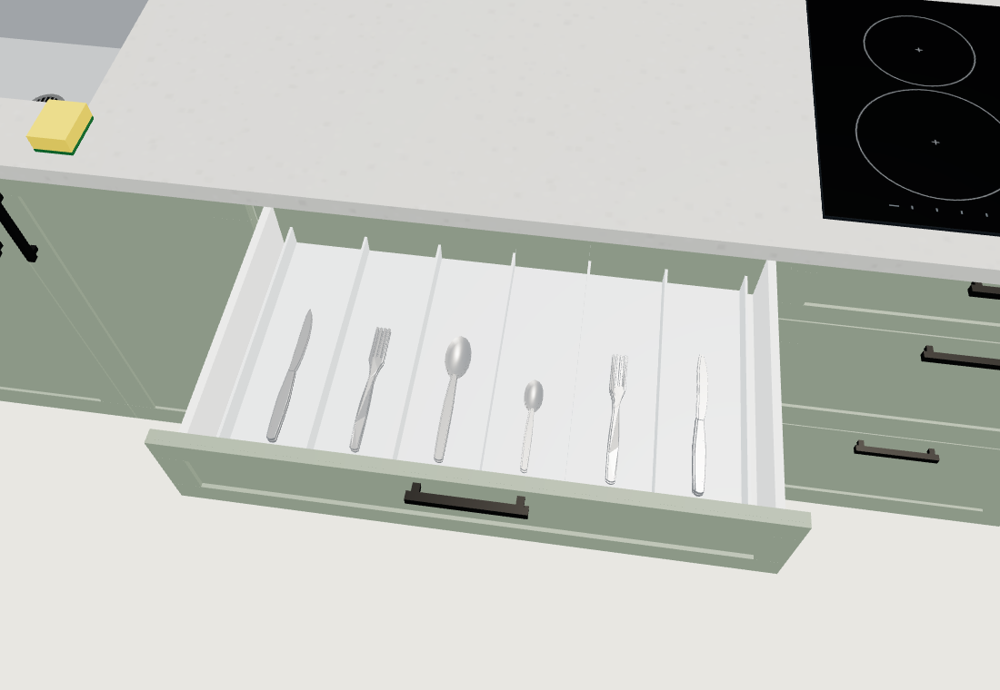
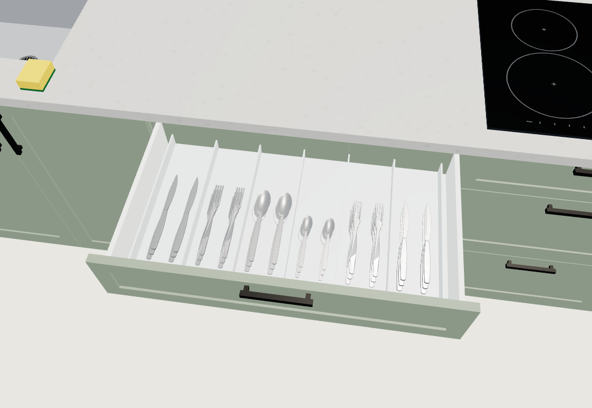

# Fler bestick i kökslådan (#1052)

24 bestick har blivit 36: två lätt förskjutna högar om tre i varje befintligt fack.
Knivar, gafflar, matskedar och teskedar använder samma detaljerade geometri som #1039.

| Före | Efter |
| --- | --- |
|  |  |

`tools/cutlerystocktest.cjs GAME OUT` använder verklig köksplan, `buildInterior`,
`fillKitchen` och `Openable` i Chromium med WebGL/SwiftShader. Före-bilden använder
fryst `src/kitchenstuff.js` från `9dac3b8e`; kör med `--baseline` och `BASELINE_FILE`
satt till den frysta filen. Bootstrap spärras och komponenten har egen jämn belysning.

Båda slutkörningarna avslutades med CLI 0, utan browserundantag. Kontroller:
antal 24 respektive 36, varje bestick inom sitt eget facks sid- och djupgränser,
samma två sammanslagna materialmesh, dold stängd låda, mellanläge i animationen,
full ursprunglig utdragssträcka och full stängning tillbaka till utgångsläget.
Före/efter-översikt och efter-detaljbild öppnades och granskades manuellt.

| Komponentmått | Före | Efter |
| --- | ---: | ---: |
| Bestickens trianglar | 11 808 | 17 712 |
| Insatsens trianglar | 120 | 120 |
| Draw calls, öppen låda | 52 | 52 |
| Trianglar, öppen låda | 19 744 | 25 648 |
| Draw calls, stängd låda | 50 | 50 |
| Trianglar, stängd låda | 7 816 | 7 816 |

Inga nya material, ljus eller slutliga draw calls. Kostnaden är 5 904 extra
trianglar när lådan är öppen. Resultatet avser denna kökskomponent, inte full World,
E-/touch-dispatch, FPS, mobilprestanda eller ett fysiskt telefonprov.

Första kontrollen av full omslutning underkändes både före och efter: den befintliga
skedens undersida når 1,5 mm under insatsens botten. Detta bevaras; ingen synlig defekt har bekräftats. #1053 stängdes därför som
obekräftat geometrifynd. Slutkontrollen kontrollerar sidor, djup och övre kant och redovisar även
ursprungliga y-gränser i [råresultatet](result.json); den påstår inte full omslutning.
Lokala originalkörningar och detaljbilder finns i `/tmp/lunden-start-1052`.
