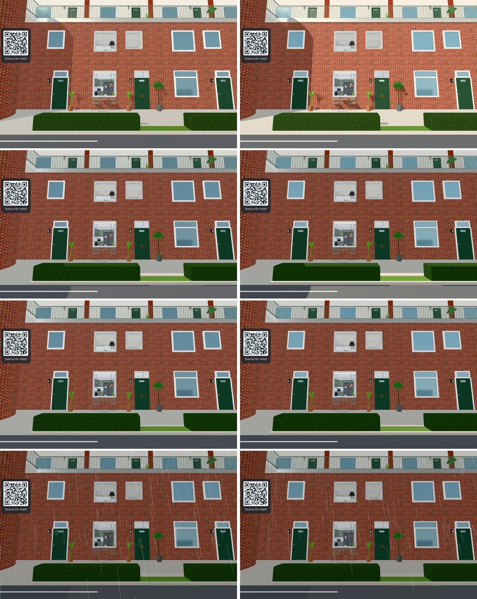
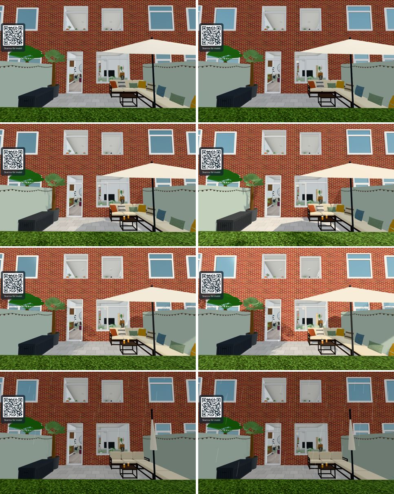
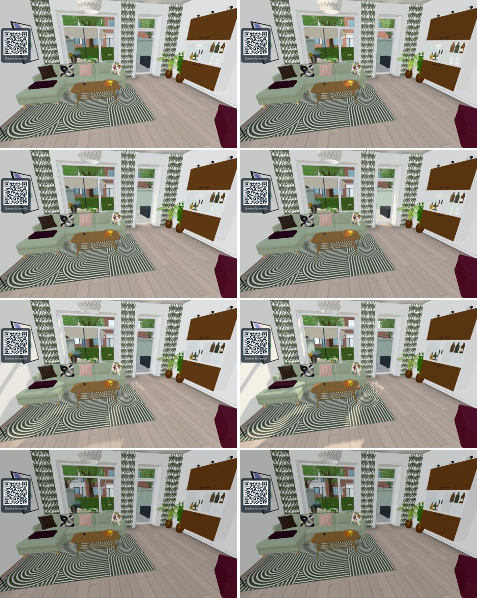
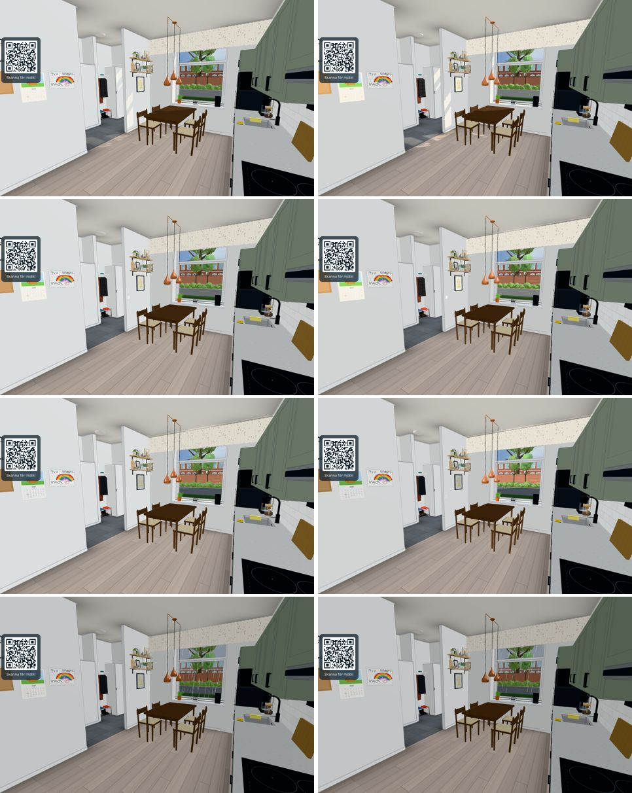

# #1073 — clearer sun and shade sides

Before (left) / after (right) at 09:00, 13:00, 18:00 and 13:00 in rain, 15 June, `&freeze&mess=0&quality=3`,
960 × 600, headless Chrome on the Surface Pro's GPU (Iris 640, `--use-angle=gl`). Views (`?at=`):
front `2.9,-7,180,6` (north façade), patio `2.9,18,0,4` (south façade), living room `3.5,8.0,170,-18`,
kitchen `4.9,4.7,30,-8`. The clock was moved in the page (`day.hour`, `day.update(0)`), weather via `&weather=`.

Mean luminance (whole frame, Rec. 709, 0–255): `before-stats.json` / `after-stats.json`.

| View | 09 | 13 | 18 | rain 13 |
|---|---|---|---|---|
| front (shade at noon) | +9.4 % | ±0 % | −1.8 % | +0.1 % |
| patio (sun) | ±0 % | +7.5 % | +8.5 % | −0.2 % |
| living room | −1.8 % | −1.8 % | −1.2 % | ±0 % |
| kitchen (north) | −1.7 % | −1.6 % | −1.9 % | +0.1 % |

Brick crops at 13:00: sunlit south 85.9 → 96.4, shaded north 83.0 → 79.7 (ratio 1.03 → 1.21).
The 09:00 front gain is the low morning sun that really reaches the north-east-facing façade in June.
Night, rain and the garage use the unchanged `LIGHTING.sky.overcast` values (exposure 1).

   
