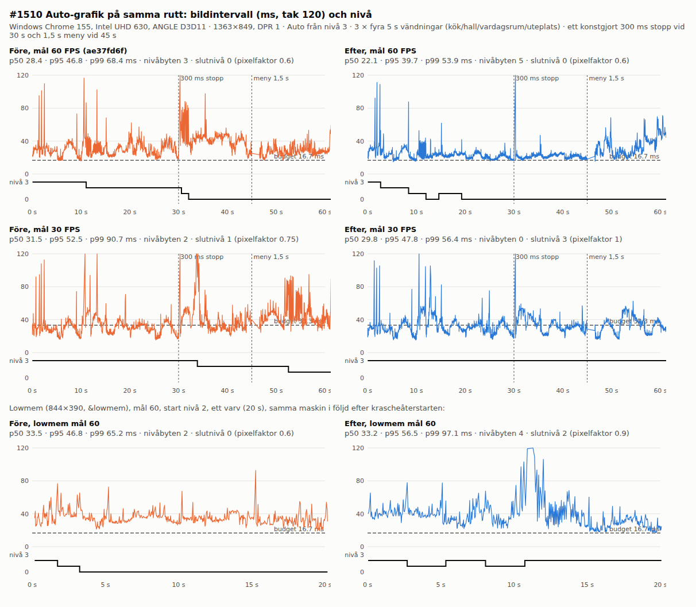

# Auto graphics regulator (#1510)

`src/quality.js` regulator: 1 s median windows against the 30/60 FPS budget, trial steps up with
revert/backoff, single stalls in diagnostics only, explicit pauses, and response measurement of
down steps (details: [performance.md](../../development/performance.md), `QUALITY.auto`).

- Decision logic: `node tools/qualityautotest.mjs` 25/25 PASS (sustained slow, single stalls and
  short bursts, repeated hitches, vsync cap trial/revert/doubling backoff, kept trial, 144 Hz,
  20 s block after a down step, cpu?/gpu? order, ineffective revert, scene-heavier `step-unclear`,
  manual lock, pause/visibility, 30 target). `node tools/qualitychoicetest.mjs` 16/16 PASS.
  Simulated devices only; no hardware claim.
- Real route: Windows Chrome 155, Intel UHD 630, ANGLE D3D11, Auto, the #1508 four-turn route
  (kitchen/hall/living/patio, 5 s each) with fridge/door toggles; 60 s runs add a synthetic 300 ms
  stall at 30 s and a 1.5 s menu at 45 s. Before = `ae37fd6f`, run back to back on one machine.

| Run | p50 / p95 / p99 ms | level changes | final level (px) |
|---|---|---|---|
| target 60, start 3, before | 28.4 / 46.8 / 68.4 | 3 | 0 (0.6) |
| target 60, start 3, after | 22.1 / 39.7 / 53.9 | 5 | 0 (0.6) |
| target 30, start 3, before | 31.5 / 52.5 / 90.7 | 2 | 1 (0.75) |
| target 30, start 3, after | 29.8 / 47.8 / 56.4 | 0 | 3 (1) |
| target 30, start 0, before | 23.1 / 64.7 / 104.3 | 4 | 0 (0.6) |
| target 30, start 0, after | 23.0 / 47.8 / 68.3 | 4 | 0 (0.75) |
| lowmem 844×390, target 60, start 2, 20 s, before | 33.5 / 46.8 / 65.2 | 2 | 0 (0.6) |
| same, after | 33.2 / 56.5 / 97.1 | 4 | 2 (0.9) |
| same, after, 60 s | 28.6 / 48.9 / 71.6 | 4 | 0 (0.6) |

The 300 ms stall moved no level after the change (the old regulator stepped down twice on it at
target 60). Pinned levels on this route (knob matrix, 1363 wide) cost 46–51 ms at level 3 / px 3 and
32–34 ms at level 0 / px 0; resolution alone bought little, so most overloads classify as `cpu?`.

**Lowmem oscillation (diagnosed).** A pre-crash lowmem run under memory pressure (median 45–67 ms,
a 2.5 s stall) reverted every down step: 2→1 helped, 1→0 then measured 17 % WORSE because the
scene/loading got heavier, was reverted as `ineffective`, the resolution step likewise (−13 %),
leaving the start level three times over budget with both step kinds backed off. A cheaper step
cannot cost more, so a median worse by ≥ `minGain` is now `step-unclear` and the step is kept;
only a change within ±8 % reverts. Switching stays bounded by the doubling backoff (4 changes in
60 s). On the stable post-restart machine the lowmem route is level-independent (~33 ms at every
level, main-thread bound): Auto tried both kinds, measured +6 % / +4 %, gave the picture back and
held level 2 for the 60/120 s backoff, where the old regulator dropped to level 0 at the same frame
rate.

**Step cost (the ~100–120 ms frames at 10–12 s, bottom right).** These are not caused by the step.
Measured standing still on lowmem (844×390, level 2), 12 frames after each knob's `apply()` against
the room's median: living room (median 32 ms) shadows 1536↔1024 max 39/43, resolution 0.9→0.75 max 49,
0.75→0.9 34, detail / mirrors / weather ≤ 35, whole level 2→1 / 1→2 max 32/45; kitchen (median 25 ms)
all ≤ 44. No step reaches the 50 ms hitch line (3 × budget). A pinned level 2 route with no
steps shows the same >100 ms frame at the living-room spawn (10.6 s), while pinned level 0 has
none. The 20 s after-run's first such frame (97 ms at 10.48 s) also comes before the revert at
10.67 s, and the 60 s after-run shows the same living-room frames at level 0 (34–35 s) with no step
nearby. So they are a scene cost of the living-room view at the higher level that Auto kept, not a
reallocation hitch. Harness: `stepcost.cjs`, `levels.cjs` (orchestra evidence dir).

Limits: one machine and GPU, no GPU timer (classification is always uncertain), no physical phone;
thresholds are *guess*.
