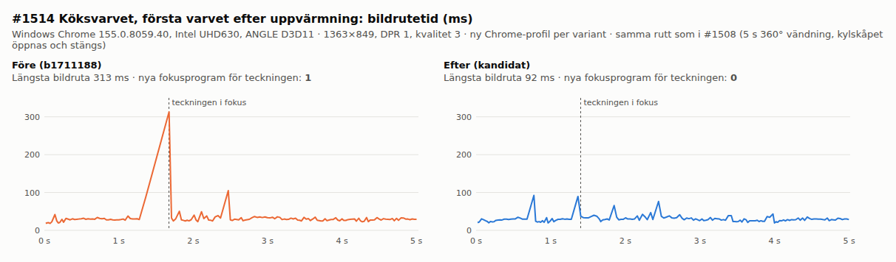

# #1514: late-arriving drawings in warm-up, 2026-10-23

Base `b1711188`. The candidate changes `src/warmup.js` (`add`, `lateSlice`), one hook in
`src/posters.js` (`onBuilt`) and three lines in `src/main.js`.

## Arrival and patch order (diagnosis)

These are instrumented WarmUp/Posters prototypes on the normal app route, measured in Windows
Chrome155.0.8059.40 with Intel UHD630/ANGLE D3D11 in a new profile. The scenario is
`cloud=&life&perf&quality=3&time=12&month=7&day=1&freeze&weather=clear&mess=0&at=3.5,3,0,0`.

| Step | Base, ms | Candidate, ms |
|---|---:|---:|
| Whole-scene screen compile submitted | 29196 | 28587 |
| Saved drawing built (`Posters.build`, after the IndexedDB read) | 33129 (state `compiling`) | 33069 (state `compiling`) |
| Late screen compile of the drawing (+ focus extra) | — | 33086 |
| Mirror compile (whole scene, drawing included) | 36140 | 36237 |
| Programs at `warm.done` | 412 | 413 |
| New programs at first screen focus on the drawing | **1** (`…lampwash\|lampwashV\|interaction-brightness:1.12:mesh`, sRGB output) | **0** |

The drawing missed the screen compile because it arrived while WarmUp waited for those programs.
The draw-everything pass compiled its base program and the mirror compile added its mirror
focus variant. The screen focus variant was never compiled. The lamp-wash key order, first
`lampwash` and then `lampwashV`, matches the WarmUp `prepare()` patch and the #1508 capture.
Phone (`lowmem`, sliced, 844×390): the candidate compiles the drawing between screen slices
(0 new programs at focus). On this route the base phone run also had 0 because the drawing's
phone key already had an equivalent focus variant. Phone evidence therefore shows that the late
path runs and stays within budget. It does not show a reproduced phone stall.
IndexedDB blocked by an init script that makes `IDBFactory.open` throw: the home drawing still
appears, warm-up finishes, 413 programs and 0 new at focus.

## Matched first/repeat lap

The route is the same as in #1508 `compare.cjs`: four 5 s 360° turns (kitchen, hall, living room
and patio) with fridge and front-door toggles. It starts after `warm.done` and uses touch start
with focus emulation. Chrome, GPU and scenario are as above, at 1363×849, DPR 1 and quality 3.
Each variant has its own new profile (base first, then candidate). This is not the user's
stronger GPU or ordinary manual play.

| Metric | Base lap1 | Candidate lap1 | Base lap2 | Candidate lap2 |
|---|---:|---:|---:|---:|
| Samples | 629 | 569 | 444 | 427 |
| Median, ms | 29.7 | 31.0 | 44.0 | 45.7 |
| p99, ms | 84.4 | 76.2 | 91.5 | 99.7 |
| Max, ms | 312.8 | 379.2 | 123.8 | 117.9 |
| >100 ms / >250 ms | 4 / 2 | 2 / 1 | 2 / 0 | 4 / 0 |
| New programs (all) | 1 | 0 | 0 | 0 |
| New drawing focus programs | **1** | **0** | 0 | 0 |
| Frame when the drawing is focused, ms | **312.8** | 89.7 | 69.5 | 28.7 |
| Kitchen-turn max, ms | 312.8 | 92.3 | 81.9 | 61.0 |

The candidate's lap1 maximum of 379.2 ms is in the living room. That frame has a 1-texture/17-buffer
first upload and an 88.7 ms mirror pass, with 0 new programs. The base had a 273.6 ms stall
there as well. This is not the drawing case and remains #1506 territory. Lap 2 is slower in
both variants (median about 45 ms). This repeats across variants on the shared machine, so
the comparison uses lap1 against lap1.

## Tests

- `tools/focuswarmtest.html`: 18/18 PASS in native-GPU Chrome and in headless SwiftShader.
  The same file against base `src/` fails 4 late-arrival checks, so the test reproduces the bug.
- `tools/focusperftest.html` 6/6, `tools/postertest.html` 37/37, `tools/homedrawingtest.html`
  17/17 PASS in native-GPU Chrome, with warm-up running. Image, placement, saving, reload and
  home-drawing behaviour are unchanged.

No personal drawing image or save file is published. The chart contains only frame times.
Raw JSON and harnesses are kept locally in `~/.local/state/orkester/claude-wsl-20261023/1514/`.
The public downstream has no WarmUp, InteractionOutline or drawings, so there is no port.
