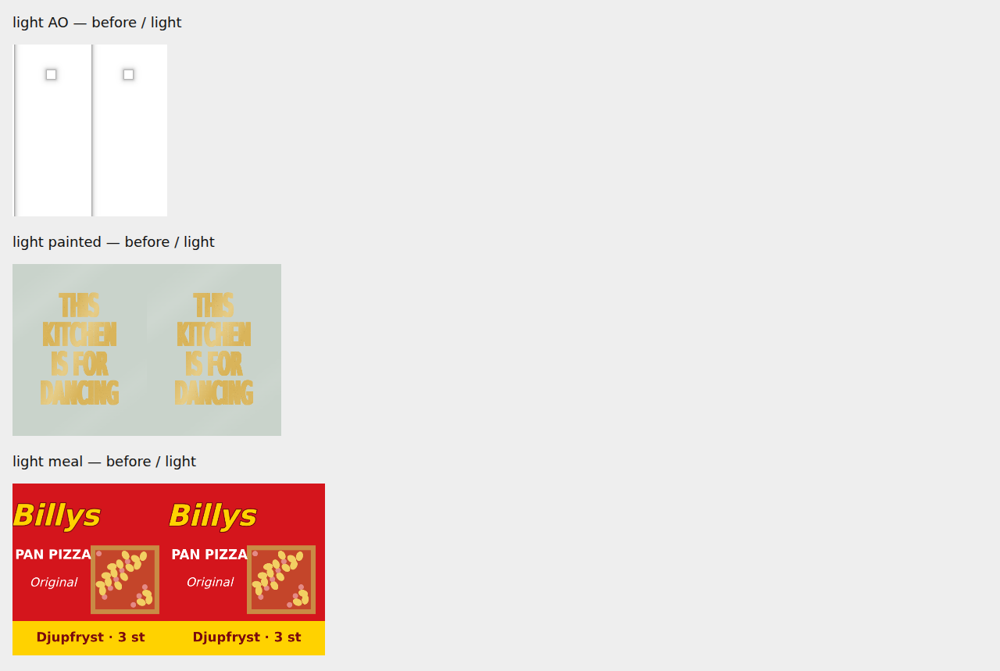

# #1549: procedural canvases at startup size

Source baseline: `b9ed31bd36d54cba7295b5233372c6e3eb6d15f8`; exact changed-source SHA-256 hashes,
input parameters and actual World counters: [memory.json](memory.json). Component checks and errors:
[component.json](component.json). Full desktop AO, painted picture and Billys print retain every pixel
and their 360×800, 720×920 and 512×563 dimensions. Light gives 230×512, 400×512 and 465×512,
the same upload dimensions as before, with mean channel errors 0.000013, 0.1824 and 0.6738/255.
The picture's temporary foil canvas is capped too. The existing computer-menu and snake canvases
repaint identically. Actual Billys/Gorbys open/closed meshes, visibility/material flags and ray distances,
and AO geometry/rays, have identical fingerprints.

Inspected: AO blocker/stair-hole edges, gold text, food-brand lettering and illustration. The picture is a
source-texture comparison, not a screenshot of the physical phone's display. The small interpolation and
text-rasterization differences preserve the intended appearance.

Actual World, same phone start route and normal warm-up (Chromium/SwiftShader, not a physical phone):

| metric | before | after |
| --- | ---: | ---: |
| live CPU canvases >4096 pixels | 270 | 267 |
| estimated CPU canvas storage | 95.184475 MiB | 92.122463 MiB |
| texture allocation bytes | 97,427,515 | 97,427,515 |
| uploaded texture count | 207 | 207 |
| calls / triangles | 346 / 730,811 | 346 / 730,811 |
| scene geometry CPU bytes / count | 120,990,209 / 4,191 | 120,990,209 / 4,191 |

The observed 3.062012 MiB reduction includes 1.125 MiB from three fewer randomly selected cup
patterns (cups are unchanged). The attributable retained-source saving is **1.937012 MiB**:
1.745605 from the kitchen print plus 0.191406 from Billys packaging. AO is already capped and freed by
`freeCanvasAfterUpload`; its benefit is avoiding the oversized construction canvas, not an additional
steady-state reduction. The distance grid remains authored resolution; no geometry saving is claimed.

Warm-up completed in both runs. Both have the same unrelated `/data/todo.json` 404 and corresponding
console error; component tests have no page errors. App load/warm-up and heap/RSS varied, so no
startup-time, frame-time or total-heap improvement is claimed. The raw phone screenshots contain the
existing iPhone install overlay and are retained privately as raw artifacts, not presented as result images.
No global scene sweep or desktop full-app run was needed: the actual desktop painter dimensions and
pixels are exact, and geometry/interaction code is unchanged.

Raw scripts/logs and the saved pre-change modules remain in `/tmp/orkester-codex-20261023/e1549/`.
Public applicability: the generic size helper and AO can transfer if the downstream retains their callers;
the personal kitchen print and gameplay food models must not transfer. The conductor owns the separate
low-priority port issue and its own downstream verification.
