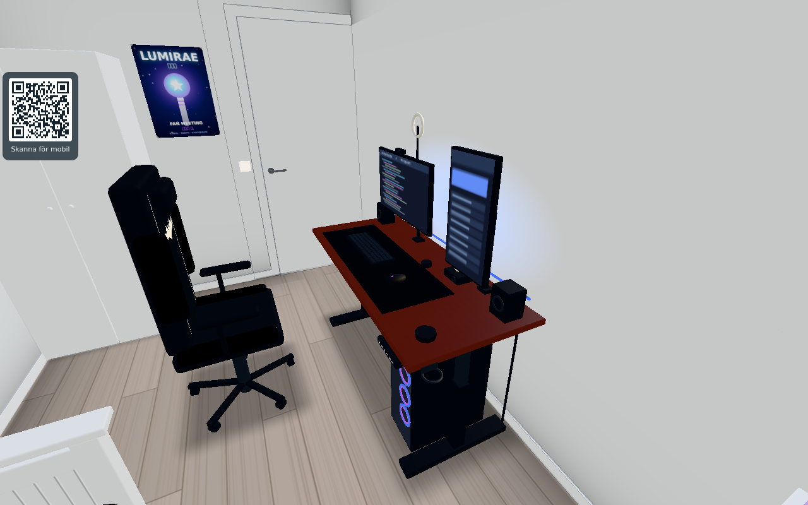
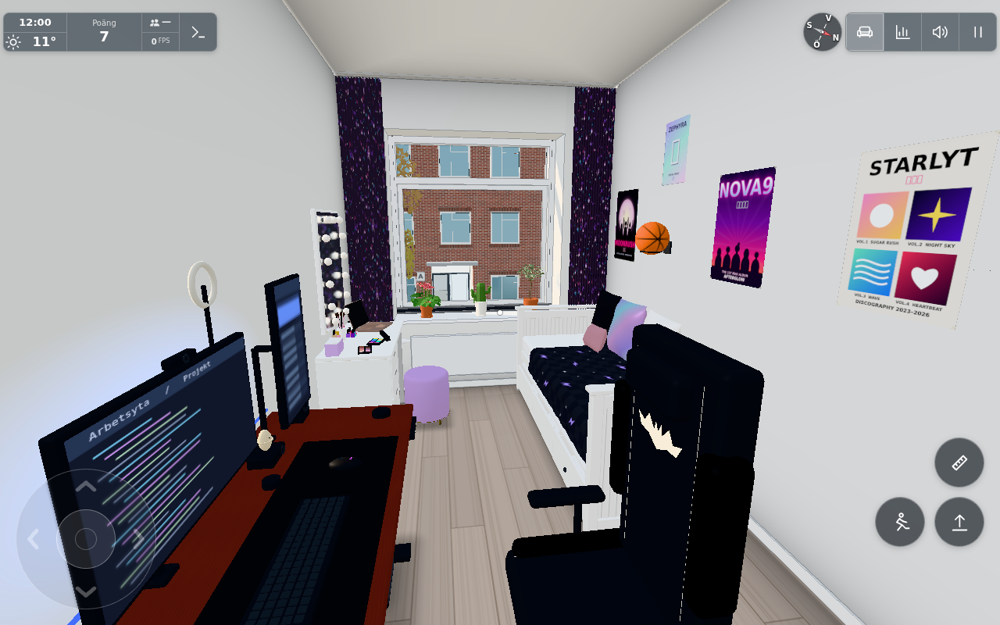

# Datorhörnan i Tillys rum – #1557

Granskat 2026-10-24 mot användarens [referensfoto](../../datorsetup-secretlab-batman.jpg).
Återställd implementation på `b361f59a`; exakta källhashar finns i [source.json](source.json).
Alla tillkommande mått och proportioner är fortfarande **guess**, centraliserade i
`TILLY_DESK`. Detta är personlig inredning enbart för originalet; inget förs till den
publika rundvandringen.

Skrivbordet med röd skiva, svarta T-ben, liggande och stående skärm, monitorarmar,
ringlampa/webbkamera, underlägg, tangentbord, mus, högtalare, små tillbehör och
RGB-dator. Stolen har svart klädsel, ljusa sömmar, kolfibermönstrade sidor och
stiliserat Batman-märke. Skärminnehållet är påhittat och statiskt.

Vy från dörren mot fönstret visar relationen till dagbädd, affischer och sminkbord.
Ingen befintlig möbel eller affisch har flyttats. Stolens placering lämnar en
smal men passerbar väg väster om stolen.

## Tre riskbaserade kontroller

[checks.json](checks.json) innehåller 10 godkända delkontroller från samma riktiga
appsession, med `?cloud=&shot&test=lazy&time=12&freeze&mess=0`. Ingen originaltjänst
användes. Resultatbilderna växlar till kvalitet 3 och skuggor med det dokumenterade
`testkit.shot`; SwiftShaders tid/fps säger inget om fysisk enhetsprestanda.

1. **Geometri, svep och kollision.** Rumsdörrens och båda SMÅSTAD-luckornas hela
   öppningsintervall samplades i 101 lägen vardera, totalt 303, utan överlapp mot
   bord eller stol. Inga överlapp mot befintliga möbler eller affischer.
   `Player.isFree` avvisar bordets, datorns och stolens upptagna plats. Ett 2,5 cm
   rutnät över den faktiska kollisionsvärlden hittar en sammanhängande väg från
   (1,90; 8,20) till (1,60; 10,75), med spelarens vanliga radie 22 cm.
   Ingen extra säkerhetsmarginal används för denna gångkontroll. Den första grövre
   5 cm-kontrollen med 2 cm extra marginal missade den smala passagen; modellen
   ändrades inte för att få kontrollen att passa.
2. **Verklig app och befintliga interaktioner.** Den fokuserade ordinarie
   handlingsknappen visar Sitt ner och sätter spelaren i Batman-stolen vänd mot
   skärmarna. Res dig ger fri golvplats. Befintliga Rearrange väljer stolen,
   vrider 45°, förhandsvisar och bekräftar en ny plats samt återställer originalet.
   Inga sidfel registrerades under dessa kontroller eller bildtagningen.
   Profilvalet stängdes före interaktionskontrollen; ett första bildförsök med
   dialogen kvar ersattes. Närbilden togs därefter om från större avstånd för att
   även visa golvdatorn.
3. **Lokal renderkostnad.** Den faktiska modulbyggaren före/efter `mergeStatic`:
   bord 182 → 17 meshes och 11 900 trianglar; stol 30 → 6 meshes och 2 648 trianglar.
   Sammanlagt 23 slutliga delmeshes, 14 548 trianglar och noll nya ljus.
   Detta är lokal geometri-/batchräkning, inget helvärlds- eller fps-test.

Bordets höjd är statisk; minnespanelen är dekor. Skärmar, ringlampa, fläktar och
LED-list har inga nya appar eller ljuskällor. Stolen flyttas och vrids via
Möblera om, utan separat snurrmekanik. Bordet har ingen fri avställningsyta för
lösa saker. Delade serveranrop, synkronisering, fysiska mobiler och verklig GPU
har inte provats eftersom ändringen inte inför någon sådan väg.

Övriga hus A/B/C är inte tillämpliga: ändringen avser lös personlig inredning i
L1007 och ändrar ingen gemensam byggnadsgeometri.

Verifieringsskript och råa körningar bevaras för dirigentens granskning under
`/tmp/orkester-codex-20261024/verify1557/`. Bildpublicering, tillgängliga permanenta
bildlänkar, slutlig changelog-numrering och publicering/stängning ägs av dirigenten.
Slutligt publiceringsresultat och commitlänkar spåras i [ärende #1557](https://github.com/solwation/lunden-3d-apartment/issues/1557).
