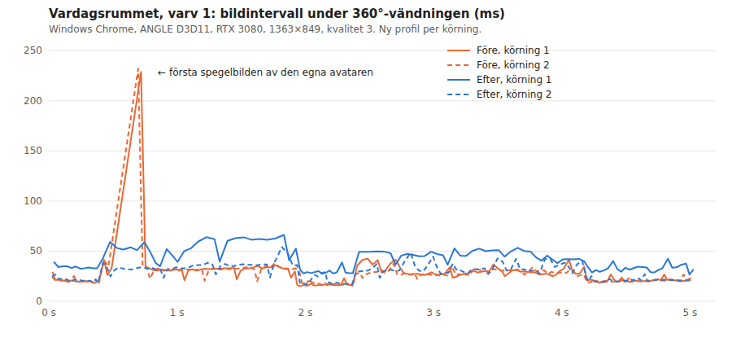

# #1558: first mirror image of our own avatar in the living room, 2026-10-23

Base `e1a4b53e`. The candidate adds one line in `src/ghosts.js`: our own mirror avatar's
root gets `userData.warmDraw`.

## Cause (diagnosis)

The run used the #1507/#1514 scenario on the normal app route:
`cloud=&life&perf&quality=3&time=12&month=7&day=1&freeze&weather=clear&mess=0&at=3.5,3,0,0`.
A per-frame GL capture (`&diag1558` in `harness/route.js`) wrapped `bufferData`/`texImage2D`/`texStorage2D`/`texSubImage2D`
and matched each uploaded array or image against the scene's attributes and textures.

In lap 1, the first frames in which the living-room mirror (`skogsgransen`) reflects upload:

| Frame | Uploads | Owner |
|---|---|---|
| 1st mirror pass | 4 buffers, about 3.5 KB | the Reflector's own plane (hidden until it is active) |
| 2nd mirror pass | 13 buffers, about 3.3 MB (position, normal, skinIndex, skinWeight, morph/face attributes, color) + 1 texture (8×8 float, `texStorage2D`) | `Scene/ghosts/Group/avatar/ghost:Anonym`, our own mirror image (#691), and its bone texture |

This matches the "1 texture / 17 buffers, 0 new programs" frame in #1514 (4 + 13 buffers).
Our mirror avatar's root group is `visible = false` outside the reflector pass
(`Ghosts.beforeMirror/afterMirror`). The warm-up therefore compiled its programs (three's
`compile` visits hidden objects) but never drew it, so neither its geometry nor its bone
texture was uploaded, and its draw state was never created on the GPU. The callback that does
that work takes only 36–38 ms of CPU. The **next** frame interval is 229–234 ms in all three base
runs, of which about 210 ms falls outside the app's callback (`outsideWorkMs`). This stall
lies in the browser/GPU process (driver/ANGLE work for the first draw of these buffers and
programs). The trace does not split it further. No GPU timer was read.

## Fix

`Ghost` (self = true) sets `root.userData.warmDraw = true`. `WarmUp.withWarmVisible` already
shows such objects for the warm-up's full draw-everything passes, both on screen and into the
mirror target (the precedent is the gulls, #1265). The avatar is drawn once behind the loading
cover and then hidden again. The change adds no new programs, textures or render targets, and
the warm-up gets no extra stage. The sliced phone draws (#669) only show `warmDraw` renderables
inside their slice. This group is not a renderable, so phones keep the avatar lazy as before
(#628, no extra GPU memory or slices).

## Matched hardware runs

Windows Chrome 155.0.8059.85 was driven over CDP from WSL (`harness/`: `cdp.mjs` with Windows
`node.exe`, `route.js`, `run.sh`). The window was kept off-screen with focus emulation and
`--disable-backgrounding-occluded-windows`. The viewport was 1363×849 at DPR 1, so the render
size was 1363×849. Quality was pinned at 3, with `lowMemory` false and the resource profile
`full`. Each run used a fresh profile. Run order: base, base, candidate, candidate, all on
the same server/revision except `src/ghosts.js`.

**GPU: `ANGLE (NVIDIA, NVIDIA GeForce RTX 3080 Direct3D11 vs_5_0 ps_5_0, D3D11)`.** On this
day Windows exposed only the RTX 3080 (the Intel UHD630 used in #1508/#1514 was not an active
adapter). The stall was therefore measured on a strong GPU: 230 ms here, against 270–380 ms on the UHD630 in #1514.
The display refresh rate was not recorded (median about 17 ms suggests 60 Hz).

Route: the game starts with touch, then each lap has four 5 s 360° turns (kitchen with the
fridge opened and closed, hall with the front door opened and closed, living room facing south,
patio). It starts after `warm.done` and has 60 frames between laps. All samples are `active`
(no pause/background/warm-up tags). Statistics come from `__app.hitch.intervals` (raw callback
intervals, #1507).

**Lap 1 (first visit)**

| Metric | Base 1 | Base 2 | Candidate 1 | Candidate 2 |
|---|---:|---:|---:|---:|
| Duration, s | 20.02 | 20.00 | 20.04 | 19.99 |
| Samples | 1105 | 1117 | 865 | 1008 |
| Median, ms | 16.7 | 16.5 | 20.1 | 18.4 |
| p95, ms | 30.6 | 30.5 | 46.3 | 33.0 |
| p99, ms | 36.1 | 33.9 | 61.4 | 39.7 |
| Max, ms | 229.0 | 232.1 | 137.2 | 54.2 |
| >50 / >100 / >250 ms | 2 / 1 / 0 | 2 / 1 / 0 | 29 / 1 / 0 | 2 / 0 / 0 |
| **Living-room turn max, ms** | **229.0** | **232.1** | **66.2** | **54.2** |
| Avatar buffers in first mirror frames | 13 | 13 | 0 | 0 |

**Lap 2 (repeated, same page)**

| Metric | Base 1 | Base 2 | Candidate 1 | Candidate 2 |
|---|---:|---:|---:|---:|
| Duration, s | 20.04 | 20.02 | 20.00 | 20.02 |
| Samples | 1041 | 1123 | 980 | 1022 |
| Median, ms | 17.6 | 16.8 | 18.9 | 18.4 |
| p95, ms | 33.4 | 29.3 | 31.8 | 31.5 |
| p99, ms | 37.7 | 33.3 | 35.7 | 34.9 |
| Max, ms | 62.9 | 47.0 | 47.0 | 44.9 |
| >50 / >100 / >250 ms | 1 / 0 / 0 | 0 / 0 / 0 | 0 / 0 / 0 | 0 / 0 / 0 |
| Living-room turn max, ms | 49.4 | 36.2 | 37.0 | 36.6 |

The lap 1 living-room stall (229–232 ms, directly after the avatar upload frame) is gone in
both candidate runs. A third candidate run with the GL capture on (`afterdiag`) also gave a
living-room max of 47.0 ms. In it, only the Reflector planes' 4 small buffers were uploaded
in the living room. Candidate 1 was a noisier run on the shared machine (median 20.1, 29
intervals >50 ms spread over the lap). Its 137.2 ms maximum is the patio teleport frame,
with 80 ms in `step` (JS) and no uploads. It is unrelated to the mirror: base had 53–55 ms
there. Programs at `warm.done` were 421 in every run. The warm-up duration (about 181–184 s
from navigation in this off-screen setup) did not change measurably. No startup improvement
is claimed.

## Functional checks (headless SwiftShader, not timing)

`tools/selfmirrorwarmtest.cjs` (Chromium 145 headless, `&warm`):
- desktop 960×600, quality 3: the warm-up drew the avatar twice (states `draw` and
  `mirror-draw`) and reached `done`. PASS.
- phone (`&lowmem`, iPhone UA, 844×390, touch): sliced warm-up, 0 avatar draws, `done`. PASS.
  The phone path is unchanged. The phone warm-up gets no extra draw, upload or slice.

## Limits

- The Intel UHD630 from #1514 was not available, so the stronger RTX 3080 was used instead.
  The UHD630 size of the remaining effect is not re-measured. No Chrome Performance trace was
  recorded, so the 210 ms outside the callback is not split into GPU, driver and compositor
  time. The counted uploads and the before/after interval are the evidence.
- Phones still upload the avatar at their first mirror frame (deliberately lazy, #628). That
  hitch was not measured on a phone.
- Other players' first appearance (the hidden `sample` outline avatar, #705) is a separate case
  outside this route, with `cloud=` disabled. Not measured.
- Raw JSON lives locally in `~/.local/state/orkester-claude-wsl-20261023/1558/h/`. The chart
  shows only frame times.

Downstream: `solwation/kvarteret-lunden` (`ad5e82e0`) has the `setMirrorExtra` hook in
`reflections.js` but no ghosts/avatar module, no caller and no WarmUp. There is no port.
