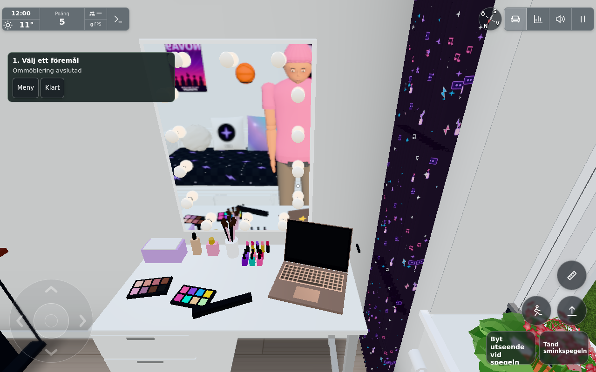

# Laptop tillbaka på sminkbordet – #1563

Granskat från `c7df3f98` den 2026-10-24. Rapportbilden visar datorn på golvet framför Tillys sminkbord. Felet är äldre än datorhörnan #1557: `Rearrange.update()` gav endast Symfonisk och fristående TV en ray mot avställningsytor. Laptopens sikte gick alltid mot golvplanet. Den befintliga, smala ytan på sminkbordet är avsedd för småsaker och täcker inte laptopens ursprungsplats.

En separat osynlig yta täcker lämpliga mittpunkter på bordets fria högra del. Den används enbart vid ommöblering av laptop, inte av vanliga föremål. Efter 5 cm rutnätssnappning och rotation måste basen och det öppna locket rymmas på den fria skivan, framför spegelns utstick. Dessa fria mått är fortfarande märkta som gissningar. Laptopens flytt använder samma förhandsvisning, lokala sparning, revision och synk som annan ommöblering; ytan följer med bordet. När laptopen väl står där identifieras den som stödledd och följer med om bordet flyttas.

Resultatbilden togs om med slutlig kod `84e428b6`: laptopen flyttades först till golvet, förhandsvisades sedan giltigt på `(2,35; 4,01; 11,75)` och bekräftades med appens touchknapp (revision 2). Profilvalet var stängt, inga sidfel uppstod och `testkit.shot` tog bilden med full kvalitet och skuggor. Råresultat: `/tmp/orkester-codex-20261024/verify1563/final-shot.json`. Bildens SHA-256: `2b78e6beb7da19c78b2e74ceb937cd53cd5d2d6a0db640d025a838b19547dead`.

## Avgränsad verifiering

- Verklig lokal Chromium-app, `?cloud=&shot&test=lazy&time=12&freeze&mess=0`, port 8363. Profilvalet stängdes med **Hoppa över** före kontroll och bild. Inga originaltjänster användes.
- Den första funktionskörningen flyttade laptopen från golvets 3,25 m tillbaka till avställningsytans 4,01 m via faktisk rayträff och giltig förhandsvisning. Två lokala sparningar gav revision 2; `groupFor(vanity)` innehöll därefter både sminkbordet och laptopen. Inga sidfel. Råresultat i `/tmp/orkester-codex-20261024/verify1563/result.json`.
- Appens touchknapp valde och bekräftade placering på bordet (revision 3). Efter byte till musläge med verkligt Pointer Lock valde och bekräftade E samma placeringsyta (revision 4). E ignoreras avsiktligt i touchläge.
- Slutlig kantkontroll i verkliga appen: [edge.json](edge.json) visar giltig kandidat på 4,01 m vid 0°, 45° och 90° extra vridning från laptopens ursprungsriktning samt från motsatt kameravinkel. Alla fyra hörn för bas och öppet lock ligger inom fri skiva. En ray på ytans yttre hörn får ogiltig kandidat efter snappning: x når lokalt 0,542 m utanför gränsen 0,495 m. Inga sidfel.
- Det enda befintliga följdprovet [rearrangeplacementtest.log](rearrangeplacementtest.log) passerade alla 15 kontroller, inklusive Symfonisk på fönsterbänk/bord, `groupFor(table)`, sparning och omladdning. `rearrangeSurfaces ?? []` håller äldre fixtureworld utan det nya valfria fältet fungerande.
- Datorhörnans och stolens kollision är oförändrad: `src/tillydesk.js` och `TILLY_DESK`-delen i `src/config.js` är oförändrade från [#1557:s uppmätta kontroll](../1557/README.md). Den nya ytan är osynlig och saknar footprint, skuggor och fysikkollision.

Källhashar (SHA-256): `src/config.js` `711e5dc116b87f9dc241e75002a6a0d18bd52f96b0a81197925042b3df794de0`, `src/furniture.js` `9274685dc34eda510a0f3f397a46fad1ec09f55d0d6ce7b1b6adaa5f41a2151a`, `src/laptop.js` `c5cedb0a42c8979600f9e2966e6f549d5eec763ae4ac8716e25938ee9fd19518`, `src/rearrange.js` `646805abf842215a3af78ce1eed7f62d97db655b4bc2c7987fe593503ef0adee`. Testet använde SwiftShader; en fysisk telefon, verklig GPU och delad server har inte provats. Personlig inredning och ommöbleringsspel, alltså ingen port till den offentliga rundvandringen.

Vid integration på senare main återanvändes dessa gröna källbundna resultat. Den
orelaterade originaländringen `c3b46883` ändrade endast södra bakgrundshusens stil
och dess konfiguration; laptopens, sminkbordets och interaktionernas verifierade
kod/mått var oförändrade. Källhasharna ovan avser den faktiskt testade arbetarkopian.
