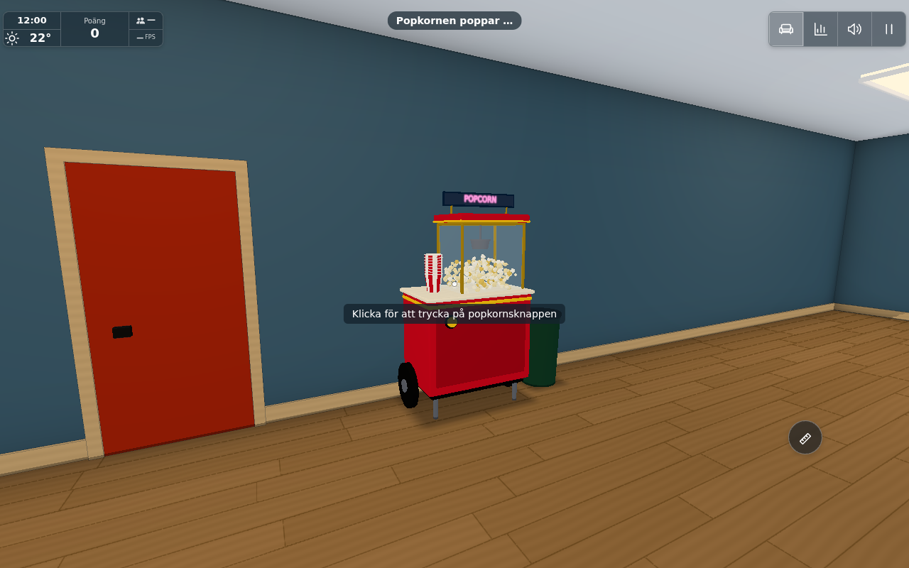
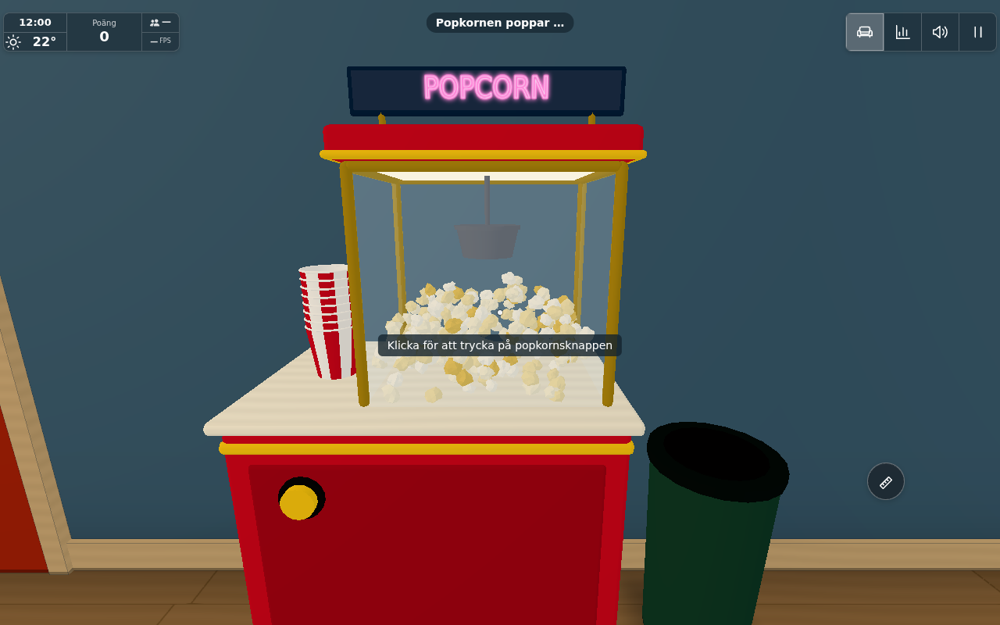
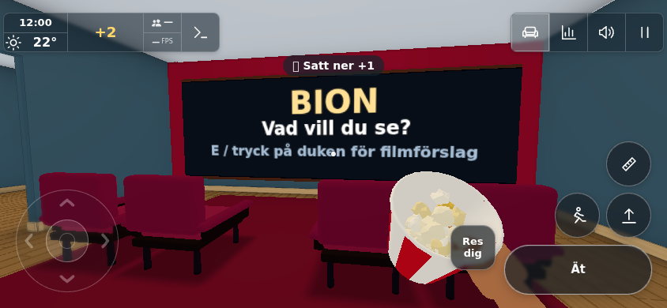

# Popcorn cart in the playhouse (#1567)

Recovered from the interrupted WSL checkout on base `697e3ed0d590b02a32bb160ba57412076edf1480`.
The final patch reuses Holdable, keep.js and life.keepPart; no new storage system,
food rewards, hunger mechanic, light source or public downstream content is added.

## Scoped verification

- `tools/popcorntest.html` through `tools/runtests.cjs --test-only`: **38 PASS**
  rows in 52 seconds, real World and production action button. Pop/gradual case fill,
  collision, take/fill, six visible bites while seated, refill, full/empty discard,
  automatic stack replenishment, re-pop, and page-made reload with a placed half-full
  tub plus a full tub in the hand. This is iteration/test-only, not full/test parity.
  The subsequent change only adds the room visibility gate for held/placed tubs;
  the driver below verifies that gate directly.
- `tools/popcorndrawtest.cjs`: actual pointer lock and native keyboard **E** start
  popping. Full-quality 1280×800 cart views; **844×390 with hasTouch and native tap**
  eats one bite while seated (five to four). **Zero page errors**. Final source
  SHA256s are in `source-hashes.json`, raw counts in `result.json`.
  The case/stack and glass add **2 draws** in the paired hall view (14→16);
  outside, removing all dynamic popcorn parts leaves **295→295 draws**, and the
  still-held tub is hidden. No room lights. Static cart/bin and sign/lamp share
  existing room batches. These are scoped counts, not a whole-world profile.
- Existing `clubhousetest.mjs` and `clubhousefinishtest.mjs`: **5/5 PASS**;
  partitions, passages, trim and exit threshold retain their layout. `git diff --check`
  and syntax checks pass. No house A/B/C/L architecture changes apply.

Chromium 1208 / SwiftShader in WSL with pinned Three.js 0.170.0; this establishes
functional/render behavior, not physical-phone performance or production multiplayer.
No external media playback is required by this snack interaction.

## Result images

Images were opened and inspected. The transient popping badge in the cart views
comes from the native E action while the fixture advances simulation time to the full
case. Publication, accessible embedded issue images and Pages validation are the
integration owner's remaining delivery gates. Original-only gameplay: no public port.
