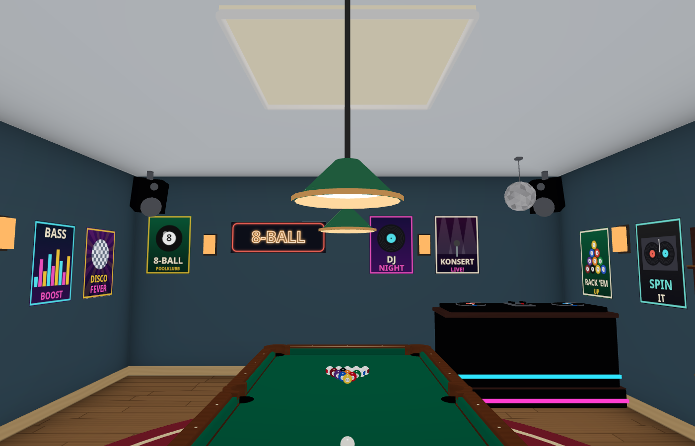
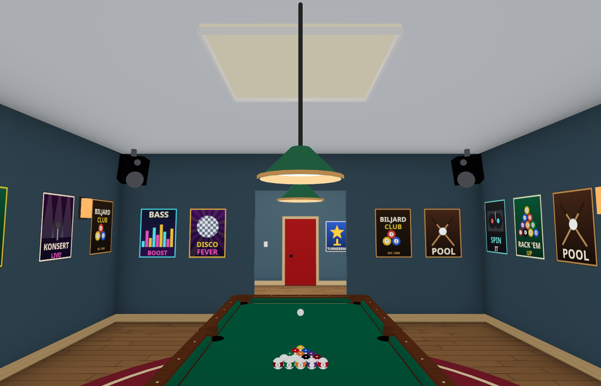

# Four speaker boxes below the ceiling, #1658

Source/images: `37734701325626e8534c7cec2ad19b9d50498a4d`.
The original 0.15 m centre drop was smaller than the tilted box's upward extent:
`(0.4*cos(0.35)+0.3*sin(0.35))/2 = 0.239309 m`.
The common drop is now 0.32 m, so all four boxes end at y=2.619309 below the
ceiling at y=2.7, leaving 80.69 mm clearance. The four x/z centres, orientation,
box dimensions, render batches and shared sound-position source are unchanged.

Checks:

- `node --test tools/playroommusictest.mjs tools/playroomposterslayout.test.mjs`: 17/17 passed. Lowering exposed the layout test's old ±0.5 m keepout cube crossing into the adjacent SPEL room; it now uses the actual oriented box bounds.
- `tools/browsertest.sh node tools/playroomspeakerstest.cjs http://localhost:8772 OUT`: observes the real production `BoxGeometry` after tilt/yaw/translation, before merging; all four ceiling/room bounds, downward/inward orientations and sound-source alignments pass. The largest geometry/audio centre difference is 0.046 mm (Float32 rounding). Raw values: [clearance-result.json](clearance-result.json).
- North/south pictures use the production `Playroom` component with normal non-disco ambient, antialiasing at 1400×900. No page/shader errors; peak 491 MiB, Chromium/SwiftShader. No physical phone, whole-world route or native-GPU performance claim. The ceiling mounts intentionally touch the ceiling; the speaker boxes are fully below it.

The pictures and green checks predate the unrelated DJ delivery rebase. The
speaker construction block is byte-identical afterwards (SHA256
`302f8c51bf87af304d7b0dd987b577f40183d3f26e344f471b0752e8f49cd110`);
its 0.32 m drop is retained. DJ documentation and changelog 1288 were preserved,
and the speaker entry uses 1289. No duplicate app run was needed.

[Pages](https://github.com/solwation/lunden-3d-apartment/actions/runs/40691112566)
and [Worker](https://github.com/solwation/lunden-3d-apartment/actions/runs/40691112543)
both succeeded. Published `version.json` returned `3773470`. Both pinned PNGs
returned HTTP 200 and were embedded in the [issue comment](https://github.com/solwation/lunden-3d-apartment/issues/1658#issuecomment-6469434490)
before the closing push.

A/B/C/L have no equivalent gameplay room variant. The public downstream excludes
this gameplay fixture, so no transfer applies. An unrelated older woofer/case
outline defect is tracked separately in #1669; it was not changed here.
