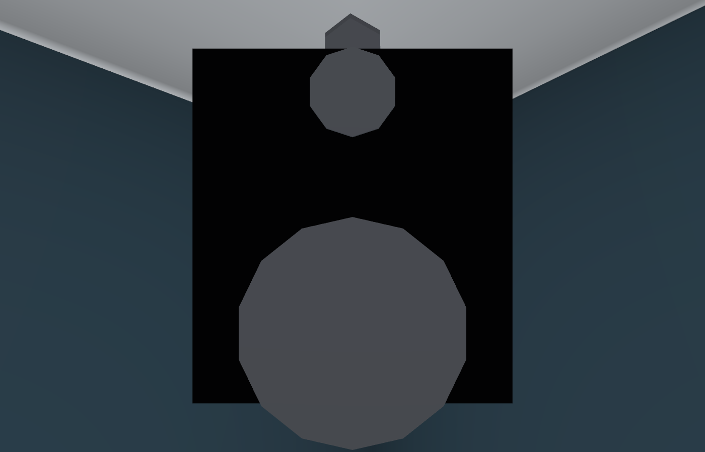
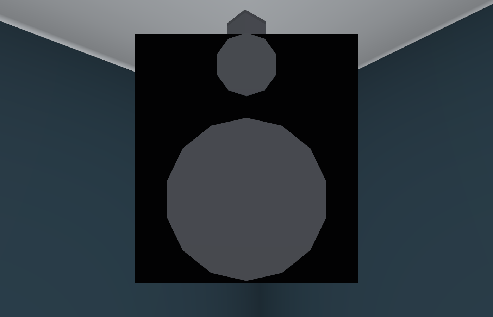

# Speaker front drivers within the boxes, #1669

Source/images: `12cab8b16808fe09f7583310bebbaae79297ba08`.
The woofer centre was -0.12 m with a 0.13 m radius, putting its lower edge
0.05 m below the 0.4 m case. `PLAYROOM.speakers.wooferY` is now -0.065 m:
the lower edge is -0.195 m, with 5 mm margin inside the case. Only the four
woofer centres move. Cases, tweeters, speaker/source positions, tilt and height stay.

Checks:

- `node --test tools/playroommusictest.mjs tools/playroomposterslayout.test.mjs`: 19/19 passed, including shared mixer transport and speaker positions.
- `tools/browsertest.sh node tools/playroomspeakerstest.cjs http://localhost:8772 OUT`: observes the eight actual production front-cylinder geometries after all transforms and projects every vertex against its case's actual right/up axes. All eight fit within x ±0.18 / y ±0.20 m (0.2 mm Float32 tolerance). Pre-fix main `8ce555ce`, with `WOOFER_BASELINE=1`, reproduced four lower edges at -0.249984 m; the fixed woofer edges are about -0.195 m. Raw fixed values: [result.json](result.json).
- Matched front closeups, production `Playroom` component, ordinary non-disco room lighting, AA at 1400×900. Pictures were inspected. No page/shader errors, Chromium/SwiftShader, peak 507 MiB. North/south component views keep the same 29/15 draws and 67044/66314 triangles before/after. No new meshes, lights or textures; no full-world or native-GPU performance claim.

The #1658 ceiling clearance remains 80.69 mm at all four boxes, with the same
inward/downward orientation and sound centres (maximum rounding error 0.046 mm).
No physical phone was tested. A/B/C/L have no equivalent gameplay room variant;
public downstream excludes this fixture, so no transfer applies.

[Pages](https://github.com/solwation/lunden-3d-apartment/actions/runs/40693488568)
and [Worker](https://github.com/solwation/lunden-3d-apartment/actions/runs/40693488503)
succeeded, and published `version.json` returned `12cab8b`. Both pinned images
returned HTTP 200 and were embedded in the [issue comment](https://github.com/solwation/lunden-3d-apartment/issues/1669#issuecomment-6469789516)
before the closing push. Changelog entry: 1290.
