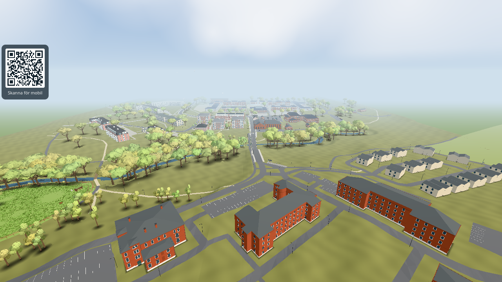
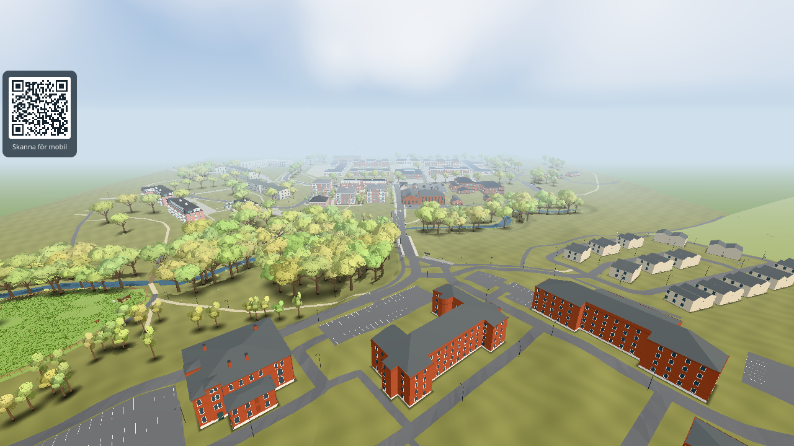
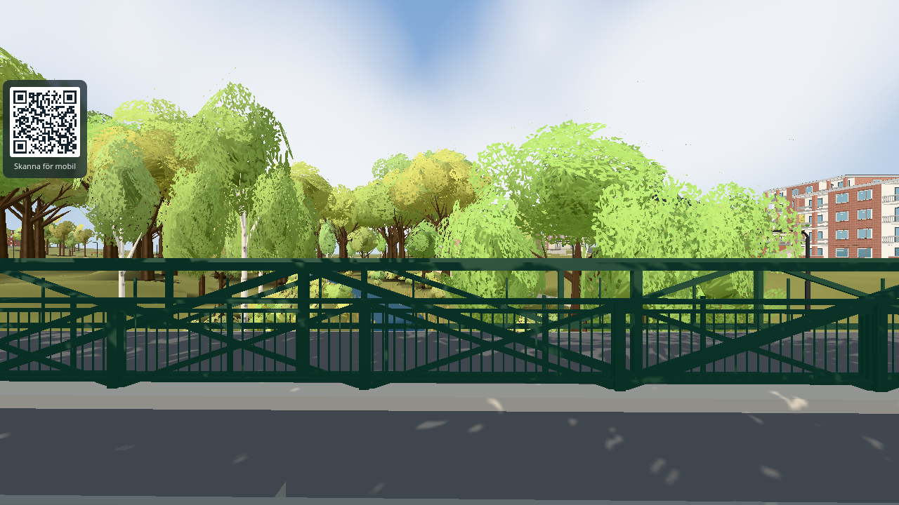
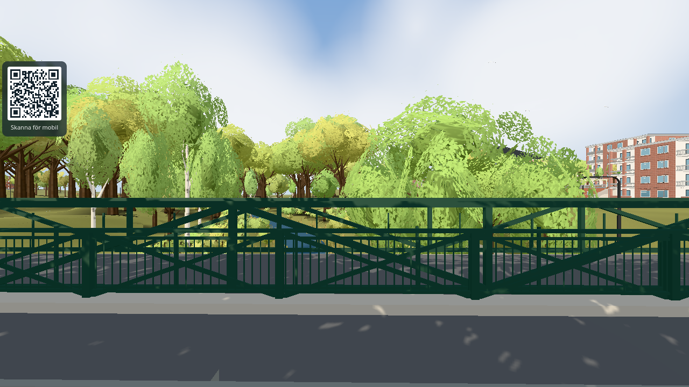
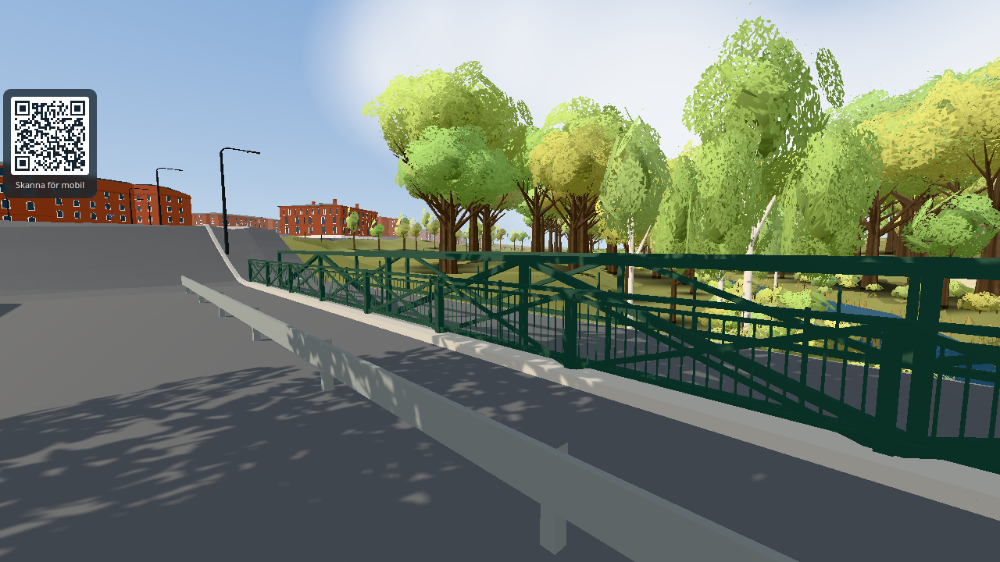
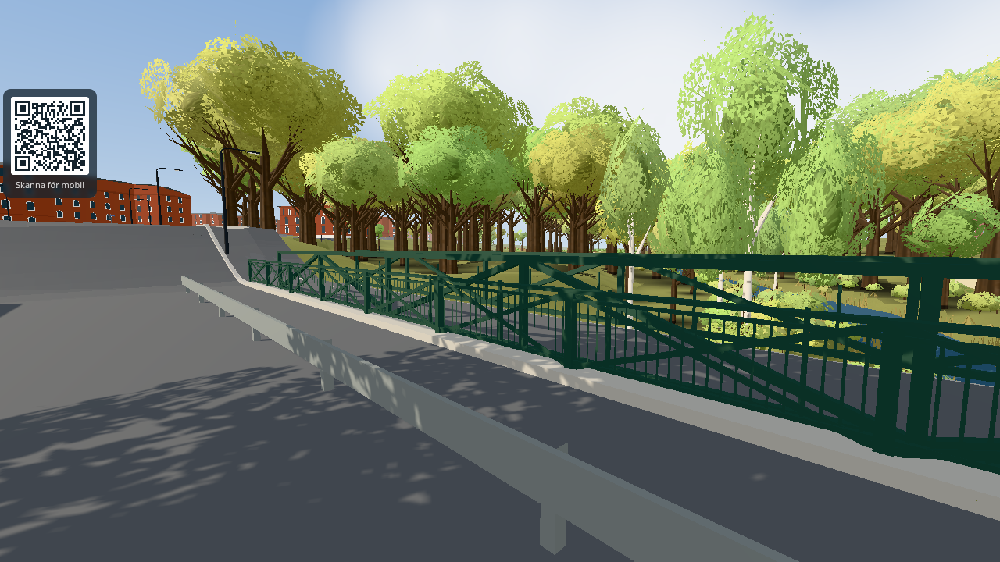

# #1674 Höje å valley as dense deciduous forest

Two new patches in `SITE.riverPark.patches`: `forest-165719099` (OSM `landuse=forest`, the wooded south slope towards the bus stop) and
`forest-333646812` (OSM `landuse=forest`, the north bank under Karpvägen). Big crowns (scale 1.7-2.5), at least 8.5 m apart, through the existing
shared instanced trunk/crown batches. 31 + 4 trees were placed (the north-bank strip is narrow and already had trees). Camera and options:
`?at=...&shot&time=13&month=9&day=20&freeze&weather=clear&cloud=` in headless Chromium (software GL, `&test=lazy` + full quality for the stills).

| View | Before | After |
|---|---|---|
| hoje-a-broarna-lagt (`at=11.3,370.1,-2,-20,88`) |  |  |
| On the road bridge looking west (`at=23.6,122,90,0,-3`) |  |  |
| On the road bridge looking south-west (`at=23.6,128,135,-5,-3`) |  |  |

## Budget (one render at each view, perfcount's counting, `origin/main` 939ec43a vs. this change)

| Profile | View | Draw calls | Triangles |
|---|---|---|---|
| desktop | hoje-a-broarna-lagt | 464 -> 464 | 1 111 431 -> 1 128 822 (+1.6 %) |
| desktop | bron-vast | 113 -> 113 | 532 954 -> 540 801 (+1.5 %) |
| desktop | bron-sydvast | 45 -> 45 | 347 418 -> 365 169 (+5.1 %) |
| desktop | campus from south-west (`at=101,352.1,13,-32,218`) | 412 -> 412 | 1 005 679 -> 1 022 676 (+1.7 %) |
| `&lowmem&quality=0` | hoje-a-broarna-lagt | 376 -> 377 | 878 359 -> 895 596 (+2.0 %) |
| `&lowmem&quality=0` | bron-vast | 138 -> 138 | 615 203 -> 631 384 (+2.6 %) |
| `&lowmem&quality=0` | bron-sydvast | 62 -> 62 | 402 879 -> 419 676 (+4.2 %) |
| `&lowmem&quality=0` | campus | 340 -> 341 | 768 299 -> 785 640 (+2.3 %) |

Frame time on software GL (SwiftShader, only relative, mean of 20 rAF at the last view): desktop 4945 -> 5203 ms, lowmem 1948 -> 1920 ms (noise).
No real phone fps was measured. The +1 draw call in lowmem is an instanced chunk that the new crowns bring into view; PERF budgets are unchanged.

## Checks

`node --test tools/squirrelbraintest.mjs` 9/9; `tools/terraintest.html` passes (no tree on asphalt or paving, test mode); `tools/riverparktest.html` extended with
the forest patches (fence, paths, glade, 8.5 m spacing).
