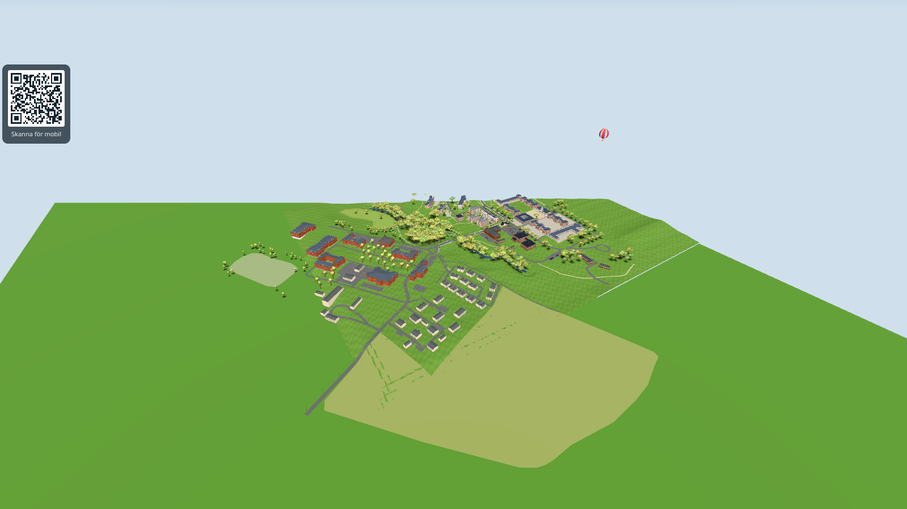
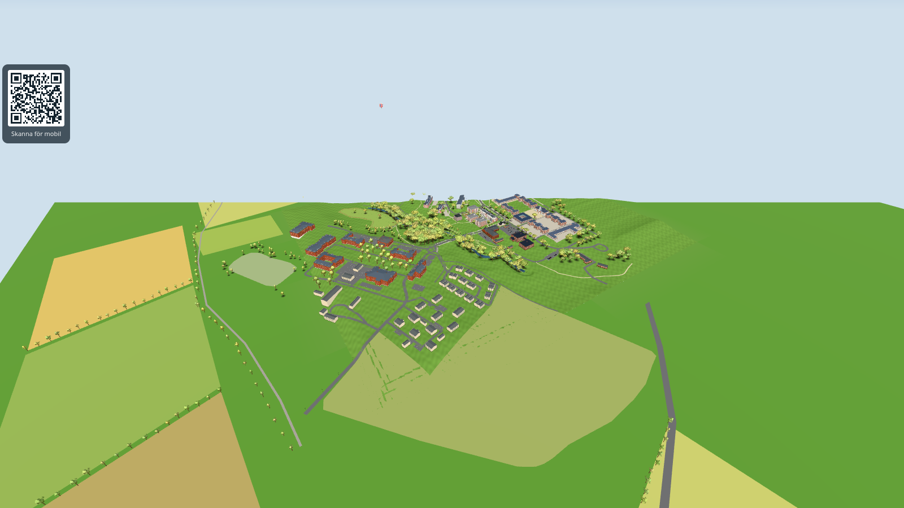
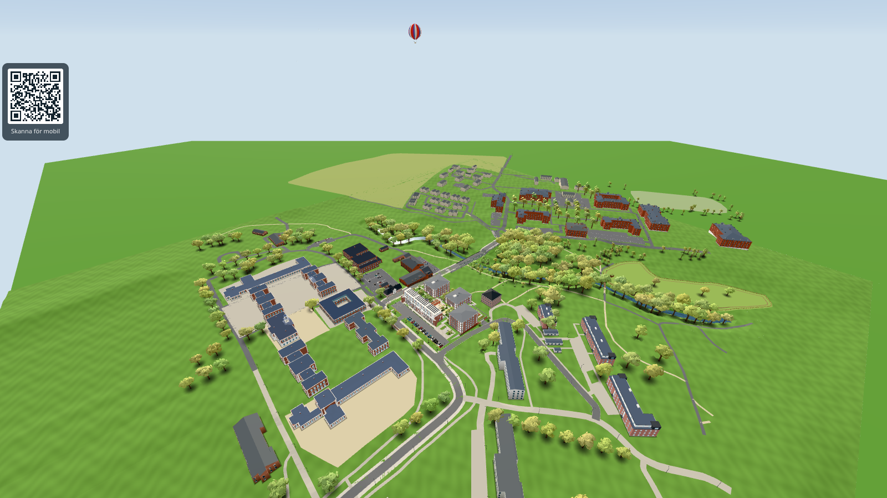
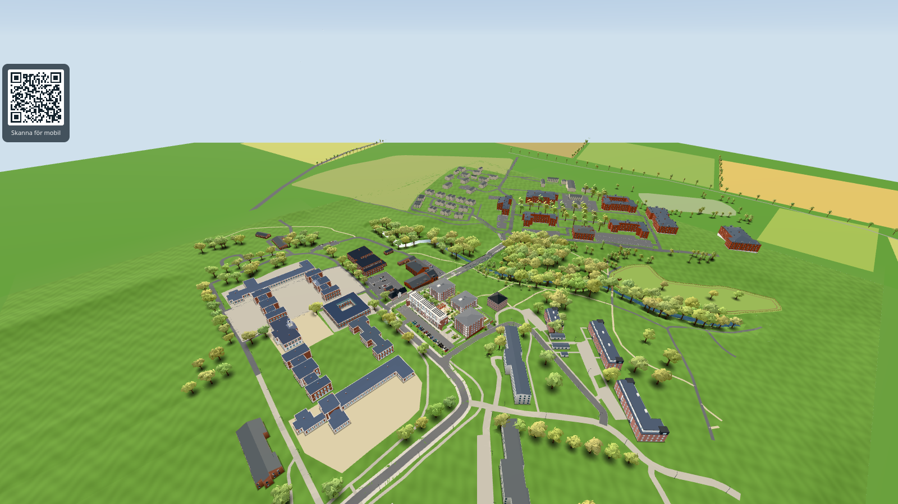
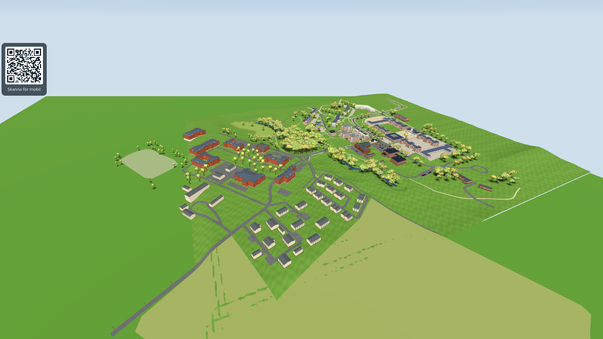
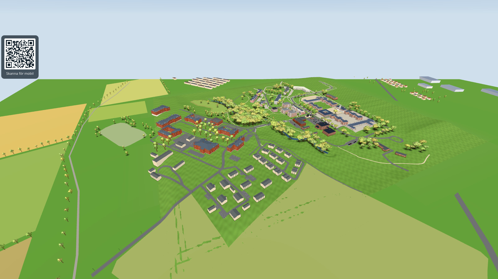
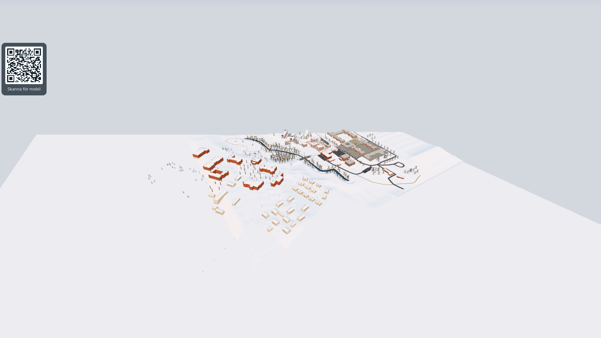
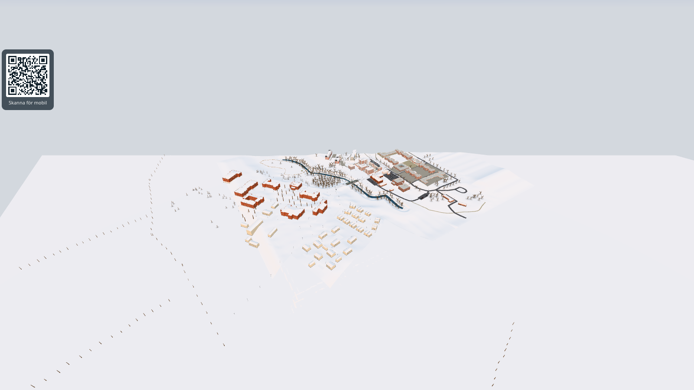
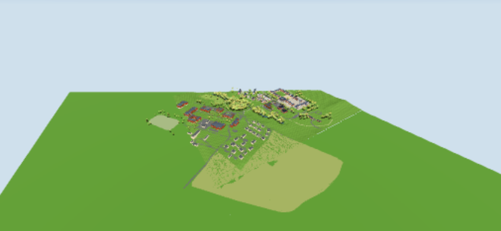
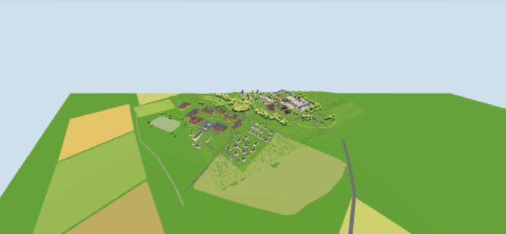

# #1682 världens kant: verification

Avlägsna kulisser utanför terrängrektangeln (`src/edgebackdrop.js`, `EDGE_BACKDROP` i `src/config.js`). Alla positioner är *guess* (avlästa ur Google 3D-vyerna, ±50 m). Bilder: swiftshader headless Chromium, `&shot&time=13&month=9&day=20&freeze&weather=clear&cloud=`, dimma och molndäck dolda i sidan (ingen kodändring), FOV 35. Kamerorna är `?at=` från `docs/references/google-3d-2026-10-29/README.md`.

| Vy | Före | Efter |
|---|---|---|
| hela-omradet-fran-soder |  |  |
| fran-norr-over-lunden |  |  |
| oversikt-fran-soder |  |  |
| hela-omradet, januari |  |  |
| hela-omradet, `&lowmem&quality=0` (844x390) |  |  |

Extra efter-vyer: `after-nw-radhus-och-hallar.png` (`at=-420,150,-60,-25,120`: radhusen vid Kallby ängaväg, villor och hallar i fjärran) och `after-ne-malmovagen.png` (`at=-60,-560,170,-20,60`: norra marken och Malmövägen; mjuk ramp mot terrängens norra kant, som står ~9 m över plattan).

## renderer.info (hela bildrutan, en `render`)

| Vy | Före calls / tris | Efter calls / tris |
|---|---|---|
| hela (desktop) | 395 / 996 452 | 397 / 1 016 061 |
| norr (desktop) | 384 / 876 376 | 385 / 895 097 |
| oversikt (desktop) | 398 / 1 022 078 | 399 / 1 040 799 |
| hela, januari (desktop) | 391 / 879 880 | 393 / 887 321 |
| hela, `&lowmem&quality=0` | 331 / 769 145 | 332 / 770 266 |
| marknivå `at=30,340,90,-6,4` (desktop) | 40 / 320 695 | 42 / 340 392 |
| marknivå, `&lowmem&quality=0` | 56 / 413 204 | 57 / 414 433 |

Kulisserna är två ritanrop (land 1 121 trianglar, hus 912) plus ~338 träd som instanser i de två befintliga trädbatcherna. Telefon (`lowMemory`): bara landnätet. Inga sidfel (`pageerror`) i någon av körningarna (desktop och lowmem, hela sidan).

## Kontroller

- `node tools/edgebackdroptest.mjs`: 20 PASS (inga lådor/fält/band inne i terrängrektangeln, inga fält som överlappar kartlagda södra fält, tonvariation, lager i stigande höjd, bandet följer terrängkantens höjd, deterministiska träd).
- `tools/southbackdroptest.html`: ALL PASS (75 PASS; kräver att kantträden räknas separat, se testet), `tools/terraintest.html`: ALL PASS (25 PASS).

## Begränsningar

- Husformer, åkrar och vägar är grova gissningar efter Google-bilderna, inte OSM-fotavtryck (inga fanns i ögonblicksbilderna för området utanför terrängen).
- Marknivå: ~19 k trianglar tillkommer (träden som en batch). Ej testat på riktig telefon; `&lowmem&quality=0` är bara en emulering.
- Terrängens östra kant (z > 30) och södra kant vid de kartlagda fälten får inget band (fälten korsar kanten); en tunn vit linje vid östra kanten fanns redan före ändringen.
