# #1685 More forest on the valley slopes

Five *guess* patches in `SITE.riverPark.patches` (`forest-west-north`, `forest-west-south`, `forest-east-north`, `forest-east-south`, `forest-bend-south`), 4-14 big crowns each (scale 1.7-2.5, 8.5 m apart), through the shared instanced batches. The pony paddock is excluded. Views: `?at=...&shot&time=13&month=9&day=20&freeze&weather=clear&cloud=&test=lazy`, software GL, desktop 1280x720.

| View (`at`) | Before | After |
|---|---|---|
| hoje-a-broarna-lagt (`11.3,370.1,-2,-20,88`) | 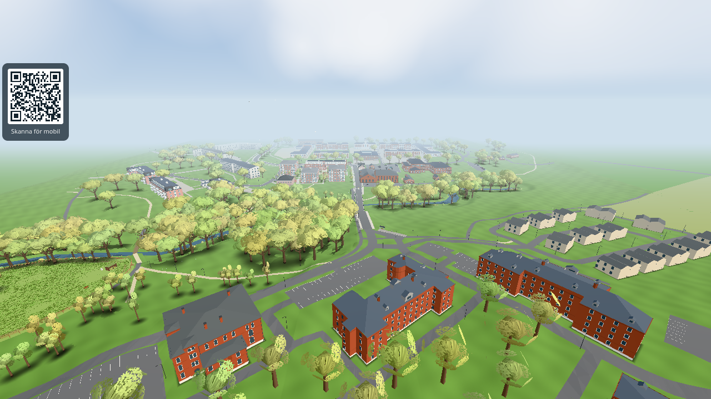 | 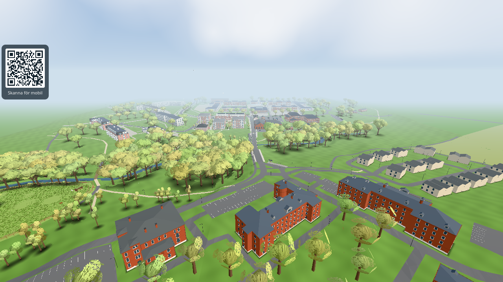 |
| West reach (`-110,172,90,-14,14`) | 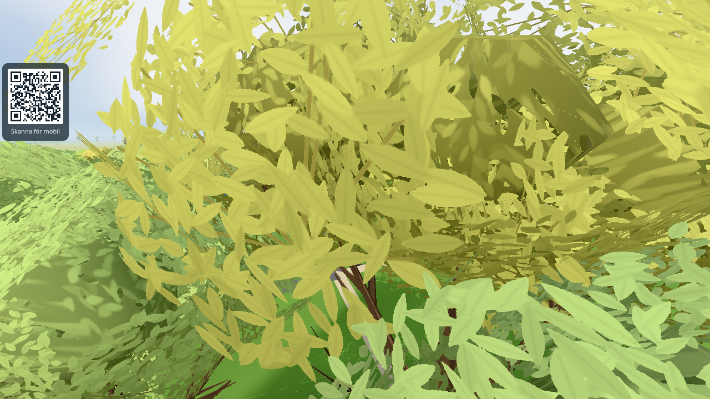 |  |
| Ground, north bank west (`-175,176,90,-4,4`) | 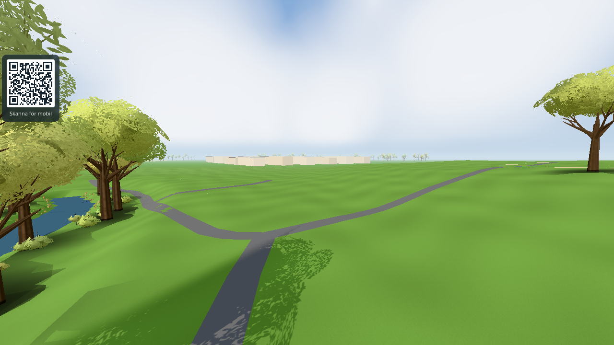 | 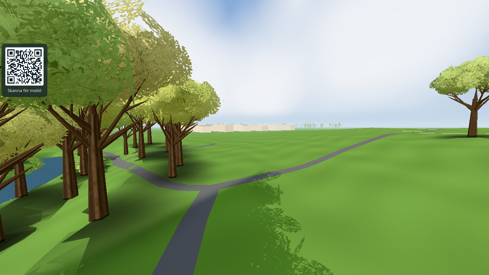 |
| East reach (`30,150,-90,-12,12`) | 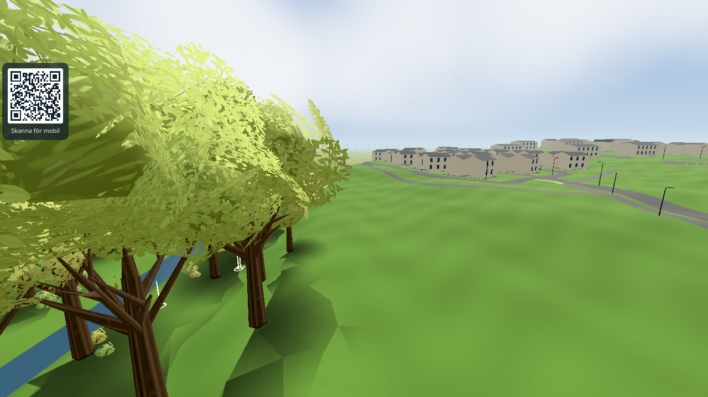 | 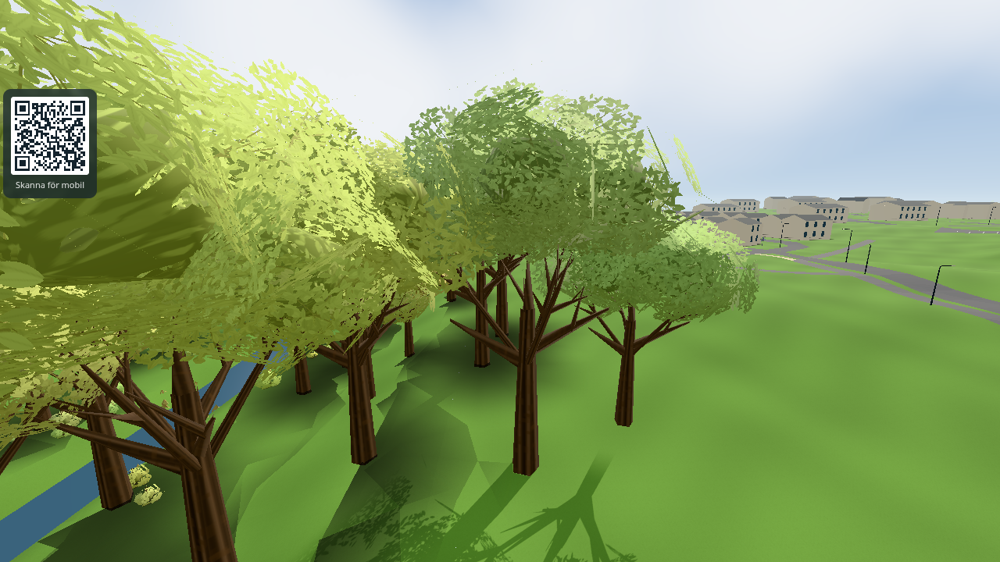 |
| Ground, north of the east reach (`90,92,-120,-4,4`) | 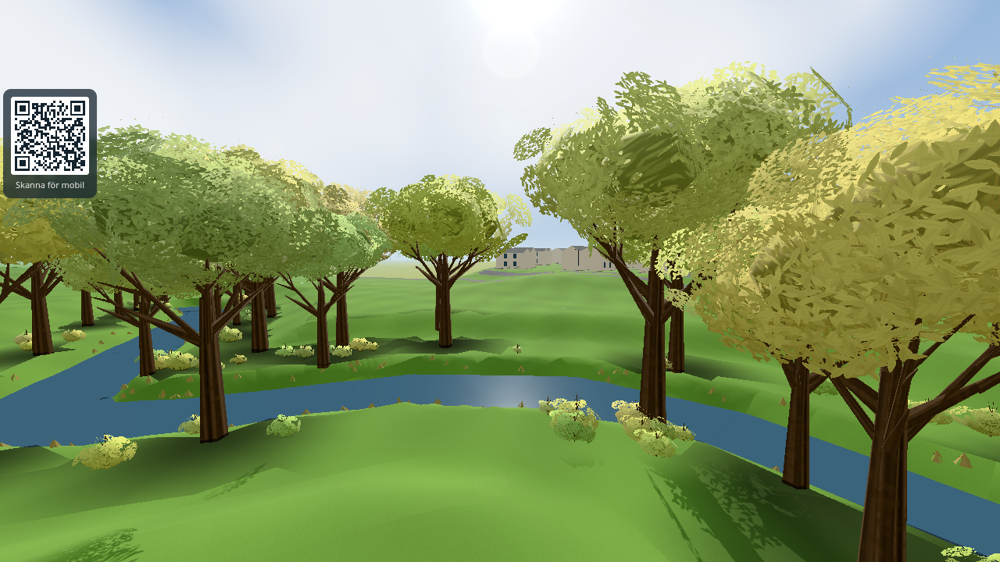 | 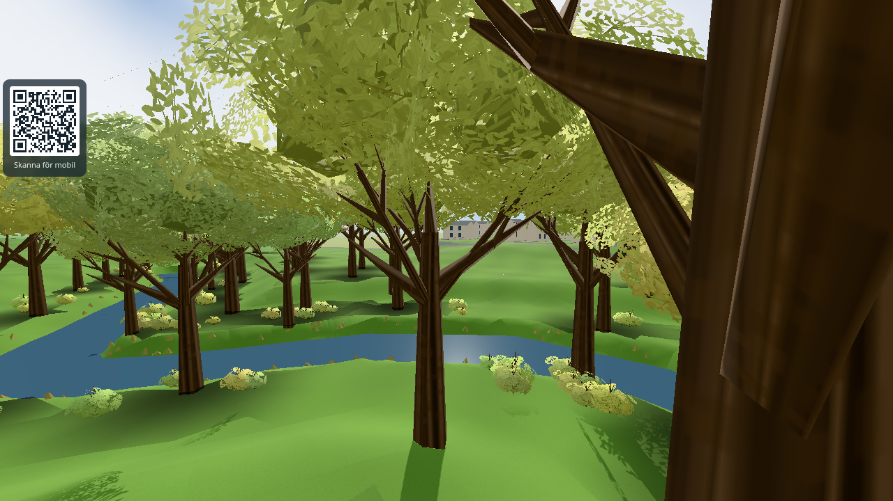 |
| Bridge south-west (`23.6,128,135,-5,-3`) | 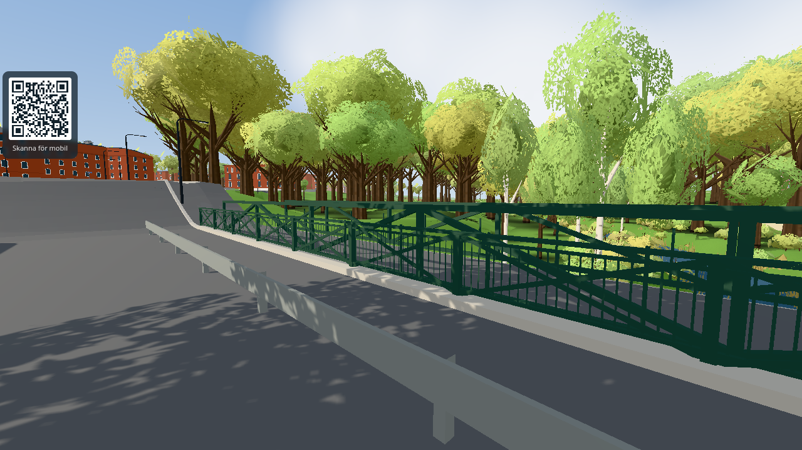 | 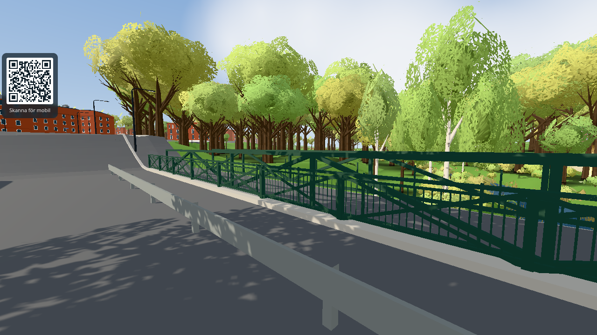 |

## renderer.info (one render per view, perfcount counting; before = origin/main 2c8c63be, after = this change before rebasing onto ed63071a)

| View | desktop calls | desktop triangles | lowmem calls | lowmem triangles |
|---|---|---|---|---|
| hoje-a-broarna-lagt | 479 -> 478 | 1 155 087 -> 1 168 364 (+1.1 %) | 390 -> 390 | 901 993 -> 917 678 (+1.7 %) |
| bron-vast | 116 -> 115 | 563 178 -> 571 667 (+1.5 %) | 140 -> 143 | 634 781 -> 649 670 (+2.3 %) |
| bron-sydvast | 48 -> 47 | 387 346 -> 395 715 (+2.2 %) | 64 -> 67 | 422 979 -> 437 812 (+3.5 %) |
| campus | 427 -> 427 | 1 048 985 -> 1 066 394 (+1.7 %) | 354 -> 357 | 792 029 -> 809 026 (+2.1 %) |
| valley-w | 42 -> 42 | 290 477 -> 299 722 (+3.2 %) | 51 -> 55 | 398 359 -> 406 658 (+2.1 %) |
| valley-n | 39 -> 39 | 270 495 -> 279 044 (+3.2 %) | 40 -> 44 | 332 961 -> 341 928 (+2.7 %) |
| valley-e | 39 -> 39 | 304 155 -> 313 882 (+3.2 %) | 50 -> 50 | 327 361 -> 337 794 (+3.2 %) |
| ground-n | 34 -> 33 | 250 902 -> 257 975 (+2.8 %) | 34 -> 34 | 275 183 -> 289 438 (+5.2 %) |

A first draft with 3 more patches and ~25 more trees gave up to +6.6 % in lowmem and was trimmed. Software-GL frame time is noise (desktop 4749 -> 4783 ms, lowmem 1662 -> 1702 ms). No phone fps measured. PERF budgets unchanged.
