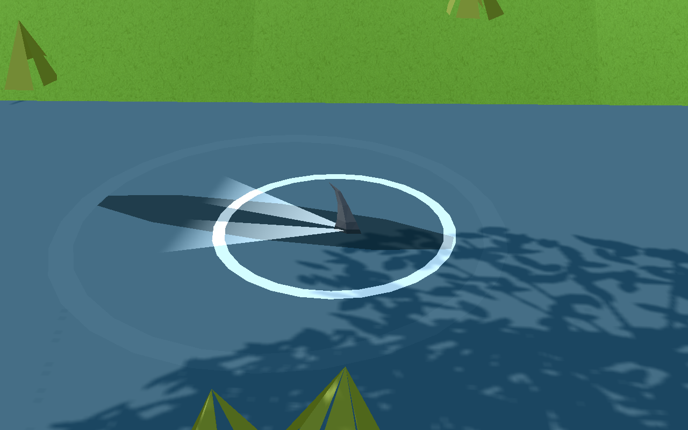
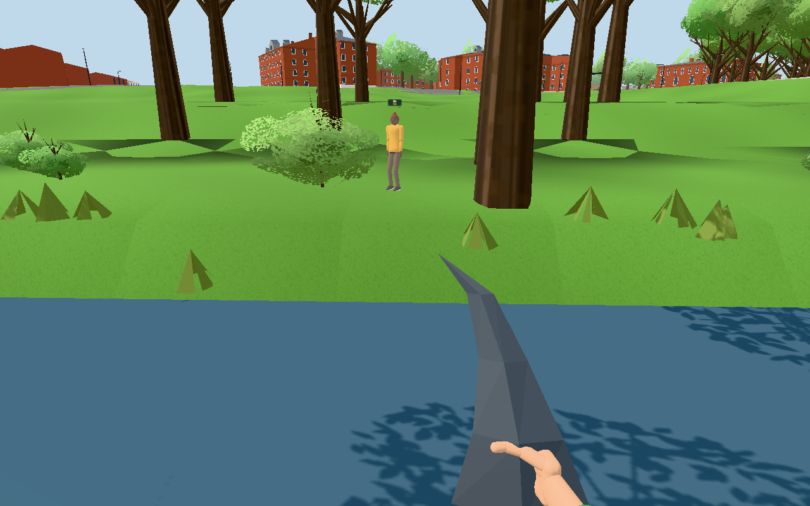
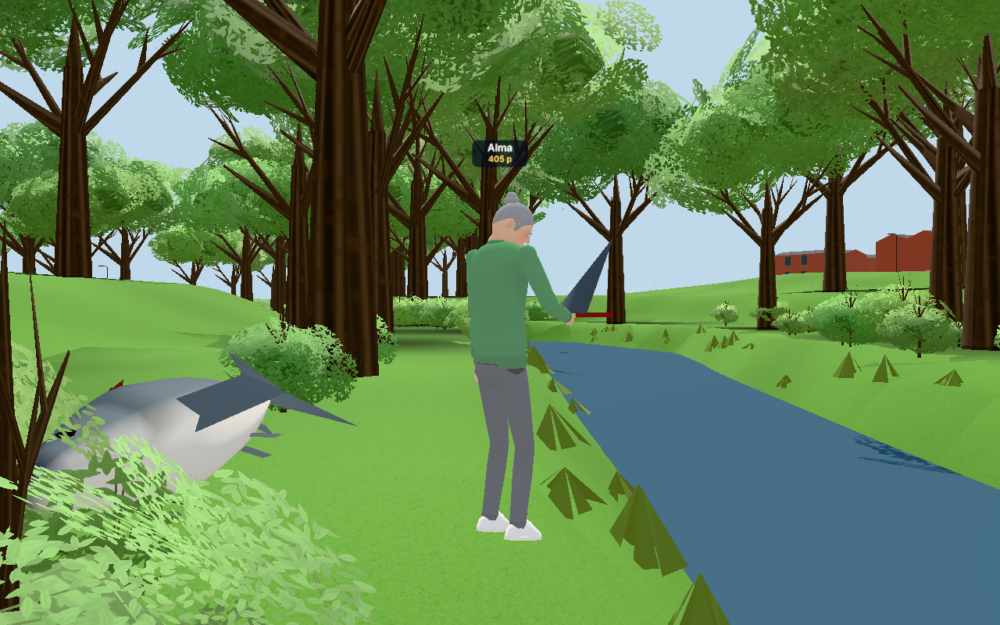
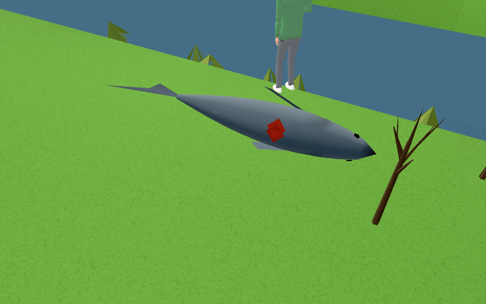
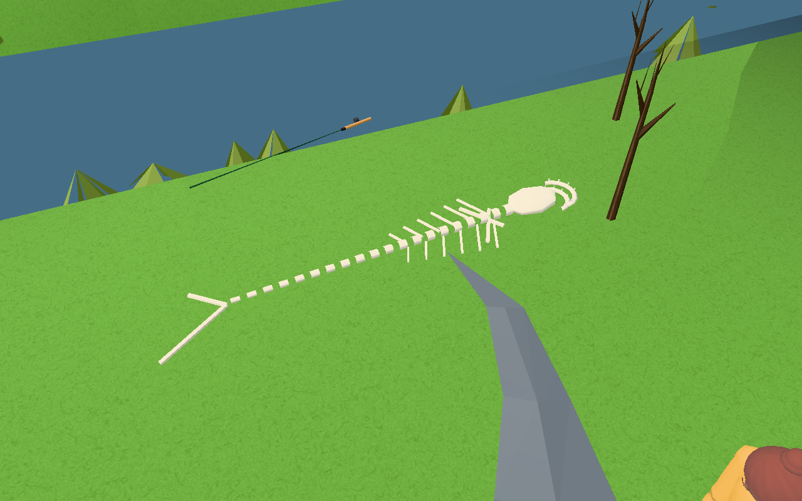

# #1769: hajfenan i Höje å

Tagna med `tools/sharktest.cjs` (två riktiga klienter mot `LUNDEN_SHARK_TEST=1 node cloudflare/dev.mjs`, testschemat: fönstret är öppet hela
dygnet) i juli kl. 12, klart väder. Hela körningen: 12 PASS / ALL PASSED.

| Bild | Visar |
|---|---|
|  | `fena-i-an.png`: hajens fena bryter ytan, en mörk skugga under, kölvattnet bakåt och ringar. Båda klienterna ser fenan på samma plats (2,5 cm isär). |
|  | `fena-i-handen.png`: A har dragit upp hajen; bara hajfenan hamnar i handen (kategori `sharkfin`). Spöet ligger vid fötterna. |
|  | `annan-spelare-fena.png`: B ser fenan (proxyn för `sharkfin`) i A:s hand. |
|  | `haj-pa-stranden.png`: hajkroppen ligger på sidan på stranden, på samma plats för båda, utan ryggfena (ett mörkrött sår där den satt). |
|  | `skelett.png`: med rummets klocka framflyttad en timme är hajen ett skelett för båda; ytterligare ett dygn senare är det borta. |

Bilderna av kroppen och skelettet är tagna snett ovanifrån stranden; buskar och träd i siktlinjen är dolda för bildens skull.
