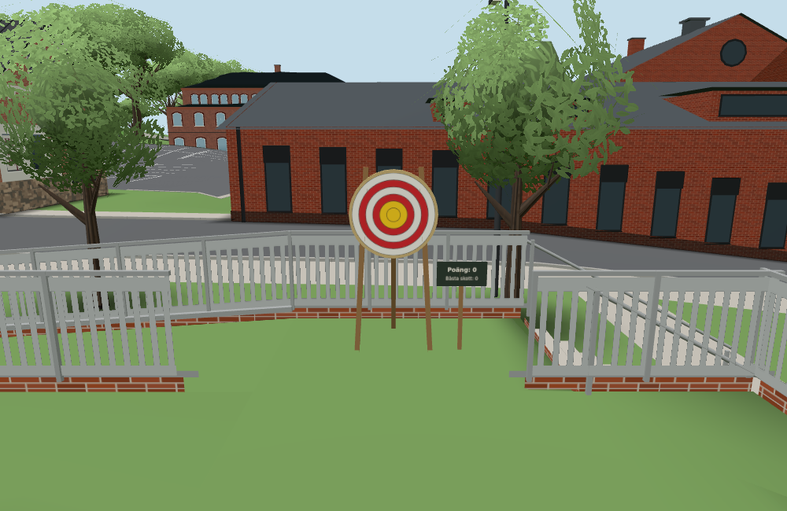
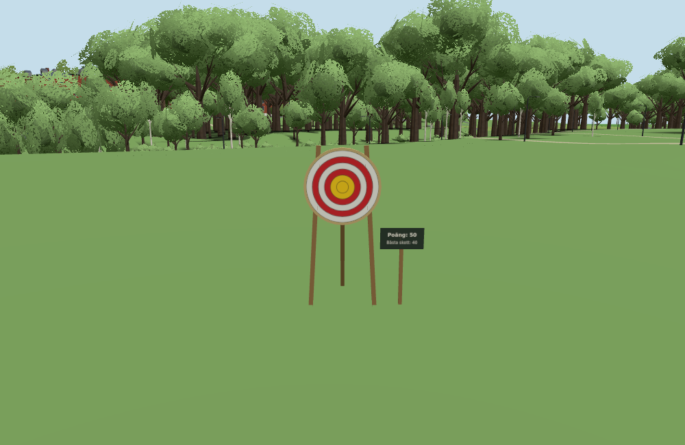

# Moving Nerf target (#1820)

Base: `f74e13d295a2837fb9ba460d165c81bd08904d8b`; changed runtime hashes in `sources.json`.
Runtime: Node 22.20.0, Chromium 1248 full browser with SwiftShader, Playwright from the existing local cache.
Actual Target/Ghosts modules and a real local PlayerRoom served this checkout on 8910/8912; apartment bootstrap was suppressed.

- `node --test tools/targetmovetest.mjs tools/targetscoretest.mjs cloudflare/deploypaths.test.mjs`: 8/8 pass.
  Includes every eligible 45–55 m hop, uniform random-choice intervals, shooter-facing math, origin fallback,
  offline relocation, room message bounds/rate/replay, two clients/late join, hibernation with existing sockets,
  continued scoring and a later join after original shooters leave, and the unchanged daily game-score ceiling.
- `node --test cloudflare/players.test.mjs`: 74/74 pass, including existing room/health/shot/state behaviour.
- `tools/browsertest.sh node tools/targetmovebrowser.cjs http://localhost:8910 http://localhost:8912 docs/verification/1820`:
  9 checks pass, zero page errors. Actual 40+10 board points caused one move. Two Target/Ghosts replicas and a late
  joiner had identical positions/yaw. The board sank at its old position before moving, rose to actual `groundY`
  and kept all 50 points on the shooter's board. Offline uses the same relocation rule.

The 51 conservative park-grass spots were inspected against actual `buildSurroundings`, `farWalls`, road/path exclusion
and stand/approach support samples, including 507 generated trees. Minimum actual obstacle clearance was 4.4565 m;
maximum ground relief across each 2×2 m stand/approach sample was 0.06230 m. Every spot has another inspected spot
45–55 m away, and all are connected to the starting position. The Worker samples eligible destinations uniformly;
it does not follow a fixed route. The atlas is a gameplay placement guess, not a survey.

`before-east-landing.png`: same actual board on its original east landing, local score zero.

`after-ring-face.png`: after the 50-point threshold, board at (-4, -3, 70), 47.26 m from its original position,
turned toward the triggering shooter; local board still reads 50 (best shot 40). The close camera is on nearby clear grass.

An attempted overview camera at (5, 2, 25.7) looked into House A, so that image was rejected and removed. The actual
triggering shot was from the east landing at approximately (11.45, 0, 25.7), with the target face one metre ahead.
The inspected stand/approach clearance proves nearby walkable viewing ground, not uninterrupted sight from the old
shooting position through intervening houses. No full-apartment traversal, physical-device performance, remote
production-player session or auditory listening test is claimed. Component draw counts in `result.json` are not a
production render-budget benchmark. Gameplay and its Worker protocol are original-only; no public port applies.

Verification setup fixes: initial scanner was started before its server remained alive, then rerun with the owned
foreground server and semantic DOM navigation. The invalid overview capture above was removed after inspection.
No unrelated green browser tests were repeated. One worker; session dispatch at approximately 07:51 UTC and handoff at approximately 08:07 UTC.
Active browser verification took under 5 minutes; queue waiting is separate. Conductor owns publication and closure.

Delivered implementation: `73b38e20f1d56cc2b8b132977453ae89d78d0f3c`.
[Pages run](https://github.com/solwation/lunden-3d-apartment/actions/runs/41601252146) and
[Worker run](https://github.com/solwation/lunden-3d-apartment/actions/runs/41601252238) succeeded.
The Worker log confirms an actual Wrangler deployment (version `5dbf1e9f-ac18-4f8c-8509-cc7c66ccf150`);
the public Pages version.json reports `73b38e2`. No additional production-player session was run.
