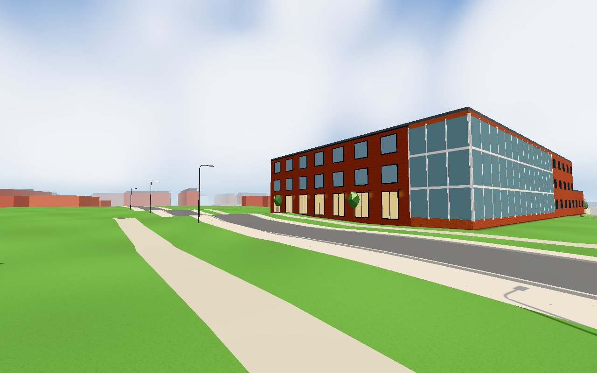
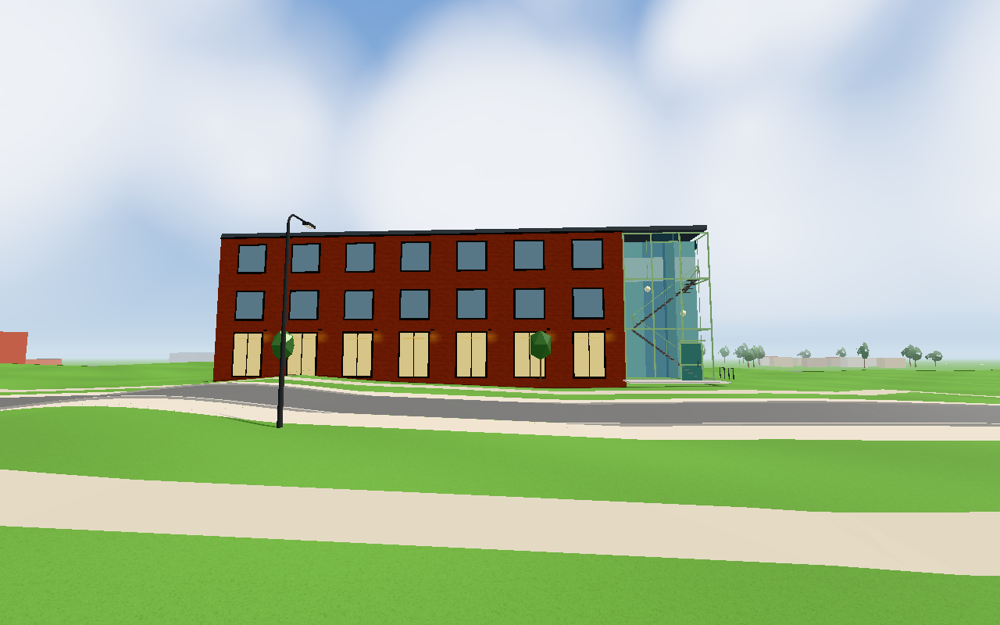
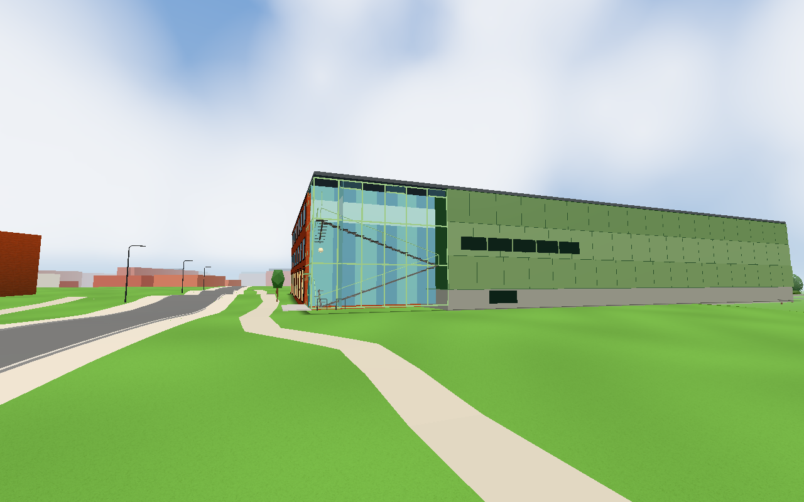
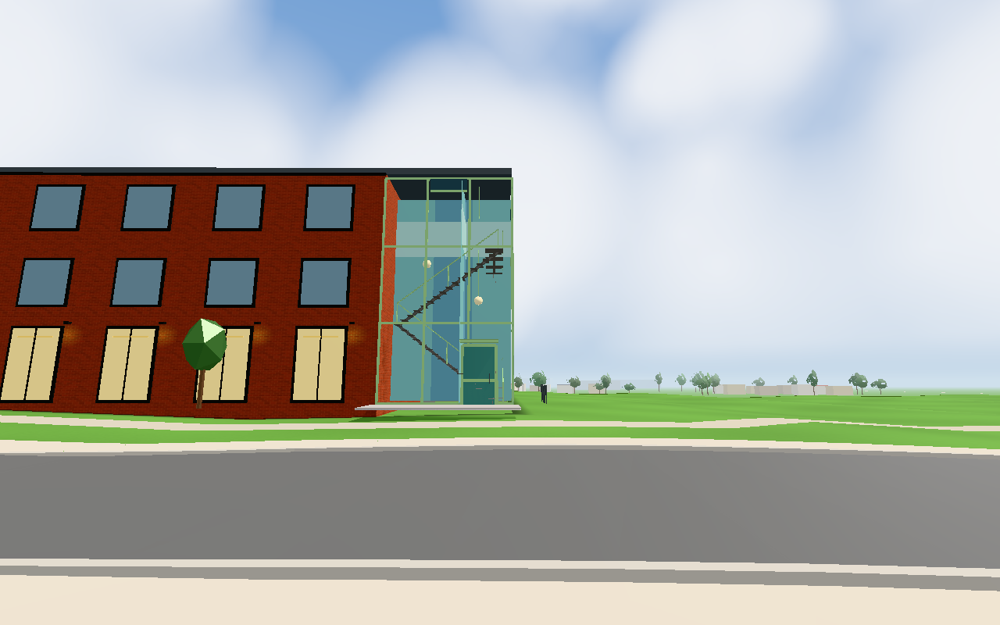

# Nordic Wellness glass entrance (#1823)

Base: `042cf8f4` (completed brick front #1822). Read the supplied front/side photographs in `docs/`.
Every entrance dimension, colour and volume subdivision is a photo-read guess, not a measurement.

The road strip stays 6 m wide, preserving all 21 front windows. The side wrap shrinks from 34 to 12 m,
with green profiles, opening lights, two stair flights and visible returns/rails, two globes, a decorative
road-facing glass door/canopy, paved entry pad and two hoop cycle stands. Blue backplanes and visible
geometry before them approximate reflective glass; there is no transparent material or actual interior.
No new light, material, texture, draw batch, interaction or walkable room is added.

## Combined dependency and revision evidence

The stairs require #1824's agreed 12×6 m cut in the opaque brick body. Both changes must be integrated
and published together, with the green hall beginning at x0+12. The actual-app images and east test below
route the exact frozen combined module/config from the two worker checkouts into the app. `combined-sources.json`
records hashes of each worker input and the composed inputs; no other production source was intercepted.
The conductor compares the final integration against those contracts before publication.

The hall worker's later cleanup centralises unchanged numeric offsets in `model.hall`. Its validator proves
byte-identical emitted geometry against the frozen combined capture source; no visual recapture is needed.
Combined emitted geometry SHA256: `b8036d92fd31cce02630397c8651bfcf1cd552d61871e3f2f808c73be8c52d61`.

- Scoped geometry: finite facade/roof/glass geometry, 21 visible front panes and seven unoccluded washes pass.
- Combined real geometry/rays: all 26 front/hall panes, seven washes, exposed treads in four flights
  (10/10/9/14 sampled hits), both globes and the decorative road door pass. Eave/roofY stays unchanged.
  Raw reproducible validator output is `combined-geometry.txt`; the script is supplied with #1824's evidence.
- Real app, Chromium/SwiftShader: road, side and entrance views captured with production rendering
  at 1280×800, June, noon and clear weather. No page errors were reported. Whole east geometry is
  87,703 triangles versus 86,873 before: +830 for both #1823 and #1824, below the existing 87,800 budget.
  The same 11 east mesh batches and nine scene lights remain; displayed views use 23/23/21 draws.
  Baseline views also use 23/23/21, though their camera framing differs, so these are not pixel/performance comparisons.
- `eastbackdroptest.html`: all affected geometry/source/window/budget checks pass, including 1,019/1,019
  exposed windows. Its old batch-count assertion fails on both baseline and final source: known #1833,
  filed separately before this work. The harness reports `SOME FAILED`; it is not described as wholly green.

## Images

Before: original dark corner glazing and grey profiles, with no visible stair or entry door.

Road: unchanged seven-bay brick front, with narrow green-profile entrance and visible staircase/globes on the right.

Side: 12 m entrance bay and visible switchback scene, adjoining the separate #1824 green hall.

Entrance: green door, crossbar/handle/canopy, shallow paving, lit-colour globes and stair railings.

The first baseline road/entrance cameras framed the brick face with the glass partly offscreen; those two
images were removed after review. The baseline side image remains useful but is not a matched camera comparison.
The building lies outside WALK, so the cameras are inspection views, not a claimed pedestrian traversal.
No physical phone, actual reflection of surrounding buildings, interior navigation, night lighting or hardware FPS
is certified. Houses A/B/C/L are unaffected: this is the single Nordic Wellness landmark builder.

Reproduction: use the existing pinned Three 0.170.0 loader and `buildNordicGym` component validator from #1824;
run the browser wrapper and the saved `capture.cjs GAME OUTPUT` driver against the final integrated checkout.
Camera coordinates, counts and source hashes are in the JSON files. Capture mode skips the apartment's heavy
warm-up only through existing `test=lazy`; `testkit.shot` restores full quality for each image.

One worker handled #1823, with the #1824 worker owning the single combined geometry validator. About 15 minutes
implementation and 5 minutes active visual/integration verification; no duplicate broad suites. The conductor
publishes images before closing, links actual deployments and tracks public transfer in kvarteret-lunden#240.

Integration review: #1823, #1824 and #1825 are delivered together. After conflict resolution the scoped native geometry check passes all 11 checks with the exact final geometry SHA `b34f6327b91af0c46b28a9f90a7e44a6a59eb93bd4b450d4810e73e6e31f66a8`: 87,712 campus triangles plus the separately verified two-triangle sign = 87,714. The hall/glass/front model values match the inspected frozen snapshot; the isolated sign module is byte-identical to its tested commit. Only this integration-sensitive component check and syntax/diff checks were repeated; accepted browser captures were reused with their documented source scopes. See [integration geometry](../1824/integration-geometry.txt).

Levererat i `46f7be89a6c8a4b601d9d2158a9097abc606bfaa`. [Pages](https://github.com/solwation/lunden-3d-apartment/actions/runs/41605499034) och [Worker](https://github.com/solwation/lunden-3d-apartment/actions/runs/41605499027) lyckades; Worker-loggen visar faktisk Wrangler-deploy och publicerad version.json bekräftar `46f7be8`. Samlad diff-/bild-/acceptansgranskning klar med redovisade begränsningar. Resultatbilderna ovan är permanent publicerade och bytekontrollerade före stängning. Avslutande verifieringscommit stänger ärendet; inga aktiva etiketter lämnas kvar.
