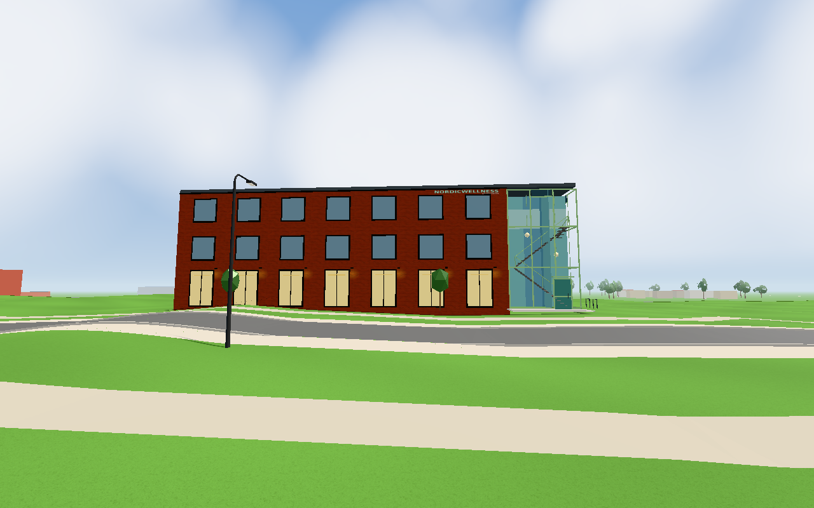
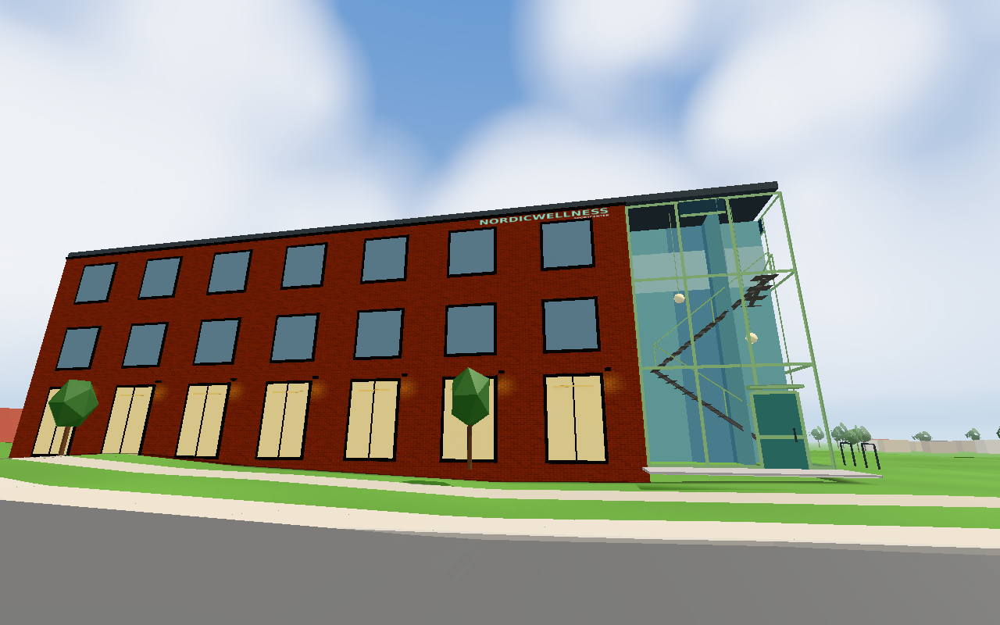
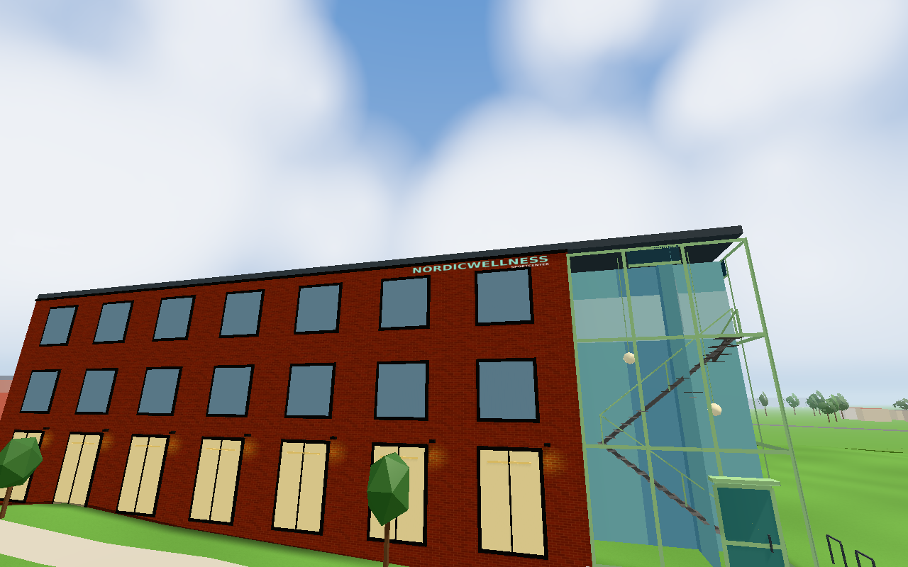

# Nordic Wellness facade sign (#1825)

Actual code base: `cb0e7409c304312f7a2578232e06e3ef9c92b55d` (published #1822 front).
The new change is isolated to `nordicgymsign.js`, its `sitebackdrop.js` hook and `model.front.sign`.
No #1823/#1824 implementation is duplicated in this commit.

The lettering is drawn directly with canvas text, not copied from a logo file: turquoise NORDICWELLNESS
above smaller white, right-aligned SPORTCENTER. The 6.8×0.52 m quad sits just below the roof above the
two right upper windows. Those dimensions, colour, offset, typography and 180 m cutoff are photo-read
or readability guesses. A native LOD shows one FrontSide quad nearby and an empty far level beyond
180 m. The static 1024×128 canvas uses the existing phone bitmap-release helper. There are no new
lights, shadows, per-frame painting, interaction or external image requests.

A small separate texture/material is justified because the existing facade glass batch has vertex
colours and no usable lettering atlas/UV layout. Changing all its windows and solar panels to share
an atlas would be a much wider change. Exactly one added draw is the explicit allowance in the issue.

## Evidence and source composition

`tools/browsertest.sh node tools/nordicgymsigntest.cjs GAME docs/verification/1825` passed all eight checks
on full Chromium with SwiftShader, zero page errors. The actual app was rendered with June/noon/clear
weather. The saved result records exact cameras, geometry, draw deltas, canvas colour counts and LOD states.

During parallel work, `GYM_SOURCE_DIR` explicitly supplied the reviewed final #1823/#1824 model/config,
plus only the new `front.sign` config. `sitebackdrop.js` and the sign module came directly from this
checkout. The final hall variant includes the parking-stripe correction (+9 triangles), already reflected
in these sign captures. `sources.json` records each exact worker/combined input; the conductor compares
final integration contracts before publication. No other application source was intercepted.

- One FrontSide quad, two triangles, two native LOD levels.
- Actual outward ray reaches the lettering before the brick facade; its bottom is above the upper
  window tops (16.09249 vs 16.01249 m) and its top below the roof eave (16.61249 vs 16.71249 m).
- The original canvas contains 28,452 turquoise pixels and 2,601 white pixels above the alpha threshold.
- At all three actual camera views, visible vs hidden sign on the identical scene/frame adds exactly
  one draw and two triangles (road 24 vs 23, footway/close 22 vs 21).
- Native LOD tests 179 → 181 → 179 m: visible → hidden → visible. It is not left permanently hidden after retreat.
- Combined east geometry: 87,714 triangles, within the unchanged 87,800 budget; nine existing scene lights.

The existing green facade/source/window checks from #1823/#1824 were reused. No broad scene suite was
repeated for this isolated two-triangle addition. The first fixture stopped immediately because readiness
referenced an undeclared `__app`; changing that fixture to `window.__app` allowed the complete green run.
This was a test setup correction, not a product failure.

Road overview: turquoise title above the two right upper windows, next to the green entrance bay.

Footway inspection view: the full facade and its title/subtitle remain legible together.

Close inspection view: self-drawn letters and the small right-aligned SPORTCENTER line below.

The building remains outside WALK, so camera poses are inspection views, not a claimed pedestrian route.
These Chromium/SwiftShader results establish rendering, placement and draw count, not physical-device FPS,
phone comfort or actual brand-font identity. The lettering is our approximation of the photographed sign.
No additional lower-window sign was necessary. Public transfer is already tracked by kvarteret-lunden#240.

One worker, about five minutes implementation and three minutes active browser verification; conductor
owns review, publication, image comment before closure and actual deployment verification.

Integration review: #1823, #1824 and #1825 are delivered together. After conflict resolution the scoped native geometry check passes all 11 checks with the exact final geometry SHA `b34f6327b91af0c46b28a9f90a7e44a6a59eb93bd4b450d4810e73e6e31f66a8`: 87,712 campus triangles plus the separately verified two-triangle sign = 87,714. The hall/glass/front model values match the inspected frozen snapshot; the isolated sign module is byte-identical to its tested commit. Only this integration-sensitive component check and syntax/diff checks were repeated; accepted browser captures were reused with their documented source scopes. See [integration geometry](../1824/integration-geometry.txt).
