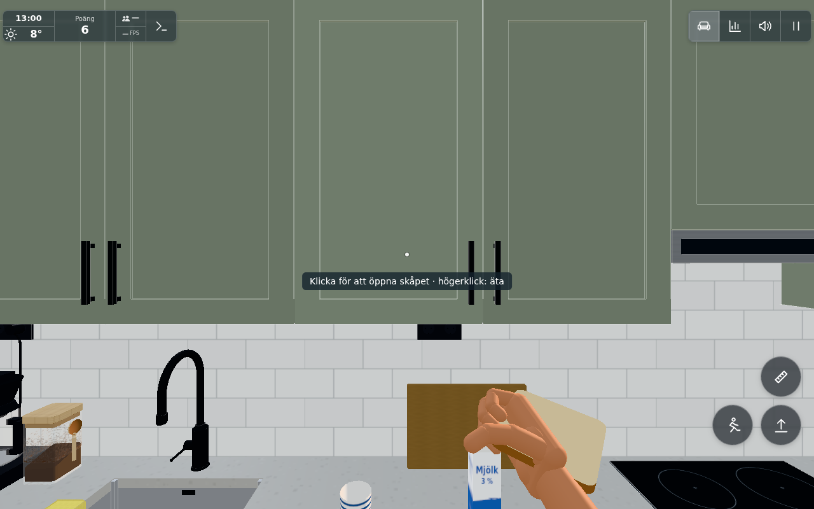
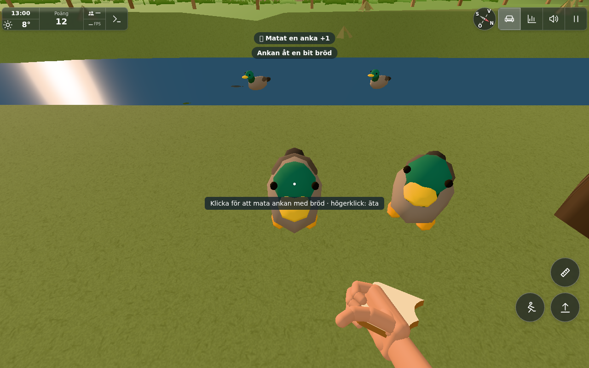
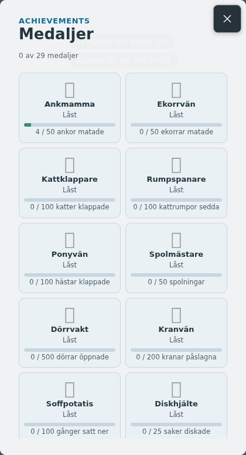

# Duck feeding rewards (#1827)

Base: `46f7be89a6c8a4b601d9d2158a9097abc606bfaa`; actual changed runtime/driver hashes in `sources.json`.
The existing four ducks, their per-duck cooldown/reach and finite Life bread consumption are unchanged.
A successful feed calls `bump('duckFeeds')` once, adds a badge, increments the medal/board counter and
credits6 direct points until120 direct points have been earned in the local calendar day (gameplay guesses).
The full counter continues after the daily cap. Existing ordinary medal-level bonuses remain separate.
Ankmamma starts at50 feeds; the counter is accepted by the Worker and has most/first board lists.

## Verification

- `node --test tools/duckrewardtest.mjs cloudflare/boards.test.mjs cloudflare/medals.test.mjs`:25/25 pass.
  Uses actual statistics bump/rawScore, with only autosave timer/pagehide registration stubbed in Node.
  100 feeds still count100 while direct reward stops at120; JSON persistence and next-day +6 pass.
  Invalid count credit is refused; finite bread, medal threshold/one-time payment and real Worker
  board storage/derivation pass. The initial Node fixture lacked `addEventListener`; adding that fixture
  stub corrected setup and produced the complete green run.
- `node tools/ducktest.mjs`:4 existing checks pass: swim/shore/motion/quacks, eating cooldown, four finite
  bites/removal and refusal of packages, stowed/stale/topped bread or a reserved action.
- `tools/browsertest.sh node tools/duckrewardbrowser.cjs GAME docs/verification/1827`:9/9 pass, zero page errors.
  Actual app/Items production pantry bag stays in pantry slot0; normal open/dispense reduces12→11 slices
  and puts one breadSlice in hand. No outdoor bag is created. The carry is real, though controlled kitchen/
  river spawns shorten the journey. Native E without bread grants nothing. The first successful native E
  consumes1/4 slice, adds exactly one feed and6 points (HUD6→12, where the earlier6 came from the cabinet).
  Repeated E during chewing gives nothing. Three native touch actions finish the same finite slice,
  producing4 feeds and24 direct duck points, then remove it. An empty-hand action afterwards gives nothing.
  The actual menu shows Ankmamma4/50. Raw values are in `result.json`.

## Result images

The held slice was dispensed from the existing kitchen pantry bag; this camera shows it carried inside the kitchen.

One native E feeding: a real quarter-bite is missing, the duck badge is visible and the HUD score has risen6→12.

Actual medal menu after the same slice's four bites: Ankmamma4/50, with its normal progress bar.

No full walking route, physical phone performance or fresh production player is claimed. Native keyboard and
emulated touch exercise the existing controls; these are Chromium/SwiftShader views. No new geometry, texture,
light or rendering loop was added. The kitchen bread source remains the only ordinary stock source; no restocking
or food lifecycle logic changed. Rewards are original-only gameplay, so no public-project transfer applies.

One worker, about8 minutes implementation and3 minutes active verification. The gym sibling used separate
keys/anchors; conductor owns the shared stats merge, one targeted combined ledger check, publication and closure.

Levererat i `a500445725edbc72d5866f2d947851e14435c649`. [Pages](https://github.com/solwation/lunden-3d-apartment/actions/runs/41607090023) och [Worker](https://github.com/solwation/lunden-3d-apartment/actions/runs/41607089936) lyckades; Worker-loggen bekräftar faktisk Wrangler-deploy och den publika sidans version.json visar `a500445`. Dirigentens kombinerade diff-/bildgranskning är klar. Bild-URL:erna ovan är åtkomliga och bytekontrollerade. Ingen rutinmässig omkörning av gröna kontroller efter orelaterad integration. Ärendet stängs genom efterföljande verifieringscommit och aktiva etiketter tas bort.
