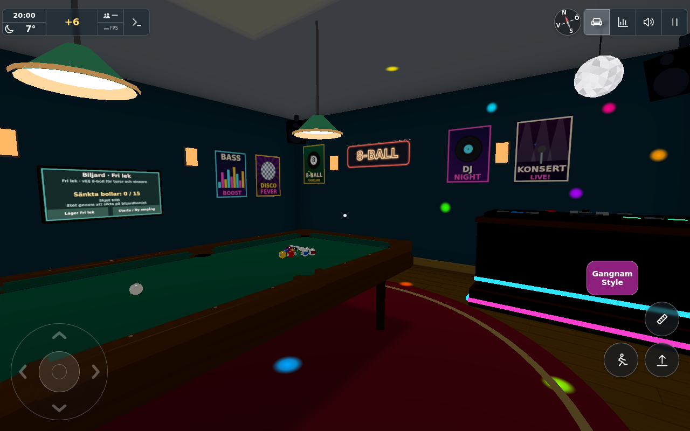
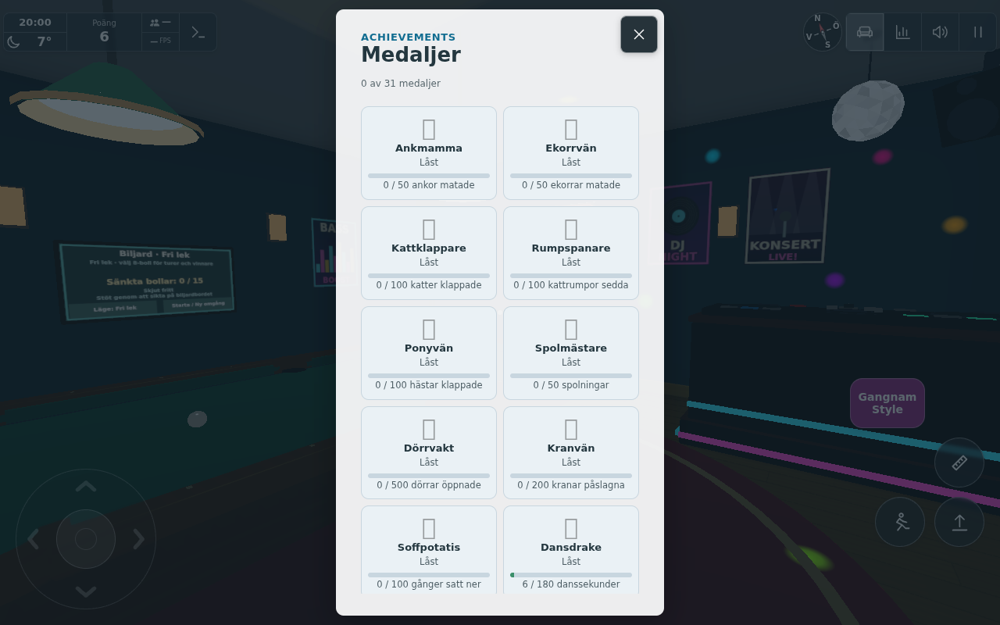

# Disco rewards (#1829)

Base: `04dcf10f`. Gameplay only; no applicable public downstream transfer.

Whole dance seconds count only while actively playing inside the BILJARD/disco bounds, dancing and with
room music playing. Menus, background visibility, reading, measuring, avatar customisation, other rooms,
paused/stopped music and nonpositive/long (>1 s) intervals reset the partial second. Floss/Gangnam share
the counter; toggles themselves grant nothing. No per-frame badge or medal evaluation is added.

Product guesses: 1 direct point/second, capped at 30 points/local calendar day; the seconds counter keeps
advancing after the cap. The saved ledger survives reload and has its own day key, preserving duck/gym
rewards. Dansdrake starts at 180 seconds (three minutes); existing medal level bonuses are separate from
the direct daily points cap. The Worker accepts the shared `danceSeconds` counter at 60/minute and derives
the same medal catalogue.

Checks:
- `node --test tools/dancerewardtest.mjs`: three scoped tests pass; [raw output](node.txt).
- Actual Chromium/SwiftShader app: child entrance uses the production playhouse action, controlled spawn
  to DJ and disco floor, native touch action on physical play0, native dance button, actual unpaused local
  audio element. 360 controlled production steps at 1/60 s yield six seconds and six points; after stop,
  120 steps yield none. [Result](browser.json), [raw output](browser.txt).
- `git diff --check` passes.

Limits: automated desktop Chromium with touch input enabled, no physical-phone or two-client claim.
The browser uses test-mode rendering and controlled spawns/steps, not a continuous walk or a real-time
six-second timing benchmark. Worker catalogue acceptance is exercised in Node, not a deployed Worker.
Initial fixture attempt incorrectly sent E in touch mode without pointer lock; the corrected fixture
uses the normal native start-touch handshake and touch action button, without application workarounds.
Both result images were inspected: visible +6 and active floss (next choice Gangnam Style); visible
Dansdrake 6/180. Emoji fonts are absent in this headless environment.

Source hashes: [SHA-256 manifest](source-sha256.txt). Images and raw output correspond to these sources.

Integration: the catfish and dance catalogue rows were merged together. The scoped dance/cat/gym/duck suites pass 16/16 on the combined source (integration-statistics.txt in #1829 evidence); existing counters and daily ledgers are preserved. Individual browser captures preceded the sibling catalogue merge, which only adds another independent medal card; the tested feeding/dancing progress is unchanged. No duplicate browser run was needed.

Levererat i `79228f12235c0a6e99330e16ec61c0b093f27ce2`. [Pages](https://github.com/solwation/lunden-3d-apartment/actions/runs/41614231300) och [Worker](https://github.com/solwation/lunden-3d-apartment/actions/runs/41614231195) lyckades; Worker-loggen bekräftar faktisk Wrangler-deploy och den publika sidans version.json visar `79228f1`. Dirigentens kombinerade diff-/bildgranskning är klar. Verifieringslänkarna ovan är permanenta; eventuella resultatbilder är granskade och bytekontrollerade. Ingen rutinmässig omkörning av gröna kontroller efter orelaterad integration. Ärendet stängs genom efterföljande verifieringscommit och aktiva etiketter tas bort.
