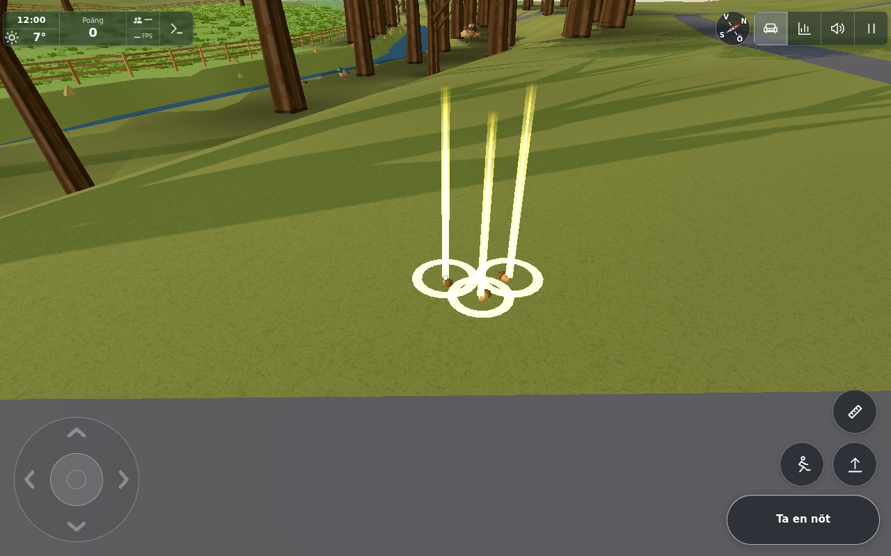
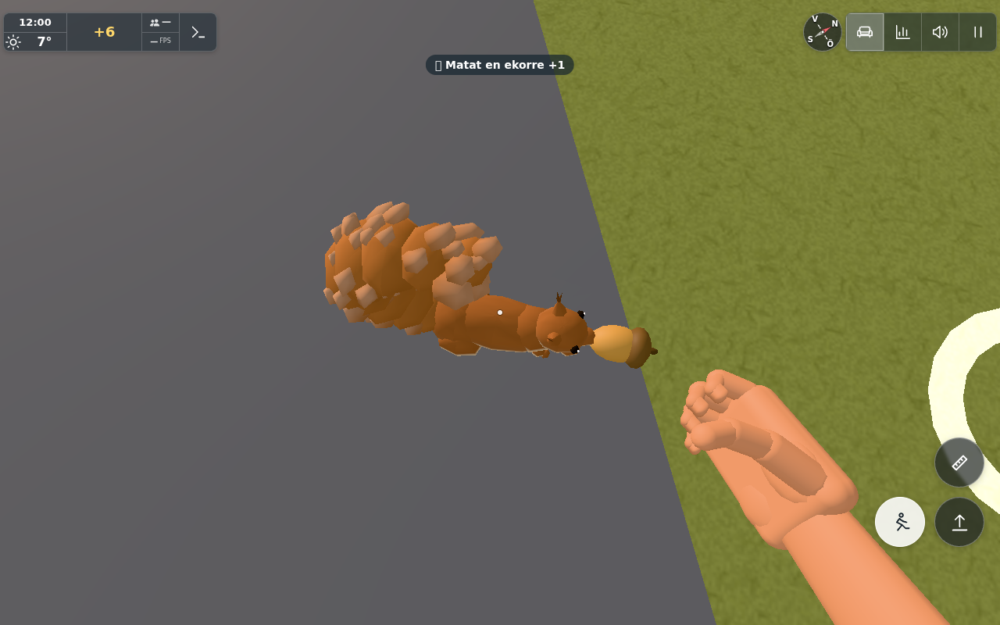

# Easier nuts by the river (#1831)

Base: `a5004457`; changed source/driver hashes in `sources.json`. The original report photo is
`docs/ingame-reports/d6bf0a9a-e172-48f1-8980-c75ca53a1b68.jpg` and was inspected before work.
It shows ordinary river-park grass/path with no visible nuts. Existing placement could spread all20 nuts
across a large tree/visitor region, while their existing glints are intentionally visible only within8m.

Eight of the existing20 slots now return to four small, predictable grass-edge pairs beside sourced
river footpaths. Candidate selection is deterministic from the existing paths, trees, ground and
collision segments, with guessed anchors/tuning in `SQUIRRELS.pathNuts`. The other12 slots retain their
existing random tree/heap placement, so they may also add nuts beside a preferred pair.
No slot count, nut size, marker size/distance, AI or sync protocol changed. No distant beacon or new
material, texture, light or mesh was added. The path search runs once during scene construction.

## Verification

- `node --test tools/nutpathtest.mjs cloudflare/squirrels.test.mjs`:13/13 pass. Deterministic pairs,
  source/path/tree proximity, invalid/steep/fenced/trunk-blocked rejection, original cap, held/put state,
  respawn/new birth, winter and safe fallback all pass. Existing room snapshot/claim/feed validation passes.
- Existing `node tools/squirrelbraintest.mjs`:27 pass, zero failures, three legacy real-map tests skipped
  because bare Three was not resolvable in that Node invocation. This is recorded as partial evidence;
  no skipped test is called passed. Actual scene paths/trees/collision are exercised by the browser below.
- `tools/browsertest.sh node tools/nutpathbrowser.cjs GAME docs/verification/1831`:8/8 pass,
  zero page errors. Eight actual preferred slots match four path-edge pairs, total stays within20,
  glints are visible from the path and the existing8m cutoff is retained. Native E picks one of these
  exact generated nuts. Ordinary crouching/stillness triggers approach → take, consumes it and grants
  one squirrel feed/+6 points/hearts. The consumed slot is removed normally.

Actual preferred pairs use sourced path51890086 near(-141.5,182.7) and path44447963 near(-73.2,144.4),
(-21.7,119.5) and(-109.6,164.6). Each is1m outside that path's edge, within14m of a squirrel tree,
at least1.2m from a trunk, with a sampled approach kept0.8m from collision segments and within0.18m
of the path's ground level. The node file tests blocked/steep cases; the actual production selector
uses those same predicates with real `farWalls`, terrain, water/road/path and grove exclusions.

`NutField` holds and put-down live nuts are not moved back to a hub. Only a dead/expired/consumed slot
spawns at its preferred point, using the same respawn wait, incremented birth id and ordinary sync
snapshot. The unchanged room protocol was checked; no extra two-browser sync run was needed for a
placement-only change with identical slots, messages and claims.

Existing short-range glints and nut meshes at the grass edge of the real river path. A third ordinary
heap nut joined the preferred pair in this deterministic fixture; it remains inside the same20-slot cap.

The normally picked-up nut has been taken by the squirrel; the badge and +6 reward appear, with the
normal nut-in-mouth pose and empty hand. Feeding code and rewards are unchanged.

Cameras use actual Player ground and ordinary native pickup. Controlled spawns shorten travel to the
selected path; one squirrel is placed on a nearby dry reachable approach and its ordinary foraging
state is prepared so the test does not wait for random roaming. The approach/take/consume/score flow
itself is production code. These are Chromium/SwiftShader views, not continuous traversal, a new
production player's experience or physical-device performance. Winter and held/put/respawn semantics
are additionally checked as pure bookkeeping. The brighter close view uses existing markers; it is not
an increase to distant visibility.

One worker, about12 minutes implementation/preparation and3 minutes active browser verification.
The conductor owns review, evidence publication and closure. No public transfer applies:
kvarteret-lunden#237 explicitly excludes collectible nuts and feeding.

Levererat i `16cd96b05e8572b6f87827d3df16fddfeca44157`. [Pages](https://github.com/solwation/lunden-3d-apartment/actions/runs/41610236543) och [Worker](https://github.com/solwation/lunden-3d-apartment/actions/runs/41610236579) lyckades; Worker-loggen bekräftar faktisk Wrangler-deploy och den publika sidans version.json visar `16cd96b`. Dirigentens kombinerade diff-/bildgranskning är klar. Bild-URL:erna ovan är åtkomliga och bytekontrollerade. Ingen rutinmässig omkörning av gröna kontroller efter orelaterad integration. Ärendet stängs genom efterföljande verifieringscommit och aktiva etiketter tas bort.
