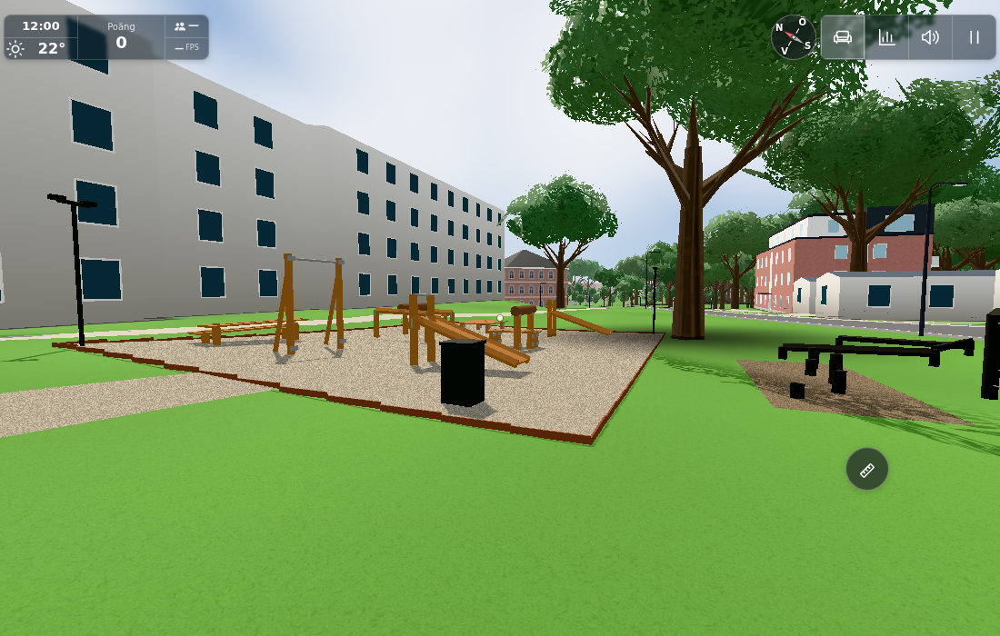
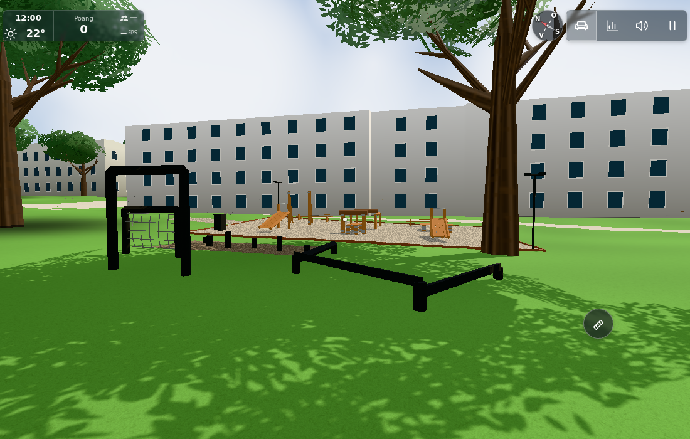

# Photo-read outdoor gym (#1835)

Base `786d75c102f89246f778953acbe8bed0adb7a2a4`; all six new reference photographs were inspected before
modelling. Only this original repository retains those references. Public transfer is separately tracked
in kvarteret-lunden #243 and must omit photographs, photographer identity and gameplay.

The larger 18×12 m gravel pad has a terrain-following corten edge and short gravel access spur. Orange-brown
square timber, grey fittings, padded rails, inclined boards, tier benches and a bin replace the sparse
woodchip interpretation. Black stumps, a portal, a rope-net frame and balance beams occupy the adjacent
grass, with a small chip patch. Lamp poles are passive geometry; no light is created. Dimensions,
colours, quantities and relative placement are photo guesses in OUTDOOR_GYM, not surveyed measurements.
Optional new seats/walkable obstacle surfaces are omitted.

The three station ids and target/spot/origin/world/stock/onRep interfaces remain. The appearance commit
changes constructor geometry/config only, with no update/status/input/effort-method edits. The normal
moving press stock uses a brown padded material; three timber bodies remain separately outlined.
All other environment geometry, trees, paths, buildings and ground heights are preserved. The existing
background buildings are not remodelled to match the photo surroundings within this issue.

## Checks and render cost

- `node --test tools/outdoorgymgeometrytest.mjs`: 2/2 pass. Constructor geometry is finite, eight batches,
  4,404 triangles, no light/new target; floor lift follows a sloped sampler; all three station interfaces,
  stock origin and clear entry footprints survive. [Raw output](node.txt).
- Existing repetition/reward tests passed 8/8 during construction review; their update logic was not
  changed by this issue.
- Actual original World: retained trunks outside the full gravel rectangle, sampled road hits zero,
  terrain lift 0.0349998…0.0350003 m, three actual player entry positions free. [Geometry](geometry.json),
  [initial raw run](browser.txt), [initial result](result.json). That first scene precedes only the final
  inclined-board cross-section orientation correction; floor, positions, collider data, counts and
  interfaces are unchanged by the correction. The final constructor test and combined scene use it.
- Actual initial full-quality inspection views: eight main-render calls/4,404 triangles added against
  the same hidden-gym frame; overall overview 412/1,075,407 and course 383/953,331. Three interactive timber
  bodies + merged passive timber/dark wood + shared metal/corten/net + merged ground + passive padding +
  existing moving stock. Four materials; shared existing wood grain plus one new deterministic 64×64 RGBA
  gravel grain. No new lights. Final combined images retain the same asset count; their full-scene/shadow
  totals were not separately remeasured and are not equated to the initial view totals.
- Combined actual desktop input: 23 checks pass across all three stations, native effort/repetition,
  actual eye/stock movement, E/Space/C exits and pause. [Scoped summary](native-scope.json),
  [raw initial driver](combined-desktop.txt), [raw data](combined-desktop.json). The raw whole-driver
  `ok:false` is preserved: it stopped subsequently at the touch portrait rotation screen. That separate
  touch continuation is owned by #1836/conductor; no touch success is claimed by this geometry delivery.
- `git diff --check` and syntax checks pass.

The nearby retained tree seen next to the course is SITE.west.trees[-143,43], local [7.071,7.071]; the
nearest relevant balance endpoint [5.8,12.2] is 5.28 m away. The initial actual scan proves the gravel pad
clear of retained trunks. This is a bounded site check, not a new walk/collision implementation for stumps.

## Exact combined source contract

The final images came from #1836's native-input browser turn, using HTTP overrides for the three frozen
modules in `state/1836-combined`. Combined outdoorgym.js preserves this issue's constructor exactly apart
from a single `this.effort=new GymEffort()` transient init and the control import/method tail from #1836.
Combined config adds only OUTDOOR_GYM.effort to the frozen geometry input; outdoorgymdecor.js is byte-identical.
[Composition proof](composition-proof.txt), [own and combined hashes/image hashes](combined-sources.json),
[own source hashes](source-sha256.txt). No #1836 control implementation is copied into this commit.

Both final combined images were visually inspected. They use the supplied local overview/course cameras
converted through gym.point(), ground + eye height, June/noon/clear, desktop Chromium/SwiftShader at
1100×700. They are controlled views, not a continuous walk, physical-phone or FPS benchmark. No extra
appearance bootstrap followed the approved combined result.

Levererat i `e21ca752b49a129f3909019707898f2d7479ddf4`. [Pages](https://github.com/solwation/lunden-3d-apartment/actions/runs/41630419839) och [Worker](https://github.com/solwation/lunden-3d-apartment/actions/runs/41630419760) lyckades; Worker-loggen bekräftar faktisk Wrangler-deploy och den publika sidans version.json visar `e21ca75`. Dirigentens kombinerade diff-/bildgranskning är klar. Verifieringslänkarna ovan är permanenta; eventuella resultatbilder är granskade och bytekontrollerade. Ingen rutinmässig omkörning av gröna kontroller efter orelaterad integration. Ärendet stängs genom efterföljande verifieringscommit och aktiva etiketter tas bort.
