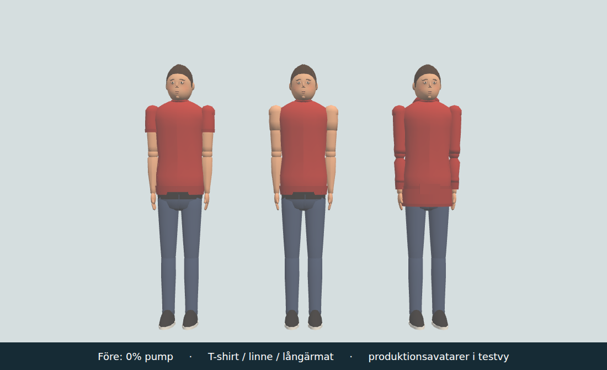
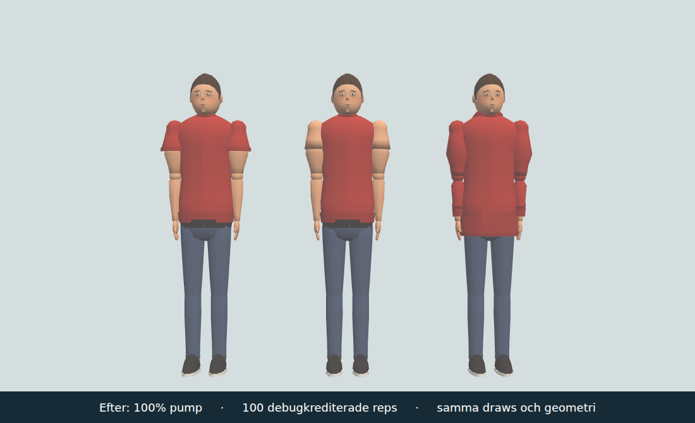
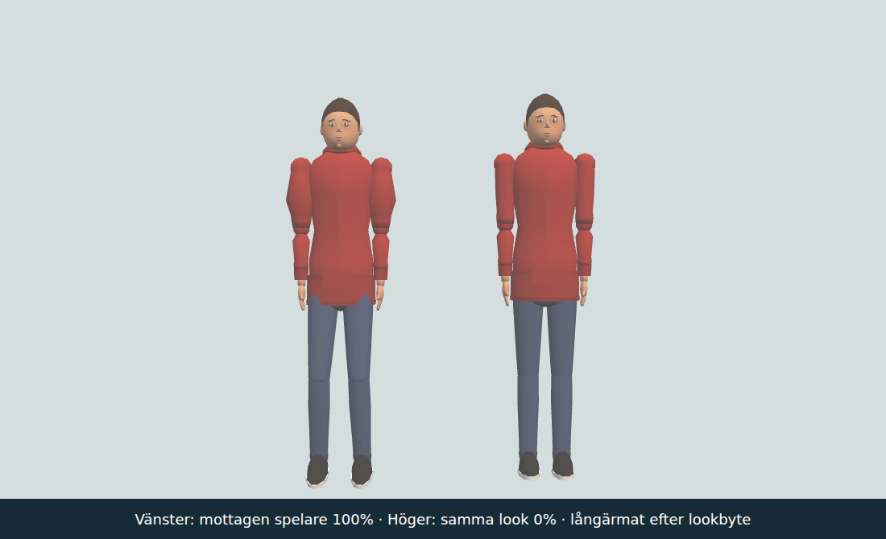

# Upper-arm pump — #1837

Base: `786d75c102f89246f778953acbe8bed0adb7a2a4`. Exact tested runtime hashes: [sources.json](sources.json).

Completed outdoor-gym repetitions retain `bump('gymReps', n)` and additionally call `growGymPump(n)` once. Guesses in `GYM_PUMP`: 100 reps to full, 72 hours linear wall-clock decay, +60% maximum upper-arm circumference. Half remains after 36 hours; after 72 hours none remains. Earning is independent of the existing daily score cap. `stats.gymPump = {value, at}` follows the existing per-player stats save/reset/profile boundary. No per-frame save or mutation for decay; future/invalid anchors yield zero.

One immutable shared `armPump` vec4 attribute marks shoulder-bone skin and sleeve vertices with a smooth bulge and its derivative. A private material uniform expands X/Z around the shoulder axis before skinning and corrects normals with the inverse deformation. At shoulder/elbow ends the bulge vanishes. Elbow/hand/leg/shoe vertices are unmarked. No shared position/normal buffer, bone scale, mesh count or per-frame geometry is changed. Look replacement reapplies the pump to the new private material.

Main samples wall-clock progress every 15 s at most; wire `bp` is clamped to 0–1 and rounded to hundredths, omitted at zero. Existing 5 Hz change/resend transport and idle policy remain intact; cosmetic changes do not reset movement idle time. Worker uses the same cleaner and retains it in existing room snapshots, including late welcome. Old/missing fields clear to zero. Pages and the actual Worker deployment must both be verified before closure. The field is optional and an older Worker ignores it during rollout; independent workflows do not guarantee ordering. The new pure Worker import is included in `cloud.yml` paths.

## Checks

1. `node --test tools/gympumptest.mjs cloudflare/deploypaths.test.mjs` — **4/4 PASS**, [raw output](node.txt). Credit/saturation, 36/72 h offline decay and JSON roundtrip; invalid/future anchors, bad rep counts, 15 s sampling; twelve real Avatar sleeve/cut/gender variants with shared positions, independent uniforms and no forearm marks; bounded Worker field and exact production main callback.
2. `tools/browsertest.sh node tools/gympumpbrowser.cjs http://localhost:8910 http://localhost:8912 docs/verification/1837` — **9/9 PASS**, [result](browser.json), [log](browser.log). Real production Avatar/Ghosts shaders, profile stats and actual local Worker/WebSocket. Actual source callback is extracted from main and invoked 100 times as debug credit. Saved record/reload retains pump and reps. Self and remote retain pump across appearance/sleeve/gender replacement; an already-pumped Worker snapshot reaches a late joining Ghosts instance. Actual observed nonzero state was 79–81 bytes (see all samples in raw JSON); existing 512-byte limit preserved.
3. `node --test cloudflare/players.test.mjs` — **74/74 PASS**, existing room/state/rate/relay regression checks, [raw output](worker.txt).

The browser fixture deliberately suppresses apartment bootstrap. Three production avatars (T-shirt, tank top, long sleeves) are rendered in a comparison stage: **3 draw calls / 32,574 triangles / 3 allocated geometries both before and after**, same geometry identities. The received remote avatar and an unpumped same-look control share the exact position attribute while retaining separate uniforms. All browser/shader errors: zero.

## Inspected images

The biceps/sleeve increase is visible; forearms, hands and shoes retain their shape. These are actual Chromium/SwiftShader module renders and actual local Worker traffic, **not** a full-scene performance claim, physical-device measurement or 100 native/manual exercises. No extra whole-world bootstrap was needed after these scoped contracts passed. The separate #1836 control work owns native exercise completion and remains independent of this unchanged callback interface. Original-only gameplay/player progress/Cloudflare integration; no applicable public transfer.

Integration review: main preserves the new #1836 effort/HUD while adding pump exactly once to the existing completion callback. A small conductor guard makes repeated unchanged self/remote `setPump` calls return before writing the material uniform; actual shape updates therefore follow the sampled/quantized value rather than render/network cadence. Geometry, shaders and values are unchanged from the inspected browser result. The original runtime hash manifest is preserved; integrated source hashes and scoped contracts are recorded separately.

Sammanslagen pump/effort/reps/deploypaths-kontroll: 17/17 gröna (integration-contracts.txt). De 74 Worker-regressionerna och den källbundna GPU-/wire-rundan återanvänds eftersom integrationen bevarar dessa funktionskällor; inga nya breda browserprov.
