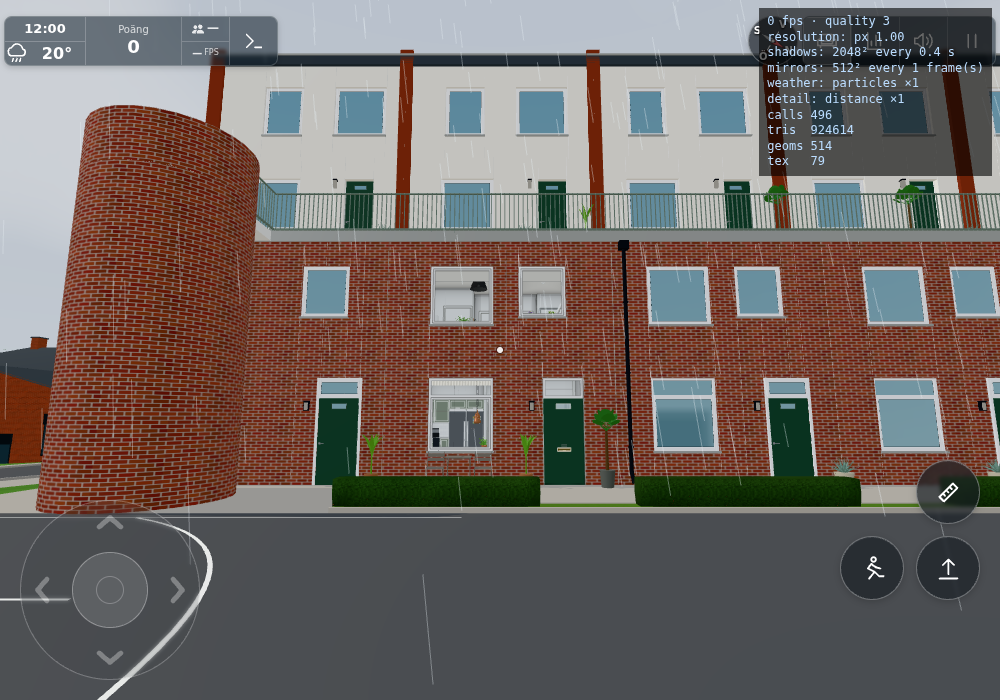
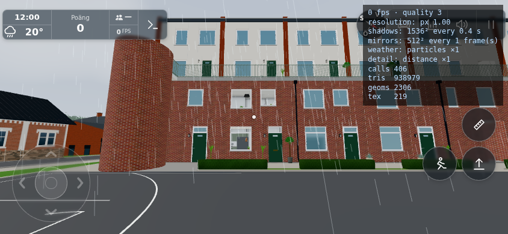

# #1838 — exact transient startup reuse

Common authored source is `8647ab37047404aa9abe622248f831381153afa2`, including #1835–1837. Before measurements use that source without product edits. After measurements change only the bounded construction cache and its three sampler hooks; source hashes are in `sources.json`. Geometry, profile selection, collision readiness, startup/update/SW retirement and plain ES-module loading are unchanged.

## Method and limits

`tools/startupserve.py 8911 CHECKOUT` serves local pinned Three and Pages-like static HTTP headers (`max-age=600`, HTML/version revalidation). The ordinary dev server's `no-store` would make a second-visit network comparison invalid. Actual response headers are saved. No Playwright request interception is used.

Run `PLAYWRIGHT_MODULE=… tools/browsertest.sh node tools/startupprofile.cjs OUTPUT`. One fresh Chromium run per before/after matrix and a fresh browser context per device, then `about:blank` and a real new document in the same context: HTTP/localStorage are warm and normal session resume is preserved. “Cold” means a fresh context with cold HTTP/application storage; the two device contexts share a Chromium/GPU process within each matrix, so no isolated cold-GPU claim is made. Desktop is touch-capable 1000×700 with full desktop rendering; phone is Android-UA/isMobile 844×390 with `lowmem`. Both use DPR1, quality3, fixed time/month and freeze, real warm-up (`warm`), no `test`, `lazy` or `shot`. Backend room connection is disabled with `cloud=`. This is local headless Chromium/SwiftShader and an emulated phone, not hardware Safari/Android performance.

The first playable marker requires the normal cover released, rendered scene after actual entry, active touch controls and already completed world/collision construction. A first visit uses the existing testkit's native **Hoppa över** for the name dialog, then the visible ordinary **Börja/Touch** button. Normal auto-resume on the second document is accepted only after a new real rendered frame. The phone's ordinary complete-view warm gate remains. Construction, loading-step timeline, per-visit sampled CPU self-time, resource timings/transfer bytes, raw CDP counters and active/collision state are saved. CDP counters are cumulative on the page across navigation; `V8CompileDuration` is not an isolated JavaScript-module parsing benchmark. The program-loading→3D-start interval includes fetch, parse and eager module evaluation. Desktop background upload completion is recorded as state, not awaited as a playability requirement.

After timing/CPU capture, the loop stops only for the saved image. Thus the image's FPS overlay is not a frame-rate measurement. Screenshots show the actual normal entry view and controls. Rain/other dynamic objects are not a whole-image byte-identity claim.

The initial incomplete fixture attempts are explicitly diagnostic (`diagnostics.txt`, `diagnostic-desktop-cold.json`, the old checkpoint); they are excluded from the four before/after comparison rows. No product error was established: the missing first-visit name-dialog handling intercepted the early forced clicks.

## Checks

1. `node tools/startupcachetest.mjs`: exact floating coordinates, capacity eviction, isolated record copies, disabled fallback and complete release.
2. `node tools/startupterraincheck.mjs` and `--off`: 6,188 actual authored terrain/river points, all three public samplers. On, off and post-release raw outputs have the identical SHA256 `36fd19a19c476b6ad428e4703c89d7aa3dd417919ad00264f4979d0e53076dbb`. Every table is inactive with zero entries after release. JSON proof is retained.
3. Same actual browser cold/second-visit protocol before and after, including native normal entry, source hash, active controls, level collision segments, cached HTTP transfers, emitted terrain hashes and representative images.

All houses A/B/C/L keep their existing shared terrain and actual geometry; there is no house layout/variant change. No four-house rendering sweep is relevant. Exact terrain sampling plus the actual shared emitted mesh is the affected boundary. No new persistent data means quota/private-mode and version/profile stale-cache failure modes are avoided; disabled cache and post-release computations use the original paths.

## Measured result

| Profile / visit | Before first playable | After | Improvement | House-build block before → after |
| --- | ---: | ---: | ---: | ---: |
| Desktop cold |102.161 s|91.762 s|10.2%|23.846 →21.579 s|
| Desktop second visit |38.234 s|34.690 s|9.3%|25.306 →22.742 s|
| Emulated phone cold |89.908 s|74.102 s|17.6%|29.974 →25.273 s|
| Emulated phone second visit |77.931 s|61.867 s|20.6%|27.300 →21.845 s|

Both measured cold paths improved. Warm-start improvement is real in these paired runs, but **the guessed 30% target was not reached** (9.3% desktop/20.6% phone). No metric-chasing reruns. Cold timing includes the normal anonymous-choice/entry interaction; second visits use actual normal resume. Single paired samples include shader/idle/UI scheduling variation and do not establish hardware-device speedup. The house-build marker gives the narrower measured construction cost. Network transfer is about 6.1 MB cold and exactly 0 bytes on each second visit, before and after. The module fetch/parse/evaluation interval is 0.90–1.04 s cold and 0.32–0.39 s warm; no isolated parsing-speed claim.

The rejected Map/string candidate's `read()` self CPU was 8,235 ms; final numeric-slot lookup measured 751 ms in desktop cold. The final tables peak at ≤ 32,768 entries each and every browser row confirms inactive/zero entries before gameplay. All four rows preserve active controls and collision segment counts [1284, 256], with zero page errors. All 143 actual browser sample points and the emitted terrain position/index SHA256 match exactly in every row; full desktop normals/UV also match. Phone normals/UV have already been released by the existing low-memory upload policy (empty hashes), so they are not claimed as retained byte proof.

Desktop image counters match 496 calls/924,614 triangles. The phone representative frame counters are 405/937,583 before and 406/938,979 after; these are different live post-start/warm frames, not a stable-scene draw benchmark. This change creates no meshes/materials and the affected emitted terrain bytes are identical. Both before/after images were inspected: same façade, road and normal active HUD. Dynamic rain is excluded from whole-image pixel equality. No physical device or steady-frame-rate claim.

`measured-sources.json` records the exact profiled source. After profiling, a scalar fallback guard was added in `startupcache.js`: non-number returns (including the terrain sampler's possible `null`) bypass Float64 storage and retain their exact type/value/identity. The existing pure test now explicitly covers null, undefined, string/object fallback, colliding coordinates, signed zero, mutation isolation and late imports after release. This fallback-only guard was not given another whole-scene profile; final source hashes are in `sources.json` and the difference is explicit. It does not change the measured numeric construction samples.

This delivers construction-time reuse. No persistent graphics cache, new storage key, SW or bundler was introduced. A new document/version has no old memo entries. Hardware device testing remains outside this bounded measurement. Generic terrain reuse is tracked in low-priority [public #246](https://github.com/solwation/kvarteret-lunden/issues/246), with explicit adaptation for its mutable parkingPatch/sampler and walking support.

Dirigentens integration bevarar1839:s ankcallback och1840:s kattrundor/markcallback. Cachehelper, surroundings och riverbridge är byte-identiska med slutligt verifierat workerresultat; STARTUP-data är lika och rena cachekontrakt passerar på sammanslagen källa. Mätvärdena ovan gäller den uttryckligen frysta8647ab37-basen med cacheändringen, inte en ny tidsprofil av senare orelaterade katt-/ankändringar. Inga rutinmässiga breda omtag.

Levererat i `59c6957a25442ef93d06e564b2082aee4a6a5159`. [Pages](https://github.com/solwation/lunden-3d-apartment/actions/runs/41641392481) och [Worker](https://github.com/solwation/lunden-3d-apartment/actions/runs/41641392486) lyckades; Worker-loggen bekräftar faktisk Wrangler-deploy och den publika sidans version.json visar `59c6957`. Dirigentens kombinerade diff-/bildgranskning är klar. Verifieringslänkarna ovan är permanenta; eventuella resultatbilder är granskade och bytekontrollerade. Ingen rutinmässig omkörning av gröna kontroller efter orelaterad integration. Ärendet stängs genom efterföljande verifieringscommit och aktiva etiketter tas bort.
