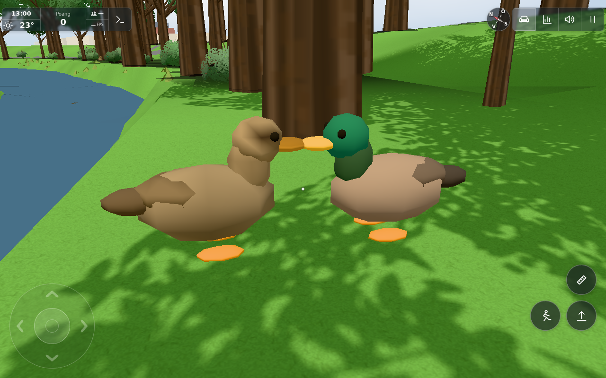
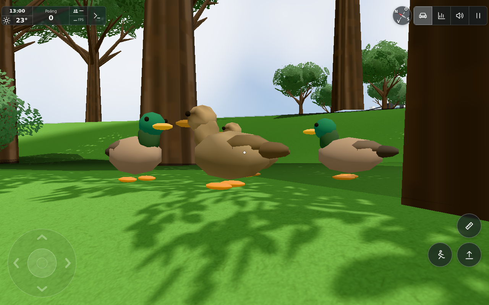
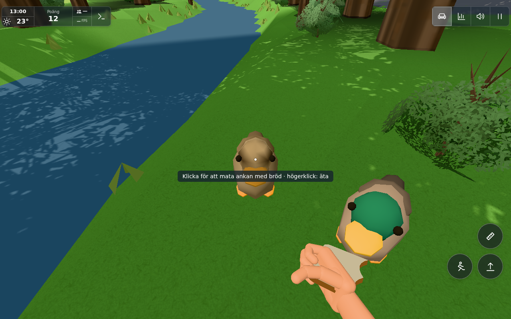

# Mixed duck pairs along the river — #1839

Source base: `59bb057e2e982e3ae2e9b3f9531b57a80a39e126`. Exact final source hashes are in [sources.json](sources.json).

Four ducks remain two male/female pairs. Seed1839 chooses stable partners and movement randomness. The female leads, the male follows around1.05 m behind, and a female waits when her mate falls behind. Temporary groups approach the leading pair for95 of every320 seconds, then return to separate pair territories. These are playful guesses in `DUCKS.social`, not an ecological simulation. Half are female. Brown mottling, dark eye stripe, orange/brown bill and blue wing patches use only vertex colours. Both sexes have identical640-triangle topology, one material, four visible body meshes total. A second shared geometry permits different vertex colours, without extra draws/lights/textures/shadows.

The familiar pair remains near(-160,207), choosing the first two rest locations; the other starts48 m downstream. Resting offsets0/24/48/72 m and the bounded[-8,80] m chainage range are guesses relative to the existing sourced river. `duckRiverPoint` follows the actual `riverPath` polyline and local width/bank/`waterYAt`. Short curve waypoints and per-step checks prevent cutting across valley bends. Valid positions stay within water/low northern bank distance and at most1.65 m above local water. Existing road/bridge geometry is excluded. Both partners sleep when either is outside65 m; meshes hide at100 m/underground.

Only Ducks now receives `renderedTerrainY` directly from main. The initial diagnostic using shared `parkGround=max(analytic,rendered)` found up to1.086 m floating above actual bank triangles along the new route, so that callback was corrected before acceptance. The [preserved diagnostic](diagnostic/analytic-max-ground.json) is a failed pre-fix result, not a current acceptance pass. No world terrain, roads, trees or other animals change.

## Scoped verification

1. **5/5 PASS**, [Node output](node.txt): seeded stable identities; bounded pair distance/female leadership; repeated group formation/dissolution; source river/road/bridge limits, water/shore transitions and full/partial distance sleeping; identical male/female topology and unchanged4×60/2.4=100 feeds/minute ceiling. Existing reward/catalog/cap tests are included.
2. **4/4 PASS**, [Legacy behavior output](legacy.txt): original walking/swimming, bounded quacks, lure/eating/cooldown and real finite Items bread, no package/stale/reserved/topped-food feeding.
3. **14/14 PASS**, [Actual browser result](browser.json), [raw log](browser.log): real full original app built once for the final source, rendered terrain contact rays, two river places and naturally simulated grouping, four-mesh budget and native keyboard E with kitchen bread at the second reach. Controlled seed/time/spawns shorten travel and waiting; the behavior itself is the production DuckFlock, not posed replacement models. The earlier interrupted diagnostic bootstrap is recorded above; this is not claimed as a single uninterrupted pre/post browser.

Count4, cooldown2.4 s, feed/onFeed/statistics/daily cap/medal and local-only ownership remain intact. The Worker100/minute assumption is unchanged and needs no increase. Existing body rendering uses4 draws/2560 triangles total when all four are in view; actual scene delta is recorded in the browser result. Functional validation camera before the framing correction:83 calls/587,032 triangles with ducks,79/584,472 without, delta4/2560. Those scene totals belong to that recorded camera; no scene totals are claimed for the replacement capture-only viewpoints. The two shared sex geometries use one material. Walking contact over60 actual dry samples differs from emitted terrain rays by at most0.000004614 m (float precision). No physical-device/FPS or continuous player walking-route claim.

## Inspected current-source views

The functional browser closed before image inspection. Its feeding view was retained; the original first-pair camera was behind a trunk and the group partly behind leaves. A separate capture-only recovery replays the same frozen source/seed to the same AI snapshot and selects dry-bank cameras with actual mesh-ray clearance to every bird. Its first fixture omitted the normal start/spawn step and hid the birds; only that capture setup was corrected. No green functional check or performance profile was repeated. [Camera/snapshot record](capture-state.json), [selected cameras](capture-cameras.json), [capture log](capture.log).

All three final images were inspected by the worker and conductor. The loose group naturally shows three full bodies and the fourth female’s head; this is enough to show the mixed group without repositioning its members.

Public transfer: #235 is historical and complete. The new generic model/pair/group/range slice requires a new dedicated low-priority downstream issue after conductor queue/duplicate review. Feeding, bread, Life, rewards, audio/services and personal content are excluded from that slice. No downstream work or issue was created by this worker.

Dirigentens integration behåller biceps/effort/onRep och byter endast Ducks markcallback till den verifierade ritade ytan. Duck-modulerna är byte-identiska med de granskade runtimekällorna; 5/5 sammanslagna ank-/rewardtester passerar (integration-node.txt). Ingen extra browserprofil efter orelaterad sammanslagning.
