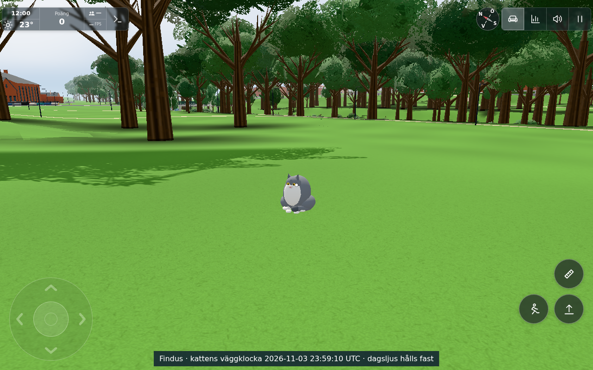
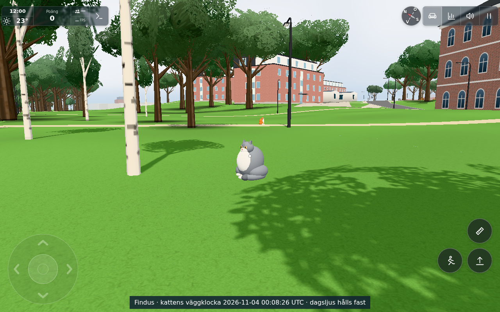
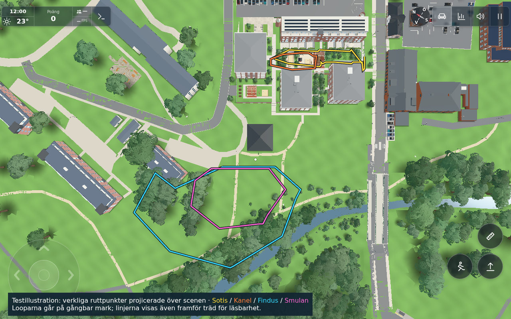

# Larger outdoor-cat patrols — #1840

Base: `47ac6269d7b86a1380509da1bafdf0ba14126c40`. [Exact source hashes](sources.json), [old route/rest snapshot](baseline.json), [exact new route/rest/vary data](proposed.json).

Four existing cats retain their appearances, personality traits, promotion, food and pet lifecycle. Explicit larger loops use the courtyard's connected free spaces and the dry park. Kanel remains the smallest/laziest; Findus has the largest park loop. The numerical sizes, resting points and patrol timing are guesses constrained by the actual geometry. The courtyard's eastern fenced corner requires a short out-and-back spur, so these are approximate loops rather than geometric circles.

## Coverage and scheduling

Both convex-hull area and axis-aligned box area are measured from each cat's **scheduled positions every2 s for24 h**, compared with the same sampling of its old route. Areas describe the patrol's spatial envelope, not every square metre inside it being walked. All four exceed the requested approximate4× minimum by both measures. The smaller30 m lazy-cat width is deliberately bounded by the available courtyard; its area still increases over8×.

| Cat | Width × depth (m) | Hull area ratio | Box area ratio | Lap (min) |
| --- | --- | --- | --- | --- |
| Sotis | 60.0 × 13.0 | 15.26× | 12.74× | 11.99 |
| Kanel | 30.0 × 11.0 | 8.69× | 9.17× | 8.96 |
| Findus | 110.0 × 68.0 | 10.29× | 9.86× | 18.89 |
| Smulan | 63.0 × 40.0 | 19.86× | 15.75× | 14.32 |

[Raw metrics](day-coverage.json). Each lap independently hashes wall-clock lap number and cat id to choose clockwise or anticlockwise. Both directions share exactly the same home/end point, distance, rest budget and period; position stays continuous at lap boundaries. There is no random state, client-local route choice or runtime pathfinder. `routePlan` builds two immutable time tables once; `catAt` uses a constant-time table lookup and at most one boundary correction. Brain stop anchors, outings and information caches use the selected direction. The cache remains bounded to two sets of legs, preserving deterministic personality/outing behavior.

The longer loops were planned only in the development fixture against real scene walls, closed-building polygons, furniture/obstacle footprints, road geometry, water and height. A bounded offline A* in that tool emits explicit points around obstacles; none of its planner, site snapshot or test illustration is imported into the app. Production configuration contains only the reviewed points/rest durations. Navigation bends have zero rest; real stopping points retain personality-specific rests.

## Actual ground and source composition

The existing analytic-max `parkGround` floated up to0.194 m over some newly reached park triangles. `main.js` now supplies OutdoorCats with `renderedTerrainY` south of the existing `OUTDOOR.z1` boundary64, retaining the real garage/courtyard deck callback to the north. Its walkability height test uses that same callback. Other animals, terrain and collisions are unchanged. [Pre-correction diagnostic](diagnostic/analytic-max-contact.txt) is a failed development check, not final acceptance.

A **single actual original app/bootstrap** was held for development and verification. The final route/brain modules were loaded before bootstrap. The generated exact final route/rest/vary JSON was applied to the already-built same-base config, existing brains were initialized from it, and their climbable-tree set was refreshed as a fresh final constructor would do. The exact final main ground/walkability callback was composed into that app before the passing checks. Static source review verifies config equals the composed JSON. No model/terrain was swapped. This is explicit source composition, not a claim that the initially loaded main/config bytes already contained those final data/callback edits.

## Three scoped checks

1. `CATRANGE_METRICS=docs/verification/1840/day-coverage.json node --test src/outdoorcatroute.test.mjs tools/outdoorcatbraintest.mjs` — **15/15 PASS**, [raw output](node.txt). Existing route/personality/outing contracts,24 h coverage/determinism, closed direction transitions including negative laps, minute-scale periods and constant lookup bounds; every0.25 m path sample checked against actual captured site solids/walls plus source roads/water and height grid; correct brain stop anchors and bounded variant caches. [Scene-derived site data](site.json) contains the final callback's local height grid and actual solids/segments, with no production import.
2. [Final route validation](route-validation.json) — **4/4 PASS** in the actual app:2,759 source-route samples and all segments clear; park callback matches rendered terrain exactly; unchanged32 m desktop /18 m phone /7 m puppet thresholds; two Findus rest positions111.018 m apart.
3. [Interactions and budget](interactions.json) — **4/4 PASS**. A real raw caught-fish instance placed by the fixture at Findus's enlarged eastern base is eaten and `catFishFeeds` advances0→1 once, with the fish removed. Approaching Sotis at its enlarged western stop promotes the ordinary named cat; its real pet interaction purrs and increments `petted`0→1. Actual body delta: **near24 calls/10,008 triangles, merged far1/10,008, beyond drawDist0/0**. Models, draw thresholds and phone policy are unchanged; no new product draw calls or geometry. The overview overlay is test-only and absent during these counts.

[Combined final result](browser.json), [full phase log](browser.log). The log preserves the initial contact diagnostic before final callback composition; the eight structured final checks are all green, zero page errors. No additional broad suite/profile or repeat bootstrap was run. The Node suite was repeated once on the final captured ground fixture, with no later source changes.

To reproduce the staged browser fixture, run `tools/browsertest.sh node tools/catrangebrowser.cjs GAME OUT CONTROL`; it writes proposed/site data and waits for `CONTROL.accept`. Copy reviewed proposed data to config before accepting. Send the contents of `tools/catrangeverify.js` and then `tools/catrangeactions.js` through `CONTROL.command`. The existing `baseline.json` preserves the original rest inputs for planning on a final checkout. Optional `catRange.camera(2,catRange.times[0|1])` and `catRange.overview()` commands prepare the three views; `CONTROL.shot` contains the image basename. Write `CONTROL.release` after image inspection. These private files belong outside the repository. No test-only control is added to product UI.

## Inspected images and limits

The screenshots use actual production cats near their scheduled base positions from **two fixture wall clocks**, with normal local notice/outing reactions retained; daylight remains fixed at noon for readable comparison. The bottom label shows the cat's wall clock (2026-11-03 23:59:10 UTC and2026-11-04 00:08:26 UTC); the normal HUD's12:00 is the held daylight clock. Controlled clock/spawn and one fixture-created fish shorten travel/interaction setup. This is not a continuous walking route, native fishing achievement, physical-phone/FPS or whole-scene performance claim. Feeding and petting use the existing production lifecycle/actions.

All three images were inspected by worker and conductor before the held browser was released. The overview is explicitly a **test illustration**: exact route x/z points projected over the real scene with an overlay that remains visible in front of trees. There is no corresponding product map/UI.

Public transfer: historical #236 remains complete. Dedicated low-priority [public #245](https://github.com/solwation/kvarteret-lunden/issues/245) tracks generic anonymous loops, clock hashing and applicable behavior after conductor duplicate review/source publication. Original names, interactions, fish/food/rewards, private data/services and these original screenshots are excluded. No downstream task or publication was performed by this worker.

Dirigentens integration bevarar1839:s separata Ducks renderedTerrainY-callback samt gym effort/pump. Kattrutt-, hjärn- och rendermoduler är byte-identiska med workerresultatet, OUTDOOR_CATS är exakt samma data och sammanslagna15/15 Nodekontroller passerar (integration-node.txt). Endast samtidiga dokumentavsnitt och ändringslogg har sammanfogats; ingen extra browserprofil efter orelaterad integration.

Levererat i `62b841e8f14d7f3312f2aaef38a3f067fecc24e0`. [Pages](https://github.com/solwation/lunden-3d-apartment/actions/runs/41639645496) och [Worker](https://github.com/solwation/lunden-3d-apartment/actions/runs/41639645424) lyckades; Worker-loggen bekräftar faktisk Wrangler-deploy och den publika sidans version.json visar `62b841e`. Dirigentens kombinerade diff-/bildgranskning är klar. Verifieringslänkarna ovan är permanenta; eventuella resultatbilder är granskade och bytekontrollerade. Ingen rutinmässig omkörning av gröna kontroller efter orelaterad integration. Ärendet stängs genom efterföljande verifieringscommit och aktiva etiketter tas bort.
