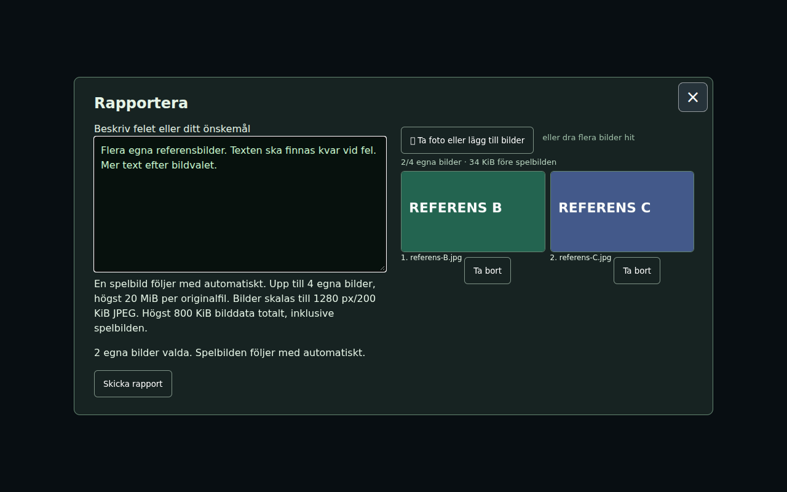
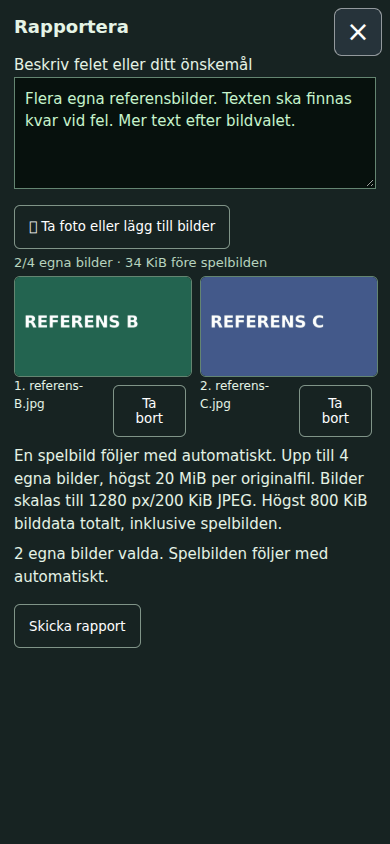

# Multiple own report pictures — #1841

Base: `c761457db7f350387a84e5cdd02f0236075e3bbb`. [Final source hashes](sources.json). Original-only game/report/Cloudflare functionality; no applicable public transfer.

Users may select several files, add another batch, inspect separate previews and remove one picture. Limits are guesses in `REPORTS`: **4 own pictures plus automatic screenshot;20 MiB per original file;1280 px and200 KiB per encoded JPEG;800 KiB total decoded JPEG data including screenshot;1200 KiB full UTF-8 PUT body**. A new invalid/oversized/excess batch is rejected atomically while existing text/pictures remain. JPEG re-encoding, white background for transparent images and browser orientation handling remain intact; source image metadata is not sent. A changed selection gets a new report UUID; an unchanged failed submission retries exact cached screenshot/attachments under the same UUID. Successful submission removes only submitted picture identities and preserves subsequent typed drafts/new selections.

## Schema, safety and rollout

Legacy `image` is still the screenshot. `photo` is still the first own picture, preserving `<UUID>-2.jpg`, its manifest keys, body text and journals. A bounded ordered `photos` array contains **additional** own pictures, maximum3, requiring `photo`. Import export normalizes them into `photo2`, `photo3`, `photo4`, files `<UUID>-3.jpg` through `<UUID>-5.jpg`. Each needs its own relevance assessment and exact SHA256; all originals remain included for related/unrelated/unclear assessments. No report/image text is treated as instructions.

**A nonempty additional list writes to `/reports/v3/<UUID>`**, explicitly parsed by new outer/inner Worker routing. An old Worker rejects that route404 before storage; its old reports handler alone rejects `v3` as invalid UUID400. The new client retains every attachment/text on an update error and never retries using a lossy legacy route. Current Worker rejects nonempty extras on legacy PUT. Single-photo/screenshot legacy writes, old retry hashes, storage UUIDs, import claims and receipt/ack routes remain compatible. This prevents silent truncation during Pages/Worker deployment races or rollback; the two deployment workflows may finish independently, and both are checked before closure.

GET pages now hold10 reports. Even ten full1200 KiB PUT envelopes are about11.72 MiB plus a small wrapper, below16 MiB. The importer's **pre-existing32 MiB page bound was not raised** and still accepts old pages up to50 reports; its64 MiB total export limit remains. Every extra image gets the same JPEG validation and aggregate accounting. Fixed GitHub Contents paths only, separate durable image metadata/review, exact body hash and per-image verification before ack remain enforced. Upload failure, changed last image or missing SHA/relevance retains the report for safe same-journal recovery. Tokens, credentials, permissions and private files were not changed.

## Three focused verification groups

1. **16/16 PASS**, `node --test cloudflare/reportphotos.test.mjs cloudflare/reports.test.mjs cloudflare/deploypaths.test.mjs` — [output](worker.txt). Actual Worker/DrawingRoom storage, ordered immutable extra bytes, legacy image/photo retry identities, type/frame/size/count/800 KiB/stream boundaries,10-report cursor pagination, authentication, claims, receipts and replay. Versioned writes are claimed/acknowledged through the original paths. Ordinary tests are independent of old git history.

   `node tools/reportlegacycheck.mjs` — [manual source-bound output](legacy-rollout.txt), **4 PASS**. Requires the reviewed c761 full-history object locally; never fetches history or reads credentials. Executes the pinned old outer routing and old reports handler against local in-memory storage: v3 yields404/400 before any write. A counterfactual old-URI call demonstrates why a200 receipt count would be insufficient: old code would accept but omit extras. Current Worker accepts v3 intact and rejects versionless extras. Full source SHAs are printed in the preserved log. No production requests.
2. **70 PASS,3 explicitly skipped (73 discovered)**, `PYTHONDONTWRITEBYTECODE=1 python3 -m unittest discover -v -s tools -p ingame_reports_test.py` — [output](import.txt). All five pictures exported separately without base64 leakage, reviewed/SHA checked, durably uploaded/linked/verified and acknowledged; failed last upload resumes without overwriting earlier images; wrong/missing last review and changed last image prevent acknowledgement. Exact800 KiB accepted, over-total rejected. Legacy screenshot/photo filenames, section text/body hash, version-1 journal and receipt tests remain green. The three existing skips are two optional actual-HTTP local-Worker fixtures and an optional production-dialog-export fixture; they are **not** reported as passes.
3. **25/25 PASS**, `REPORT_NO_SHOTS=1 PLAYWRIGHT_MODULE=… tools/browsertest.sh node tools/reportmultibrowser.cjs GAME docs/verification/1841` — [result](browser.json), [log](browser.log). Real index DOM, native dialog, actual `AdminReports` and JPEG encoder with local intercepted PUT only. Desktop1280×800 and touch390×844: native file chooser selects2, adds1, removes A, retains B/C; continued typing works. Count/type/20 MiB errors and a synthetic byte-total case retain the draft; server413 and old-server404 retain both pictures/text; retries preserve UUID/exact bytes; final PUT contains screenshot+B+C in order. All actually submitted JPEGs pass Worker validation, have ≤1280 px edges, strip injected source metadata and clear the submitted selection after success. No page errors.

## Inspected UI images and limits

Both images were inspected by worker and conductor. They show the actual index/AdminReports component fixture, **not** a full3D bootstrap or a report sent to production KV/GitHub. Only procedural fixture images/text were submitted to a local interception. There is no physical-phone/camera-sheet/FPS claim.

An early fixture accidentally supplied a1920 px synthetic screenshot and correctly failed the JPEG-dimension assertion; its [diagnostic](diagnostic/oversized-fixture-screenshot.json) is retained separately. Correcting only that fixture to1280 px produced passing desktop/touch checks. The accepted images were then reused while the nonvisual v3 URI/error guard was added and the affected local sequence rerun with `REPORT_NO_SHOTS=1`; no new views or3D/profile sweep was taken. [Image-phase source hashes](image-source.json) distinguish that capture phase from final protocol source. The UI markup/layout and previews are unchanged by the guard.

[Full import schema, field/file/review mapping and credential boundary](../../development/report-import.md#multiple-own-pictures-1841). The conductor owns publication, deployment and final issue evidence/closure.

Dirigentens integration behåller de senare ank-/kattrundorna och startup-cachen. Rapportklient, markup, Worker, encoder, bilagehelper och importverktyg är byte-identiska med slutligt verifierat workerresultat; REPORTS är samma data. Sammanslagna16/16 rapport-/deploypathkontroller passerar (integration-worker.txt). Python/UI/protokollbevis återanvänds på identisk berörd källa, inga extra browseromtag.

Levererat i `aa0241e68471e995747c185693ed056fcba013dd`. [Pages](https://github.com/solwation/lunden-3d-apartment/actions/runs/41644518419) och [Worker](https://github.com/solwation/lunden-3d-apartment/actions/runs/41644518584) lyckades; Worker-loggen bekräftar faktisk Wrangler-deploy och den publika sidans version.json visar `aa0241e`. Dirigentens kombinerade diff-/bildgranskning är klar. Verifieringslänkarna ovan är permanenta; eventuella resultatbilder är granskade och bytekontrollerade. Ingen rutinmässig omkörning av gröna kontroller efter orelaterad integration. Ärendet stängs genom efterföljande verifieringscommit och aktiva etiketter tas bort.
