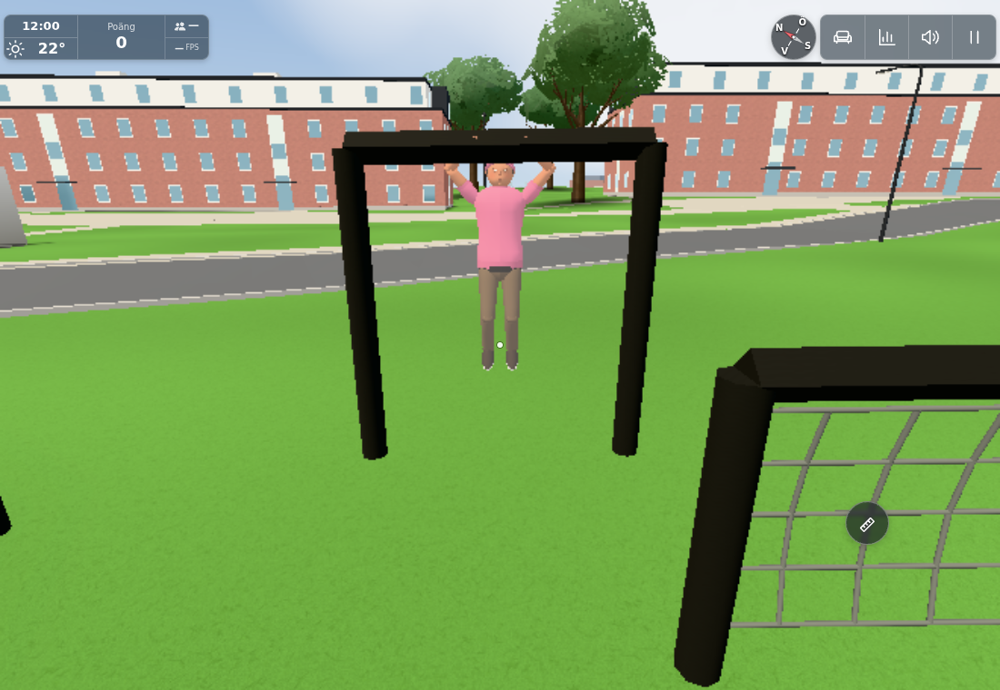
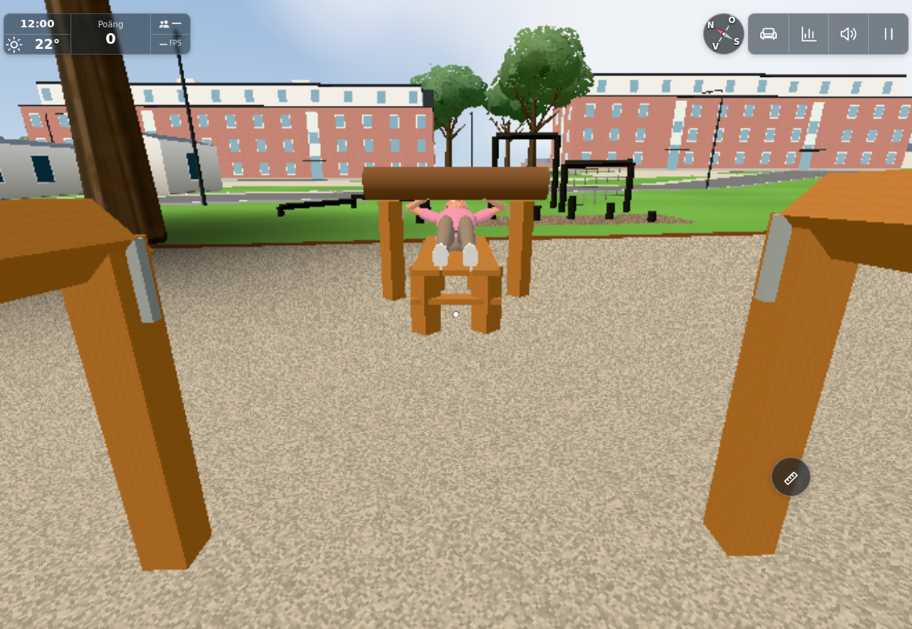
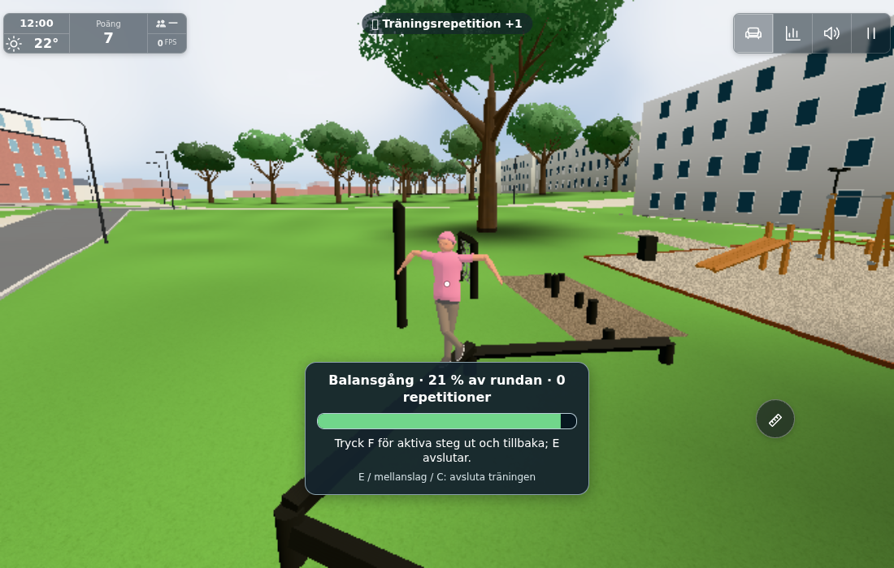
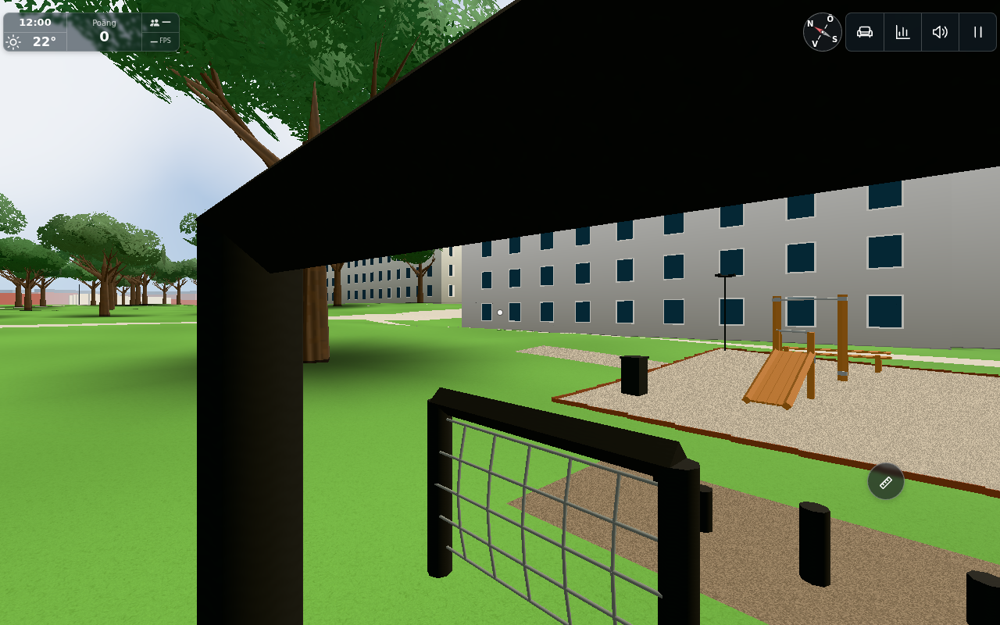
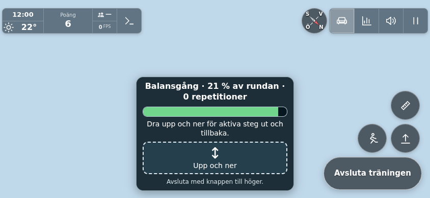

# #1842 – alla utegymmets redskap och synliga medspelare

Underlag: main `f0a29d61`, originalrapporten och fotona som anges i issueplanen. Slutliga runtime-SHA256 finns i `sources.json`. Ingen ny synlig redskapsgeometri eller belysning: samma åtta meshbatcher/4 404 trianglar som #1835. Sju osynliga mål tillkommer; ingen ny pathfinder.

## Inventering och kontrakt

Tio handlingar: befintliga räckhäv, liggande press och uppsteg; två snedbänkar för sit-ups; dips vid parallellställningens vadderade tvärstång; armgång längs portalens överliggare; sidoklättring på nätets nedersta stöd med händer på en faktisk nätribba; balansgång över de tre sammanhängande balkarna; steg över samtliga sex stubbar. Vanliga sittbänkar, soptunna och lampor är miljö/vila, inga träningsmaskiner.

F respektive verkliga fram-/tillbaka-drag på touchplattan ger kraft. En impuls beställer högst ett steg framför aktuell position. En hel ut-och-tillbaka-runda plus full kraftcykel krävs för en repetition på färdredskapen. Stillhet, avbruten runda och bara insteg ger inget. Gamla `onRep → gymReps/poäng/dagstak/biceps` är bevarat. E/mellanslag/C eller touchknappen avslutar till kontrollerat fritt insteg. Kropps-/greppmått är uttryckliga gissningar i `OUTDOOR_GYM.use`; pressens nåbara stockhöjd/stroke har korrigerats inom samma befintliga mesh.

Alla tio handlingar skickar en liten valfri transient `gx`-tagg genom befintlig Worker/PlayerRoom. Mottagaren poserar sin riktiga Ghost och befintliga pressstock. Lokal press prioriteras i egen vy, annars lägsta synliga medspelar-id nära stationen. Ingen ny occupancy-tjänst, lagring eller mottagarpoäng. Worker ska driftsättas före klienten; legacy-posefält bevaras.

## Kontroller

* `node.txt`: 13/13 komponentkontroller: inventering, inga synliga mesh-/ljusökningar, sju nya handlingars stillhet/cykel/avbrott, verkliga Avatar/Olof-ben och grepp/stöd för kort/vuxen/lång samt olika höjd/bredd, gamla tre mottagarposer, stockprioritet/reset och riktig Worker-validering. Slutlig nät-ribbegräns och huvud-/namnankare ingår.
* `legacy-reps.txt`: 8/8 befintliga gymrep-, poäng-, medalj-, dagstaks- och Worker-kontroller. `deploypaths.txt`: befintlig deploypaths-kontroll passerar inklusive nya Worker-importen.
* `native-initial.txt/json`: verkliga tangentbordshändelser för alla tio insteg, kraft, stillhet, belöning och fria utsteg; touch räckhäv/press passerar. Fortsättningen i `touch-final.txt` täcker återstående touchhandlingar, hela arm-/balansrundor och avbrutna nät-/stubbrundor utan kredit. De gröna inputresultaten återanvänds efter de små senare pose-/ankarskydden; inga nya inputregler ändrades.
* `actor-states.json` → `room-states.json`: 30 accepterade snapshots (alla tio vid 0/0,5/1) genom riktig Worker och PlayerRoom med befintliga devws tvåsocket-stand-ins. `receiver.json`, `receiver-checks.json` och `receiver.txt`: samma sparade paket genom riktig browser-Ghost.push/draw; alla tio rör kropp/händer/huvud, huvud/namn följer skelettet och pressstock följer fas. Inga page errors. Detta är en fokuserad Room→Ghost-gräns, inte två fulla appstarter eller en driftsatt Cloudflare-mätning.

Slutliga åskådarvyer ger 49 calls/384 768 trianglar (armgång) och 52/386 286 (press), inklusive verklig annan avatar och övrig synlig miljö. Det är olika kameror, inte före/efter-renderdeltan. Redskapets åtta synliga batcher är oförändrade. Inga extra lampor eller kroppsmesher behövs för animationen.

## Granskade resultatbilder

Åskådarvyerna är riktiga mottagarfigurer från sparade Room-paket; vittneskameran ändrar bara bildutsnitt. Förstapersonsbildens normala ögonläge/pitch återställdes från apparatens sparade position i den hållna receiver-scenen och återrenderades, utan ny input-/Roommatris, och visar horisont/redskap vid pitch 0. Den saknar gymrutan i denna capture-fixtur och är endast orienteringsbevis. Ursprungliga `keys-monkey-body.png`, `keys-monkey-hud.png` och `touch-monkey-hud.png` är diagnostik: saknad figur/stale himmelcanvas och ska inte användas som godkända resultatbilder.

## Fixturhistorik och gränser

Den första emulerade step-exittapen gav trusted pointerdown/up men ingen click, trots noll fokus/held och korrekt knapp. Även en tillfällig vanlig kontrollknapp utan apphanterare fick samma bortfall efter CDP-drag; efterföljande normal riktiga knapp fick trusted click och avslutade. Se `step-handler-probe.json`, `touch-control-probe.json` och råloggar. TouchCancel-försöket avvisades eftersom gesten redan var slut; det bevisar ingen produktfix. Fortsatta touchprov använde en neutral gestbarriär efter emulerade drag, borttagen före bilder. Ingen generell eventomskrivning eller säker produktdiagnos har gjorts.

Första fortsättningen nådde 30 gröna Room-paket men använde fel fixtur-API (`Ghost.update` i stället för `draw`) och nådde browserwrapperns 15-minutersgräns. Separat kort mottagaråterhämtning återanvände paketen; inga nya native-/Roomomtag. Tidiga cirkulär-JSON-/capture-fel är också fixturdiagnostik, inte appfel. Fysisk telefon och verkligt nätverk mellan två fulla klienter har inte provats.

L/A/B/C:s inomhusvarianter ändras inte: detta är det gemensamma externa utegymmet och oförändrad terräng/kollision. Ingen bred hus-/scenmatris behövdes. Gameplayinteraktionerna porteras inte till publik version; #243 gäller endast passiv geometri. Inga topplistor (#1847) ingår.

Dirigentens sammanslagning bevarar senare flerbilderstöd, hållplatsskyltar, startup-cache och externa Pokédex-referensbilder. Alla berörda gym-/pose-/Ghost-/Worker-moduler är byte-identiska med workerresultatet och OUTDOOR_GYM samma data.22/22 sammanslagna komponent-/rep-/reward-/deploypathkontroller passerar (integration-node.txt). Inga nya browser- eller Roomomtag efter orelaterad integration. Serverstödet publiceras separat före den krävande klienten; mellansteget har ingen ändrad webbplats eller nya synliga funktioner.

Server-först: `1104f416c56ec09db42c4fca93d8b738e12378b1` publicerar enbart cloudflare/players.js med samma exakta bounded gx-validator inline. [Worker 41658115074](https://github.com/solwation/lunden-3d-apartment/actions/runs/41658115074) är grön och Wrangler-loggen bekräftar faktisk driftsättning före klientpush. Pages triggas inte av denna server-only-fil; inget sådant pass påstås. Klientslicen delar därefter samma validator i src/gymposewire.js, med oförändrat wirekontrakt.

Portbedömning: den rena statiska stockhöjden0,95 m tas med i befintlig public #243 som fortsatt gissning, utan gx, input, IK, rörlig åskådarstock eller andra spelmekanismer. Ingen separat gameplay-port skapas.

Levererat i `357389701091efaec91a673bd0cc15f11904d7bb`. [Pages](https://github.com/solwation/lunden-3d-apartment/actions/runs/41658578274) och [Worker](https://github.com/solwation/lunden-3d-apartment/actions/runs/41658578260) lyckades; Worker-loggen bekräftar faktisk Wrangler-deploy och den publika sidans version.json visar `3573897`. Dirigentens kombinerade diff-/bildgranskning är klar. Verifieringslänkarna ovan är permanenta; eventuella resultatbilder är granskade och bytekontrollerade. Ingen rutinmässig omkörning av gröna kontroller efter orelaterad integration. Ärendet stängs genom efterföljande verifieringscommit och aktiva etiketter tas bort.
