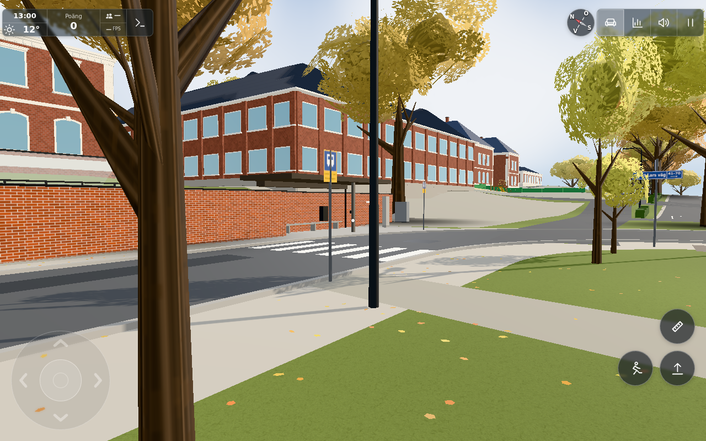
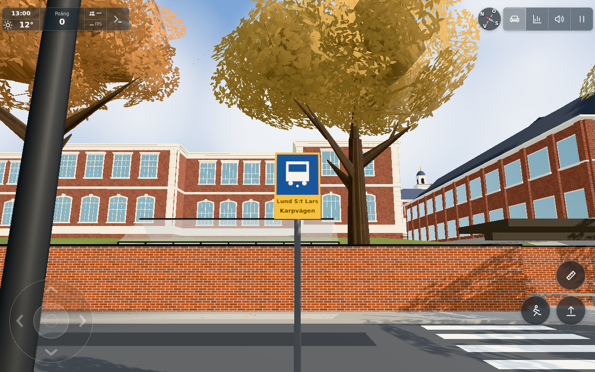

# Northern stop restored after local works — #1843

Base: `0864f5ac210d9f30d24e74db9936a3bd56c6444f`. Exact final source: [sources.json](sources.json). The issue's original reference image was inspected locally to identify the northern `SITE.street` crossing, not the river's separate `SITE.busStop` platform. No original photograph is copied into this result record or a public port.

The completed work's yellow trolley signal at(8.6,−23.5) and two warning stands at(13.2,−23.0)/(10.6,−23.2) are removed. The red Flyttad board at the existing near-side pole(6.5,−23.75) becomes an ordinary stop board; the existing opposite pole(20.6,−28.7) remains. Both show the exact requested name **Lund S:t Lars Karpvägen**, painted on two fitted lines in the existing generic yellow/blue bus pictogram style. They share one canvas instead of separate ordinary/moved canvases. Existing normal board dimensions0.42×0.62 m and centre height2.3 m are reused.

Only the bus-board face offset becomes40 mm (guess), beyond the existing30 mm post radius. The old12 mm helper placement let the post intersect the board and obscure central letters; the corrected front/back planes clear it. All other signs retain their12 mm offset. No new geometry, lights or operator/photo/font asset.

Road geometry, curbs, both crossings, school shelter/paving, street/park lamps and their pools, refuge/island yellow bollards, no-parking/A-board/crossing/flag signs and bus behavior remain unchanged. No collision/navigation module changed. Optional rendering support for other/future work signals/warnings remains; the retirement is local config only.

## Scoped checks

1. `node --test tools/busstoprestoretest.mjs` — **2/2 PASS**, [output](node.txt). Constructor-level exact name/locations/shared map and post clearance; roads/source config outside the retired/restored fields match the frozen baseline. The first seven street surface/crossing/lamp/pool geometry hashes and every other sign's position/geometry stay exact. The two yellow refuge bollards remain64 triangles. All971 static collision segments retain SHA256 `16d9aa46bf493a36b5e2cff6eeccbaa7ed93a17c6c0fe633cf38bba746cbd4f0`; separate river-platform data/collision remain identical. Day/night update remains valid without signal materials.

   [Before-source baseline](baseline.json) was captured before edits from the stated base with a flat ground callback. The same-input component falls **28→24 meshes,82,064→81,828 triangles (−4/−236)**; no added lights. These constructor totals are not a whole-scene performance claim. Derived `_samples` road caches are excluded from the config snapshot comparison; actual curb/crossing geometry hashes cover their emitted geometry.
2. **5/5 PASS** on the final near-only turn, [actual app result](browser.json), [raw log](browser.log): real original app, controlled pedestrian cameras at the affected stop/crossing, exact labels on both original pole sites, one shared canvas, removed temporaries, poles off asphalt and three local approach points still free. Both current views were inspected by worker/conductor. Final near-view main render:54 calls/366,352 triangles with the street group,45/339,906 without, delta9/26,446. Actual rendered street-component scene deltas are recorded per view; background scene totals depend on camera and real terrain callbacks and are not compared to the flat Node fixture.

## Inspected result views

The accepted overview is reused from the first app turn, after the local restoration but before only the28 mm extra face separation. The final close view is captured on the final40 mm offset; all street objects, pole sites, label content and terrain are otherwise identical. [First-turn metadata](diagnostic/panel-through-post-browser.json) binds the overview to that earlier12 mm face-offset variant. The [initial occluded close view](diagnostic/panel-through-post-restored-stop-name.png) demonstrates the post intersection and is diagnostic, not acceptance. Only the affected near view is retaken in the second short turn; no new overview/campus/profile sweep. The final browser is held until image inspection before release.

This is actual original-app Chromium/SwiftShader rendering with controlled local inspection spawns. It is not a continuous walking/bus journey, physical-device/FPS measurement or wider campus verification. No collision behavior or route is changed.

Public transfer: this generic environment improvement is tracked in dedicated low-priority [public #247](https://github.com/solwation/kvarteret-lunden/issues/247), created after conductor duplicate review/exact source publication. Only procedural config/rendering changes are eligible; no original report/reference photographs or personal content. The worker creates no port issue or publication; the conductor owns that follow-up and final deployment/issue evidence.

Dirigentens integration bevarar flerbilderstödet och startup-/katt-/ankändringarna. Street-modulen är byte-identisk med workerresultatet och SITE.street samma data; sammanslagna2/2 komponentkontroller passerar (integration-node.txt). Browser-/bildbevis återanvänds på samma berörda källa, inga extra profiler.

Levererat i `3d455f4cda94d4ec58b66704f87823000d7a859d`. [Pages](https://github.com/solwation/lunden-3d-apartment/actions/runs/41649566382) och [Worker](https://github.com/solwation/lunden-3d-apartment/actions/runs/41649566199) lyckades; Worker-loggen bekräftar faktisk Wrangler-deploy och den publika sidans version.json visar `3d455f4`. Dirigentens kombinerade diff-/bildgranskning är klar. Verifieringslänkarna ovan är permanenta; eventuella resultatbilder är granskade och bytekontrollerade. Ingen rutinmässig omkörning av gröna kontroller efter orelaterad integration. Ärendet stängs genom efterföljande verifieringscommit och aktiva etiketter tas bort.
