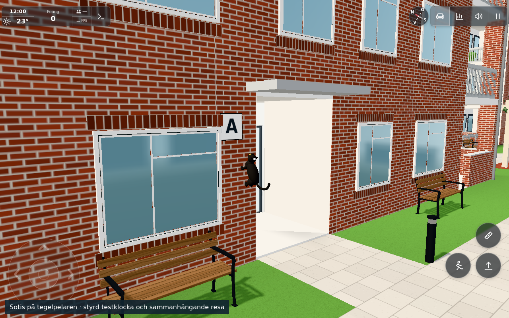
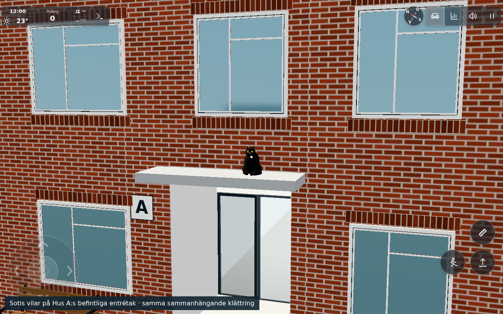
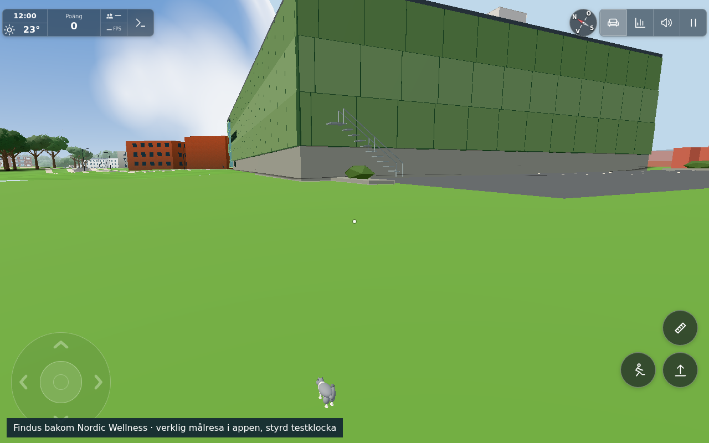
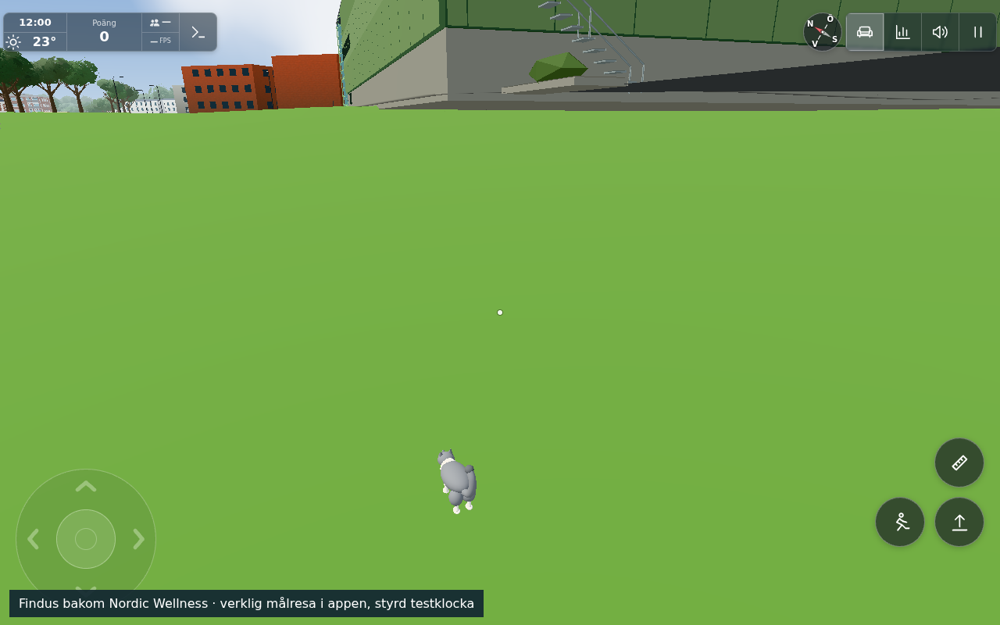
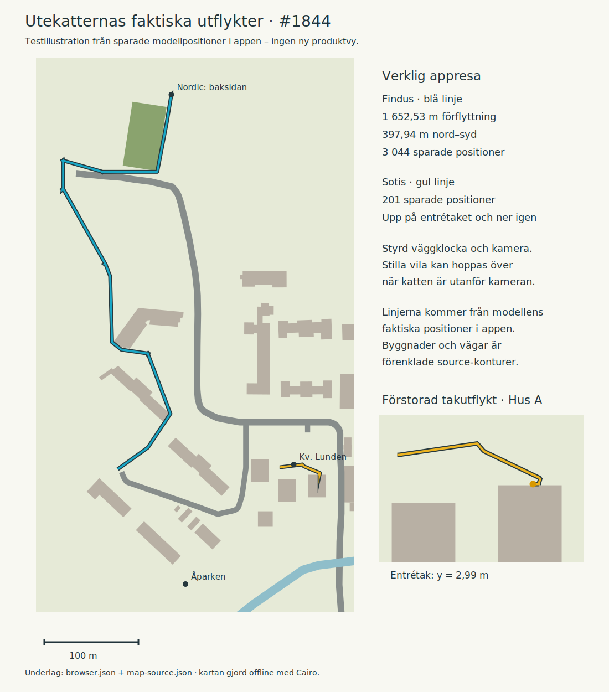

# Goal-driven outdoor-cat exploration (#1844)

Base: `1227a731` (full SHA and final file hashes in [sources.json](sources.json)). One original-only implementation; publication and the generic public #245 follow-up belong to the conductor.

The four existing cats now choose between18 validated goals and21 reusable connections. Novelty, progressively discovered reach, hashed identity/day/decision and existing personality traits select destinations; there is no compulsory enlarged polygon loop. Lazy cats make fewer journeys and rest longer. Rest is distributed through the day, avoiding a common afternoon/evening home-only period. Routes meet continuously at the daily boundary. Discovery is rebuilt deterministically each day, not stored in a new service; local visitor/food/social states pause that cat's schedule and return to the same anchor.

All-pairs paths are prepared once on this small graph. A cat/day uses at most56 decisions /1008 candidate evaluations, caches at most12 plans, and looks up poses by binary search. The existing32m desktop /18m phone /7m puppet gates and all models/materials remain. No new draw, light, storage or network service.

## Three scoped verification groups

1. **Pure AI/lifecycle and source-site contracts:13/13 PASS**, [node.txt](node.txt). Seven simulated days per cat verify actual visited positions, deterministic reloads, goal growth/variation, daytime/evening distribution, bounded work/cache and continuous return. The same brain tests preserve personality, winter/night outings, food and local behavior. Roof pause/food/return and a cat put down outside its roof are covered: the latter stays on ground and uses the existing unreachable fade/return lifecycle. The shared12cm source-edge predicate rejects the original grazing Nordic corner and accepts the corrected passage.
2. **Source-derived3D safety**, [scene-safety.json](scene-safety.json), [graph-and-wall-diagnostic.json](diagnostic/graph-and-wall-diagnostic.json), and the actual-app assertions in [browser.json](browser.json). All54 ground segments pass captured source solids/walls, dry drawn terrain and height-step checks. The final Node contract samples7579 points against walls, building/vehicle-way footprints and12cm edge clearance, including beyond Player's collision buckets. Six actual mesh rays confirm brick along Hus A's pillar; the actual roof and northern ground rays confirm paw support. `scene.json` and `final-scene.json` are byte-identical snapshots of the unchanged building/roof metadata.
3. **Actual final app**, [browser.json](browser.json):15 distinct successful contracts (19 assertion calls include repeated approach/arrival assertions during fixture corrections). Sotis approaches, climbs, rests on the existing Hus A entrance roof at y2.99 and descends.201 saved model positions, maximum step0.55m; stationary skipped rests drift0m.43 near animated contact samples have paw/body clearance5mm from the brick; the coarser LOD hull also stays outside. Findus travels to the actual rear of Nordic and returns south:1652.53m of model travel,397.94m north–south,3044 saved positions, maximum step0.753m. Real raw-fish lifecycle counts0→1, real pet action0→1, promotion retains Findus, carry works and put-down preserves the same instance. Actual render deltas: near24 calls /10008 triangles; medium1 /10008; outside range0 /0. No physical-device/FPS claim.

The final simulated period visits all18 goals for every cat and spans about530m north–south. Day0 decisions: Sotis46, Kanel24, Findus51, Smulan44. Per-day home minutes and distinct daytime/evening destinations are recorded in the Node JSON output; every tested day has several daytime/evening destinations and under30% home-only rest.

## Inspected results

All five result images were inspected by the worker and conductor; no more capture was requested.

The map is explicitly an **offline test illustration**, generated by [tools/catexploremap.py](../../../tools/catexploremap.py) with installed Cairo from real [browser.json](browser.json) positions and [map-source.json](map-source.json) contours. It has a100m scale and enlarged local roof trace. It is neither a product UI nor evidence of a new rendering mode. The first aerial capture was obscured by fog and remains diagnostic only.

## Source and fixture limits

- Ground contact follows the actual garage courtyard deck, drawn terrain triangles, northern feathered skirt and the existing Nordic parking quad. `createCatGround` reproduces existing surfaces; it does not change terrain or architecture. Only Hus A's selected entrance roof is a climbing affordance; the other houses are unchanged.
- Nordic lies beyond the player's unchanged northern WALK limit z−200. Only the invisible player boundary is omitted from cat development planning; actual building/road geometry is retained. Northern cat travel and test cameras do not establish ordinary player access there. The standalone pre-existing Nordic rear-ground mismatch is tracked in #1850; its low-camera diagnostic image is not an accepted cat result view.
- The first development search had an unsnapped endpoint and excessive bound and was interrupted. Recovery used spatial candidate indices, snapped endpoints and strict time/node limits. A second source diagnostic found the invisible Player boundary, which was then excluded explicitly. No runtime A* ships.
- The held final app loaded normal production modules. A measured23.6cm rotated-paw gap was corrected there by refreshing only contact/brain imports with cache-busted specifiers; source bodies and world geometry were preserved. The standing contact cache was rebuilt before attachment, exactly as the production constructor does. One Nordic link's two bend points then moved0.6m around a grazing corner; its ground heights and relevant trip were refreshed in the same scene. The shared local clearance predicate was refreshed before interaction checks. These import/fixture recoveries are not app failures.
- Roof images and its local travel remain valid across the northern bend-point and local-clearance correction. The final off-surface carry guard only affects a cat put down outside its roof, and is covered by the pure regression assertion; stable captured paths are unchanged. Final byte hashes and preserved geometry identities are in the manifest.
- Wall clock, visitor/camera positions and one raw caught fish are fixture controlled. Movement uses the real brain/OutdoorCats/model path; stationary offscreen rest may skip time. This is not a native fishing achievement or a real-time walk lasting hours. The normal start/overlay handshake is used. The final held browser reached its40min fixture deadline after functionality and the four accepted app images were saved; no app bootstrap was repeated for the map.

Manual helpers: `tools/catexplorebrowser.cjs ... final` starts the real final app and holds it for private `.command` / `.shot` / `.release` markers. `tools/catexplorefinal.js` establishes controlled clock/travel helpers; follow the saved roof segment times in `roof-travel.json`, then run `tools/catexplorenordic.js` and `tools/catexploreactions.js`. Planning mode additionally needs base1227a731 Git objects; ordinary Node checks have no history dependency. The source-site check uses the already installed Three0.170 dependency (as in the app); no repository dependency or build-system change was introduced. The final raw assertions/traces are authoritative, rather than treating an empty marker or a diagnostic screenshot as success.

Phase time: planning/implementation and source export about45min including the shared-browser wait; held final-app work about40min including the scoped contact/corner corrections; offline illustration, review and delivery documentation followed. Browser and own server stopped; no production KV requests, push or issue closure by this worker.

## Conductor integration

The combined source retains the roof-contact initialization/pose hook and social-pose hook, plus both elevated-surface feeding and social interruption. Final combined cat tests pass18/18 in [integration-cat-node.txt](../1845/integration-cat-node.txt). [Exact source/config preservation](../1844/integration-sources.json) confirms399 other config exports unchanged, the expected cat/duck blocks and10 worker-module byte identities. The final graph supplies the same natural park meeting at Unix1793577422;42 approach samples pass its12cm source-edge rule. Prior inspected app images remain the scoped visual evidence; no routine browser repeat after integration. Cat.js only names an existing nose mesh relative to1844, without geometry change.

Levererat i `131b5d9d9c11a5853320d7b36b4bf61409367f39`. [Pages](https://github.com/solwation/lunden-3d-apartment/actions/runs/41670475448) och [Worker](https://github.com/solwation/lunden-3d-apartment/actions/runs/41670475388) lyckades; Worker-loggen bekräftar faktisk Wrangler-deploy och den publika sidans version.json visar `131b5d9`. Dirigentens kombinerade diff-/bildgranskning är klar. Verifieringslänkarna ovan är permanenta; eventuella resultatbilder är granskade och bytekontrollerade. Ingen rutinmässig omkörning av gröna kontroller efter orelaterad integration. Ärendet stängs genom efterföljande verifieringscommit och aktiva etiketter tas bort.
