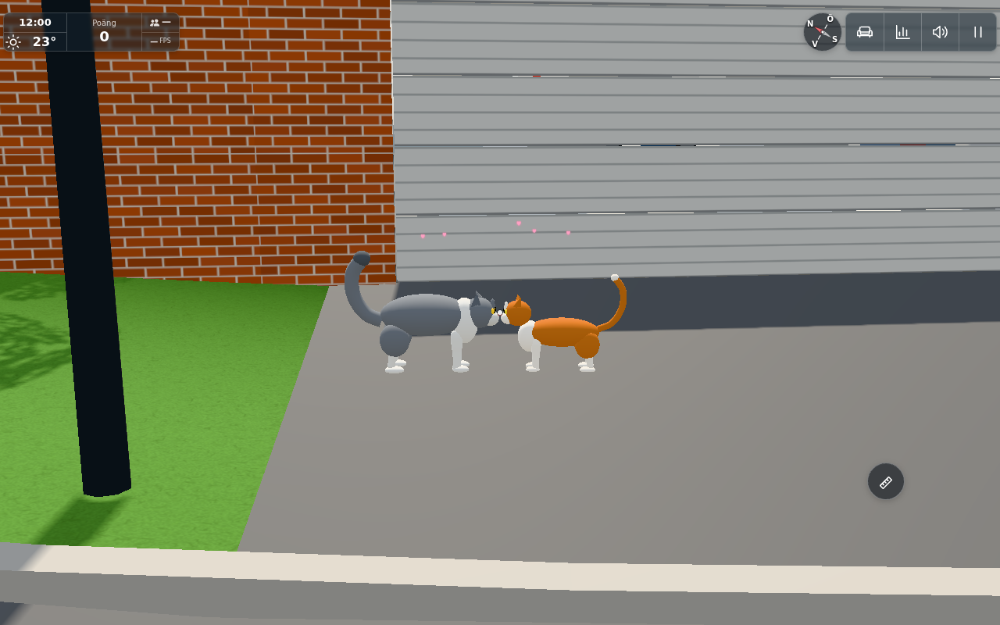

# #1845 – utekatter myser nos mot nos

Scope: ett lokalt socialt möte mellan två lediga markkatter i samma zon. Ingen ny spelinteraktion, poäng, medalj, lagring eller nättrafik. Gissningarna finns i `OUTDOOR_CATS.nuzzle`: 3 s parscan, sannolikhet viktad av socialitet, 150 s individuell paus, högst 5 m ansats och en kort kontakt. Bara ett par åt gången, inom befintlig puppetdistans och kamerabild; desktop/telefonens avståndsgrindar ändras inte.

Parmodulen använder #1844:s överenskomna `set('social')`/`set('home')`: utforskningens klocka fryses under mötet, sedan går katterna tillbaka till sitt frusna ankare och återupptar egen utforskning. Den skriver inte om habitat eller utforskningsplan. Upptagen, matad, promoterad/buren, sovande, klättrande eller vädergömd katt väljs inte. Matning får ta över social state; den upptagna katten behåller sitt nya tillstånd och partnern går hem. Även förlorad närvy eller blockerad väg avbryter.

`cat-nose` namnger den redan befintliga nosmeshen, utan geometriändring. Verkliga stående nosmått mäts efter rasens ben-/huvud-/storlekstransformer. Kropparna står på var sin sida; en liten huvudrörelse håller nosytorna intill varandra. En återanvänd, lat skapad Hearts-pool ger fem korta hjärtan, inga nya lampor.

## Kontroller

`node.txt`: 5/5, grupperade över parval/tid/avbrott, modellkontakt/kroppsfrigång och faktisk #1844 paus/återgång. Körning:

```sh
CAT_BRAIN_SOURCE=/path/to/composed/src THREE_DIR=/path/to/three node --test tools/catnuzzletest.mjs
```

De fyra första kontrollerna kan köras utan `CAT_BRAIN_SOURCE`. Modellkontrollen använder riktiga `createCatPuppet` för både gårdens och parkens raspar, mäter nosytornas kontakt och kontrollerar att verkliga torso-bounds inte skär varandra. Den femte använder exakt komponerad #1844-hjärna och återgår till route utan förlorat ankare/klockbokföring. Den första extra brain-fixturen saknade exporterad route/config-dependency (`node-fixture-missing-route.txt`); den diagnostiken är inte ett produktfel. Kompletta beroenden gav grönt resultat.

En enda riktig appscen används för tidsplanerat möte, kontakt/hjärtan, ritdelta och återgång. Chansutfallet accepteras deterministiskt i fixturen; parval, fri väg, tillgänglighet, kropp och kontakt kör vanlig produktkod. Katterna sätts vid sitt schemalagda ögonblick, inte vid konstruerade mötespositioner. Den accepterade kontrollen finns i `browser-retry.json` och råloggen `browser.txt`. Naturligt möte: Unix 1793577422 (2026-11-01 23:57:02 UTC), medan scenens ljus är fryst till klar sommardag. Findus startar [-72.9140,39.7477] (goal 2/segment 387), Smulan [-73.3144,43.2510] (goal 0/segment 2). Exakta start-/schemauppgifter finns i `browser-schedule.json`. Inga konstruerade mötespositioner används. Modulerna väljer och går till mötet runt [-73.1142,41.4993] själva; fixturen accepterar chansutfallet och placerar observatören vid sidan.

Verkliga nosytors mätta gap är 2,65e-15 m (flyttalsnoll). Båda återgår till route, med cirka 10 s bokförd paus och ingen kvarvarande hjärteffekt. Samma kamera och scen med effekten av/på: 332→333 draw calls, 892 175→892 175 trianglar, 80→85 points; scenen har nio ljus och effekten skapar inget ljus. Samma fem Points och material används efter storleksjusteringen, utan ändrad geometri eller anropsmängd.

### Slutbild



Denna granskade närbild använder halverat kamerafov som vittnesutsnitt; kattpositioner och kontakt ändras inte av kameran. Slutlig `heartScale` är **2,5**, med befintliga Hearts konstruktionsvärden `k=2.5`, `material.size=0.1125`, fem partiklar. De ursprungliga bilderna `contact-hearts.png` och `contact-close.png` använder 1,3 och är förejustering: noskontakt godkändes men hjärtana var bara rosa prickar. I samma hållna appscen återspelades samma naturliga möte för enbart slutbilden med de nya konstruktionsvärdena. Övrig grön funktions-/återgångsdata återanvänds; inga nya matriser eller appstarter för effektstorleken.

### Källfaser och fixturfel

Basen är `26b32dcbf76570c2bd7cd41400b56faef51d5635`. `sources.json` anger exakt fryst #1844-hjärna, graf, habitat och main samt komponerad OutdoorCats/config och egna nosmoduler. Bara `OUTDOOR_CATS` från #1844 används ovanpå basens aktuella config; övriga konfigblock bevaras. Den enda avsiktliga mergepunkten i feed-villkoret bevarar #1844:s surface-vakt och lägger till social state.

Första appförsöket blandade av misstag äldre helkonfiguration med basens nyare gatukod och stoppades före katter: `SITE.street.busStopName` saknades i street.js. En normal retry i samma browser med enbart kattblocket komponerat gav alla gröna resultat ovan. Detta är ett testkompositionsfel, ingen ändring i produkten. `browser.json` är den avbrutna första körningen; `browser-retry.json` är det accepterade resultatet. Browserwrapperns 8-minutersgräns nåddes vid slutlig release (signal 137), efter att resultaten var sparade och slutbilden direkt granskad. Ingen ny browseromgång gjordes för detta; processen är avslutad.

Target har därefter lagt till klätterkontakt, två Nordic-böjpunkter och en 12 cm byggnadskantsgrind i #1844. Dessa ingår inte i detta frysta browserunderlag; social/home-API:t är oförändrat. Integrationsgranskningen ska bevara båda pose-hookarna och jämföra det nya grafunderlagets naturliga möte i ren Node. Denna bild bevisar inte det senare grafunderlagets exakta väggklocka. Ingen ny appbootstrap planeras för de dokumenterade lokala skillnaderna.

## Avgränsning

Ingen bred profil, Roommatris eller fysisk telefonkörning behövs för denna lokala miljö-AI. L/A/B/C:s layoutvarianter är inte berörda; kattmodellen och den gemensamma ute-AI:n är ändringsgränsen. Publik tillämpning bedöms separat av dirigenten efter källpublicering inom miljödjursundantaget; inga personliga namn, spelarinteraktioner eller tjänster ska överföras. #1846 ankpussar och #1847 Styrkelyft ingår inte.


## Conductor integration

The combined source retains the roof-contact initialization/pose hook and social-pose hook, plus both elevated-surface feeding and social interruption. Final combined cat tests pass18/18 in [integration-cat-node.txt](../1845/integration-cat-node.txt). [Exact source/config preservation](../1844/integration-sources.json) confirms399 other config exports unchanged, the expected cat/duck blocks and10 worker-module byte identities. The final graph supplies the same natural park meeting at Unix1793577422;42 approach samples pass its12cm source-edge rule. Prior inspected app images remain the scoped visual evidence; no routine browser repeat after integration. Cat.js only names an existing nose mesh relative to1844, without geometry change.


Levererat i `131b5d9d9c11a5853320d7b36b4bf61409367f39`. [Pages](https://github.com/solwation/lunden-3d-apartment/actions/runs/41670475448) och [Worker](https://github.com/solwation/lunden-3d-apartment/actions/runs/41670475388) lyckades; Worker-loggen bekräftar faktisk Wrangler-deploy och den publika sidans version.json visar `131b5d9`. Dirigentens kombinerade diff-/bildgranskning är klar. Verifieringslänkarna ovan är permanenta; eventuella resultatbilder är granskade och bytekontrollerade. Ingen rutinmässig omkörning av gröna kontroller efter orelaterad integration. Ärendet stängs genom efterföljande verifieringscommit och aktiva etiketter tas bort.
