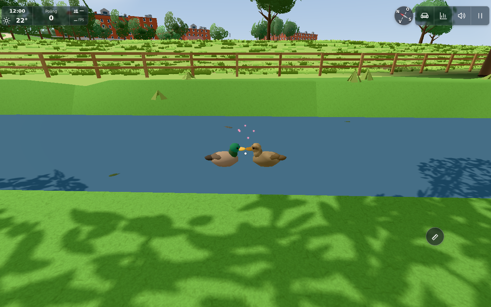
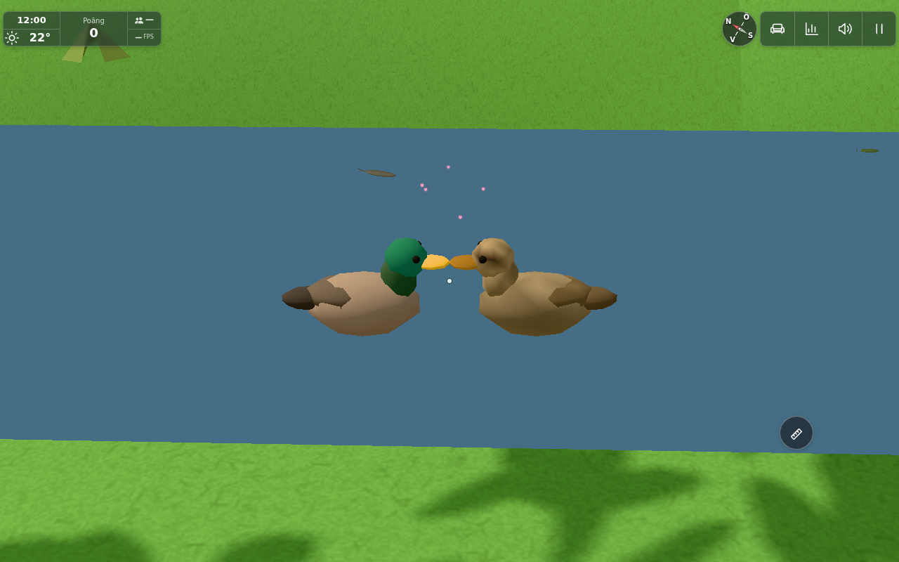

# #1846 – ankparens näbbpuss

Bas `a698f659`, exakt revision och runtime-SHA256 i `sources.json`. Ingen extern config/main-komposition: bara det nya ankblocket och de små Ducks-hookarna ligger ovanpå egen bas. Par, kön, färger, fyra 640-trianglars kroppar, habitat, matning, poäng och befintliga ljud är bevarade.

En liten lokal modul lånar ett av de två stabila paren. Honan skapar frigång före vändningen; båda vänder mot sin partner och närmar sig tills deras verkliga modellnäbbfronter möts. Efter kontakt drar de sig lite isär före återvändningen till tidigare riktning och vanlig hona-ledd rörelse. Samma yttyp och högst 1 cm höjdskillnad längs ansatsen krävs, så ojämn strand/land–vattenbyte avböjs. Modellen förändras inte; bill-fronten mäts från de befintliga vertexpositionerna.

Gissningar finns i `DUCKS.kiss`: första scan efter 20 s, därefter 10 s mellan försök, 12% chans för ett giltigt synligt tillfälle och 180 s individuell cooldown. Bara ett par åt gången och inom 12 m/kamerabild, under ordinarie 65 m AI- och 100 m ritgräns. Aktiva flockgrupper störs inte. Matningslure, lyckad matning, eating/cooldown, förlorad närvy, dold/ogiltig yta eller timeout avbryter. Inga nya poäng/medaljer, ljud, knappar, tjänster eller lagring.

## Tillräckliga kontroller

* `node.txt`: 3/3 – stabilt verkligt par, sparade mål/seed, ansats/kontakt/återgång och cooldown; matning/lure/dold/fjärran/ogiltig yta och nollchans; verklig hona/hane-modell med korrekt näbbfront och fria kroppsextenter.
* `feeding.txt`: befintliga `node tools/ducktest.mjs` – gång/simning, brödlure, tuggpaus/cooldown, exakt fyra ändliga brödbitar, borttagning vid noll, vägran för förpackning/toppat bröd/stale eller upptagen hand. `rewards.txt`: befintliga `node tools/duckrewardtest.mjs`, 3/3 för räknare/medalj/dagstak. `onFeed`/valideringen ändras inte; det enda tillägget är avbrott efter lyckad befintlig brödkonsumtion.
* `browser.json` / `browser.txt`: EN riktig appturn, inga fel eller omtag. Befintliga seedade hem och normala habitatvägar används; inga konstruerade fågelpositioner. Observatörskameran följer paret och fixturen accepterar chansutfallet deterministiskt. AI väljer, närmar sig, vänder och kontaktar själv.

Det naturliga tillfället inträffar vid lokal AI-tid 110,4 s för hona id 0/hane id 3, runt [-166.715,205.396]. Föregående mål och seed sparas i browserresultatet. Horisontellt näbbfrontgap är 0 m; höjdskillnaden är 1,02 mm inom modellens 21,63 mm höga frontkant, alltså verkligt överlappande kontaktintervall. Kropparna ligger tydligt isär. Båda fortsätter den normala flockrörelsen efteråt och hjärtana försvinner.

Samma statiska kamera/scen, bara effekten av/på: **35→36 draw calls**, **335 015→335 015 trianglar**, **80→85 points**. Fortfarande fyra ankmesh, inga nya ljus/skuggkastare. En lat återanvänd Hearts-pool med fem partiklar, `heartScale=2.5`, används även vid senare tillfällen; ingen permanent fjärreffekt körs.

## Granskade resultatbilder

Närbilden använder halverat kamerafov som vittnesutsnitt. Samma faktiska kroppar, kontaktfas och fem partiklar visas; inga modeller/positioner byts för bilden. `approach.png` visar den första ansatsen. Båda slutbilderna är direkt inspekterade och accepterade före browserrelease.

## Gränser

Detta är lokal ambient AI, ingen fysisk telefon-, nät-/Room- eller bred scenprofil. Ordinarie avståndsgrindar utökas inte. L/A/B/C:s husvarianter berörs inte: modellen och det gemensamma åhabitatet är kontrollgränsen. Den visuella pussen är lekfull, inget zoologiskt faktapåstående. Offentlig miljöanpassning bedöms av dirigenten efter källpublicering inom den ostartade konsoliderade #244; matning/poäng/personligt innehåll/tjänster ska inte följa med. Katter och Styrkelyft ändras inte.
