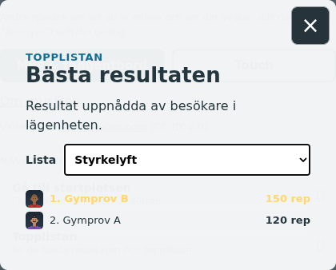
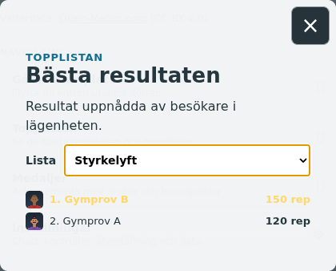

# #1847 – Styrkelyft

Den enda produktändringen är en `BOARD_LISTS`-post: `styrkelyft`, `kind: most`, `counter: gymReps`, exakt titel **Styrkelyft**, enhet **rep**. Bas `a698f659`; exakt revision/källhashar i `sources.json`.

Alla befintliga accepterade repetitioner används. Inga ändringar i COUNTERS (30/min, start 10 000), räknare, synkintervall, servercadens, rankningskod, lagring, gymcykler, poäng/dagstak eller biceps. Befintlig fallande antal-/tidsordning vid lika värde, namn/avatarer och egen rad återanvänds. Inga vikter, maxlyft eller tjänster tillkommer.

## Kontroller

* `node tools/strengthboardtest.mjs`: riktig `cloudflare/worker.js.fetch` och `/boards` POST/GET med isolerad minneslagring, två lokala fixture-spelare. Äldre sparade gymReps syns direkt utan återställning eller ny GET-skrivning. Lika 120 rep behåller den befintliga äldre-rad-först-regeln; därefter uppdateras den andra spelaren genom riktig POST och rankas 150 före 120. Ogenomskinliga row keys, avatarer och övriga listor bevaras. Råresultat i `worker.txt`, publik respons i `worker-fixture.json`.
* `browser.json` / `browser.txt`: riktig **index.html DOM och CSS**, verkliga **Leaderboard och Boards**, mus/touch. Endast `src/bootstrap.js` ersätts så att den orelaterade stora 3D-världen inte byggs. `/fixture-api/boards` svarar med ovanstående faktiska lokala Worker-resultat; ingen produktions-Worker kontaktas. Native click/tap öppnar väljaren/dialogen, listvalet görs via det riktiga select-elementet med Playwright selectOption, och verkliga change-handlern hämtar/renderar listan. Detta certifierar komponentens touch-/valväg, inte en fysisk telefons OS-väljare. Default Totalpoäng, exakt titel/enhet, fallande värden, avatarer, verklig `mine`-markering, sparat val, annan befintlig lista samt stäng/öppna passerar. Inget horisontellt spill eller page error. Alla boardanrop går till lokal intercept; inga provrader skickas till produktion.
* `node --test cloudflare/deploypaths.test.mjs`: passerar. `cloud.yml` innehåller redan `src/boardcatalog.js`; ingen workflowändring behövs. Dirigenten verifierar faktisk Pages- och Worker-driftsättning efter publicering; den har inte körts från denna checkout.

#1842:s sparade fullcykel-/ingen-passiv-rep-, medalj-/dagstaks- och pumpunderlag återanvänds: [befintlig verifiering](../1842/README.md), med 13 komponentkontroller och åtta tidigare rep-/poängregressioner samt faktisk input/Room-gräns. Denna ändring skriver bara en katalogpost och rör ingen av de källorna. Inga gymrundor eller breda 3D-/husmatriser upprepas. L/A/B/C:s geometri är inte berörd.

## Granskade resultatbilder

Båda visar de lokala fixture-spelarna Gymprov B (150 rep) och Gymprov A (120 rep), med B markerad som egen rad. Båda bilderna är direkt inspekterade och accepterade före browserrelease. Ingen 3D-route eller verklig gameplay-session påstås av dessa komponentbilder.

Gameplay/topplista/Cloudflare är original-only. Ingen offentlig port ska göras.

## Dirigentens integration

Katalogen och8berörda kärnmoduler är byteidentiska med arbetarens gröna underlag; se [integration-sources.json](integration-sources.json). Alla4nya changelogposter har egna unika stigande tilldelade id, visas nyast först; alla gamla poster bevaras. De två bilderna är direkt granskade. Inga nya UI-/gymrundor behövs efter de orelaterade katt-/ankändringarna. Faktisk Pages-/Worker-verifiering följer före stängning.

Levererat i `131b5d9d9c11a5853320d7b36b4bf61409367f39`. [Pages](https://github.com/solwation/lunden-3d-apartment/actions/runs/41670475448) och [Worker](https://github.com/solwation/lunden-3d-apartment/actions/runs/41670475388) lyckades; Worker-loggen bekräftar faktisk Wrangler-deploy och den publika sidans version.json visar `131b5d9`. Dirigentens kombinerade diff-/bildgranskning är klar. Verifieringslänkarna ovan är permanenta; eventuella resultatbilder är granskade och bytekontrollerade. Ingen rutinmässig omkörning av gröna kontroller efter orelaterad integration. Ärendet stängs genom efterföljande verifieringscommit och aktiva etiketter tas bort.
