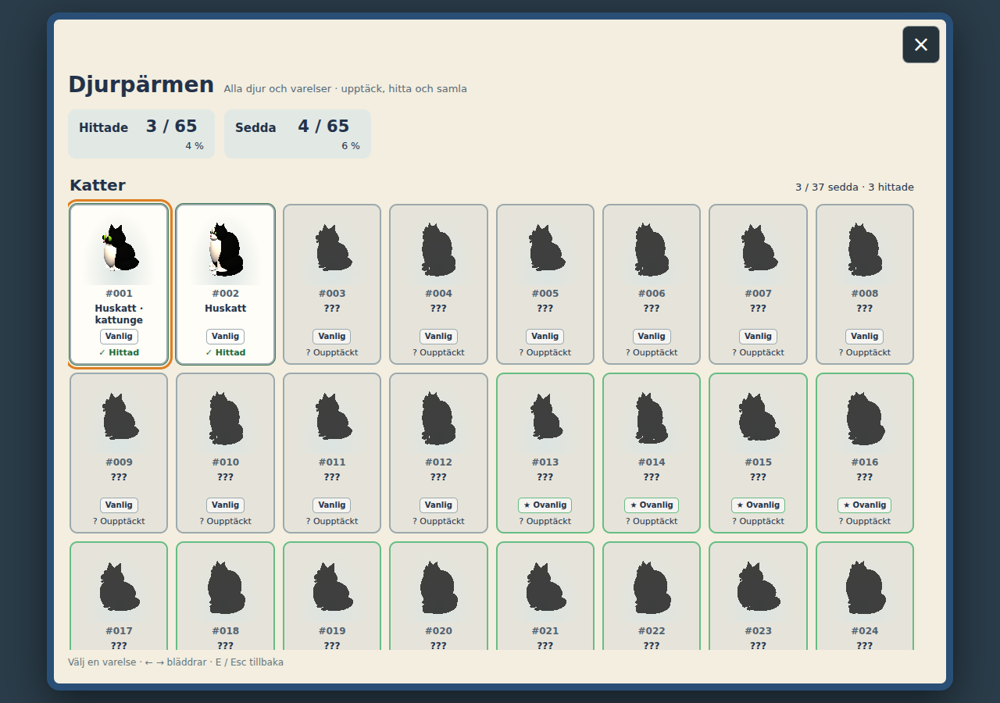
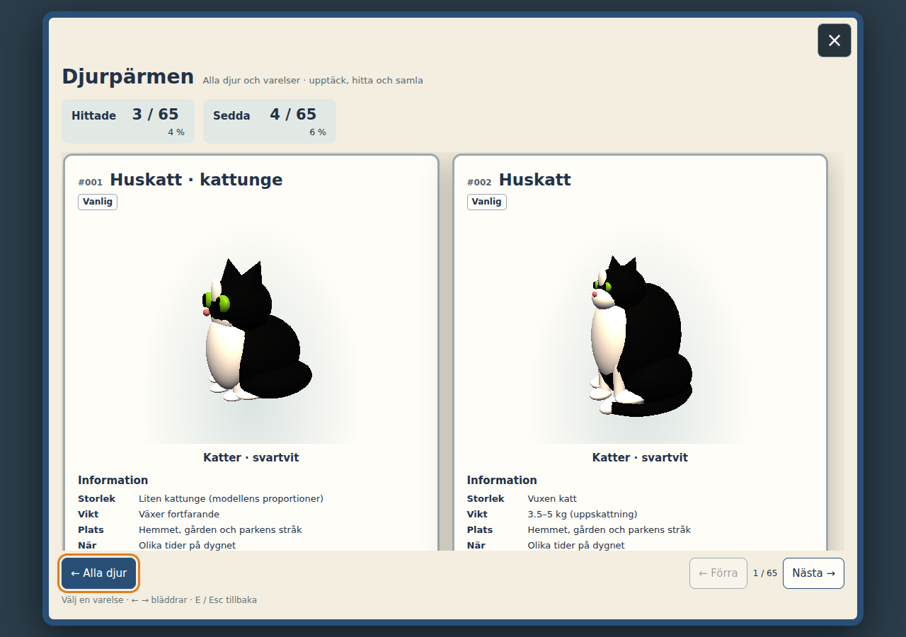
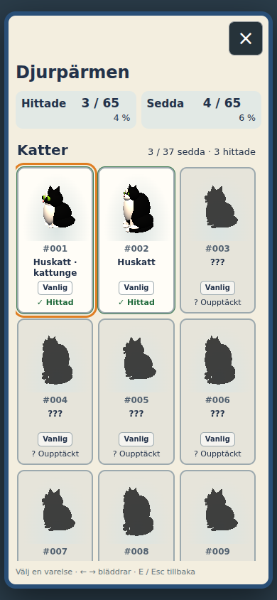
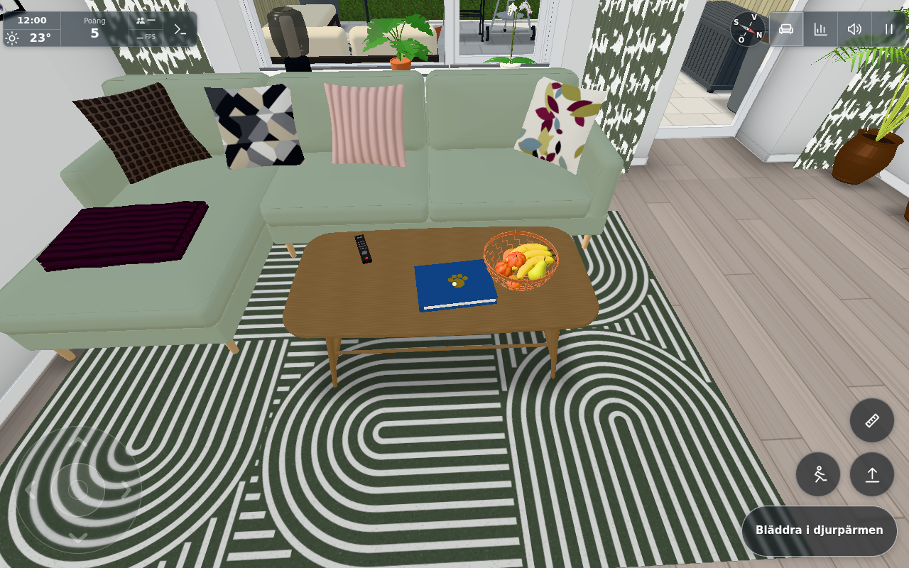
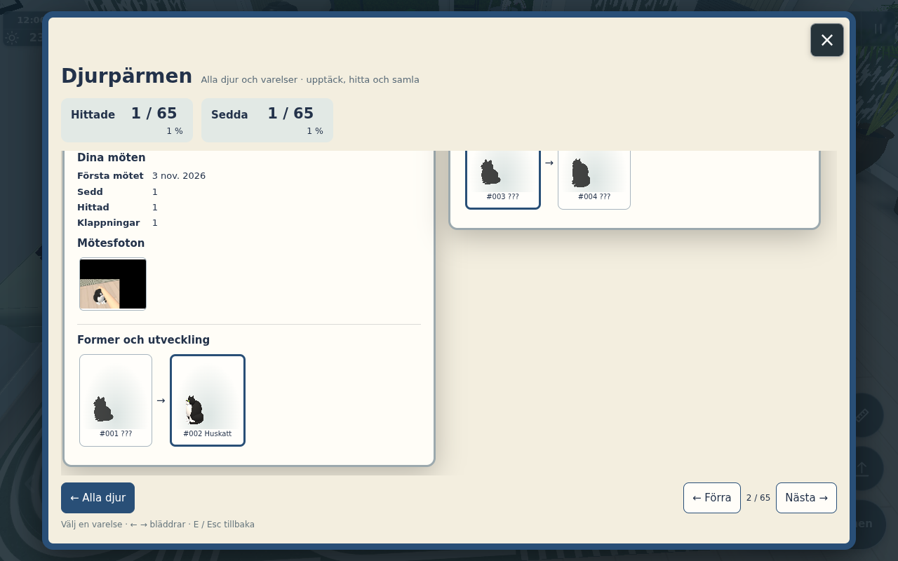
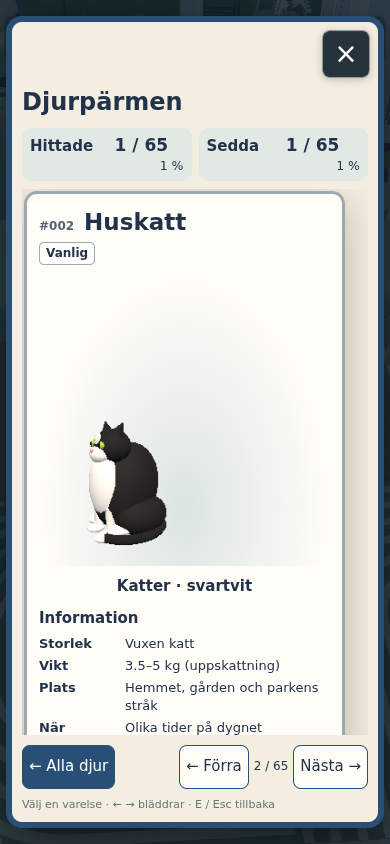

# #1848 – Djurpärmens UI och bordspärm

Gym-worker äger här bara `catbinder.js`, avgränsad `#binder-view`-markup/CSS, `catbinderprop.js`, soffbordets exakta furniture-hook och CAT_BINDER:s placeringskommentar. Register, events, upptäckt/fynd, lagring/IDB, modellrecept/bildprovider och main ägs av integrationsägaren. Ingen egen claim eller separat feature har skapats.

Alla fyra användarreferenser lästes/inspekterades: det numrerade Pokédex-rutnätet, detaljkortet med kedja, tvåkortsuppslaget och samlingsvyn med sedd-/fyndräknare. UI använder detta som struktur i spelets svenska pappers-/pärmstil, utan gamla fasta fotofickor eller rotationsregler.

## Kontrakt och beteende

`new BinderPanel({registry,collection,images},el)` behåller `.open`, `.show(bool)`, `.back()`, `.key(code)` och `.render()`. UI har ingen separat djurlista. `registry.list()/subscribe`, `collection.get()/summary()/subscribe` och `images.get(id,96|320)` bestämmer allt innehåll. En ny registrerad post dyker därför upp utan UI-ändring. Rarity-färger/märken visas även i översikten; stora kort återanvänder CAT_CARD:s foil/glitter-stil med stöd för minskad rörelse.

Översikten är ett numrerat rutnät med familjer, Hittade/Sedda/andel och egentliga mörka modellsilhuetter för okända. Transparent PNG från bildprovidern gör att modellen, inte en svart bildkvadrat, blir silhuett. **Familjens komplettmarkering betyder uttryckligen alla sedda**, inte alla hittade: mås och två fjärilsformer är sedd-poster utan eget fyndmoment. Dessa får en tydlig förklaring i detaljen, utan påhittad interaktion/fyndräknare.

Detaljen visar en stor modell, nummer, namn/variant, rarity, information/fakta, första mötet, egna antal/actions/bästa mått där de finns samt senaste mötesfoton. Bred vy visar två kort som uppslag; smal vy ett kort. En godtyckligt lång ID-kedja visas med klickbara modellminiatyrer/pilar, där okända led förblir silhuetter. Foto öppnas separat; Esc/E går foto→kort→rutnät→stängning via main. Pilar/Home/End sköter numrerad bläddring respektive rutnätsfokus; riktiga knappar stödjer mus/touch och Tab hålls i den öppna modalen.

UI beställer bara IntersectionObserver-synliga 96 px-bilder och synliga 320 px-detaljer. Kön har **högst en pågående get**, dedupliceras för synliga element och töms på stängning. Sena svar får inte skriva i en ny/stängd vy. En redan pågående bild kan slutföras i providern; UI startar inga fler jobb efter stängning. UI sparar inte egna miniatyrer eller privata fynddata. Lagringsfel från `collection.error` syns i ett statusfält.

## Tillräckliga separata kontroller

`tools/bindertest.cjs` är nu en tydlig ingång till `tools/bestiaryuitest.cjs`; den borttagna fasta fick-/rotationsmodellen testas inte längre som om den vore produkten. Komponentkontrollen använder verklig index-DOM/CSS, BinderPanel, integrationsägarens 65 registreringar, faktiska modeller/transparent bildprovider och en liten offscreen-renderer. Fynd och modellbaserat exempelfoto är uttryckliga **UI-fixturer**, inte bevis på spelvärldens discovery-wiring. Ingen lägenhetsvärld startas av denna kontroll.

`component.json`/`component.txt`: desktop 1280×900 och touch 390×844 passerar numrering/familjer, sedd-/fyndskillnad, verkliga silhouettes, rarity, två-/enkortsdetalj, fakta/statistik/foton, hierarkisk Esc, pilar, nya registreringar utan UI-edit, en åtta-ID-kedja, synligt lagringsfel och stoppad bildkö. Initialt beställs bara 7 av 65 bilder, max en samtidigt. Båda bredderna är utan sidspill. Detaljerna har ingen ärvd höjdklippning; nedre fakta/foton/kedja är nåbara. Inga page errors.

`tools/bestiaryproptest.mjs` / `prop.json`: den riktiga propbyggaren har tre meshbatcher/118 trianglar och inget nytt ljus/skuggkastare, som tidigare. Pärmens nederkant vilar på bordets **lokala 0,47 m** (i kontrollens mattförskjutna värld y=0,482). Exakta standard-x/z är kvar. Cirka 5,93 cm marginal till fruktskålens X-bounds och 8,25 cm till fjärrens, säsongens champagneglas också fria. Översidesray träffar binder-target; undersidesray genom skivan avvisas. Även roterad/flyttad föräldratabell behåller korrekt occlusion, och furniture-hook använder `y: h`.

Två faktiska korrigeringar under egen verifiering finns dokumenterade: första UI-fixturens generella src-route gav CSS fel MIME och lämnade menyns QR synlig (testkomposition, inte produktfel); därefter upptäcktes att min nya `.card` behövde uttrycklig `max-height:none/max-width:none/margin:0` så globala menykortsregler inte klippte detaljinnehållet. Slutliga komponentkontrollen innehåller en riktig unclipped-assertion. Tidiga råloggar heter `component-*-diagnostic.txt`.

## Granskade komponentbilder

Dessa är komponentbilder med markerade UI-fixturer. Diagnostikbilderna i `diagnostics/*-chain-before-lazy.png` togs före den asynkrona miniatyrkön hann fylla bilderna och är inte slutbevis för kedjans modellbilder. Integrerad appkontroll och den fysiska pärmbilden samordnas av integrationsägaren i en enda riktig världsscen; `tools/bestiarynative.cjs` kör mus/touch/keyboard på en redan öppnad verklig panel och kräver verklig statistik/foto utan att skapa upptäckter eller starta en ny värld.

## Gränser

Ingen global 3D-/husmatris, fysisk telefon eller extra molnsynk verifieras här. L/A/B/C:s byggnadsgeometri är inte ändrad; den bordslokala propbyggaren följer den befintliga möbeltransformen. Den personliga samlingen och soffbordspärmen är original-only, ingen offentlig port. Helärendet hålls öppet till gemensam register/events/UI/bildbudget-acceptans.

En sen kodgranskning lade till en enda återöppningsguard: `show(true)` nollställer rutnätets scroll före render så ett tidigare långt detaljkort inte lämnar det första tangentbordsfokuset utanför bild. Integrationsägaren är informerad och kontrollerar den lilla metoden i den hållna scenen utan omstart; övrig UI-källa är oförändrad.

## Gemensam faktisk appacceptans

Integrationsägarens **enda** verkliga appturn är nu avslutad och direkt granskad av både dirigenten och UI-worker. Primärdata: [app/browser.json](../1848/app/browser.json), [kombinerade källhashar](../1848/app-sources.json). Native handlingsknapp öppnade pärmen på bordet. En verklig huskatt gick från sedd men inte hittad till ett fynd/en klapp/ett verkligt världsfoto efter native Klappa katten; poängen gick från 5 till 15 genom befintlig kattregel. Riktig IDB-återläsning behöll fynd/klapp/foto. Desktop visade två kort, 390×844 touch ett kort. Foto/Esc/pil och touch foto/tillbaka passerade. Den sena återöppningsguardens show-metod hothämtades i samma hållna scen och gav scroll 0 vid ny öppning; ingen ny appbootstrap gjordes.

Contexten var touchkapabel och valde normal Touch-start; världens tangentbords-E var då korrekt spärrad utan pointerlock och används inte som keyboard-world-bevis. Pärmens tangentbordsväg verifierades separat i UI-komponenten och panelen i den faktiska appen. Ingen inputomskrivning eller fysisk telefoncertifiering påstås.

Samma världsbild före/efter UI: **210 calls / 663 871 trianglar / 1 271 geometrier / 51 texturer**, exakt samma båda gånger. Totalt 27 små modelljobb, 48 cacheträffar och 24 minnesposter; inga kvarvarande bild-/fotoköjobb. Detta är en riktad isolerings-/resurskontroll, inte en generell Surface Pro-FPS-certifiering.

Använd `tabletop-prop.png` som propbevis. Filen `tabletop-prop-final.png` har pausmenyn ovanpå och är diagnostisk; den tydliga första bilden är redan fullgod och ingen omtagning behövs. Dessa appbilder hör till core-ägarens commit; UI- och core-commits måste integreras som en sammanhängande feature före publicering. Gemensam changelog/README/topic-text ägs av core-ägaren, ingen duplicerad featurepost görs här.
