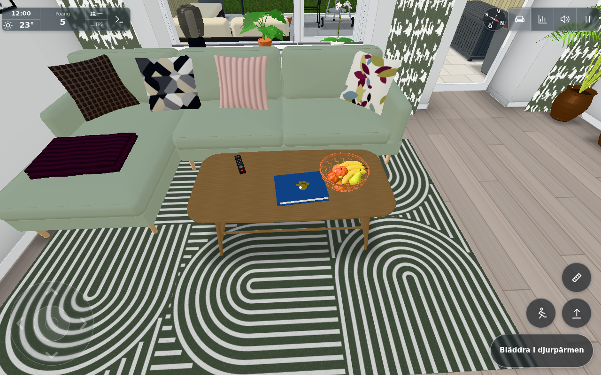
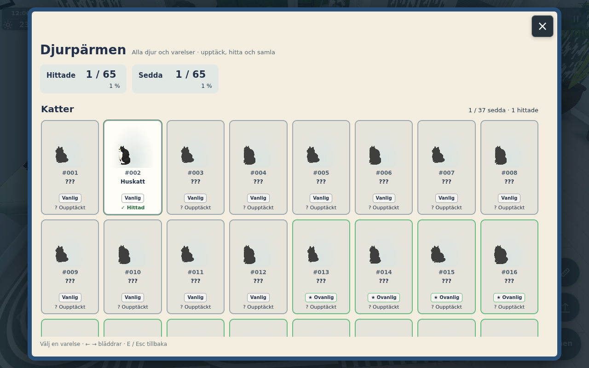
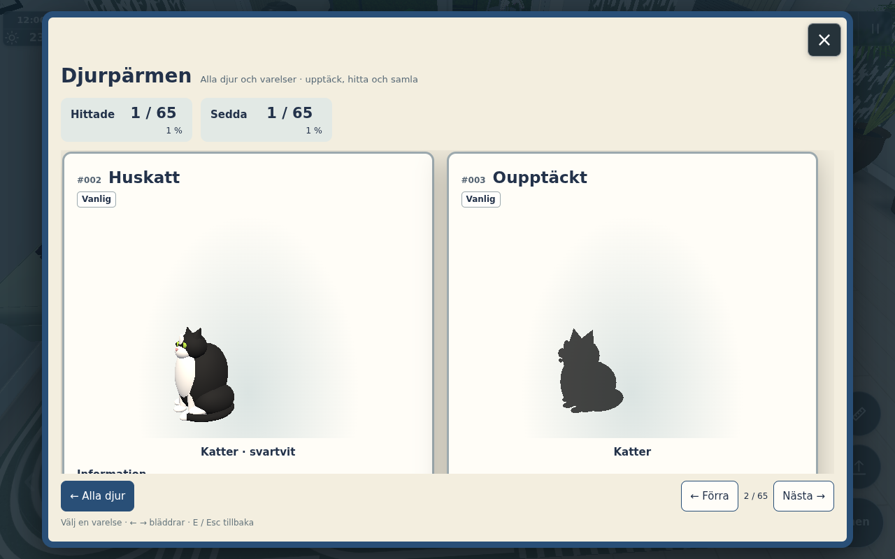
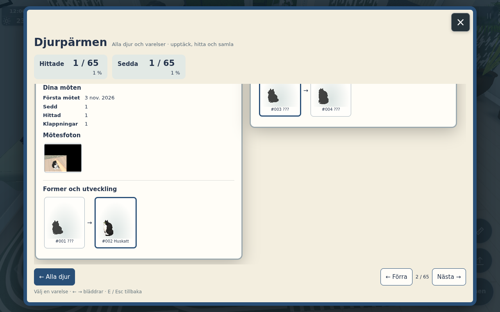
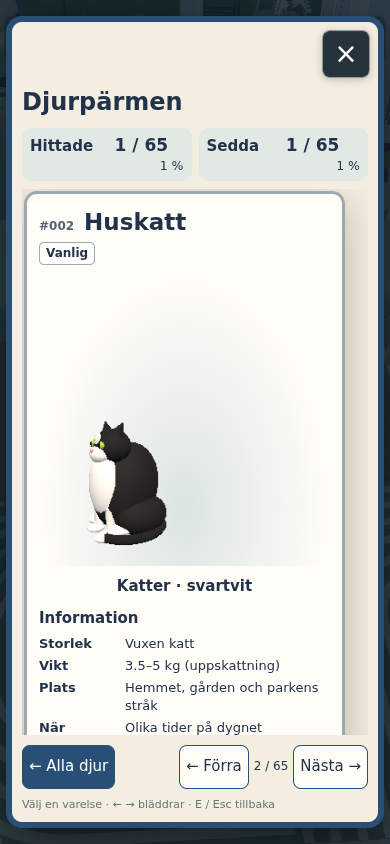
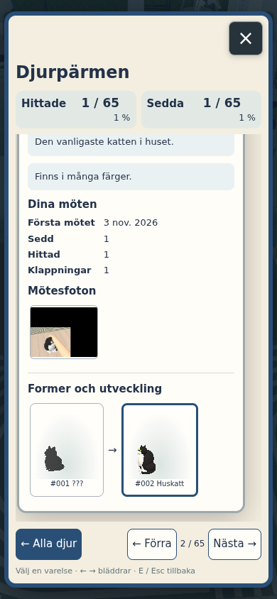

# #1848 — Djurpärmen

Implementation base: `131b5d9d9c11a5853320d7b36b4bf61409367f39`. Original gameplay/personal collection only; no applicable public port and no new Cloudflare service or wire field.

## Inventory and registration contract

The production modules register 65 entries in `bestiary.js`, independently of binder UI code. Explicit numbers are append-only; a new form must receive a new unused number, even when its family sorts earlier in the grid. Never recycle or renumber an existing ID. Increment `modelVersion` when a recipe/model changes so disposable thumbnails refresh. The source-derived catalogue check fails on missing/extra spawn forms, duplicate numbers, missing information or dangling chain links.

| Numbers | Source | Actual forms |
| --- | --- | --- |
| 001–037 | `cat.js` BREEDS/coats | 18 coat/breed combinations × kitten/adult, plus adult Miele |
| 038–047 | `squirrels.js`, SQUIRRELS.animals | Ten configured coats/shapes |
| 048–049 | `ducks.js`, duckmodel.js | Male and female mallard plumage |
| 050 | `birds.js` | One gull form; low/high flocks are the same species |
| 051–057 | `riverfish.js`, `shark.js` | Six configured fish species and the rare shark |
| 058–059 | `paddock.js`, PADDOCK.pony.animals | Zoey and Princess coats/markings |
| 060–062 | `outdoorcats.js`, `marks.js` | Yellow/orange chase butterflies and the wand's magical butterfly |
| 063–065 | `santa.js`, `olof.js`, `pingping.js` | Actual meetable/animated figures |

`ghostcat.js` is a remote player's held-cat appearance proxy, **not a spectral creature species**. It and outdoor cats resolve to the same breed/coat/age IDs. The observer includes genuinely visible held proxies. Live/caught fish also share species IDs; size, cooked state, fin/body/skeleton, clothing/blankets, individual random cat names and real-player avatars do not invent extra biological forms. `nest.js` is a smart speaker, not a bird module. Static toys/secret trinkets and stars/hearts/smoke are not independently moving creatures. This is the source-based correction to the issue's filename assumption, not an omitted species.

Kitten/adult chains are linked ID arrays, with no fixed length in the registry/UI. Miele and species without a modelled growth stage retain one entry. Measurements not produced by game logic are explicitly estimates; the source model supplies actual scale/length where available. Rarity reuses the five CAT_CARD tier labels without adding points or a family bonus.

## Events, persistence and budgets

The observer runs every 0.75 s, tests only actual visible production instances, projects their current model/shader positions and checks at most two candidates for occlusion using a visual-only Marks segment helper. Transparent/hidden overlays are skipped without masking later opaque surfaces; opaque doors and instances still occlude. The older 2D interaction wall rule is not used. Local forms use 45 m, gulls 150 m; shader-hidden high birds do not count. Sightings repeat at most once per form/minute in a visit. A real interaction also establishes the first sighting once. Pure visibility never sets `found`.

Found actions are actual successful pet/hug/feed/catch/scare/greet events. Existing validation, cooldowns, finite bread/nuts, fish catch verdicts, scores/caps and cat first-found counters remain in their original paths. Remote pony pats and feeding somebody else's nut do not become local finds. Gull and the two outdoor chase butterflies have **sighting-only** entries because they have no player interaction; their detail cards say so. Family completion means **all seen**, with separate honest found totals.

Personal metadata uses the pinned profile's `lunden.bestiary`; it survives a home reset like the prior personal album. IndexedDB v4 adds `bestiaryPhotos`/`bestiaryThumbs`, retaining all old stores/data without migration into the new collection. Legacy-profile deletion clears both new stores; other profile databases remain separate, and stale deleted-player adapters cannot write. Existing drawings/cloud sync are unchanged; the old cat collection was already local.

Keep three latest actual encounter photos per entry. Photo writes serialize per entry; a failed transaction keeps previous photos and discoveries and reports a visible error. Base64 is never duplicated into synchronous localStorage. A global, de-duplicated queue holds at most eight pending IDs, rechecks current visibility/occlusion and renders at most one world photograph per five seconds, at least thirty seconds apart per form. The existing cat pat-photo event now uses that same budget. Photographs are best effort if an animal leaves view or graphics/storage is unavailable; this never rolls back discovery or points.

Model images are transparent PNGs made from the production geometry/material factories, lazily at 96 px (grid) or 320 px (detail), queued one at a time using the existing renderer and a temporary offscreen target. Cache keys contain stable ID/modelVersion/size; IndexedDB serves a newly-created provider without rendering. At most 24 data URLs stay in the provider's memory; visible DOM images have their normal browser-managed decoded lifetime. Only visible UI cells request thumbnails; no continuous extra world render/context/light/shadow. Offscreen lights exist only in the disposable thumbnail scene. Shared caught-fish geometries/textures are never disposed; private materials/geometry, render target and skeleton resources are disposed. Renderer state/counters restore after both thumbnail and encounter-photo jobs; those jobs' real cost is reported separately, not hidden in a world draw-delta claim.

## Focused checks

- `node --test tools/bestiarytest.mjs tools/bestiarycatalogtest.mjs tools/playerprofilestest.mjs tools/duckrewardtest.mjs`: **18/18**, raw `data.txt`. Covers exact source forms/numbers/chains, observation versus action, high-bird gating, bounded work, visual sight through transparent hits to later solid doors/instances, dedup/reload, best catch, transactional/concurrent photos, profile/deletion isolation, storage failure, global snapshot queue and existing duck cap semantics.
- `tools/bestiarymodeltest.cjs`: **65/65 recipes**, real production modules and WebGL renderer in a component page. Real IndexedDB v3→v4 retains the legacy photo, both new stores exist, 65 transparent 96 px renders and a fresh provider's IDB cache hit adds zero renders. Live cat/fish/squirrel arrays remain unchanged; fish geometry receives no dispose. Clear colour/alpha, viewport, scissor/test and render target restore exactly; no browser errors. `models.json` is the final IDB run. The earlier diagnostic run used an in-memory backing store and is not claimed as IDB proof.
- Integrated actual app: **14/14 acceptance checks**, `app/browser.txt` / `app/browser.json`. Full production index/main/world and actual model/provider/IndexedDB, `test=lazy` rendering with explicit cat-position/time/weather flags. This is a controlled encounter, not an organically earned complete collection. Native action button opens the tabletop prop; actual visibility gives seen=true/found=false. Native “Klappa katten” gives found/pet1, score5→15 and one real encounter photograph. A new collection instance reads the same metadata/photo ID from the real profile stores. Desktop opens two cards, photo/keyboard-arrow/Esc work; 390×844 touch opens one card and actual photo/back buttons. All six final images were inspected by both worker and conductor. No production report/network writes.
- World draw/geometry isolation in the same fixed view **after the pet, before/after UI model jobs**: 210 calls,663871 triangles,80 points,4737 lines,1271 resident geometries and51 textures in both measurements. This is one actual camera/test quality, not a new whole-campus/physical-device/FPS claim. Final provider totals:27 on-demand model-image renders,48 cache hits,24 memory URLs,0 pending. One separately-budgeted world-photograph render,0 pending. The relocated prop retains3 meshes/118 triangles; no extra world light/shadow/material batch. UI-only component and prop checks are in the companion [UI evidence](../1848-ui/README.md).

## Combined source phases and fixture recovery

`app-sources.json` is the exact combined source at the single app bootstrap: UI/prop/furniture/index from the UI worker, core/data/event/model adapters from this worker. `final-combined-sources.json` records the final reviewed combination. Two deliberately bounded changes followed bootstrap without another world load:

1. The observer gained the final explicit enabled predicate (active game, no covering start/modal/book/drawing/reading view, document visible), and the photo queue uses the same active-view gate. The pure enabled/tick test and inspected main predicate cover this guard. The recorded encounter ran in an active, unobscured world; the UI captures do not rely on behind-modal discoveries. No claim that the old bootstrap exercised the new disabled predicate.
2. The UI worker's sole final `show(true)` change resets scrollTop to0. The final module was imported with `?reopenGuard1848=1` and its exact `show` method installed on the existing panel prototype; a normal native close/action-open returned scrollTop0. Other UI methods/models stayed the bootstrap versions. A later IDB version-header comment and binder comment/import cleanup are non-behavioural differences in the final manifest. No broad retest/rebootstrap.

The 65-recipe/ownership/IDB component run is bound to `model-sources.sha256`. The final thumbnail target additionally uses explicit sRGB output (same geometry/alpha and ownership/state logic), visibly exercised by the actual-app coloured model images. The final combined manifest includes this normalization. Original old cat/pony geometry factories remain the source; registration/event exports do not alter their geometry.

The touch-capable browser context naturally selected the normal touch start. A diagnostic keyboard-E attempt without pointer lock was ignored and an invisible mouse-start button could not be clicked; no product workaround was added. Actual world actions then used their normal visible action/choice buttons, and panel keyboard/mouse/touch were exercised normally. The diagnostic pause-menu capture is **not** the prop result. Raw control log is `app/browser-diagnostic.log`; only the six images below are final results.

## Reproduction and result images

Use the existing Three/Playwright installation (the Node catalogue check imports the production Three modules). Start the usual dev server, then `PLAYWRIGHT_MODULE=… tools/browsertest.sh node tools/bestiarybrowser.cjs http://localhost:8914 OUT CONTROL`. This holds one actual lazy app and accepts `CONTROL.command` (page JS), `.native` (native key/click/tap/viewport), `.shot` and `.release` marker files. The initial normal start is automatic; flags place a real huskatt at(4.4,9) and freeze midday/summer weather.

The recorded preparation used player.spawn(3.64,9.4,0), looked at the real binder target, and clicked its visible action button. After closing via Esc, player.spawn(4.4,7.8,π) (normal collision correction yielded eye[4.529,1.62,8.5]) looked at the cat's actual head, stepped9×0.1s for the seen-only proof and clicked the real “Klappa katten” choice.13×0.1s completed the photo event. Return to the tabletop view for fixed-view draw comparison and normal action-open; select#002, open its real photo, Esc and keyboard next. `tools/bestiaryappflow.py CONTROL OUT` records the native reopen/portrait/photo-back follow-up from that already-validated desktop detail state. `tools/bestiarynative.cjs` is the UI worker's reusable native helper for an already-open real panel. No fixture directly credits discoveries, points or photos.

## Conductor integration

Core38634346 and UIcb46cf24 are integrated together. All30 runtime files match the reviewed final combined manifest byte for byte; [integration-sources.json](integration-sources.json) records the source commits and hashes. The single new changelog entry is1427 and every previous row is preserved. All six actual-app result images were directly inspected. The source-bound18 Node,65 real model/IDB and14 app-acceptance results are reused without a routine browser repeat. Gameplay/collection/personal photos have no applicable public port.
