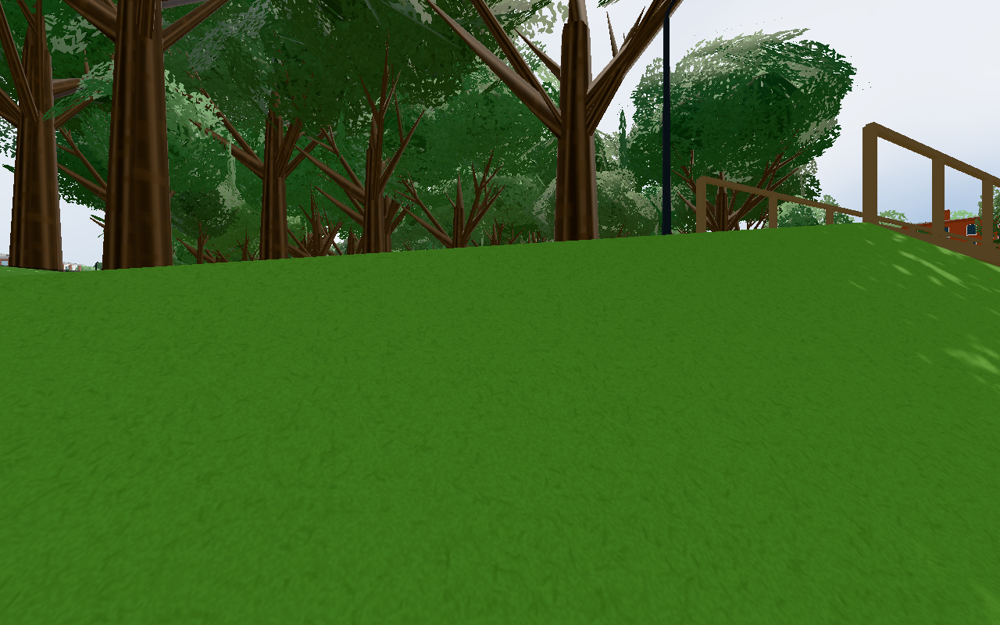
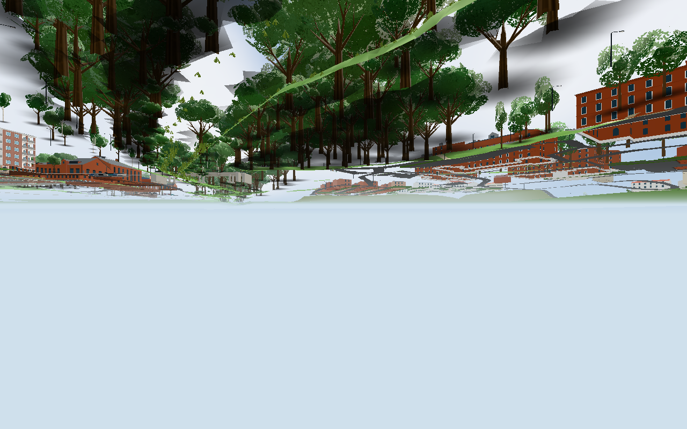
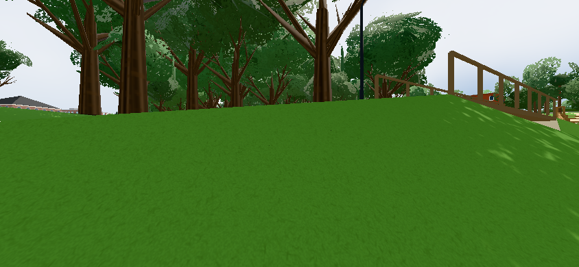

# #1849 – brofästets jordkant

Bas: `43dd4e4c`. Rapportbilden visar platsen, inte själva felet. Den reproducerade kanten ligger vid träbrons norra jordfyllning, start `(x,z)=(-137,195.4)`, riktning österut. Jordfyllningen har befintliga synliga kantytor; ingen bro-/terräng-/ågeometri har ändrats.

## Orsak och ändring

Vid sprint 4,8 m/s och `dt=0.05` kan nästa delsteg nå en fyllningsyta högre än `PLAYER.stepUp`. `groundAt` avvisar då sitt enda markstöd och returnerar `-Infinity`, medan ingen sidokollision stoppar spelaren. I appens företrace fortsätter fötterna från −5,67 till −17,82 m efter 31 uppdateringar utan vattenräddning. `before.json` serialiserar JavaScripts `-Infinity` som `null`.

`Player.blockedByBridgeFill` använder exakt befintlig `parkFillAt`: en högre än steghög solid jordkant stoppar horisontella delsteg, även de två glidalternativen längs axlarna. Nåbar ramp-/brohöjd behåller den befintliga steguppgången. Inga koordinater eller hastigheter har justerats.

## Kontroller

- `component.txt`: 3/3 grupper. Negativ kontroll stänger enbart den nya spärren och reproducerar `-Infinity`/fall under −15 m. Aktuell kod behåller ändligt stöd vid 20/30 fps och fri backning. Båda ramperna och hela träbron passeras fram/åter med gång/sprint vid 20/60 fps. Väg- och GC-syskonbroarnas gånglinjer körs fram/åter; deras fyllningsspärr är inaktiv. Walk 1,6 / indoor run 3,2 / outdoor run 4,8 m/s bevaras.
- `browser.json`: verklig full app/värld, aktuella Player samt befintliga setupTouch. Native `KeyW`+Shift och native CDP-touch (full joystick, y=1, sprint=true) körs med deterministisk `dt=0.05`. Båda stannar vid `[-136.904,-5.6723703,195.4]` med ändligt stöd i alla 60 steg. Native S/backning når x=−138,504. Inga pageerrors.
- UI/3D-matrisen begränsas till denna utomhuskant. Hus L/A/B/C, interiörer och deras öppningar berörs inte. Node-fixturen använder verkliga Player/farWalls/support med en minimal inomhusvärldsram; app-fixturen använder verklig full världsgeometri.

Appens första förebesök laddade gamla Player-källan före ändringen. Slutbesöket laddade ny källa. Inga gamla hela config/main-filer komponerades in. `sources.sha256` anger slutlig Player och oförändrade geometrikällor.

Browserfixturen pausar ordinarie RAF efter byggsteget och pumpar Player för en reproducerbar låg bildfrekvens. Native tangenttryck vidarebefordras av fixturen till spelarens keys eftersom appens vanliga tangentväg kräver pointer lock; testet verifierar därmed Player-rörelsen, inte en ny pointer-lock-session. Touch går via befintlig setupTouch och dess verkliga analoga utsignal. Detta är emulerad Chromium-touch, ingen fysisk telefon. Den kontrollerade bildfrekvensen är inte en prestandamätning av telefonen.

## Bilder och kostnad

Godkända, direkt inspekterade bilder:





`after-keyboard-stop.png` är en blank resize/canvas-fångst: viewportändringen gav tom canvas vid första stillbilden i den pausade RAF-fixturen. Den används **inte** som visuellt acceptansbevis. Position-/inputtracen är separat grön. Den efterföljande touchbilden är korrekt renderad och visar stödet ovan mark. Bildernas viewport skiljer sig: före1280×800, touch844×390; inga pixelidentitetspåståenden.

Slutappens renderprov rapporterade 95 calls / 553352 triangles / 80 points / 653 lines (`keyView`). Detta är ett enda lokalt renderprov, inte ett före/efter-profilmått. Ändringen lägger endast till en analytisk stödkontroll: inga nya objekt, material, trianglar eller ljus; geometri-/drawdelta är noll enligt oförändrade ritkällor. Ingen bred renderprofil behövdes.

## Återkörning

Med lokal pinned Three.js och Playwright:

```
node --experimental-default-type=module --test tools/bridgefall1849test.mjs
PLAYWRIGHT_MODULE=/path/to/playwright tools/browsertest.sh node tools/bridgefall1849browser.cjs GAME OUT
PLAYWRIGHT_MODULE=/path/to/playwright tools/browsertest.sh node tools/bridgefall1849final.cjs GAME OUT
```

Föredrivern kräver gammal Player-källa för reproduktion. Slutdrivern håller scenen efter resultatet; `touch /tmp/1849-release` släpper den. Lokal devserve använder ordinarie källa utan CDN-behov. Ingen fysisk telefon eller produktionsdata/tjänst används. Offentlig selektiv buggrättningsport bedöms av dirigenten efter källpublicering; detta arbete gör ingen port.


## Dirigentens integration

Player och de tre berörda bro-/markkällorna är byteidentiska med arbetarens granskade slutunderlag, se [integration-sources.json](integration-sources.json). Ändringen består av den lokala fyllningsspärren; Djurpärmens orelaterade ändringar kräver ingen omkörning av grön rörelsedata. Alla tre slutbilder är direkt granskade. Changelog1428 följer efter1427 med alla gamla poster bevarade. Filerna väntas utlösa Pages, ingen Worker-ändring; faktisk körlista kontrolleras före stängning.


Levererat i `a312a31de3158e10031ab0adb3059dff2d27dd24`. [Pages](https://github.com/solwation/lunden-3d-apartment/actions/runs/41683121537) lyckades. Ingen Worker-körning utlöstes av ändringens filer; körlistan är kontrollerad och ingen utebliven körning räknas som passerad. Den publika sidans version.json visar `a312a31`. Dirigentens kombinerade diff-/bildgranskning är klar. Verifieringslänkarna ovan är permanenta; eventuella resultatbilder är granskade och bytekontrollerade. Ingen rutinmässig omkörning av gröna kontroller efter orelaterad integration. Ärendet stängs genom efterföljande verifieringscommit och aktiva etiketter tas bort.
