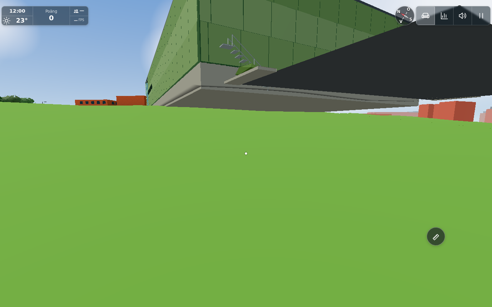
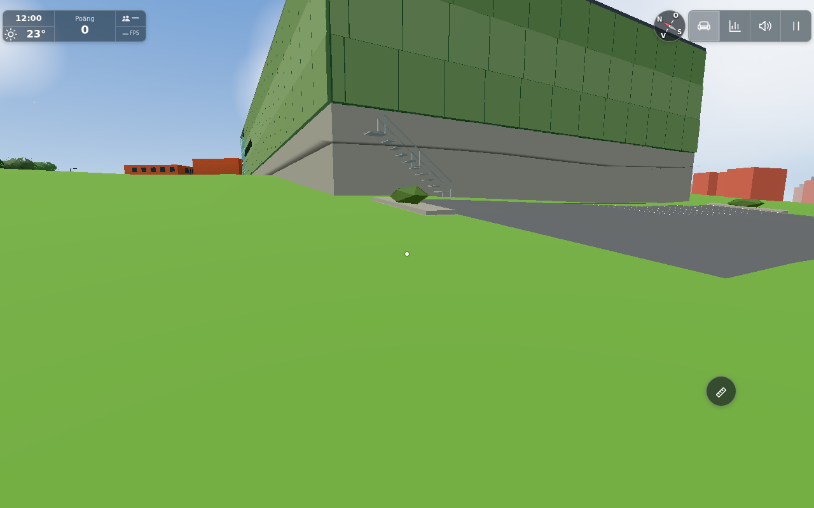
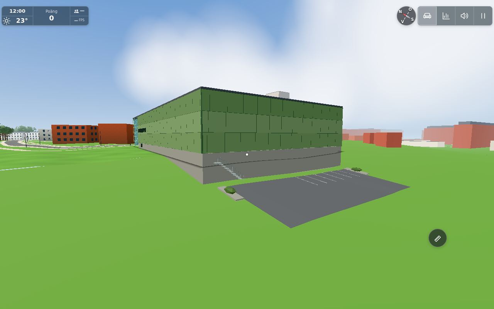

# #1850 — Nordic rear parking/ground contact

Base: `43dd4e4c` (full SHA in `sources.json`). The issue's committed #1844 diagnostic image and all comments were read and inspected before implementation. This is a local model contact correction, **not a verified real-world cellar depth, surveyed parking gradient or Peab dimension**. Existing footprint, floor/eave/roof datum, front, glazed entrance, hall windows, stair dimensions and materials remain intact.

## Cause and correction

All four rear parking corners are north of `SITE.backgroundGround.z0 = −340`, at about z−365…−382. The actual grass there is `edgebackdrop.skirtParts`, a feathered strip with its own source triangle heights. The old Nordic builder sampled the continued `renderedTerrainY` function beyond its terrain rectangle instead. In the actual loaded app, parking was up to **5.168 m** above its intended 45 mm clearance over the drawn grass; both steel stair foot posts were about 2.7 m high and the foundation left open space below.

`nordicground.js` shares the local frame, terrain selection and parking height with `cathabitat.createCatGround`. Asphalt and stall paint clip to the existing north-band source triangles, including their exact step/diagonal, rather than one interpolated corner quad. A four-corner-only lowering was rejected: the source-shaped component still gave a 27 cm interior gap and 3 cm penetration. The actual built skirt mesh, not an analytical ground assumption, validates the final triangulation.

Only the existing grey foundation extends down to the minimum of the source-triangle intersections within its footprint. Its top datum stays fixed; this is an assumed retaining/contact shape, not evidence for actual basement walls. Corner-only foundation sampling initially left a 33.5 cm gap; the corrected minimum includes the clipped triangle vertices (`diagnostic/first-foundation-check.txt`). Planter boxes retain their vertical height and drape at their corners. The existing 3.2 m steel stair with 10 treads moves down onto the real ground; both foot posts independently meet the slope. No rear door/interior is invented.

No `Player`, bridge support, `groundY`, rendered terrain, edge-land geometry, terrain extent or walking bounds changed. Houses A/B/C/L use other unchanged builders and are not affected; no new house/campus sweep is justified. The #1848 binder and #1849 Player bridge fixes are unrelated to these source-bound checks.

## Two risk groups and results

1. **Source/component/contact/budget** — `component.txt` (9 PASS) and retained `retained-architecture.txt` (11 PASS). 651 asphalt/skirt mesh points agree within 2.09 µm, all paint vertices within 1.65 µm,651 cat/asphalt points within 1.96 µm. Both actual foot post corner sets meet the sloping mesh within 3.1 mm. The foundation reaches all sampled northern ground. All front/brick and roof geometry buffers are byte-identical to the frozen before builder; 453 other hall/entrance/glass/solar geometries are byte-identical. Existing pane/wash/entrance-flight/globe/door/roof and paint controls pass. The Node fixture builds real `skirtParts` buffers using its supplied terrain callback; it is complemented by actual app buffers below.
2. **One actual app before/after turn** — `app/browser.txt` / `checks.json`: **12/12**. 63 points from actual production asphalt and `edge-land` batch buffers give max after error 2.15 µm and cat sampler parity 2.10 µm. All four exact asphalt corner vertices preserve XY and sit 45 mm above the real grass mesh. Both actual foot-post centres meet ground within 0.2 µm; component checks cover their finite cross-sections. The foundation reaches the sampled slope, and the `edge-land` buffer UUID is unchanged. Three representative result images were inspected directly by the worker and conductor.

Actual complete east campus count, **including the two sign triangles**: 87,714→**87,721**, unchanged 14 meshes, below the unchanged 87,800 cap. The retained architecture tool's historical contribution ledger omits those two sign triangles and reports 87,719; the actual app total above is definitive. In the same low-camera/test-quality view after settling capture flags, calls 110→110 and triangles 585,272→585,279: exactly +7, with points/lines unchanged. These are scoped actual renderer counts, not a whole-scene performance/device/FPS claim. No new material, texture, light or shadow caster.

## Exact fixture/source scope

The single lazy app starts with a request interceptor serving the frozen before `nordicgym.js`. Actual 87,714-triangle batch count and the reproduced gap confirm that it loaded. Other app/ground code is unchanged. The before image uses camera [−152,2.2,−379] looking at [−155,1.5,−375]. The after phase uses the production `buildEastBackdrop` factory with the same actual built terrain and existing brick/glass resources, replacing just that one east-backdrop group in the held scene. Module-specifier-only URL rewriting loads the final Nordic module; no scene bootstrap or terrain rebuild repeats. Matching old/new mesh visibility/layers and noon clock state are retained. Old batch GPU geometries are disposed. Raw before/after mesh measurements are `app/before.json` and `app/after.json`.

An initial Blob import used root-relative specifiers, which are invalid under a Blob URL; it failed before creating/replacing geometry. The same held page retried with full absolute import URLs. This fixture-only recovery is retained in `app/diagnostic/blob-module-specifier.txt` and `app/browser.log`, not reported as a product defect or passing attempt. Exact corner measurements use the actual Float32 mesh vertices (within 18 µm of intended XY), avoiding ambiguous rays exactly on a quantized mesh edge. No gameplay action, score or natural cat journey is claimed; the targeted cat check calls the actual production outdoor-cat ground callback against the drawn parking surface.

The final rear view uses camera [−143,10,−389] looking at [−174,6,−357]. No architecture dimensions were changed for framing. All images use the real app's production batches; no original report/photo was copied into results.

## Reproduction

Use the existing Three cache: `THREE_DIR=~/.cache/three-0.170.0 node tools/nordicgroundtest.mjs`. Optionally set `NORDIC_GYM_BEFORE` to the frozen before module for byte-isolation/+7 comparison; this tool does not require historical git objects on shallow CI. `tools/nordicgymtest.mjs` retains its existing checks and its loader now resolves the newly reached Three addons from `THREE_DIR`, without requiring a local dependency link.

Start the normal dev server, then `PLAYWRIGHT_MODULE=… NORDIC_GYM_BEFORE=… tools/browsertest.sh node tools/nordicgroundbrowser.cjs GAME OUT CONTROL`. The held page exposes `NG`; `tools/nordicgroundscene.js` extracts actual coloured triangles and mesh rays. `.command`, `.shot` and `.release` marker files keep bounded measurement/camera corrections in the same page. `sources.json` pins final files, the before module hash and unchanged shared ground/house modules. Browser/server were stopped after image acceptance.

## Results

Applicable public follow-up: a separate **low-priority** environment port owned by the conductor after exact source publication. Port the generic Nordic/terrain helper and builder adaptation; do not transfer personal cat gameplay or these original-app result images. No push or closure is performed by this worker.

Levererat i `edeff125c3645ee3ac0a0feee911713f140d08a5`. [Pages](https://github.com/solwation/lunden-3d-apartment/actions/runs/41687215178) lyckades. Ingen Worker-körning utlöstes av ändringens filer; körlistan är kontrollerad och ingen utebliven körning räknas som passerad. Den publika sidans version.json visar `edeff12`. Dirigentens kombinerade diff-/bildgranskning är klar. Verifieringslänkarna ovan är permanenta; eventuella resultatbilder är granskade och bytekontrollerade. Ingen rutinmässig omkörning av gröna kontroller efter orelaterad integration. Ärendet stängs genom efterföljande verifieringscommit och aktiva etiketter tas bort.
