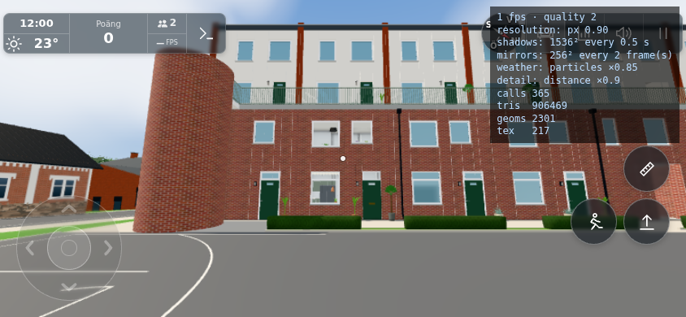
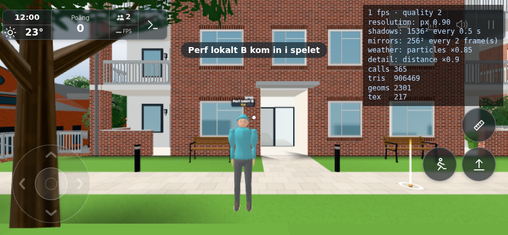

# #1851 – siktspikar, lokal telefonstart och två spelare

Fryst bas: `b54b444b5e41aad90b336413a5cadadf9832aa41` (runtime som `336b535d`). Rapportens stillbild visar en annan figur men bevisar varken nätorsak eller laddfel. Profilen belägger i stället stora CPU-pauser i djurpärmens siktkontroll redan ensam. Ingen nätkadens, payload, foto-/profil-/poänglogik, warmup eller ritad geometri ändras.

## Metod och utfall

`tools/multiplayer1851-profile.cjs` kör verklig index/app, normal telefonkvalitet och GPU-warmup (`warm&perf&lowmem`, 844×390, DPR1, Android-UA, Chromium/SwiftShader). Normal Touch-start efter namndialog; lokal PlayerRoom på 8932. CPU-profil och metodtider är inkluderande, inte summerbara mellan nästlade metoder. Efter start stoppas renderloopen för kontrollerade steg. Detta är emulering på utvecklingsdator, inte fysisk Olofs telefon eller en FPS-garanti.

| Gräns | Före | Efter raybox-fix |
|---|---:|---:|
| Ensam, 120 steg: observer total/max | 1902,8 / 1300,6 ms | 8,2 / 3,7 ms |
| Samma grupp: fyra siktanrop total/max | 1897,5 / 987,8 ms | 5,4 / 2,8 ms |
| Två sparade riktiga strålar, varm cache | ca 204–209 ms totalt | 7,4 ms totalt, max 6,3 ms |
| Samma strålar, privata kalla index efter fix | — | 38,7 ms totalt, max 26,8 ms |

Rådata: `before/runtime-one.json`, `after/ray-diagnostic.json`, `after/mesh-diagnostic.json`, `after/final-rays-runtime.json`. Långa stigande måsstrålar gav stora segmentlådor och många falska meshöverlapp. Fixen filtrerar osynliga/icke blockerande objekt före spatialt arbete, stannar vid första riktiga opaka hinder och kräver exakt rayträff i redan befintlig konservativt paddad meshbox före lazy indexbygge. Vapen/markeringars all-hit-segment bevaras.

**Kvarvarande:** en annan gårdsvy med kalla lokala index gav fortfarande observermax 143,3 ms (sikt 138,1 ms). Startmätningen var 57,9 s före och 64,4 s i den första, ännu ofullständiga efterfasen; warmup 19,5 respektive 18,1 s. Det finns inget belägg för förbättrad telefonladdning eller löst GPU-väntande. Patchen rättar den belagda siktkostnaden; den löser inte hela rapportens telefonstart. Tidiga `after/startup*` och `after/runtime-one.json` är den otillräckliga materialfilterfasen, inte slutlig prestandaacceptans.

## Sista cellklippningen – separat komponentbevis

Efter appfasen klipps endast TriGrid.hits cellintervall mot dess befintliga gridbox, med konservativ Float32-marginal eftersom boxen byggs före världstriangelns Float32-avrundning. Inga nya index, triangelkopior eller scheduler. **Appbilder och appmätningar ovan gäller raybox-fasen före denna sista klippning.** Slutkällans bytebundna komponentbevis finns i `sources.json` och `final-regression.txt`:

`node --experimental-default-type=module --test tools/trigrid1851test.mjs tools/bestiarysight1851test.mjs tools/bestiarytest.mjs` – 14/14 gröna. TriGrid-fallen använder HEAD-versionen som referens: transformerade indexerade materialgrupper, Front/Back/DoubleSide, authored bounds/drawRange, stora trianglar och positiva/negativa 0,5-metersgränser inklusive stora världstal. Exakta träffpunkter, normaler, material och avstånd lika. Kontrollerad lång diagonal: 74 088→64 cellbesök, samma tre träffar; ett lokalt litet tidsprov 4,59→0,14 ms. Detta är inte ytterligare app- eller FPS-profilering. Fyra siktfall bevarar transparent-före-opakt, blandade material, dörrar, instanser, höjd, ignorering och målmargin; sju befintliga seen/found/foto/profilfall är gröna.

## Lokal Room, bilder och fixturegränser

Två riktiga lokala PlayerRoom-klienter körs: appens socket och en separat WebSocket-peer i samma dokument, utan andra världens bootstrap. Medlemskap=2 och en riktig mottagar-Ghost verifieras. `before/runtime-peer.json` och `after/runtime-peer.json` innehåller 60 tidssteg och verkliga meddelanden. Ghost.update max 4,3→1,8 ms, Ghost.draw 3,8→1,6 ms; meddelandehantering 0,1→0,2 ms. Cachetemperatur/vy skiljer, så detta är funktion och avgränsning, ingen rättvis nät-prestandavinst. Peer-fixturens bp25 klipps av befintlig gräns till 1 i båda körningar; det är inte 25 procent. Inga produktionsrader eller externa tjänster används.

Båda efterbilderna direkt granskade och accepterade av dirigenten. HUD:s 1 fps kommer från stoppad/stegrad testscen och är **inte** en FPS-mätning. Förebilder finns under `before/`. Före-/efterverktygen nådde avsiktliga 10-/15-minutersgränser; sena extra kommandon som inte kördes räknas inte som godkända. En import med query gav dubbel registerpost i testfixturen (`registration-probe-diagnostic.txt`); korrigerat genom fixturekopia av samma metodkroppar utan metadataregistrering, ingen produktbugg eller levererad extramodul.

Publik relevans: ej tillämplig. Public har varken Marks/TriGrid-siktvägen eller djurpärmens discovery/foton. Inga gameplay-/lagrings-/tjänstkopplingar porteras. Befintliga gym-/pose-/poäng-/protokollfiler är byteoförändrade och deras tidigare källbundna gröna underlag återanvänds. Ingen ny Worker-import eller deploypaths-ändring behövs.
