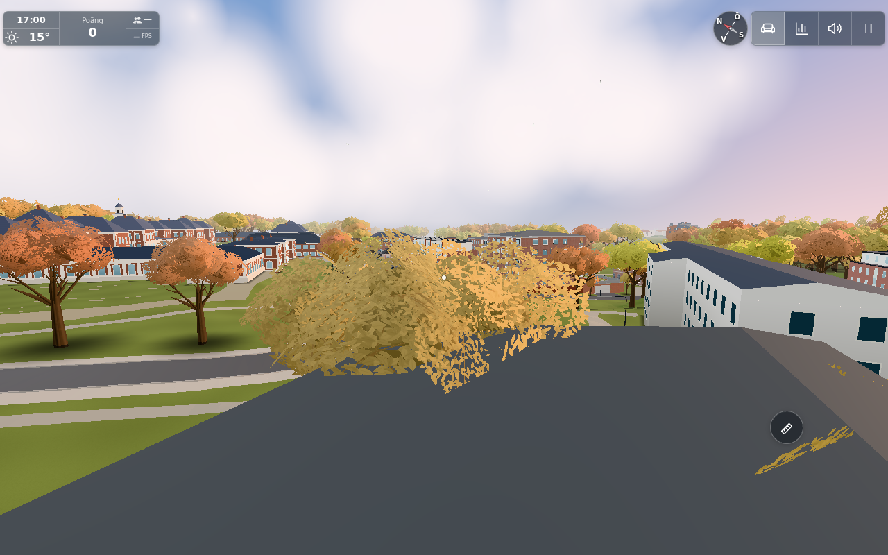
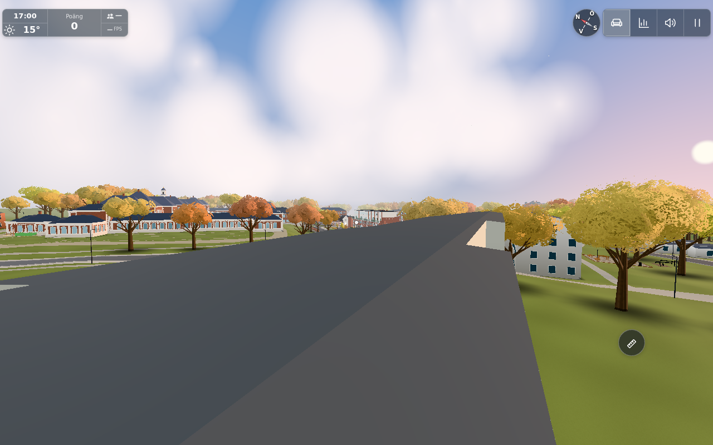

# #1852 — initial foreground diagnosis (historical checkpoint)

Latest: after the further clarification **“det är på långgaveln”**, the [scoped long-facade depth correction](long-side/README.md) supersedes the unresolved surface question.

The user subsequently confirmed Hus L farther away on 2026-11-04; see the [resumed Hus L surface investigation](resumed/README.md). The foreground target below is historical.

**Investigation only. No geometry or behavior is changed and this is not a verified fix.**
The report's original JPEG is [already committed](../../ingame-reports/380ac6df-6252-4e09-95d3-0f26f134a98e.jpg), SHA256 `31a68733cd53cebef1b609c9fecdfb9a59fe0a41ad5e0a120d6bf25f8ab90d17`.

## What the local app establishes

One actual app bootstrap on source `49233f38` was opened on an owned local HTTP server, with an empty cloud override, `mp=0`, October, 17:00 and frozen clear weather. No Worker or production report/data endpoint was used; ordinary same-origin presence attempts received HTTP501 from the static server. The normal entry handshake was completed, the animation loop stopped, and a small set of nearby camera candidates inspected. `test=lazy` reduces startup drawing; saved captures use `testkit.shot` at full quality. This is diagnostic geometry/view evidence, not a startup/performance measurement or native flight route.

The school pavilions/clock tower on the left, Lunden's brick houses farther ahead, and the pale long building on the right are consistent with a camera near the southeastern roof end of **Hunnerupshemmet / 85**, mapped source **88457603**, approximately `[-170,18.5,-39]` looking toward `[-20,-3,7]`. The right-hand pale volume is consistent with **Östra längan vid Karpvägen**, source **88457595**. This identifies plausible foreground context, not an exact recovered report camera or definitive identification of the user's faulty triangle. Leaf cover, sky and framing differ from the original.

A second local view makes the same roof's two shaded planes/nock easier to inspect:

The source currently models Hunnerupshemmet as a 1.5 m-rise gable roof at eave 14.4548997 m and ridge 15.9548997 m. Those heights, levels and roof type are existing **visual assumptions**, not a verified Peab roof specification. A tonal break between its two planes therefore exists by design. It would be speculative to flatten it or change all roofs based only on the report's word “L-huset”.

## Finite geometry result

[scene-export.json](scene-export.json) contains the actual app's north/west roof positions, indices, normals, building outlines/eave/ridge metadata and local batch counts. No global export/search was performed. The two ordinary roof batches contain 48 + 24 triangles; the adjoining separate Karp roof batch adds 16 triangles for normal analysis only.

Run `node docs/verification/1852/analyze.mjs` from this source checkout. This analyzes the archived emitted geometry against the matching source-data roof equations; **it does not rebuild the scene or certify future code**. [Raw output](analysis.txt):

- Hunnerupshemmet: 16 triangles; projected roof 990.9906669 m² versus outline 990.9906000 m², difference 0.0000669 m². Maximum triangle-center height difference from the declared roof plane is 0.000000606 m. No degenerate triangles, vertices outside the outline or unpaired internal edges.
- Östra längan: 12 triangles; projected area disagreement 0.0000796 m², maximum center-height disagreement 0.000000537 m; no degenerate/outside triangles or unpaired internal edges.
- Other records sharing those two small archived batches also satisfy the same finite checks; this is incidental batch coverage, not a general campus inventory.
- All 88 exported roof triangles have stored normals matching geometric face normals to less than 0.00000003, with no degeneracy. Upward-facing versions of the ordinary roof normals match their declared roof planes within 0.000063 (small Float32 triangles). The material is double-sided, so consistent winding alone is not a visible fold defect.

These checks found **no concrete wrong triangle, crack or normal discontinuity within an otherwise single plane** to correct. They do not prove that the assumed roof type is architecturally correct, or that this is the precise surface the user meant.

## A/B/C/L scope and remaining question

`docs/peab/situationsplan.png` and the plan/material topic were inspected. The actual Hus L/Parklängan is a straight bar with a flat solar-panel roof built in `exterior.js`; the A/B/C houses use the separate per-house hip-roof implementation in `surroundings.js`. The candidate foreground roof instead uses `sitebackdrop.js`'s mapped-building gable routine. No shared A/B/C/L defect has been established. Their dimensions, openings, glass, roof surfaces, materials, navigation and budgets are untouched; **no new actual A/B/C/L regression matrix is claimed**.

The next step is a precise GitHub question asking the reporter to mark the faulty point and distinguish the foreground roof from Hus L farther ahead. [Question draft](question-draft.md). The conductor owns publication of accessible pinned diagnostic images and the question/user-question state. Acceptance for #1852 remains unresolved.

No runtime patch, player-visible changelog, after-state picture, CI success or render-performance improvement is claimed. A local budget delta is therefore zero by unchanged source; archived counts are observations, not a new budget gate. A public port is not yet actionable without an identified applicable fix; if one is established it needs its own low-priority issue and no original photos/personal content.

The diagnostic browser was released to high-priority #1851 before offline analysis; its server and browser are stopped. [Exact source hashes](sources.json) bind the archive. The additional roof-picnic report image suggested by the conductor was inspected only as a location clue; its different roof details were not used as evidence of a shared target or brought into this issue's scope.

## Published clarification checkpoint

The diagnostic archive was published in `09f554508f51b5b7eef7f1cd2b54f6018ad8818a`. The conductor directly inspected the landmark-match image, checked its permanent public bytes and posted [the precise clarification question](https://github.com/solwation/lunden-3d-apartment/issues/1852#issuecomment-6612476292). At that checkpoint issue #1852 remained open with `user-question`; active work and ownership labels were removed. Other startable original work continues. No runtime change, deployment success or verified fix is claimed by this checkpoint.
