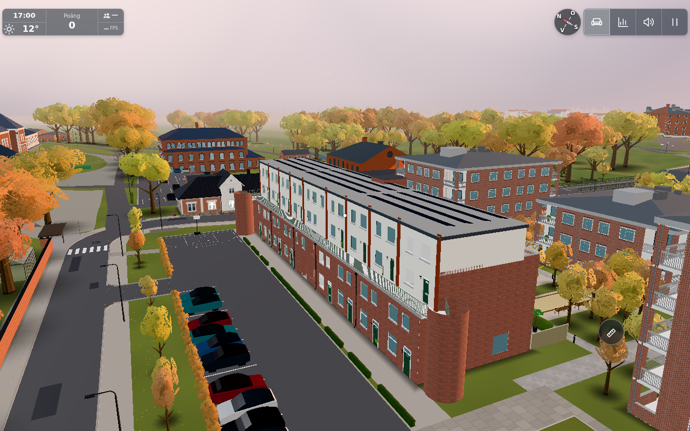
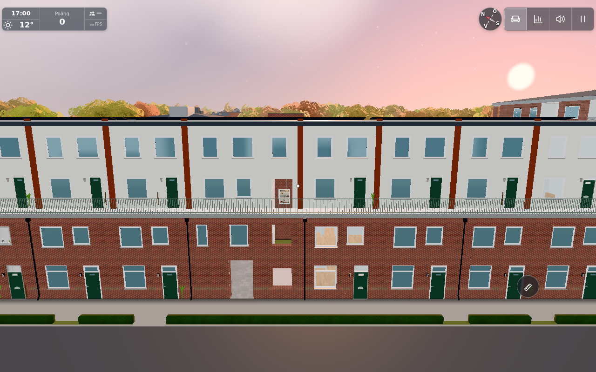

# #1852 — keep the long façade's opaque backing behind its skin

Source baseline: `c318ec8fde08e15cffb99cae0a692c4776287378`.
The user clarified **“det är på långgaveln”**, recorded in
[comment6627456071](https://github.com/solwation/lunden-3d-apartment/issues/1852#issuecomment-6627456071).
This continuation targets the long façade/loftgång (area2 in the previous diagnostic),
not the short end gable, foreground building or a redesigned roof.

## Concrete depth conflict and bounded fix

The actual Hus L brick and render skins are only **6 mm** in front of simplified
opaque mass faces. The skins and backing had no polygon offset. Actual ray probes
identify **450** long-façade triangle-centre layer pairs on both skin materials;
[full pair coordinates/material state](before-layer-pairs.json). The backing uses a
plain wall colour different from the brick/render, so a depth tie can expose the
wrong surface in triangle-shaped fields without any malformed world-space triangle.

The actual production Player/step at the report-context roof position gives
**near0.05/far1000**, not the outdoor-ground0.12 used in the earlier manual camera
inspection. Feet[-170,16.88,-39], supported roof15.6634m and eye18.5m produce the valid
roof/aloft minimum: [observed state](roof-near-state.json). Projecting the actual layer
pairs through a 24-bit depth model at the context camera yields **89 equal-code pairs**.
This is a concrete precision conflict, not a new geometric fold. It is the best
supported correction for the reported distant long-façade artifact; an exact original
pixel/root cause on the user's physical GPU is **not proven**.

Only `exteriorBackingMaterial(wall)` and its use by `add(solids, …)` are added to
`exterior.js`. It clones the incoming wall material, retaining colour, map, side,
roughness and existing fragment lighting compile/cache hooks, then applies the
**positive** counterpart of the existing shared `DECAL_OFFSET`:factor1,units2.
This pushes backing depth away from the viewer; it moves no vertices. Skins, frames,
panes and other façade details keep their existing materials/depth rules. The original
wall material is unchanged and still used by six other actual scene objects.

No new dimensions/tunables, geometry, render calls, shader feature, lights or texture
are introduced. One local material clone is added. Existing room/wall lighting hooks
are preserved; backing remains opaque/depth-writing and shadow-casting.
The source geometry/holes/panes/towers/roof/solar panels, collisions and physical
architecture remain exact. Nothing is reinterpreted as surveyed dimensions.

## Planned risk groups and results

1. **Material isolation and actual depth pairs.**
   `THREE_DIR=/path/to/three-0.170.0 node tools/facadebacking1852test.mjs`
   passes. It imports the actual production factory; the original material/appearance
   values and fragment hooks remain intact, the clone has positive backing bias.
   The independent 24-bit projection of the actual450 ray pairs has89 ties before,
   none after the2-unit bias, minimum2-code margin. This model ignores the additional
   positive slope factor (which increases separation). [Raw output](component.txt).
   It is explicitly analytical depth evidence, not a native GPU screenshot test.
2. **One held actual app/affected view.**
   One original app bootstrap, October17:00/clear/freeze, lazy test with full-quality
   screenshots, empty cloud override/mp0. It identifies the actual L exterior, measures
   the450 layer pairs and native near-plane policy, then applies the **current production
   factory** to that actual backing mesh without rebuilding the world. Every exterior
   mesh position/normal/geometry UUID remains identical. Real before/after frame:
   **291→291 calls,785636→785636 triangles**, points/lines unchanged. Final lighting
   compile/cache callbacks and program-key type are identical; no final shader program
   type is added. [Full geometry/material ledger](material-and-geometry-final.json).
   All146 actual window/door pane centres still raycast to exposed glass,0 failures;
   roof surfaces/real doors and all existing opening geometry remain intact.
   [Openings proof](openings-check.json). Syntax check `node --check src/exterior.js` passes.
3. **Image review, equivalents and scope.**
   The actual before/after long-side views and closer final façade below were opened
   and reviewed. The ordinary SwiftShader view is preserved. As documented for #1276,
   this environment does not establish native 24-bit hardware flicker: the pictures
   show retained façade/loftgång/windows, not a falsely claimed pixel-level flicker fix.
   Final source diff is confined to material handling, one Swedish changelog sentence
   and relevant docs/evidence. Existing finite triangle audit remains source-bound:
   no geometry-generating code changed, so no routine rerun or roof sweep was needed.

## Relevant A/B/C/L variants and public assessment

L uses `buildExterior` with the specific 6 mm brick/render-to-mass construction; it is
fixed on both its long sides and all its simplified masses through that one material.
A, B and C records were checked against `surroundings.aHouseParts`/`loggias` and
CoreHouse paths. Their bodies/brick faces/entrance shell are separate implementations;
none calls this L backing material factory or shares its6mm skin/mass construction.
No changed dimensions, LOD, windows, glass/passages or roof forms are needed there.
Those source/data variants remain byte-identical; no new full A/B/C app matrix is claimed.

The current public `src/exterior.js` has the same6mm skins and plain shared backing
wall, so a **separate low-priority public port applies** after exact source publication.
Transfer only this local material factory/import/call and scoped public verification;
retain its public content/storage/network limits. Do not copy original pictures,
personal world data, gameplay, main/config trees or service integrations. The conductor
owns that public issue/cross-link and the published source SHA.

## Reviewed actual result images

Camera for before/after:[−70,23,−20] toward[−15,8,6], FOV50, near0.05.
The close result uses[−19,13,−24] toward[−19,8,2], FOV55.
The close frame records272calls/812362triangles in this scene; that different framing
is not a before/after budget comparison. [Close-view metadata](close-view.json).

## Fixture corrections and limits

A first metadata hash tried a missing normal on an existing glow mesh; it was corrected
to treat absent normals explicitly. An initial material clone dropped pre-existing
lamp-wash compile callbacks (ordinary Three clone behaviour); that draft was rejected
and corrected before acceptance. Final factory copies both callbacks, retaining
lighting and program keys. A frontal framing candidate was blocked by a school; those
screenshots and rejected draft results are private and do not appear as result evidence.
Only affected commands/captures repeated inside the same app; no bootstrap matrix ran.

No page exceptions were recorded. Expected static-server missing-data/presence responses
are not claimed as tested production networking. Browser and own server8935 stopped.
Verification passed its10minute review point: it was narrowed to the three groups above
with no additional expensive profiles. Approximate phases: source/claim5min, one held
app/material/depth investigation and focused checks12min, docs/review5min. Physical
hardware flicker and the exact reporter pixel remain unverified; this is the best
supported local fix, with that limitation to be stated in the completion comment.
Publication verified by conductor: source/image commit `7acb84d948cbb9f41b3fa8e9d60c929213074b02`, successful [Pages41811021274](https://github.com/solwation/lunden-3d-apartment/actions/runs/41811021274), live `version.json` version `7acb84d` / content `5961851095c9`. Permanent image bytes verified and embedded in [completion comment6627926126](https://github.com/solwation/lunden-3d-apartment/issues/1852#issuecomment-6627926126) before resolving push. Applicable low-priority public transfer is [kvarteret-lunden#253](https://github.com/solwation/kvarteret-lunden/issues/253).
