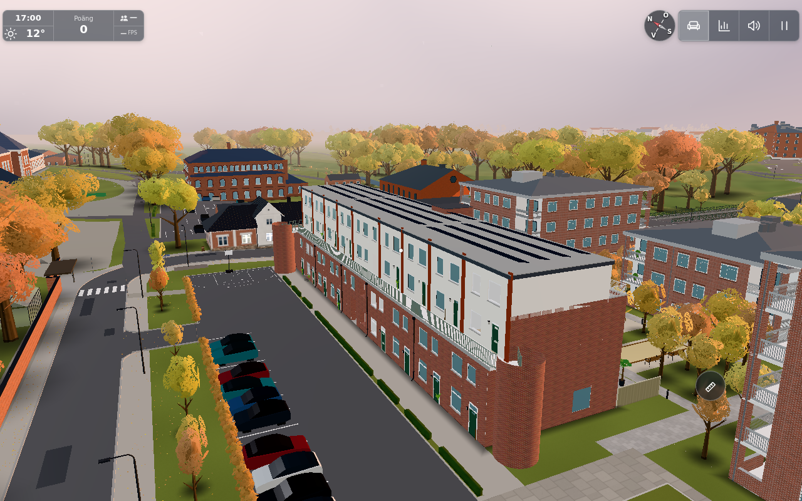
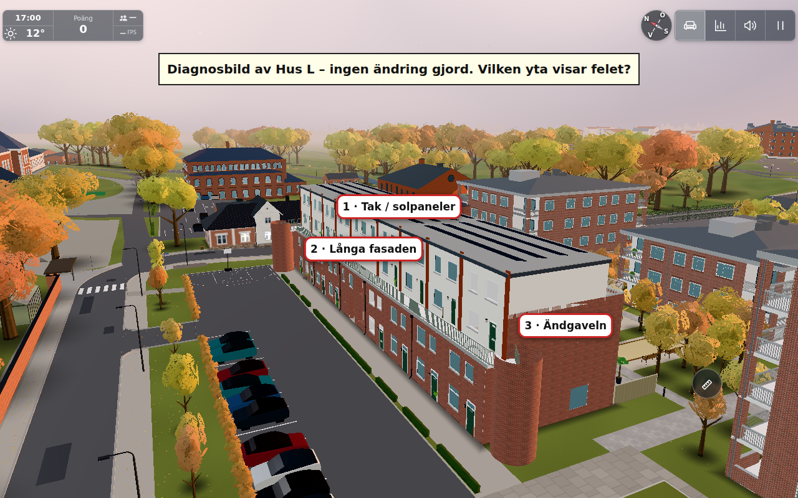

# #1852 — Hus L confirmed; exact faulty surface remains unresolved

On 2026-11-04 the user answered **“Hus L längre bort i bilden”**;
[recorded answer](https://github.com/solwation/lunden-3d-apartment/issues/1852#issuecomment-6626038455).
The new target is the real Hus L. The earlier Hunnerupshemmet foreground analysis
is historical context, not identification of the reported defective surface.
**No runtime patch or verified fix is delivered here.** “Vikningsfel på L-huset”
does not establish that the defect is on the roof rather than a wall or gable.

## Bounded actual-scene investigation

One actual original app on `0931b84de82b48e1e435843676e4c7908aa551c6` was started
on owned port8935 with October/17:00/clear/freeze, `test=lazy`, empty cloud override
and `mp=0`. Three r170 modules were served from the existing local cache. Entry/name
handshake completed; the main loop was stopped before bounded camera/mesh inspection.
Full-quality screenshots use the existing `testkit.shot`, not reconstructed buildings.
Zero page exceptions were captured. Normal static-server missing data/unsupported
presence responses are not claimed as working multiplayer or production-network tests.

The report-context camera remains approximately [−170,18.5,−39] toward [−20,−3,7];
foreground foliage differs and hides much of Hus L, so this is not an exact recovered
camera. The nearer view [−88,25,−30] toward [−15,8,6] exposes the actual building.
The final gable/long-façade/roof view is [−70,23,−20] toward [−15,8,6], FOV50.
It was actually rendered at that different camera; it is not a duplicate context frame.

[Actual exterior mesh metadata](l-metadata.json) identifies Hus L through its own
`userData.walk` L-roof surfaces, rather than an arbitrary nearby building. The group
bounds are x−44.955…12.06, y−0.01…13.35, z−3.6…17.7224. Its main solar roof and loftgång,
white upper façade, brick lower façade/end drum and solar panels were visually inspected.
The source's existing set-backs, drums, openings and raised core box are retained;
none is presumed defective simply because it changes the silhouette.

## Finite checks and their limits

[Actual surface audit](l-surface-audit.json) covers the six relevant emitted material
batches: brick1 426, render918, solid5 780, capping1 440, roof24 and solar144 triangles.
All **9 732 triangles** are finite and nondegenerate. Render/capping and the two roof
boxes have their expected axis-aligned planar face normals. Brick includes rounded
stair drums: its minimum vertex/face normal dot0.9937 is the existing smooth cylinder
shading, not a flipped face. Solids and tilted solar panel normals agree with geometric
faces within Float32 rounding; no reversed/folded face was found in this scoped audit.
This is not a claim of closed topology for every façade opening or rounded drum.

The [small actual roof export](l-roof-final-export.json) is replayed by
`node docs/verification/1852/resumed/analyze-roof.mjs`.
[Output](roof-analysis.json):24 triangles, minimum area0.083m², dot1,36 geometric edges
all paired twice, four authored y levels12.4/12.7/13.3/13.35 within Float32 rounding.
The existing two closed box roofs have no degenerate, bent or flipped triangle.
These values are existing visual assumptions, not a new assertion of measured architecture.
This finite check does not prove that a defect in another surface/material/camera is absent.

No concrete wrong geometry, crack or normal to repair was established. No daylight/
shadow/GPU/device matrix, speculative roof redesign or broad campus inventory is added.
The original image can still refer to a surface not isolated by these views. The next
step is a **new precise surface question**, not the already-answered building question.

## A/B/C/L and public scope

Hus L uses `buildExterior`, its flat boxes/solar slabs and its own façade openings.
A/B/C use their individual hip-roof data through the separate `surroundings.hipRoof`
and CoreHouse shell paths. No shared failing cause has been established to transfer
between these implementations. Those variants were source-inspected for relevance;
no new actual A/B/C browser proof or architectural correctness claim is made.
All product sources, real dimensions/openings/solar installations, collision and render
budget are unchanged. A budget delta of zero is by identical source, not measured FPS.
There is no applicable generic runtime fix to port yet; any future identified generic
fix needs its own low public issue. These original diagnostic images are not transferred.

## Reviewed pictures and next question

Both final pictures were opened and inspected. The numbered overlay is an inspection
annotation only, rendered over the real app:1 roof/solar panels,2 long façade,
3 end gable. The heading explicitly says no change was made. [Marker coordinates](numbered-surface-labels.json).
Suggested question: which numbered surface shows the fold, and roughly where on that
surface (or describe another part of the house)? [Draft](question-draft.md).

The first attempted gable command selected raw children using indices from a mesh-only
list and failed on a nonmesh. Its stale picture and wrong preliminary roof export were
rejected and preserved privately, not counted as evidence. The corrected mesh selection
ran in the **same held app**, the genuinely changed camera was captured, and its roof
export/audit is the final data above. No second app bootstrap was needed.

Browser and owned server stopped. Sources/images/results are SHA-bound in manifest.json.
This is a diagnostic Refs1852 checkpoint only; the conductor owns publishing accessible
images and the next GitHub/user-question state. No closure, changelog, CI pass or
performance improvement is claimed. Planning/source inspection about3min, one actual
app and bounded camera/audit turn about6min, documentation/review about3min.
