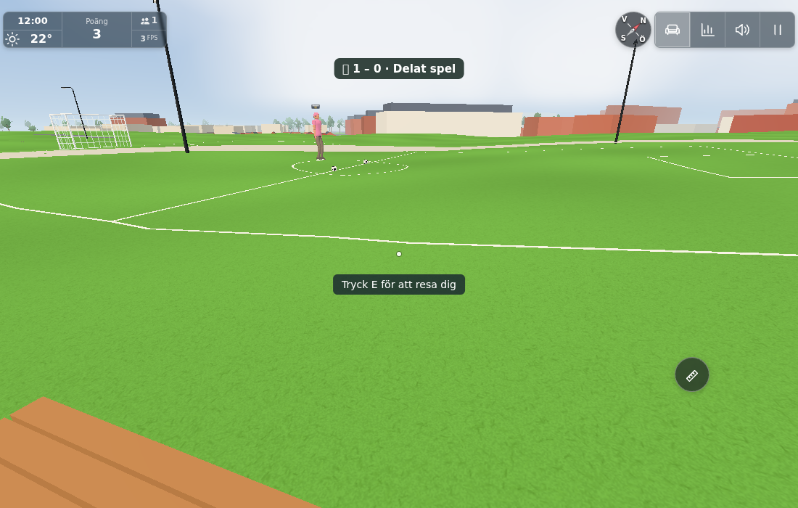
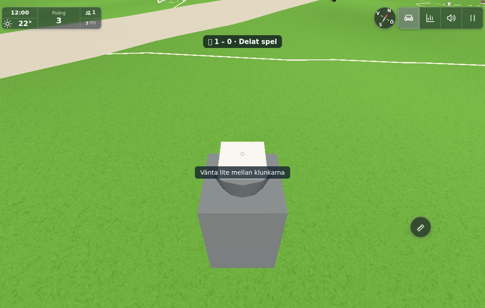
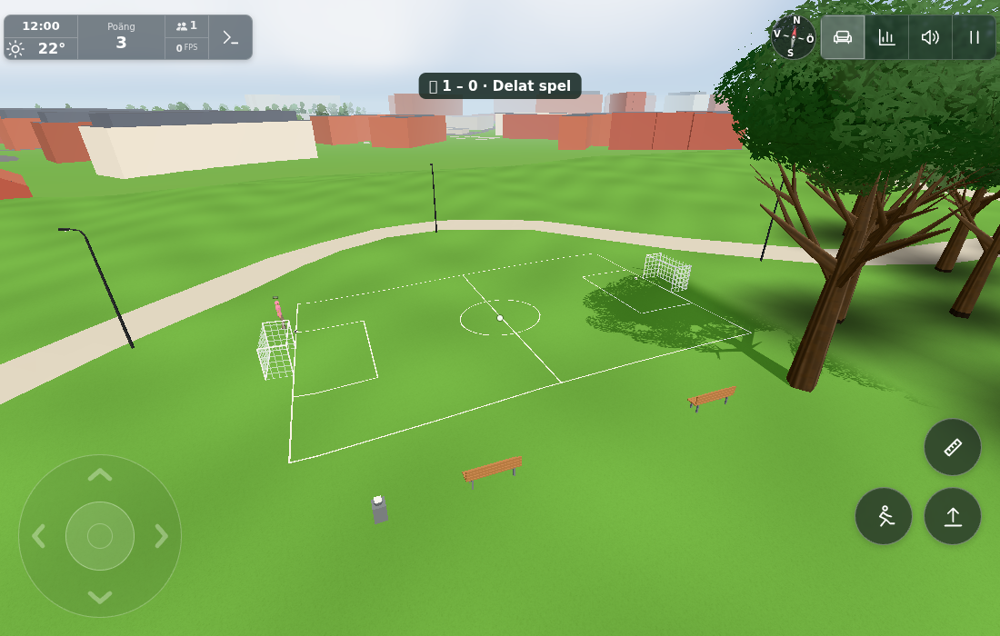

# Shared football field (#1853)

Implementation and local verification of the reported open northern grass field. The report image is localization input, not a result image. A source-only surroundings view matched its Karpvägen / Hunnerup landmarks; `site-location.json` retains the actual sampled terrain, tree positions, source footprints and WALK bounds. Field centre **(-262,-21)**, 16×24 m, goals, fittings and play constants are **model guesses**, not surveyed installation dimensions. No existing trees, buildings, paths or terrain vertices are moved.

## Contracts

Two genuinely playable, ground-rolling balls (stable IDs 0/1) share one authoritative PlayerRoom match. E/touch claims or drops one ball; walking/running dribbles it at the feet; click/touch kicks, right-click/alternate touch passes. Hands remain empty. Only one player owns each ball and each player can own one ball. Both balls collide with each other and all eight goal posts. The whole ball must cross an open goal mouth from the field: one point to its last controlling player, one shared goal, then an independent reset. Net resting, repeat queries, stale nonces and rejoining do not duplicate credit.

Discrete actions and completion queries use the existing 5 Hz Ghosts outbox and existing Room rate/size cap. Ordinary body poses supply dribbling; there is no ball-position packet stream, periodic physics polling or new server timer. A free ball uses a bounded 10 ms, constant-deceleration prediction anchor. This is a small two-ground-ball activity, not airborne or generic scene physics. Online disconnection freezes authority; an older Worker without the football capability cannot silently create a local match. Explicit offline visits retain local play.

The existing DO storage gains one `football` record, read on wake and written for accepted actions/discrete goal/reset/stop/release changes, never ordinary dribbling poses. The match survives an empty room. Per-profile stats retain old own socket IDs and monotonic goal receipts, saved together with the goal counter for reconnect/reload recovery. No new service, binding, migration, board, medal, bonus or change to older daily caps.

The static world feature supplies a narrowly bounded field/runoff/east-spectator-apron `groundAt`; Player preserves its house, garage, stairs, bridge and higher-support priorities. The support uses actual rendered terrain, whose difference from the older analytic default reaches approximately 17.5 cm here. It exists independently of the later gameplay manager and returns null outside its bounds. Fixed fittings use existing far-walk collision buckets. Moving ball meshes explicitly opt out of static Marks bounds/TriGrids.

Two level seated spectator benches use existing Rest targets (two spots each). The direct fountain sip uses the existing timed Life Runner, empty-hand/reach checks, cancellation and a five-second interval; a completed 1.2 s sip emits the existing `water +1` / `drank` 50 ml event. No new health model or outdoor food source.

## Focused checks

- `scoped.txt`: 86/86, production Worker/PlayerRoom forwarding, auth/rates and older interaction regressions, football protocol/ownership/physics/races/replay/late join/wake/empty-room recovery, workflow deployment import coverage. The old chat storage assertion now explicitly permits exactly the new football snapshot in addition to monthly billing; chat history remains absent.
- `site-stats.txt`: 3/3, finite terrain-cut paint and fixed fittings, exact render/collision footprint parity, all 17 fitting foot contacts, two real seat poses, local support boundaries, timed fountain cancellation/blocked/reach/cooldown/commit, actual profile stats save/reload and one-point dedup while retaining duck/gym/dance ledgers.
- Actual local app/wire/contact evidence and the two explicitly separated layout phases are recorded below. No production reports or production gameplay data were written.

## Scope and downstream

No general campus/phone matrix is implied by these local checks. The static field markings, goals, benches and fountain are candidates for a separate public environment-only follow-up after exact source publication. Balls, gameplay, Life actions, score, original report/result photos and Cloudflare integration are excluded from that port. The conductor owns that separate queue item.

## Actual app, explicit phases and images

One actual full game page (`?test=lazy`, local static server 8924, local Worker 8934) plus one small iframe running the **production Ghosts + Football modules** joined the same real PlayerRoom. The iframe was not a second full 3D-world bootstrap. Desktop pointer lock / native E/W/D/mouse down-up and emulated touch action/pass buttons drove the main app. The initial touch-capable context needed a corrected normal mouse-start/focus handshake; diagnostics retain the failed attempts rather than treating them as product failures. Playwright `mouse.click(x,y)` moved the locked camera and the first kick missed; a subsequent native down/up without cursor movement scored. No product workaround was added.

**Functional phase: earlier 20×32 m layout at (-267,-9).**
`app/native-dribble.json`: E claimed ball0; W moved actual feet 2.88016 m on sampled terrain. The peer independently owned ball1. `native-goal-clean.json`: native strafe and kick scored one real authoritative goal; both clients reported1–0 and actual profile footballGoals became1. `native-touch-pass.json`: native touch claimed/passed ball0, both clients observed the same released ball/velocity. `native-bench.json`: native E sat at the ordinary Rest target. `native-drink.json`: native E started footballDrink, its water stream became visible, the completed real Life sip changed water0→1 and the normal cooldown blocked another sip. `access-boundary.json` retains ordinary native walking inward/outward over the initial local support boundary. Stats persistence was also read in the actual app (`final-budget.json`): saved footballGoals1 and its own-socket receipt agree with the live counter. Pure reload tests cover replay/dedup and old activity ledgers.

**Final geometry phase: 16×24 m layout at (-262,-21).**
The actual mesh check found that one initial corner overlapped a separate `SITE.north.access`4m route (source44447972), which SITE.roads/onRoad does not include. The initial layout was rejected. A bounded local source check selected the smaller field; no existing access/path/tree/ground was altered. Final field/runoff is localu[-10,10],v[-14,14], with only a narrow east apron u[8,13],v[-8,12]. Both benches and the fountain fit entirely within it. `placement.txt` proves continuous segment/rectangle clearance to all47 source road/access/path records, not only sampled points: minimum1.559607 m from the **outer runoff/apron edge** to the access edge, tree-centre distance2.122827 m, source-building distance42.861015 m, and unchanged WALK bounds. The21 real tree positions and10 footprint records come from the bounded source-world export in site-location.json. Crown/shade over a small field corner is natural; trunks remain outside.

The same held world was frozen, FOOTBALL parameters updated, and only this new feature rebuilt from the final production footballmodel.js. Existing ball roots were retained. The fixture refreshed the corresponding already-memoized local collision arrays as a fresh source initialization would; production has no runtime cache-refresh API or added per-frame work. Main/peer gameplay was **not rerun on the final layout** and the frozen HUD is not live-peer/FPS evidence. Final parametrized pure/real-Worker checks are separate. The failed module fetch during this phase came from the old static-server process having exited; restarting the local static server recovered the same Page without another world bootstrap.

`app/final-mesh-contact.json`: all17 actual fitting feet plus four field corners and centre hit the real emitted site-terrain-remainder; max absolute gap0.000000106 m. The normal triangle ray method is invoked directly for the intentionally noninteractive terrain remainder (its product raycast is disabled); transparent AO is excluded. Four outside-hook samples preserve the previous Player ground support exactly. `fixture/contact-code.js` records that bounded direct-mesh probe. `final-scoped.txt`:14/14 on final parameters, including genuine two-ball contact pushing a ball across the goal line. The later independent `wake-anchor.txt`5/5 covers exact owned-ball reanchoring on hibernation and production Worker compatibility, without rerunning unaffected browser work.

The conductor directly inspected and accepted all three images. No physical phone, public/multiplayer production deployment, full-scene/mobile performance profile or second full-world client is claimed.

## Local budget and isolation

`app/final-budget.json`: frozen same-view 480×300 direct renderer on/off measurement, shadows off:29→33 calls,276815→278143 triangles,0→76 line segments. Increment is **4 draws /1328triangles /76net segments**: one batched static mesh968tri, one net draw, two shared-geometry ball meshes180tri each. The temporary fountain stream adds one draw /100tri only while drinking. No lights or bitmap assets. `indexed-ledger.json` corrects the first raw logger's position.count/3 estimate for indexed pick/water meshes; actual renderer.info deltas are unchanged. Invisible pick boxes never draw. Near/far gates remain140m for fittings/60m for balls. No global cap is increased; this local delta is not a campus benchmark.

## Server-first integration and source phases

Deploy the complete Worker-compatible source set first: cloudflare/football.js, cloudflare/players.js, src/footballphysics.js, src/footballwire.js, the FOOTBALL config block, and cloud.yml's import triggers. Then deploy client/world/UI/stats. A new client seeing an old welcome without protocol1 keeps shared play unavailable; it never invents local online goals. The Worker has no dependency on renderer, Life, footballcredit or DOM code. A tiny server-owned ftBall anchor uses the already-written socket attachment to retain the last dribble point across wake (including a route around a post), so sparse DO persistence never creates a false old-position→new-position goal chord. No extra pose message, serialize cadence or DO write is added.

For simultaneous1854 integration: keep Football constructor immediately after target; its clean/handle branches immediately beforetg; football welcome field adjacenttarget; independent ready/flush/trim hooks and DO keyfootball. Boule uses its own constructor/clean/handle/welcome keys and storageboule. Merge both activities into the existing main keepConnected predicate (`football?.interest || bouleSync.interest`) while retaining cinema/TV/computer/fishing terms. Both Ghosts event dispatchers/outbox helpers stay separate. No PlayerRoom general refactor is needed.

Final source SHA256s and exact changed-file inventory are in sources.json. The functional browser phase preceded the final layout and a small offline-only collision-crossing/wake-anchor correction, each covered by the stated focused final tests. sources.json explicitly records these differences; screenshots are not presented as byte-identical full-final gameplay verification. Base09f554508f51b5b7eef7f1cd2b54f6018ad8818a; checkpoint eff27c93 plus the final implementation commit form the full Refs delivery range.

## Conductor integration

Raw full range09f55450..a2d8f125 retained. Server-first stage `b5171549f55a70628f9ebfbf5ea6e712677a5417` merges the existing shared Boule constructor/capability/protocol with Football and preserves both workflow import sets. All independent football runtime/test files remain byte-identical; `integration-sources.json` identifies combined entry points. The integrated server batch passed80 distinct checks; one file initially could not load its client-credit test dependency in the intentionally staged checkout. Adding that exact source module resolved the fixture dependency; its4tests then passed. Both raw logs are retained. No product failure was hidden, no unaffected broad rerun or browser replay added. Entry-module syntax checks passed. Actual staged Worker/Pages outcomes are recorded below after publication.

Server-first release gate: actual [Worker run41709817392](https://github.com/solwation/lunden-3d-apartment/actions/runs/41709817392) succeeded at exact stage `b5171549f55a70628f9ebfbf5ea6e712677a5417`; Wrangler logged `Deployed lunden-l1007 triggers` before the following client push. Client Pages result and byte-identical server dependency parity are recorded in the closing evidence.

Levererat i `c10d16ad33e2eea5246127f4c22b80ade3381a6c`. [Pages](https://github.com/solwation/lunden-3d-apartment/actions/runs/41710464101) och [Worker](https://github.com/solwation/lunden-3d-apartment/actions/runs/41709817392) lyckades; Worker-loggen bekräftar faktisk Wrangler-deploy (server först i `b5171549f55a70628f9ebfbf5ea6e712677a5417`; serverns relativa importgraf och deploymentfiler är byteidentiska i klientrevisionen `c10d16ad33e2eea5246127f4c22b80ade3381a6c`, ingen utebliven Worker-körning räknas som passerad). Den publika sidans version.json visar `c10d16a`. Dirigentens kombinerade diff-/bildgranskning är klar. Verifieringslänkarna ovan är permanenta; eventuella resultatbilder är granskade och bytekontrollerade. Ingen rutinmässig omkörning av gröna kontroller efter orelaterad integration. Ärendet stängs genom efterföljande verifieringscommit och aktiva etiketter tas bort.
