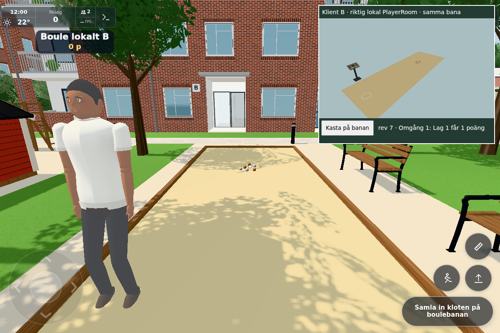
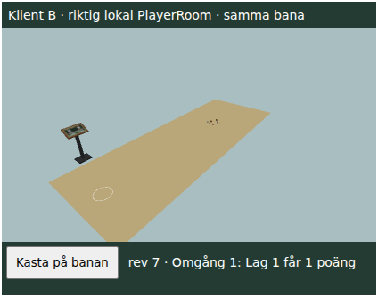
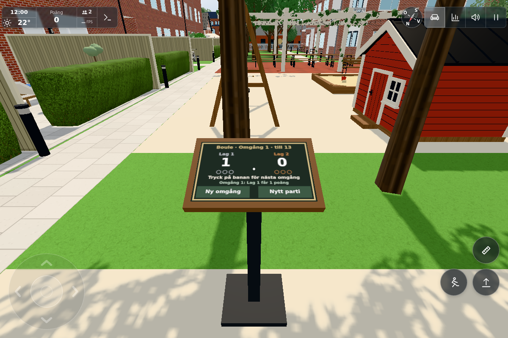

# #1854 – gemensam befintlig boule

Bas `16d826544197454d79ece261a664680cf0945f22`, källcheckpoint `ae5e1e18`. Ingen ny bana eller ny regeluppsättning: befintliga BouleRules/BoulePhysics, tre klot per lag, befintlig lillen-distans, turordning, omgångsvinst och parti till 13 används. Ritad geometri/ljus/kollisionsfot är oförändrade. Alla tre slutbilder direkt granskade och accepterade av dirigenten.

## Kontroller och faktiskt utfall

`regression.txt`: **40/40 gröna** med

```sh
node --experimental-default-type=module --test tools/bouleclienttest.mjs cloudflare/boule.test.mjs tools/bouletest.mjs cloudflare/billiards.test.mjs cloudflare/roommusic.test.mjs cloudflare/deploypaths.test.mjs src/outbox.test.mjs
```

Grupperna omfattar befintliga regler/fysik, deterministisk flykt/rullning/replay, riktiga lokala Worker/PlayerRoom-klienter med samma revision och tillstånd, samtidiga/stale/early/malformed/utanför-banan-kommandon, två lagplatser, sen anslutning mitt i flykt, ny anslutning, hibernation med bevarat DO.storage och bounded senastepost. Sex klot avgör en omgång en gång; gammal revision kan inte kasta/räkna resultat igen eller duplicera reset. Befintlig pool/musik/utkö förblir gröna. Ingen boulebaserad global stats-/dagspoäng fanns tidigare och ingen läggs till; de synliga banpoängen är befintlig regelpoäng.

Klientkontraktet kontrollerar gammal Worker utan capability, frånkopplad/startande anslutning, ingen optimistisk mutation, dubblett-ACK, sen snapshot/replay och återanslutning. Cloud avstängt behåller lokal ensamspelsgren. Efter ett delat spel fryses banan vid tappad anslutning tills delat läge återkommer; inga tysta lokala kopior. En sista liten guard för en ännu startande cloudanslutning och ett tydligare slut-på-parti-besked lades till efter appbilderna. Dessa har riktade Node-bevis; i appfasen var anslutningen redan etablerad och partiet inte slut, så de ändrar inte de dokumenterade appstegen. Ingen ny appstart för dessa avgränsade guards.

### En verklig app med liten riktig mottagare

`tools/boulesyncbrowser.cjs` + `boulesyncpeer.html`: vanlig index/main/world i Chromium, 1200×800/DPR1, test=lazy för att undvika GPU-warmup, hasTouch-kapabel desktopcontext. Andra klienten är en riktig lokal WebSocket till samma PlayerRoom, med produktions-Boule/BouleClient och en liten egen renderer i iframe – **inte** en andra full världsbootstrap och inte en injicerad slutbild. Testgolvet i den lilla renderern är endast referens; huvudbanan är den verkliga appens.

Native E från kastringen kastade lillen; native touch på riktiga handlingsknappen kastade Lag 1:s första klot; native touch på mottagarens testknapp kastade Lag 2:s klot. Därefter spelades den befintliga hela omgången med samma två inputs. `browser.json`: båda klienterna har exakt lika sju objekt, x/z/vx/vz, regler, lagens kvarvarande klot, revision **7**, resultat **Lag 1: 1–0, Omgång 1**. Main har en verklig annan Ghost och två spelare. Inga globala poäng krediterades.

Produktions-Boule räknas till **3 synliga meshdraws och 0 ljus**, samma som före; ingen ny geometri/material/texture skapas i produktionsbanan för synk. Det är komponentgränsen, ingen helscen-/telefon-FPS-profil. Den lilla mottagarens canvas är testkostnad och ingår inte i produktionsbudgeten. Inga nya per-framebollmeddelanden: bara diskreta kast/reset/resync via befintlig 5 Hz-budget. Servern skickar samma korta startbeskrivning/slutläge till rummet, inga frame-arrayer. Lokal replay är högst 12 s, 30 Hz och sju objekt; senaste lagringsposten prövas <12 kB och växer inte med historiken.





Mottagarens fixturefigur flyttades åt sidan inför bilden för fri sikt över banan; inga objekt/resultat ändrades. Sista tavlebilden är enbart kameraomramning av samma revision, utan fixturepanelen. Native touch är Playwrights riktiga browserinput på desktop med touchstöd, ingen fysisk telefon eller faktisk produktionsdeployment. Inga nya djur-, gym-, campus- eller breda UI-matriser kördes.

## Ärlig fixturhistorik

- `fixture-server-lifetime.txt`: första navigeringen nådde aldrig appen eftersom den kortlivade bakgrundsservern avslutades. Startades sedan i egna hållna verktygssessioner. Ingen produktbugg eller godkänt test.
- `fixture-first-key.txt`, `fixture-checkpoint.json/png`: första E kom efter pointerlock men **före första riktiga focus-frame** (focused saknades); q=0/pending=0 och inget kastkommando skickat. När samma scen hållits var focused=boule. Inte ett påstått fel i bouleprodukten.
- Samma hållna Playwrightprocess återhämtades via lokal Node-inspektor, utan ny värld: exponerade befintlig Page och skickade **native KeyE** efter den riktiga fokusmarkören. Båda gick direkt till revision 1. `boulesyncrecover.cjs`, `native-recovery.txt` och `browser-driver.txt` dokumenterar återstående native touch/resultatsteg. Den permanenta drivern väntar nu uttryckligen på fokuserad bana efter pointerlock och exponerar hållna Page direkt för diagnostisk återhämtning. Inspector, browser och egna servrar avslutade efter bildgranskning.
- `command-result.json` är sista kameraomramningens oförändrade q7/1–0, inte ett nytt kast. Ingen FPS slutsats dras från den manuellt stegrade/pausade scenen.

## Rollout och integrationsfiler

**Worker först**, sedan Pages. Ingen ny binding/tjänst.

1. Server: `cloudflare/players.js`, `cloudflare/roomboule.js`, `src/boulesync.js`, `src/boulephysics.js`, `src/boulerules.js`, `src/config.js` (endast BOULE.sync-tillägg). Workflow `.github/workflows/cloud.yml` har alla nya Worker-importer, deploypaths grönt. Servern annonserar `boule.v=1` och ACK efter lyckad lagring. Äldre klienter ignorerar de nya fälten och kan fortsätta alla andra interaktioner; de behöver uppdateras för delad boule.
2. Pages: `src/bouleclient.js`, `src/boule.js`, `src/ghosts.js`, `src/main.js` samt den gemensamma modellen/config ovan. Ansluten gammal Worker ger begripligt ladda-om-besked och inget lokalt låtsaskast. Före welcome visas anslutningsväntan; borttappad ACK kan resynkas utan nytt poängbeslut.
3. Targets #1853 kräver union av separat welcome.football och welcome.boule samt keepConnected football.interest och bouleSync.interest. Jag ändrar inte footballgrenen, stats eller andra nätfält. #1851:s senare Marks/TriGrid-byte och korrigerade frysta testfixtur ska bevaras vid rootintegration; inga sådana filer finns i denna patch.

`sources.json` anger finala runtimehashar och appfasens enda avvikande klienthash. Hus A/B/C/L inte tillämpliga: ingen husgeometri/kollision/nav ändras. Publik port inte tillämplig: boule/gameplay/Cloudflare får inte överföras och ingen fristående miljöbugg rättas. Dirigenten äger faktiskt Worker/Pages, CI, publicerade bildlänkar och stängning; ingen sådan driftacceptans påstås här.
