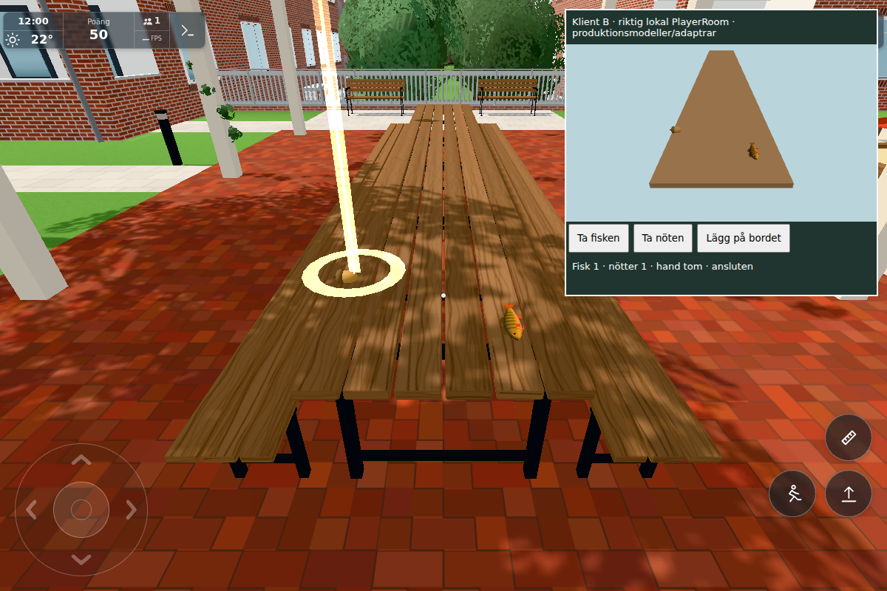
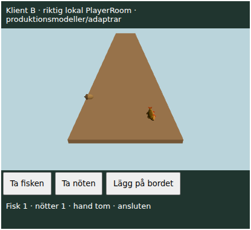

# Shared caught fish and explicit nut drops — #1855

One coherent original-only gameplay delivery, based on `f19b14e70b4031ce8ee8c6d83a5d6fbb137500b6`. Foundation `6885ef95` is not standalone; server-first completion `0d23124e` plus the following client/document commit complete it. No public transfer applies: these are personal inventory, feeding/reward and Cloudflare features.

## Result and boundaries

Updated clients share stable caught-fish IDs and natural nut `(slot,born)` IDs through the existing PlayerRoom. Native E/touch places them using the existing `Holdable.poseAt/restPose`; published three-dimensional position and normalized quaternion preserve tabletops rather than flattening to terrain. Pickup is exclusive, with ownership/revision validation; the original hand stays until durable ACK. A recipient can subsequently use the existing cooking/eating/cat-feeding or squirrel hand-feeding path. Transfers and replica creation do not call catch/reward callbacks. Foreign fish replicas cannot independently feed cats.

The fish ledger (`sharedFish`, guessed bounds in `SHARED_FISH`) holds at most24 active fish/128 records. World fish last2h, abandoned hands15min, consumed/expired tombstones24h, evaluated on Room activity. A connected custodian keeps a held or cooker fish beyond15min without position writes. Ownership keys rotate on pickup/resume and never appear in public snapshots. A bounded receipt list lives in the existing fishing save. The proposed key/intent is saved to the ordinary profile `playerWorld` **before** IO; final reward callback follows durable consume plus a local receipt save. Confirmed stale saves cannot register a new private copy. Lost ACK resumes the proposed key; storage errors retain the previous committed server state and return retry. No new service/binding/migration or general inventory journal was added.

Nut ledger `nutDrops` has at most18 explicit world drops (guess),20min world TTL, generation floors and bounded live claims. Natural20-slot spawning and near-only animal cadence stay intact. Full lists reject with a visible message and retain the hand; nobody else's drop is evicted. An abandoned nut hand ends on actual socket departure (no personal nut save is introduced). Explicit world drops survive empty rooms/hibernation and seasonal natural-nut sleeping. They are pickup items: autonomous natural-ground foraging excludes them, including already-running fetch/eat. Actual squirrel hand-feeding remains an ACK-gated consume, with one existing feeder callback. This avoids silent local deletion without a server transaction.

## Three risk checks

1. [transactions.txt](transactions.txt):15/15 focused tests. Durable delayed/rejected put, serialized pickup race, private-key masking, reach/caps/live lease/expiry, real Worker routing and wake/late welcome, actual CaughtFish/Fishing save/reload, stale former owner, lost ACK, local-save failure before IO, actual Nut/SquirrelSync/feeding callback and explicit-forager exclusion. [worker-regressions.txt](worker-regressions.txt): earlier87/87 scoped checks, including all74 existing PlayerRoom cases, old squirrel compatibility and deploypaths. Those independent Room cases were not repeated after the isolated final forage predicate.
2. One actual full app on8927 with local production Worker8937 and a small production-module peer iframe, **not a second full world**. [browser.json](browser.json), [fish-native.json](fish-native.json), [native-roundtrips.json](native-roundtrips.json), [nut-native.json](nut-native.json). Fixture creates a23cm raw perch and later a cooked perch through real `Fishing.addFish`; it does **not** claim native fishing/cooking. A naturally generated courtyard nut is taken with the actual touch action, carried by fixture repositioning, put on the real pergola table, picked up/returned by the peer, then retaken/put by A. Fish initial placement uses native E; subsequent native touch and peer buttons invoke the production adapters. First raw fish was genuinely eaten by the courtyard cat after ownership ACK: one `catFishFeeds` and one durable/local receipt; cooked fish is used for the legible lasting table view. Passing creates no catch/eating rewards. Late iframe reconnection receives the same ID/species/length/cook/bites and exact p/q. Component tests, rather than a second app, cover races and lost-ACK profile reload.
3. [final-model-budget.json](final-model-budget.json): real model bounds bottom fish0.760515m/nut0.761314m against actual plank top0.760m. With both visible, on/off main-view draw contribution is2 calls/823 triangles (499 fish +324 nut), existing model geometries/material policy, no new lights. Raw main frame110calls/615635tri versus108/614812 with just these models hidden; shadows held constant for this local comparison. Existing nut-glint batch is separate and unchanged. This is a local model contribution, not a campus/phone budget or FPS profile.

## Actual images and exact phases

Both inspected and accepted by conductor. Main view is the real app/table; B intentionally renders only a plain table proxy plus production food models and a few buttons, not the whole environment. The fish are fixture-created, not newly earned catches; the nut is naturally generated and its pickup is real. The glowing nut marker is the existing glint. HUD FPS is not measured here.

[sources.json](sources.json) pins every affected runtime/helper file and initial/final phase hashes. All input/transfer/late-join steps ran in the same held app. The manual driver initially omitted the separate frame-level Ghosts/SharedFish updates; the same Page recovered that timer without another bootstrap. Unlock initially opened the normal pause overlay; desktop handshake timeout is retained under `diagnostic`, then normal touch mode continued in the same Page. This is fixture recovery, no product input workaround.

During final framing, autonomous legacy foraging removed the local explicit nut while server/B still retained it. The final bounded guard was hotimported into the existing field's `near` and all brain `onGround` methods; a real late-peer welcome snapshot restored the local view ([forage-recovery.json](forage-recovery.json)). Final image and2/823 budget use that exact guard. Earlier successful transfers/3D/latejoin remain evidence of unchanged adapters/protocol, not a claim that every native step reran after the guard. Natural foraging has a focused final regression. The final source-only main catch around the secondary resume write preserves a successful canonical profile write if the redundant resume write fails; actual app proves the same successful canonical intent-before-IO path. No extra full app/bootstrap was used.

Executed phase scripts are retained in [fixture](fixture), with the local Node-inspector bridge to the already-held Playwright Page; `tools/shareddropsbrowser.cjs` exposes the held Page and a bounded file command/release loop. `tools/browsertest.sh` serializes browser use; normal tests require the project's existing Three dependencies. All own browser/static/Worker processes stopped after image acceptance.

## Deployment and merge

Deploy Worker first, then Pages. Minimal server range is foundation `6885ef95` plus `0d23124e`: config, pure wire, `cloudflare/sharedfish.js`, squirrel persistence/transactions, players welcome/branches and cloud import paths. Client is guarded by `sharedFish.v1` and `nutDrops.v2`; absent capability or disconnected configured cloud retains/freezes the item with a message, never pretends a shared success. Explicitly cloud-disabled visits keep existing local personal play. Legacy clients remain compatible with their existing near-only squirrel protocol, but require updated Pages for these shared-drop guarantees.

When merging the concurrently delivered football branch, retain **both** welcome fields, `df`/`sq` and football branches, both readiness/flush hooks, both Ghosts dispatch/send methods, and union `sharedFish.interest` plus held shared nut with football/boule interests. These are independent branches, no protocol cadence or common outbox refactor. No broader startup/terrain/avatar/bestiary test or public inventory port is claimed.

## Resumed integration (2026-11-04)

The complete original three-commit delivery ending93e0dd00 was preserved privately, then integrated over25adbf1d. [Integration source manifest](integration-sources.json) separates unchanged original evidence from reviewed additive Football/Bike/Astronaut unions. Player physics is unchanged. The exact conflict boundaries received syntax/diff review and [3/3 focused integration checks](integration-tests.txt): real food PlayerRoom, real Football PlayerRoom and Worker import/deploy paths. Existing15/15 and87/87 evidence, and the two already inspected images, were reused without another browser/bootstrap. Server-stage42db70e1 includes config/wire/SquirrelSync imports and durable Room transactions; publish this Worker successfully before the remaining client commit, cancelling its intermediate Pages run. No push or deployment was performed by this worker.

Actual release: server stage `ffa0a52d7e60b9716f77c8539e7bfa57af2f0b04` Worker41795357011 succeeded, with actual Wrangler deployed triggers, before the complete client push. Intermediate Pages41795357046 concluded cancelled, but inspection of its steps proves deploy-pages had already succeeded; version.json briefly showed ffa0a52. Cancellation raced the completed deployment and must NOT be described as skipped or prevented. The intermediate revision retained the legacy client and backward-compatible squirrel protocol; it did not yet provide the new shared-drop client guarantees. Final client publication and exact server-graph parity are recorded below.

Levererat i `0900778181510c1f66562d013d6ba3d1cfaa7f53`. [Pages](https://github.com/solwation/lunden-3d-apartment/actions/runs/41795528265) och [Worker](https://github.com/solwation/lunden-3d-apartment/actions/runs/41795357011) lyckades; Worker-loggen bekräftar faktisk Wrangler-deploy (server först i `ffa0a52d7e60b9716f77c8539e7bfa57af2f0b04`; serverns relativa importgraf och deploymentfiler är byteidentiska i klientrevisionen `0900778181510c1f66562d013d6ba3d1cfaa7f53`, ingen utebliven Worker-körning räknas som passerad). Den publika sidans version.json visar `0900778`. Dirigentens kombinerade diff-/bildgranskning är klar. Verifieringslänkarna ovan är permanenta; eventuella resultatbilder är granskade och bytekontrollerade. Ingen rutinmässig omkörning av gröna kontroller efter orelaterad integration. Ärendet stängs genom efterföljande verifieringscommit och aktiva etiketter tas bort.
