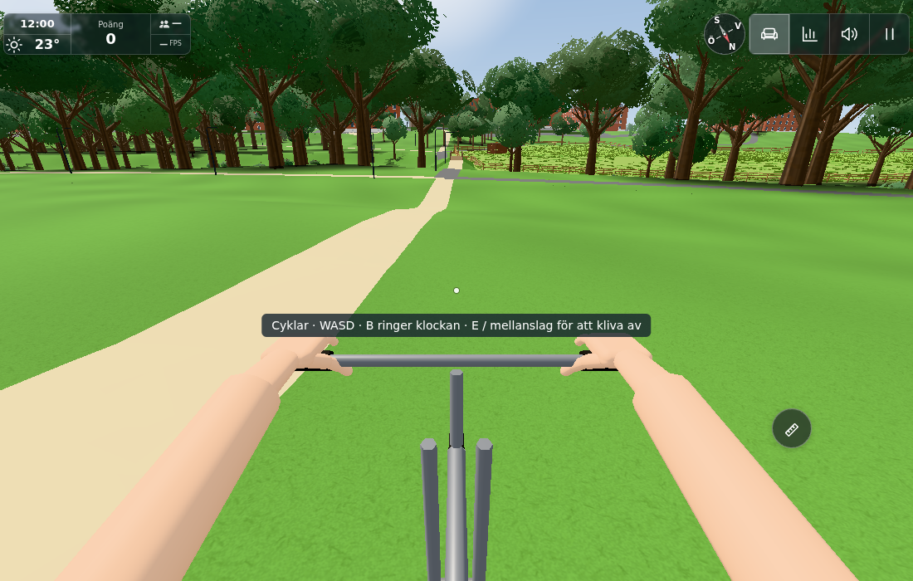
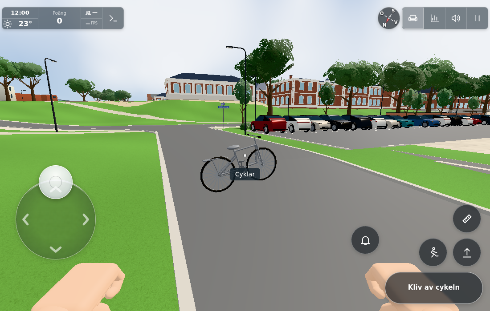
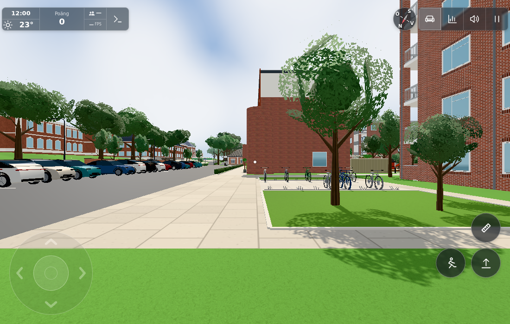

# #1856 – utförsfart och riktig kort luftfärd med befintlig cykel

Bas `c8a0415984862f9703150aa0b19a22b63e90d11c`. Checkpointar `f2ff78e8` och `962df0c3`; hela råintervallet hör till leveransen. Parenttakfrågorna #1852/#1858 saknade svar vid färsk claim. Ingen bildplacering eller takändring ingår här. Originalbilden för1856 är direkt visad och visar cykel i grässluttning, inte en tidsserie eller tidigare hopp.

## Ändring och gränser

Befintlig cykel fick tidigare omedelbart6m/s från W/full stick och följde hjulstödet ned även över ett krön. `bikemotion.js` ger cykelspecifikt fartminne, tramp/broms/rullmotstånd och lutningskraft från verkligt hjulstöd. Pedalens gamla grundfart6m/s och backfart2m/s behålls, maxfart11m/s är en spelgissning. Bakåt bromsar framåtfart innan det blir backning; neutral bromsar genom rullmotstånd. Positiv vertikal stödhastighet kan behållas när krönet avlastar däcken mer än gravitationen. Det finns ingen ny hoppknapp, kosmetisk uppflyttning eller generell fysik-/pathfindingmotor.

Alla nya känslovärden ligger som guess i BICYCLE.motion. Hjulgeometri, maxRise.12/maxDrop.35, kroppens tiltgräns, verkligt mark-/kant-/brostöd, rörelsesvep och ändligt stöd används som tidigare. Samma distansbaserade .05m-substeg används även vid högre fart, inte ny global scheduling. Stopp mot hinder nollar farten. Luftrotation följer verklig vy inom tidigare maxTilt. Små kontaktreturer som aldrig gav positivt fall/gap skapar inget negativt landinganrop; verklig luft/fall använder en enda befintlig onLand(drop,gap).

**Ny luftfas får inte teleportera:** dismountBicycle nekar r.airborne/fall innan safe-save-fallbacken kan välja gammal lastStanding. Avsett kontrakt var redan ”airborne dismount refused”, men gamla testets lastStanding var ogiltig och missade hålet. Nytt riktat fall använder giltig lastStanding och bevarar landad laglig avstigning. Ingen allmän spar-/navomskrivning eller ny poängregel.

## Tre verifieringsgrupper och exakta källfaser

1. **Ren fart/launch:** `motion.txt`, tidig tvåfallskontroll på7m/s gate. `final-motion-exit.txt`: **9/9 gröna** på slutlig5.5m/s gate, faktisk Player med analytiska stöd-/kollisionssamarbeten och utan renderer/World. Fyra dt1/120,1/60,.05,.1 får verklig positiv stödhöjdsrörelse, luft och en enda landning; långsam3m/s och planmark får ingen luft. Kontroll ovan/under slutliga fartgränsen, broms/coast/reverse/max och luftens avsaknad av ny acceleration. Giltig-lastStanding luft/fall nekar exit, landad exit fungerar. Node använde temporär länk till befintlig Three-cache; länken är borttagen och inte levererad.

```sh
node --experimental-default-type=module --test tools/bikemotion1856test.mjs tools/bike1856finaltest.mjs
```

2. **Befintlig riktig geometri:** `component-final/driver.txt` och `final.json`, **32/32**, källfas962df0c3 med launchSpeed7.0. Riktiga Player/Street/StreetLife/Courtyard, noll WebGL. Samtliga >1000 verkliga renderade gatukantboxars höjd har ray-paritet; gamla upp-/nedtrappor, ramp/reverse, 5cm- och10cm-kant,3m-fall/en landning, stängd dörr/vägg, fulltiltöverhäng, huvudutrymme, dt0 och luft-exit. De äldre geometriresorna seedas med redan etablerad6m/s och något längre färdtid eftersom start nu accelererar. Nya start-/luftfallen testas separat. Analytisk höjdyta är uttryckligen kontrollerad samarbetspartner, inte ny terräng i produkten. Vid7m/s gate gav fyra dt maximal stödseparation0.685–0.723m och en verklig landning; dessa är komponentvärden från den fasen, inte telefon-/slutappmått.

Den oförändrade gamla repositorydrivern `bicycleterraintest.cjs` missade först tidsdistanskrav som avsiktligt ersätts av acceleration. Därefter avbröts dess historiska main-fixtur med `ReferenceError: ducks is not defined`. Stack/version är sparad i `component/legacy-driver.txt`; separat low#1859 äger alla saknade fokusbindningar (även senare football), ingen produktbugg påstås och ingen sidofix gjordes. `bike1856component.cjs` använder dess geometri-/hullfall men kör inte denna brutna inputinjektion. Första egna scriptutkastets exponentparentesfel stoppade före browser och korrigerades; ingen grön körning påstås där.

3. **En verklig app, före/efter i samma värld:** vanlig index/main/world,1100×700/DPR1, hasTouch-kapabel desktop, test=lazy, tom cloud/mp0, juli/noon/clear. Inga nya världsstarter eller fysisk telefon-/FPS-garanti. Genuin native E monterar den befintliga första cykeln från dess yaw-riktiga insteg; `native-mount.json`. För rutter fixtureplacerades samma redan monterade cykel på verkliga fria startpunkter, ingen terräng eller modell ändrades. `initial-ground.json`/`route-support.json` beskriver stöd/klar passage; första fasta x−137-linjen går utanför den sneda bron och är bara diagnos, inte den körda bron. Den körda rutten använder brons verkliga ändar[-131.05,199.16]→[-124.08,212.06].

**Före:** source-pinnad c8a04159 Player.bikeStep importerades som separat klass och bara metoden sattes på samma Player. Native W körde79.2m i264×.05s: härledd fart6.000m/s och max stödgap0 (`before-route.json`). Råfältet v=0 är den nya instansens oanvända speedfält; den gamla metoden saknar fartminne och värdet är INTE en mätning av gammal fart. Inga andra före-källor byttes.

**Efter, första7m/s-fasen:** samma riktiga bro-/backrutt med native touchdrag (analog.y=1). Farten byggdes till7.498m/s utför och sjönk uppför till5.9684 vid krönet. Ingen luft, korrekt passage/ändligt stöd; `after-route-first.json`/`bridge-native-touch.js`. Detta är ärligt negativt lyftbevis, inte ett slutligt5.5m/s-broprov.

**Slutlig kalibrering:** den gissade launchSpeed sänktes till5.5m/s (~20km/h). Detta är fortfarande snabb cykling, och verklig positiv hjulstödsderivata/krönavlastning krävs. Både configfil och samma redan laddade konfigobjekt sattes till5.5; inget nytt World. Slutliga9/9 ovan återkör just påverkad high/low/flat/dt/exit, inte alla oförändrade32 terrängfall. Så inga gamla7m/s-resultat påstås vara en ny full slutmatris.

**Slutlig positiv riktig rutt:** native touch körde frånx−120,z0 över befintlig grässlänt och gatukant. Utförsmax7.6183m/s, vid paus nära luftbågens topp fart6.3369m/s och faktisk Player/bike position[-77.349924,.277031,0], stöd−.199288: stödgap**0.476320m**. `actual-curb-height.json` använder samma befintliga gatukantgenerator/groundY i ren Node: x−78.8,z0 har kant0.100152m över terräng, alltså den riktiga10cm-kanten. Hjulbasen når/avlastar kanten innan kroppens centrum passerar den. Inga guppobjekt eller artificiella ytor lades till.

Native E och Space i luften behöll cykel, luftläge och exakt position trots giltig lastStanding från det riktiga insteget (`native-air-exit.json`). Bildens sidokamera är en tillfällig vittneskamera över samma levande paus; den verkliga cykeln flyttades inte för bilden. Sadelkameran återställdes före fortsatt fysik. Verklig landning vidx−75.4715 gav **ett** anrop(drop=gap0.478034m), sedan stödgap0. Native touch-avstigning slutade på närliggande faktisk stödpunkt[-69.46137,−.263345,.9], ingen återgång till insteget (`after-road-complete.json`).

Första efterföljande touch-”broms” hade analog.y=1 och stannade mot kanten; det räknas **inte** som bromsacceptans. Separat kort native W→S på samma fria gräsremsa väster om kanten gav5.9684→0m/s på14×.05s, KeyS=true i alla steg och stopp vidx−82.8967 före kanten; native Space kliver av på giltigt stöd (`native-brake.json`). Cykeln fixtureflyttades ca10m västerut för detta lilla kontrollprov, ingen ny platsmatris eller bild. Joystick-CDP:s första återtag med en ny session gav ”Must send TouchStart first”; den ursprungliga sessionens riktiga redan hållna gesture återanvändes (`fixture-touch-session.txt`). Ingen touch-/eventproduktfix eller falsk bromsgrön.

## Resultatbilder och budget





Samtliga tre direkt visade och accepterade av dirigenten. `after-air-rider.png` kompletterar sadelkontrollen men är inte ensamt gapbevis. HUD är pausad/stegrad och är inte FPS. Ingen separat annan-spelares renderer/Roommatris kördes: gamla p/bk, Ghosts, PlayerRoom och deras kadens är byteoförändrade; luftpositionen går som befintligt feet-p. Ingen ny payload/service.

Ingen modell/material/ljus skapas av ändringen; source-manifestets oförändrade cykel-/hand-/Worldbyggare skyddar0 nya produktionsbatches/trianglar/ljus. Den verkliga valda cykeln har4 befintliga komponentbatcher, hela nuvarande World69 registrerade cyklar (`air-witness.json`), inte äldre dokuments14. Vittnesvyn77calls/523481tri/339geos/53tex, exitvyn273calls/865022tri/347geos/53tex är **hela olika kamerors** räknare, inte en före/efterdeltamätning eller isolerad cykelkostnad. Ingen geometri- eller CPU/FPS-vinst påstås; högre fart gör fler av de befintliga distanssubstegen.

## Integration och kvarvarande gränser

`sources.json` innehåller bas/checkpointar/finalhashar, exakt före-bikemetod samt appens fysikkälla/parameterfaser. Slutappens hotimport ändrade bara dismountvakten; bikeStep är byteidentisk med962df0c3. Vanliga icke-cyklande update/runSpeed/groundfunktioner, PLAYER-konfig, Marks/TriGrid, terräng, nät/sparning och item-stow är oförändrade. Inga gamla profil-ID:n eller belöningar läggs till.

BICYCLE finns i config.js som också importeras av Worker; därför måste root göra faktisk Worker+Pages/utlöst CI trots att enda funktionella ändringen är klientcykel. Ingen ny Worker-import, binding eller serverschema krävs. Root publicerar bilder/commit och stänger efter driftacceptans. Egna processer/browser avslutade och inga nya bilder/körningar behövs för docs. Original-only cykelspel; ingen fristående generell navigationsdefekt rättas och ingen publicport behövs. A/B/C/L-layoutkontroll inte tillämplig; oförändrad husgeometri, riktade befintliga trappor/ramp/hull är kontrollerade.


Levererat i `0ccaec2c4681e0b9fc7d0bfb1c88766326b3331d`. [Pages](https://github.com/solwation/lunden-3d-apartment/actions/runs/41716337152) och [Worker](https://github.com/solwation/lunden-3d-apartment/actions/runs/41716337196) lyckades; Worker-loggen bekräftar faktisk Wrangler-deploy. Den publika sidans version.json visar `0ccaec2`. Dirigentens kombinerade diff-/bildgranskning är klar. Verifieringslänkarna ovan är permanenta; eventuella resultatbilder är granskade och bytekontrollerade. Ingen rutinmässig omkörning av gröna kontroller efter orelaterad integration. Ärendet stängs genom efterföljande verifieringscommit och aktiva etiketter tas bort.
